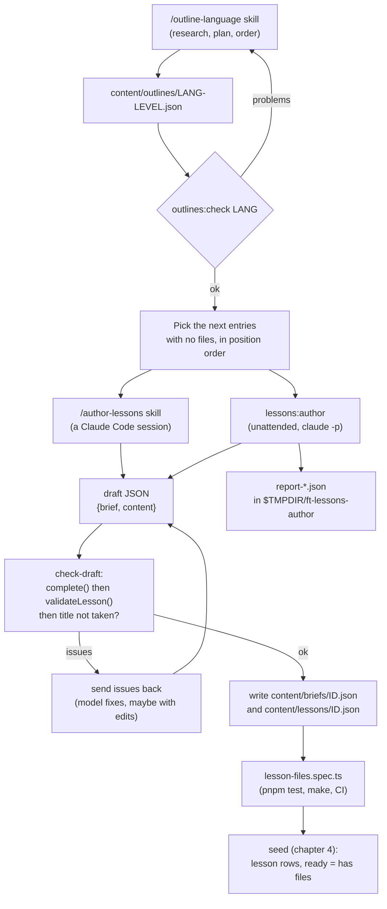
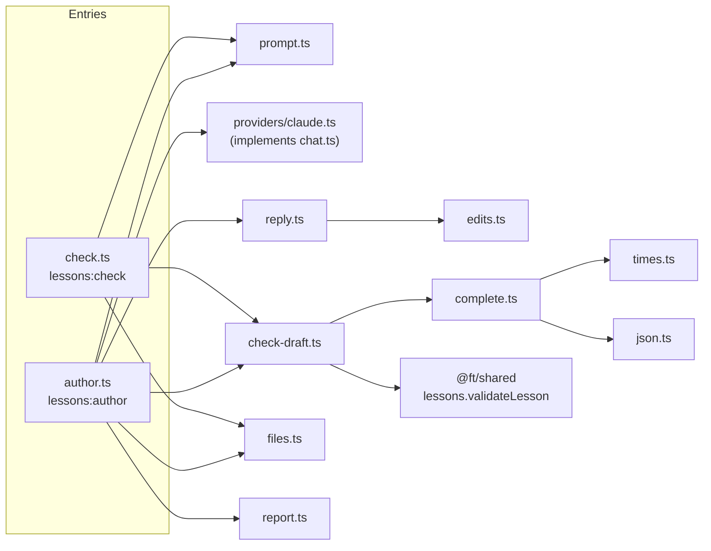
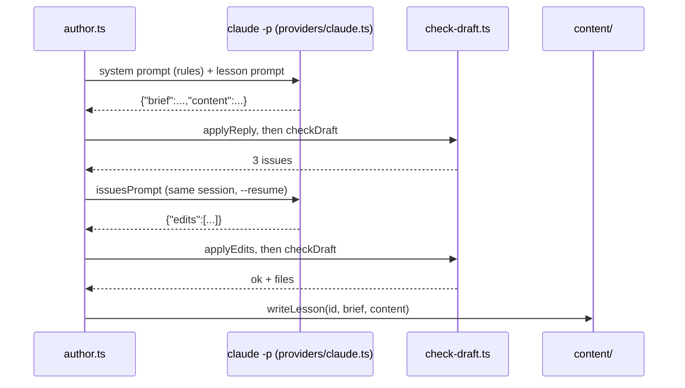

# Chapter 11 — The scripts folder

In this chapter:

- What a "script" is here, and how it differs from the API server
- The `content/` folder and the **lesson authoring pipeline**: outlines → briefs → lessons
- How each script is launched (`package.json`, pnpm, Claude Code skills)
- [check-outlines.ts](../../apps/api/scripts/check-outlines.ts) and
  [try-generation.ts](../../apps/api/scripts/try-generation.ts)
- The lesson authoring kit in [scripts/lessons/](../../apps/api/scripts/lessons), file by file
- The specs that test the kit, and [item-files.spec.ts](../../apps/api/src/items/item-files.spec.ts)

---

## 1. Big picture

### What is a script?

The API server (chapters 1 to 9) runs all the time and answers HTTP requests. A **script** is
different: it is a small program you start **by hand** from the terminal. It does one job,
prints the result, and stops. Think of the server as a restaurant open all day, and a script
as the cook who comes in the morning to prepare the ingredients.

The scripts are TypeScript files run with **[tsx](https://tsx.is)**, a tool that runs a `.ts`
file directly without building it first. They are **not** part of the compiled app (`nest
build` only builds `src/`), so they never run in production.

```
apps/api/scripts/
├── check-outlines.ts      check one language's six outline files
├── try-generation.ts      ask the LLM for real placement questions, store them
└── lessons/               the lesson authoring kit (#83)
    ├── author.ts          ENTRY: lessons:author, writes lessons with Claude Code, unattended
    ├── check.ts           ENTRY: lessons:check, checks one lesson (or prints its rules)
    ├── check-draft.ts     complete + validate + title check: shared by both entries
    ├── complete.ts        fills in what the model is not asked to write
    ├── times.ts           computes every duration and time limit
    ├── reply.ts           reads the JSON in a model's reply
    ├── edits.ts           applies small "edits" instead of a whole lesson
    ├── prompt.ts          builds the text sent to the model
    ├── files.ts           paths, reads and writes in content/
    ├── json.ts            JSON helpers and sha256 hashing
    ├── report.ts          progress lines, final summary, JSON report
    └── providers/
        ├── chat.ts        the Provider interface, rate-limit and quota errors
        └── claude.ts      the only provider: runs `claude -p`
```

### The content folder

Lessons are **not** written by the server at runtime. They are JSON files, written once,
committed to git, and then loaded into the database by the seed (chapter 4). They live in the
root [content/](../../content) folder:

| Folder | What it holds | Example |
| --- | --- | --- |
| `content/outlines/` | The plan of a level: one entry per lesson (id, kind, topic or theme, working title, intent). 6 levels × 3 languages = 18 files. | `fr-a1.json` |
| `content/briefs/` | One **brief** per written lesson: the plan of that lesson (title, objective, targets...). | `fr-greetings.json` |
| `content/lessons/` | The **content file**: the playable lesson. Every kind but vocabulary has one (a vocabulary lesson is built from its brief alone). | `fr-ordering-at-a-cafe.json` |
| `content/items/` | The authored placement questions (chapter 7). Checked by `item-files.spec.ts`. | `de-grammar.json` |

### The lesson authoring pipeline



In words:

1. **Outlines** are written first (with the `/outline-language` skill in
   [.claude/skills/outline-language](../../.claude/skills/outline-language/SKILL.md)) and checked
   with `outlines:check` until it prints `ok`.
2. For each entry, a model writes a **draft**: a brief, then a content file.
3. The kit **completes** the draft (the parts the code can compute), **validates** it with
   `validateLesson` from `@ft/shared`, and checks the title is not used yet.
4. If something is wrong, the issues go back to the model, which fixes them (often with small
   **edits**). This repeats a few times at most.
5. When the lesson passes, its files are **written** to `content/`. A file is never
   overwritten: to redo a lesson, you delete its files first.
6. `lesson-files.spec.ts` checks every committed file again, and the seed loads them.
7. `lessons:author` also prints a **report** (time, tokens, cost) and saves it as JSON.

The rules of a lesson are **not** in the kit. They are the Zod schemas and validators in
`packages/shared/src/lessons/`. The kit sends their **source code** to the model, so a rule
change reaches the next run with nothing else to update.

---

## 2. How the scripts are launched

From [apps/api/package.json](../../apps/api/package.json):

```json
    "generation:try": "tsx --env-file-if-exists=../../.env scripts/try-generation.ts",
    "outlines:check": "tsx scripts/check-outlines.ts",
    "lessons:author": "pnpm --filter @ft/shared run build && tsx scripts/lessons/author.ts",
    "lessons:check": "pnpm --filter @ft/shared run build && tsx scripts/lessons/check.ts"
```

| Script | Typical command (from the repo root) | Notes |
| --- | --- | --- |
| `outlines:check` | `pnpm --filter @ft/api outlines:check de --level B1` | reads `content/outlines` |
| `generation:try` | `LLM_PROVIDER=gemini pnpm --filter @ft/api generation:try b1 vocabulary grammar` | loads the root `.env` if it exists; **writes to the database**, can **spend tokens** |
| `lessons:check` | `pnpm --filter @ft/api lessons:check fr-greetings --draft draft.json` | builds `@ft/shared` first |
| `lessons:author` | `pnpm --filter @ft/api lessons:author fr a1 --max 3` | builds `@ft/shared` first; needs Claude Code installed and logged in |

Why build `@ft/shared` first? The lesson scripts call `lessons.validateLesson` and the
duration formulas from `@ft/shared`, and they must use the **current** rules, not an old build.

`pnpm --filter` runs a script **from `apps/api`**. So the scripts find `content/` with
`../../content` (the code says: "pnpm --filter runs from apps/api, as vitest does").

There is **no Makefile target and no turbo task** for these scripts; you run them by hand. The
two Claude Code **skills** call them:

- [.claude/skills/author-lessons/SKILL.md](../../.claude/skills/author-lessons/SKILL.md):
  `lessons:check <id> --rules`, then `--draft <draft>`, then `--write`.
- [.claude/skills/outline-language/SKILL.md](../../.claude/skills/outline-language/SKILL.md):
  `outlines:check <lang>`, also with `--dir` on a work folder.

The rules for writing content are explained for humans in
[docs/content/lessons.md](../content/lessons.md) (sections 7 and 8).

---

## 3. [check-outlines.ts](../../apps/api/scripts/check-outlines.ts)

**What it is for**: checks the six outline files of one language while people write them. It
checks what [outline-files.spec.ts](../../apps/api/src/lessons/outline-files.spec.ts) checks,
**plus** house style that the spec leaves to reviewers.

**Exports**: nothing. It runs `main()`.

**How it works**: it reads the arguments, then loops over the six levels:

```ts
  const lang = LanguageSchema.safeParse(process.argv[2]);
  const level = option('--level');
  const onlyLevel = level === undefined ? undefined : LevelSchema.safeParse(level.toUpperCase());
  if (!lang.success || onlyLevel?.success === false) {
    console.error(USAGE);
    process.exitCode = 1;
    return;
  }
  // pnpm --filter runs from apps/api, as vitest does.
  const dir = resolve(option('--dir') ?? join(process.cwd(), '../../content/outlines'));
```

For each file it collects **problems** (strings) instead of stopping at the first one:

| Check | Message example |
| --- | --- |
| file exists, is valid JSON | `de-b1.json: missing` |
| matches `LessonOutlineFileSchema` (Zod) | `de-b1.json #3 de-modal-verbs.intent: ...` (the entry number and id, not just an index) |
| declares the right `lang` and `level` | `declares de A2` |
| number of entries = `LESSONS_PER_LEVEL` | `118 entries, expected 120` |
| entries per kind = `KIND_COUNTS` | `grammar 40, expected 42` |
| keys in the order `id, kind, topic/theme, workingTitle, intent` | keeps the files easy to diff |
| no level in an id (`-b1-`) | a lesson can move level and keep its id |
| no en/em dash, no quotation marks (French may keep « »), no double space | house style |
| no id or (folded) title used twice in the language | duplicates across all six levels |

```ts
      // A lesson can move level and keep its id (docs/content/lessons.md section 5).
      if (/(^|-)[abc][12](-|$)/.test(entry.id)) problems.push(`${at}: id names a level`);
```

At the end, `--level` keeps only the problems that name that level's file, "so several people
or agents can each fix one file while the others are half done". It prints `ok`, or the list
and `process.exitCode = 1`.

**Who calls it**: people and the `/outline-language` skill.

---

## 4. [try-generation.ts](../../apps/api/scripts/try-generation.ts)

**What it is for**: a real test of the AI question generator (chapter 7), outside the tests.
Its header warns: "WRITES to DATABASE_URL and, with Gemini, spends tokens".

**How it works**: it builds the same objects the server builds, by hand, without Nest:

```ts
  const categories = picked.data.length > 0 ? picked.data : QUESTION_CATEGORIES;
  const prisma = new PrismaService();
  const stock = new QuestionStockService(prisma, createLlmProvider(process.env));

  try {
    for (const lang of LEARNABLE_LANGUAGES) {
      for (const category of categories) {
        const cell = { lang, level: level.data, category };
        const started = new Date();
        const { status } = await stock.restock(cell, 0);
        const ms = Date.now() - started.getTime();
        if (status !== 'filled') process.exitCode = 1;
```

For one level, every language, and the chosen categories (or all three), it calls
`QuestionStockService.restock` (the same code the placement exam uses), then reads back the
new generated rows (`sourceId: null`, created after `started`) and prints them as JSON with the
status and the time. `finally` disconnects Prisma.

**Who calls it**: a developer, to see real output of a provider, as shown in
[docs/content/item-bank.md](../content/item-bank.md).

---

## 5. The lesson authoring kit: [scripts/lessons/](../../apps/api/scripts/lessons)

Two entry points share the same check:



We follow one run of `lessons:author`, in the order the code runs.

### 5.1 [author.ts](../../apps/api/scripts/lessons/author.ts): the unattended writer

**What it is for**: writes the lessons of one level with Claude Code, on the member's own
subscription (no API key), 12 lessons per run by default. Its header draws the loop:

```ts
 *   the model writes the lesson ─→ complete + validateLesson (check-draft.ts) ─→ ok: write the files
 *          ▲                                                    │
 *          └──────────── the issues, same conversation ─────────┘  at most --attempts times
```

**Options** (`readOptions`, with Node's `parseArgs` in `strict` mode, so an unknown option is
an error): `--only`, `--max` (12), `--concurrency` (2), `--model` (sonnet), `--effort`,
`--attempts` (4), `--timeout` (15 minutes per reply), `--claude-bin`.

**`pickLessons`** chooses the entries: no files yet, matching `--only`, at most `--max`. It
refuses a choice that would leave a **gap**, because "the lessons with files are the level's
first entries": ready lessons must be a gap-free head of the outline.

**`authorLesson`** writes one lesson:

```ts
    while (run.attempts < s.attempts && !s.stop) {
      run.attempts++;
      const reply = await chat.send(prompt);
      addUsage(run, reply);

      const read = applyReply(draft, reply.text);
      if ('error' in read) {
        issues = [{ path: '', message: read.error }];
        prompt = issuesPrompt(issues, []);
        continue;
      }
      const check = checkDraft(draft, ctx, s.usedTitles);
      draft = check.completed;
      issues = check.issues;
      // A failed edit is sent back even when the lesson passes: the model meant something else.
      if (check.files && read.editProblems.length === 0) {
        // No await between the title check and this line: two lessons cannot take one title.
        s.usedTitles.set(foldText(check.files.title), { title: check.files.title, id: entry.id });
        await writeLesson(entry.id, check.files.brief, check.files.content);
        run.outcome = 'written';
        return run;
      }
      prompt = issuesPrompt(issues, read.editProblems);
    }
```

- Each lesson has **one conversation** (`startChat`), so the model sees its earlier replies and
  fixes its own lesson.
- The title is reserved in `usedTitles` **right after** the check, with no `await` between,
  so two lessons running at the same time cannot take the same title.
- A lesson that fails leaves its last draft in `WORK_DIR/failed/<id>.json`.
- A `QuotaError` (usage limit) sets `s.stop`: every other lesson stops after its current reply.

**`pool`** runs `authorLesson` on `concurrency` lessons at a time, and stops taking new ones
once `stopped()` is true. **`main`** puts it together, prints the summary and the report path,
and exits with code 1 if anything was not written.



### 5.2 [files.ts](../../apps/api/scripts/lessons/files.ts): where things live

**Exports**: `BRIEFS_DIR`, `LESSONS_DIR`, `WORK_DIR`, `Located`, `readJson`, `writeWork`,
`readOutline`, `locate`, `filesOf`, `readUsedTitles`, `writeLesson`.

- `WORK_DIR` is `$TMPDIR/ft-lessons-author`: "what the kit keeps between runs but nobody
  commits" (system prompts, failed drafts, reports).
- `readOutline(lang, level)` parses an outline with its Zod schema.
- `locate(id)` finds an id in its language's six outlines (`fr-greetings` → `fr`, its level,
  its entry).
- `filesOf(entry)` answers `'none'`, `'partial'` or `'complete'`. "Partial" (a brief without
  its content, or the reverse, or a vocabulary lesson with a content file it should not have) is
  left alone.
- `readUsedTitles(lang)` reads every brief's title, **folded** (case and accents removed with
  `foldText`), so "Les métiers" and "les metiers" count as the same.
- `writeLesson` formats the JSON with **prettier**, using the repo's own prettier config, so the
  files look like the rest of `content/`.

### 5.3 [prompt.ts](../../apps/api/scripts/lessons/prompt.ts): what the model reads

**Exports**: `PROMPT_VERSION` (`'author-4'`, recorded in each file's provenance),
`systemPrompt(kind)`, `lessonPrompt(request)`, `issuesPrompt(issues, editProblems)`.

The **system prompt** is the same for every lesson of a kind, so the provider can cache it.
It holds "the ground truth, not a summary of it": the source files of the schemas and
validators for that kind (from `packages/shared/src/lessons/`), one complete lesson that
passes, and the reply format:

```ts
  const files = [...COMMON, ...sources]
    .map(
      (f) =>
        `<source path="packages/shared/src/lessons/${f}">\n${readFileSync(join(LESSONS, f), 'utf8')}\n</source>`,
    )
    .join('\n\n');
```

It also lists what the program computes (so the model may leave it out), asks for French help
text that uses **tu**, and lists "What the checks cannot see": one correct answer per exam gap,
every accepted spelling, agreement, no false "only" or "never".

The **lesson prompt** holds what changes per lesson: the outline entry, the **five entries on
each side** (so the model neither repeats them nor teaches what comes later), and the titles
already taken. The **issues prompt** lists what is still wrong and the edits that could not
apply, and asks for `edits` rather than a whole new lesson.

### 5.4 [providers/chat.ts](../../apps/api/scripts/lessons/providers/chat.ts): the interface

**Exports**: the types `Usage`, `Reply`, `Chat`, `Provider`; the errors `QuotaError` and
`RateLimitError`; `QUOTA_MESSAGE`, `RATE_LIMIT_MESSAGE`, `refusal`, `RETRY_DELAYS_MS`,
`retryRateLimits`.

```ts
export interface Chat {
  send(prompt: string): Promise<Reply>;
}

export interface Provider {
  name: string;
  model: string;
  /** One line for the run's header: the binary it runs. */
  where: string;
  startChat(kind: LessonKind): Chat;
}
```

Any model can plug in by implementing `Provider`. Two kinds of refusal are told apart:

| Error | Meaning | What happens |
| --- | --- | --- |
| `RateLimitError` | short refusal ("rate limit", "too many requests", HTTP 429) | `retryRateLimits` waits 30 s, 1 min, 2 min and tries again |
| `QuotaError` | lasting refusal ("usage limit", "limit reached", "quota"), or a rate limit that outlasts the retries | the whole run stops; the next run continues |

`refusal(status, message)` picks the right one; the regexes are "narrow on purpose: a crash
that only says 'limit' somewhere (a memory limit, a line limit) fails one lesson, not the run".

### 5.5 [providers/claude.ts](../../apps/api/scripts/lessons/providers/claude.ts): Claude Code headless

**Exports**: `ClaudeOptions`, `findClaude`, `claudeProvider`.

It runs `claude -p` (Claude Code without its interface) on the member's own login. Every call
is cut off from the repo and from the member's setup:

```ts
  const baseArgs = [
    ...['-p', '--output-format', 'json', '--model', o.model],
    ...['--tools', '', '--setting-sources', '', '--strict-mcp-config'],
    ...(o.effort ? ['--effort', o.effort] : []),
  ];
```

No tools, no settings, no MCP servers, and `--system-prompt-file` with the kit's own system
prompt (one file per kind, written to `WORK_DIR`). The first reply gives a `session_id`; later
prompts of the same lesson add `--resume <session>`, which is how one lesson stays one
conversation.

- `findClaude()` uses `claude` from the PATH, else the binary the VS Code extension ships
  (a dev container often has only that one).
- `runClaude` spawns the process in `WORK_DIR` (so its sessions stay out of the member's list),
  writes the prompt to stdin, kills it after the timeout (SIGTERM, then SIGKILL after 5 s), and
  turns error output into `QuotaError`, `RateLimitError` or a plain `Error`.
- `toReply` reads the token counts and `total_cost_usd` from the JSON output. The cost is the
  API price, "not billed on a subscription: a measure of the quota used".

### 5.6 [reply.ts](../../apps/api/scripts/lessons/reply.ts): reading the answer

**Exports**: `parseReply(text)`, `applyReply(draft, text)`.

A model sometimes wraps its JSON in a code fence or adds text after it. `parseReply` finds the
**first** `{` and walks to the brace that closes it, skipping braces inside strings:

```ts
  for (let i = start; i < text.length; i++) {
    const ch = text[i];
    if (inString) {
      // A backslash skips the character after it, so \" does not end the string.
      if (ch === '\\') i++;
      else if (ch === '"') inString = false;
    } else if (ch === '"') inString = true;
    else if (ch === '{') depth++;
    else if (ch === '}' && --depth === 0) return JSON.parse(text.slice(start, i + 1));
  }
```

`applyReply` accepts three shapes: `{"brief":…,"content":…}` (the whole lesson), `{"edits":[…]}`
(handed to `applyEdits`), or a bare brief (some models send that for vocabulary). It returns the
edit problems, or an error message for a reply it cannot read.

### 5.7 [edits.ts](../../apps/api/scripts/lessons/edits.ts): small fixes

**Exports**: `Edit`, `applyEdits(draft, edits)`.

To fix three issues, the model can send only the changes:

```
{"edits":[{"file":"brief","path":"targets.3.examForms","value":["un livre"]},
          {"file":"content","path":"steps.2.pages.0.items.1","delete":true}]}
```

Every path refers to the draft **as the model saw it**. So the sets are applied first, and the
deletes last, **from the highest index down**: "deleting items 1 and 3 of a list removes those
two, not 1 and then what was 4". Anything that cannot apply is reported back, never guessed
(index out of range, a missing path). `__proto__`, `constructor` and `prototype` are refused,
because they would reach the prototype of every object.

### 5.8 [check-draft.ts](../../apps/api/scripts/lessons/check-draft.ts): the shared check

**Exports**: `Issue`, `DraftCheck`, `checkDraft(draft, ctx, usedTitles)`.

```
draft ─→ complete() ─→ validateLesson ─→ title not taken? ─→ ok, the files to write
                                                           or every issue
```

```ts
  const completed = complete(draft, ctx);
  const result = lessons.validateLesson(completed.brief, completed.content, ctx);
  if (!result.ok) return { completed, issues: result.issues };

  const taken = usedTitles.get(foldText(result.title));
  if (taken && taken.id !== ctx.entry.id)
```

The lesson's own id is skipped, so checking a written lesson does not flag its own title. Both
`author.ts` and `check.ts` call it, so the two ways of writing a lesson are judged the same.

### 5.9 [complete.ts](../../apps/api/scripts/lessons/complete.ts): what the code writes itself

**Exports**: `Draft`, `CompleteContext`, `GENERATOR` (`'ft lessons:author'`), `complete`.

The model is not asked to write what the code knows or can compute exactly. `complete` adds it:

- the **envelope**: `schemaVersion`, `id`, `lang`, `level`, `locales`, `kind`, `topic` or
  `theme`, placed first in the schema's order (`withEnvelope` spreads the head twice: once for
  the order, once so its values win);
- the **provenance**: generator, model, prompt version, date, and `inputHashes` (the sha256 of
  the outline entry, and for the content also of the final brief, "since the content is written
  from the brief");
- the **scoring** (practice weight 35, exam weight 65, orthography credit 0.5);
- every **duration** (via `computeTimes`).

A vocabulary lesson has no content file, so a content file the model sent is dropped. The
draft passed in is not changed (`structuredClone`).

### 5.10 [times.ts](../../apps/api/scripts/lessons/times.ts): every duration

**Exports**: `pagesOf`, `computeTimes(kind, brief, content, level)`.

The validators recompute durations to the second, so the model never writes them; they come
from the formulas in `@ft/shared` and always agree:

| Kind | The model chooses | Computed here |
| --- | --- | --- |
| vocabulary | nothing | `targetCount`, `estimatedMinutes` |
| grammar | every `estimatedDurationS`, the exam time limits in the brief | `estimatedMinutes` (both files), the content pages' `timeLimitS` |
| functions | nothing | every page's duration and limit, `estimatedMinutes` |
| reading | nothing | the same, plus every `skimSeconds` |

Each function works on raw JSON that has not passed a schema yet. Broken parts are left as
drafted (`try { … } catch {}`), and `validateLesson` reports them.

### 5.11 [json.ts](../../apps/api/scripts/lessons/json.ts): helpers

**Exports**: `Json` (an `any` type for untyped model output), `isObject`, `canonicalJson`,
`sha256`. `canonicalJson` sorts the keys and drops spaces, so the same value always gives the
same text, and therefore the same hash: `canonicalJson({ b: 1, a: [2] })` → `'{"a":[2],"b":1}'`.

### 5.12 [report.ts](../../apps/api/scripts/lessons/report.ts): what you see

**Exports**: `Outcome`, `LessonRun`, `newRun`, `addUsage`, `clock`, `printProgress`,
`failedDraftPath`, `Summary`, `printSummary`, `saveReport`.

One line per finished lesson (`✓ [3/12] fr-greetings vocabulary 2 attempts 1 min 40 s …`),
then a summary: written / failed / not done, wall time per lesson, averages **by kind**,
tokens, the API-equivalent cost, and an estimate of the time left for the level. `saveReport`
writes the same numbers to `WORK_DIR/report-<date>.json`. These are the figures quoted in the
time table of [docs/content/lessons.md](../content/lessons.md).

### 5.13 [check.ts](../../apps/api/scripts/lessons/check.ts): checking one lesson

**What it is for**: the loop of the `/author-lessons` skill, and the tool for anyone writing a
lesson with another model by hand.

```
lessons:check <id> --rules                    the prompt lessons:author would send
lessons:check <id> --draft <file>             checks a draft: {"brief":…,"content":…}
lessons:check <id> --draft <file> --write     …and writes it to content/ when valid
lessons:check <id>                            checks the lesson's committed files
```

How it works:

- `--rules` prints `systemPrompt(kind)` and `lessonPrompt(...)`: you paste that into any model.
- `--draft` is read relative to `INIT_CWD` (the folder where you typed the command; pnpm sets
  it), not `apps/api`.
- A draft with **only a brief** is checked as a brief: the missing content file is not an issue
  yet, and a placeholder `estimatedMinutes` lets the rest be checked. It prints "the brief
  passes; write the content next".
- `--write` refuses if the lesson already has files.
- `--model` names the writer in the provenance (default `claude-code`).
- Exit code 1 while anything is left to fix.

The header gives one warning: on committed files `complete` runs again and recomputes every
duration, so a file with wrong durations would pass here. `lesson-files.spec.ts` checks the
files as they are, and catches it.

---

## 6. The specs for this chapter

The scripts folder has no tests of its own; the specs live in `src/` so `pnpm test` runs them.

| Spec | What it checks |
| --- | --- |
| [lesson-complete.spec.ts](../../apps/api/src/lessons/lesson-complete.spec.ts) | Takes prototype lessons of each kind (from `packages/shared/test/fixtures`), strips what the model is told to leave out, runs `complete`, and checks the result passes `validateLesson` and gets back the **same durations to the second**. Also provenance hashes, the dropped vocabulary content, and `canonicalJson`. |
| [lesson-edits.spec.ts](../../apps/api/src/lessons/lesson-edits.spec.ts) | `applyEdits` (dotted paths, delete order, bad indexes, append, `__proto__` refused), `parseReply`, `applyReply`, `refusal`, `retryRateLimits`. |
| [outline-files.spec.ts](../../apps/api/src/lessons/outline-files.spec.ts) | Every committed outline (what `outlines:check` also checks, minus the house style). |
| [lesson-files.spec.ts](../../apps/api/src/lessons/lesson-files.spec.ts) | Every committed brief and content file, **as written** (no `complete`). |

### [item-files.spec.ts](../../apps/api/src/items/item-files.spec.ts)

This spec checks the authored **placement questions** in `content/items` (one file per language
and category, like `fr-grammar.json`). It is in this chapter because it plays the same role as
the scripts: it checks content files, not code.

Its header explains two choices:

```ts
/**
 * Validates the authored placement questions in content/items.
 *
 * A test rather than a standalone script: it runs in `make`, in `pnpm test` and
 * in CI with no extra wiring, and it fails for the person who wrote the item
 * instead of for whoever runs the seed a week later.
 *
 * It lives here rather than in @ft/shared because reading files needs Node, and
 * that package is a pure contract layer that the browser bundle also pulls in.
 * The api owns it because the api is what will seed these files.
 */
```

`describe.each(files)` creates one group of tests **per file**:

```ts
  describe.each(files)('%s', (name) => {
    const parsed = ItemFileSchema.safeParse(read(name));

    it('matches the item file schema', () => {
      // Printing the issues makes the failure actionable for an author who has
      // never seen a Zod error before.
      const issues = parsed.success
        ? ''
        : parsed.error.issues.map((i) => `  ${i.path.join('.')}: ${i.message}`).join('\n');
      expect(issues, `${name} is not a valid item file:\n${issues}\n`).toBe('');
    });
```

Comparing a string of issues with `''` (instead of `expect(parsed.success).toBe(true)`) means
a failure **prints every issue** with its path. The other tests:

- the file name matches `itemFileName(lang, category)`;
- no `sourceId` is in two files ("Ids are permanent: PlacementAnswer rows point at them");
- missing categories per language are **reported** with `console.info`, not failed, because
  "a language part-way through authoring is a normal state".

---

## Key ideas to remember

- Scripts are run **by hand** with `tsx` through `pnpm --filter @ft/api <script>`; they are not
  part of the built server.
- Lessons are **files** in `content/`, written once with the kit, committed, then seeded.
- The pipeline is **outlines → brief → content → check → write**; the check is always
  `complete()` then `validateLesson()` then the title check (`check-draft.ts`).
- The model writes only the text; **the code writes** the envelope, provenance, scoring and
  every duration.
- The rules sent to the model are the **real source code** of the validators, so they never
  drift.
- `lessons:author` runs `claude -p` with no tools and no settings, one conversation per lesson,
  retries short rate limits, and stops the run on a usage limit.
- The kit **never overwrites** a file and never leaves a gap in a level.
- `outlines:check` and `lessons:check` are for writing; the specs (`outline-files`,
  `lesson-files`, `item-files`) are the gate in `pnpm test`, `make` and CI.

---

Previous: [Chapter 10 — Tests](10-tests.md) · [Back to index](README.md)
