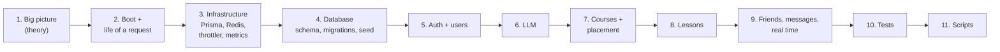

# The API, explained from zero

This folder explains **everything in `apps/api`**: what each folder and file does, and why.
It is written in simple English. Read the chapters in order: each one builds on the one before.

The chapters follow the way the program runs. We start at the entry door
([app.setup.ts](../../apps/api/src/app.setup.ts) and [main.ts](../../apps/api/src/main.ts)), then we
open the modules one by one, in the order a request meets them.

## The chapters

| #   | Chapter                                                | What you learn                                                                                    | Main folders                                                  |
| --- | ------------------------------------------------------ | ------------------------------------------------------------------------------------------------- | ------------------------------------------------------------- |
| 1   | [The big picture](01-big-picture.md)                   | What an API is, HTTP, REST, how NestJS works (modules, controllers, services, injection), the tools | `apps/api/` root files                                        |
| 2   | [Boot and request flow](02-boot-and-request-flow.md)   | What happens when the API starts, and the full path of one request                                | `main.ts`, `app.setup.ts`, `app.module.ts`, `validation.pipe.ts`, `error-code.filter.ts` |
| 3   | [Infrastructure](03-infrastructure.md)                 | The modules every other module leans on                                                           | `src/prisma`, `src/redis`, `src/throttler`, `src/metrics`, `src/health` |
| 4   | [Database](04-database.md)                             | PostgreSQL, Prisma, every table, migrations, the seed                                             | `prisma/`, `src/generated`                                    |
| 5   | [Auth and users](05-auth-and-users.md)                 | Sign up, log in, sessions, 2FA, profiles, avatars                                                 | `src/auth`, `src/users`                                       |
| 6   | [LLM](06-llm.md)                                       | How the API talks to an AI model                                                                  | `src/llm`                                                     |
| 7   | [Courses and placement](07-courses-placement.md)       | Courses, the placement test, AI-written questions                                                 | `src/courses`, `src/placement`, `src/question-generation`     |
| 8   | [Lessons](08-lessons.md)                               | Lessons, attempts, XP and achievements, the AI tutor                                              | `src/lessons`                                                 |
| 9   | [Social and real time](09-social-and-realtime.md)      | WebSockets, presence, friends, chat, the demo data                                                | `src/gateway`, `src/presence`, `src/friends`, `src/messages`, `src/demo` |
| 10  | [Tests](10-tests.md)                                   | Unit tests, end-to-end tests, mocks, fixtures, coverage                                           | `*.spec.ts`, `test/`                                          |
| 11  | [Scripts](11-scripts.md)                               | The command-line tools that write and check lessons                                               | `scripts/`, `src/items`                                       |

## How to read the code next to the docs

- Every chapter links to the real files. Open them side by side.
- Code excerpts are copied from the real files. If the code changes, the code wins.
- Words in **bold** are explained the first time they appear.

The web app has its own guide: [docs/web](../web/README.md).
