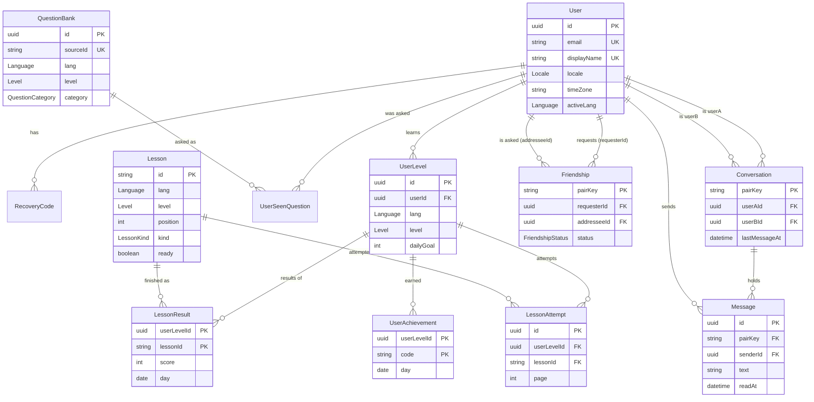

# Data model

The tables as they exist on this branch. The source of truth is
[apps/api/prisma/schema.prisma](../../apps/api/prisma/schema.prisma) and its migrations in
[apps/api/prisma/migrations/](../../apps/api/prisma/migrations/). If this page and the schema
disagree, the schema is right and this page must change.

[architecture/product.md](product.md) explains the product these tables serve,
[architecture/realtime.md](realtime.md) the socket and the stream that write some of them, and
[content/lessons.md](../content/lessons.md) and [content/item-bank.md](../content/item-bank.md) the
content the seed copies into `Lesson` and `QuestionBank`.

---

## 1. The rules

**Twelve tables**, all migrated: `User` and `RecoveryCode` (accounts and 2FA); `UserLevel`,
`QuestionBank` and `UserSeenQuestion` from Milestone 1; `Lesson`, `LessonResult`, `LessonAttempt`
and `UserAchievement` from Milestone 2; `Friendship`, `Conversation` and `Message` from
Milestone 3.

- **A table earns its place by being read at runtime**, and a 1:1 relationship is a column, not a
  table.
- **There are no SQL views.** The "views" of the lesson player are Zod schemas of what the browser
  may see ([content/lessons.md](../content/lessons.md) §10,
  [milestone2-data-model.html](../site/milestone2-data-model.html#player)).
- **Keys.** Most tables have a UUID `id`. Five do not: `LessonResult` and `UserAchievement` are
  keyed by their pair (`(userLevelId, lessonId)` and `(userLevelId, code)`), `Friendship` and
  `Conversation` by `pairKey`, the two user ids with the smaller first, because the pair is what
  makes a row unique. `Lesson` is keyed by its authored id (`de-separable-verbs`), because it is
  seeded from content and results attach to it.
- **Deleting an account leaves no orphaned row.** Every relation to `User` and to `UserLevel` is
  `onDelete: Cascade`. The one `Restrict` is `LessonResult.lessonId`: a lesson with results cannot
  be deleted.

---

## 2. The whole schema



The diagram shows only the key columns. The tables below list every column.

---

## 3. Languages and the other enums

```prisma
enum Locale           { en fr de }                 // the language the interface is rendered in
enum Language         { en fr de }                 // the language being taught
enum Level            { A1 A2 B1 B2 C1 C2 }
enum Role             { USER ADMIN }
enum QuestionCategory { vocabulary grammar reading }
enum FriendshipStatus { pending accepted }
enum LessonKind       { grammar vocabulary functions reading }
enum Topic            { … }                        // 13 grammar categories
enum Theme            { … }                        // 14 themes
```

`Locale` and `Language` have the same three values today, but they answer two different
questions. `User.locale` is the interface language. `UserLevel.lang`, `QuestionBank.lang` and
`Lesson.lang` say what is taught. An English speaker learning French has one set to `en` and the
other to `fr`, so one enum for both would make that row impossible to write. They drift apart the
day a learnable language ships that the interface is not translated into, and nothing has to change
when it does. The schema's comment gives the reason for an enum and not a string: the database
rejects a value the application has not been taught to render.

**Both appear in the URL, and they mean different things.** The course is a path segment:
`/{locale}/learn/{lang}/…`, so `/fr/learn/de` is a French interface teaching German. With the
course in the path rather than in a column, a link can be shared, the back button works, and two
tabs can sit on two courses at once.

**A learner studies several languages at once, so "has this person onboarded" is always a
question about `(userId, lang)`.** Someone who has finished French and is adding German still
needs onboarding for German. A check that asks only "does this user have any level at all" gets
that case wrong, silently, and only for the users who like the product most.

---

## 4. Accounts

| Table | Columns | Keys and indexes | What it is for |
| --- | --- | --- | --- |
| `User` | id, email, displayName, passwordHash, avatarUrl?, locale, role, createdAt, updatedAt, timeZone, lastActiveDay?, totpSecret?, totpEnabledAt?, activeLang? | Unique `email`, unique `displayName` | One account. Used by sign-up and login, the profile, 2FA, every course and the social features. Details below |
| `RecoveryCode` | id, userId, codeHash, usedAt?, createdAt | Unique `codeHash`, index on `userId` | The single-use 2FA fallback codes. Stored as a SHA-256 digest, not argon2: the codes are random enough that there is nothing to brute force, and a digest lets a login check one indexed lookup. `usedAt` marks a code spent |

The columns of `User` that need a word:

- **`passwordHash`** is argon2id. It, the `totp*` columns and `lastActiveDay` have no counterpart in
  `UserSchema` of [packages/shared/src/schemas/user.ts](../../packages/shared/src/schemas/user.ts),
  and must stay that way (the schema's own comment).
- **`locale`** (default `en`) is the interface language, stored so the server can answer in it:
  the lesson tutor reads it (`discussionPrompt(…, user.locale, …)` in
  [discussion.service.ts](../../apps/api/src/lessons/discussion.service.ts)). The web app writes it:
  `LocaleSync` ([apps/web/components/locale-sync.tsx](../../apps/web/components/locale-sync.tsx))
  sends `PATCH /api/users/me { locale }` when the URL's locale differs from the stored one (#211).
  No page renders it.
- **`timeZone`** is an IANA zone (`Europe/Zurich`), sent by the browser, `UTC` by default. It
  decides when the learner's day ends, so every day of the daily goal and the streak is counted in
  it ([product.md](product.md) §1.3). No other user sees it.
- **`activeLang`** has one job: deciding where a bare sign-in lands when the URL names no course.
  Changing a course's daily goal or its level sets it
  ([courses.service.ts](../../apps/api/src/courses/courses.service.ts)). A page with a `lang` in its
  path ignores it.
- **`lastActiveDay`** is the UTC day a tab last opened its socket. The gateway writes it once a
  day, and `GET /api/users/recently-active` reads it (the last 7 days). It is never sent.
- **`totpSecret`** is set when 2FA enrolment starts; **`totpEnabledAt`** stays null until a first
  code is verified, so an abandoned enrolment never blocks a login.
- **`avatarUrl`** points at an uploaded file served under `/api/uploads/avatars`
  (`AVATAR_ROUTE` in [app.setup.ts](../../apps/api/src/app.setup.ts)); the file itself is on disk,
  not in the database.

---

## 5. Learning

| Table | Columns | Keys and indexes | What it is for |
| --- | --- | --- | --- |
| `UserLevel` | id, userId, lang, level?, dailyGoal, createdAt, updatedAt, streak, bestStreak, lastGoalDay?, xp, lastChallengeDay?, lastChallengeCode?, challengesDone | Unique `(userId, lang)` | **One course.** A user may learn several languages, one row each. Onboarding writes it with `level` null; placement fills it in, or a learner who skips sets it directly. `streak`, `bestStreak` and `lastGoalDay` are the whole streak. The four gamification columns (#95): `xp` the course's total, `lastChallengeDay` the course day the daily challenge was last done, `lastChallengeCode` the challenge it was done under, and `challengesDone` the count the challenge achievements read. Starting an attempt, submitting each of its pages (the last one finishes the lesson) and changing the goal lock this row (`SELECT … FOR UPDATE`) |
| `QuestionBank` | id, sourceId?, lang, level, topic, category, readText?, question, options, answer, timeLimitS, createdAt, updatedAt | Unique `sourceId`, index on `(lang, level, category)` | **The placement questions.** Seeded from `content/items/*.json` and restocked by the LLM when a learner runs low in a cell. `sourceId` is the authored id the seed matches on; a null `sourceId` marks a question the LLM wrote. `timeLimitS` is the question's countdown. The index is the cell a draw reads. Full spec in [content/item-bank.md](../content/item-bank.md) |
| `UserSeenQuestion` | id, userId, questionId, createdAt, updatedAt | Unique `(userId, questionId)` | **Which placement questions a learner has been served.** The draw is a `NOT EXISTS` over these rows, which is why placement never repeats a question while unseen ones remain; `updatedAt`, bumped on every serve, picks the oldest-seen fallback ([product.md](product.md) §1.2) |
| `Lesson` | id, lang, level, position, kind, topic?, theme?, title, summary, brief, content?, ready, updatedAt | Primary key `id` (authored), index on `(lang, level, position)` | **The lesson catalogue, written only by the seed.** One row per outline entry in `content/outlines/`. `brief` is `{}` and `content` null until the lesson's files exist. `content` stays null for a vocabulary lesson, which is built from its brief. `ready` is set by the seed on every run: true when the files exist and pass `validateLesson`. `topic` labels grammar lessons, `theme` the others. Read by the daily goal page, the all lessons page (advanced search), the player and the discussion. How it is seeded: [content/lessons.md](../content/lessons.md) §4 |
| `LessonResult` | userLevelId, lessonId, score, day, finishedAt | Primary key `(userLevelId, lessonId)`, index on `(userLevelId, day)` | **One row per course and lesson, with no history.** Every finish upserts it: `score` keeps the best, `day` is the learner's day of the latest finish, `finishedAt` its moment. No row means not started, a best of 70 or more means passed, anything else failed. The daily goal counts the rows whose `day` is today, which is what the index serves. `lessonId` is `Restrict` |
| `LessonAttempt` | id, userLevelId, lessonId, motherTongue, secret, startedAt, page, deadline?, answers, completedAt?, results? | Unique `(userLevelId, lessonId)` | **The current or last attempt at a lesson**, run and scored by the server (#145). `motherTongue` is a `Locale`, fixed at the start. `secret` is 32 random bytes that key the refs naming units, options and tokens, and is never sent. `page` is the cursor and `deadline` that of the exam page at it. `answers` (JSON, `{}` at first) maps a unit id to its locked `{ response, outcome, points, timedOut, gender? }`, and `results` (JSON) is written once, when the attempt closes. A retake replaces the row. The plan is never stored: every request rebuilds it from the `Lesson` row |
| `UserAchievement` | userLevelId, code, day, earnedAt | Primary key `(userLevelId, code)` | **An achievement a course earned** (#95). The key stores a code once, whatever two finishes do at once, so an achievement is earned once and never lost. `code` is an `AchievementCode` of `@ft/shared`, a string fixed in code. `day` is the course day it was earned on |

**There is no `Topic` table.** `enum Topic` is the 13 grammar categories of the question bank; on
`Lesson` it labels grammar lessons only. The order, the titles and the count of the lessons all
live in `Lesson` itself.

**No table holds a lesson discussion.** It is stateless: the browser sends the earlier turns back
with each message, and the server stores nothing of it ([realtime.md](realtime.md)). No table
records LLM calls either: the metrics do ([operations/monitoring.md](../operations/monitoring.md)).

**No table holds a day history.** Nothing tracks minutes: the daily goal counts `LessonResult` rows
by `day`, and the streak is three columns on `UserLevel`.

---

## 6. Social

| Table | Columns | Keys and indexes | What it is for |
| --- | --- | --- | --- |
| `Friendship` | pairKey, requesterId, addresseeId, status, createdAt, updatedAt | Primary key `pairKey`, index on `requesterId`, index on `addresseeId` | **One row per pair of users**, a request while `pending`, a friendship once `accepted` (#155). Declining, cancelling and removing delete the row. `pairKey` is both ids, smaller first ([apps/api/src/friends/pair.ts](../../apps/api/src/friends/pair.ts)), so A to B and B to A share one key and two crossing requests cannot make two rows. Accepting is the only update, so `updatedAt` is when a request became a friendship. Read by /friends, the public profiles, presence and direct messages (only accepted friends may send) |
| `Conversation` | pairKey, userAId, userBId, createdAt, lastMessageAt | Primary key `pairKey`, index on `userAId`, index on `userBId` | **One row per pair who have exchanged a message** (#158), keyed like `Friendship`, so a pair cannot get two. `userAId` is the smaller id. `lastMessageAt`, set with each message, orders the conversation list. It outlives the friendship: the history stays readable by both. Two user columns and no participants table, because group chat is not claimed |
| `Message` | id, pairKey, senderId, text, createdAt, readAt? | Index on `(pairKey, createdAt, id)`, index on `(pairKey, readAt)` | **A direct message between friends** (#158). `text` is `VARCHAR(1000)`. `readAt` stays null until the other user reads it, and is never sent. The first index is the keyset the history pages on, newest first; the second keeps the unread counts and a read at the cost of what is unread, not of the whole history |

---

## 7. What Redis holds

Redis holds data too, but nothing in it is meant to last: every key is hot, disposable and
expiring, or reset at boot. [product.md](product.md) §4 says why each one is in Redis and not in
Postgres. The keys, from the code:

| Keys | What | Written by |
| --- | --- | --- |
| `sess:<sid>` | The session (`connect-redis`, prefix `SESSION_KEY_PREFIX`) | [app.setup.ts](../../apps/api/src/app.setup.ts) |
| `user:<id>:eval`, `user:<id>:eval_questions`, `user:<id>:eval_lock` | One placement run: its state, the questions asked, and a short lock. One hour TTL for the first two (`PLACEMENT_REDIS_KEY_TTL`) | [placement-session.service.ts](../../apps/api/src/placement/placement-session.service.ts) |
| `discussion:user:<id>:minute`, `discussion:user:<id>:day`, `discussion:global:minute` | The lesson discussion's rate-limit windows | [discussion-limits.ts](../../apps/api/src/lessons/discussion-limits.ts) |
| `presence:<id>` | A socket count per user, deleted at boot | [presence.service.ts](../../apps/api/src/presence/presence.service.ts) |

Presence is **not** a table: online status is that count, and it dies with the sockets.

---

## 8. What each module needs

Every claimed module ([modules/README.md](../modules/README.md)) runs on these twelve tables, Redis
and the metrics. None needs another table.

| Module | Tables it needs |
| --- | --- |
| Framework, ORM | none of its own: the ORM is the mechanism behind all of them |
| Standard user management | `User`, `Friendship` (+ Redis presence) |
| Complete 2FA | `User`, `RecoveryCode` |
| i18n, additional browsers, SSR | none (`User.locale` stores the interface language for the tutor) |
| Complete LLM interface | `QuestionBank` (the restock), `Lesson` and `LessonAttempt` (the discussion's prompt and its guard) (+ Redis limits) |
| Real-time via WebSockets | `Conversation`, `Message`, `Friendship` (+ Redis presence) |
| User interaction: chat, profiles, friends | `Conversation`, `Message`, `Friendship`, `User` |
| Advanced search | `Lesson` + `LessonResult`, searched in memory: a level has at most 320 lessons |
| Gamification | `UserAchievement`, plus `xp`, `lastChallengeDay`, `lastChallengeCode` and `challengesDone` on `UserLevel` |
| Monitoring | none: Prometheus keeps its own data |
| CI/CD, cloud deployment | none |

---

## 9. Dropped from the old plan

The first plan of this document (for example the old `PRODUCT_ARCHITECTURE.md` in `docs/`, at commit `207258a`)
listed tables that the Milestone 2 replan (#137) and the dropped modules removed. None of them is in
the schema or in any migration:

| Planned | What it was for | Why it is gone |
| --- | --- | --- |
| `Exercise` | One row per exercise of a lesson, with the learner's answer and its correction | Lessons are written ahead and committed; an attempt's answers are JSON on `LessonAttempt` |
| `Mistake` | The mistakes in a drill answer or a chat message, countable by type | No AI correction and no analytics dashboard are built |
| `Document`, `DocumentChunk` | Source texts and their embeddings for RAG | The RAG module was dropped. pgvector stays in the database image, unused |
| `LlmCall` | One row per LLM call: tokens, latency, cache hit | The metrics count calls and tokens instead |
| `DailyStat` | Minutes and answers per user and day, and whether the goal was met | The goal counts lessons, from `LessonResult.day`; the streak is three columns on `UserLevel` |
| `Topic` | The roadmap's tiles | `Lesson` holds the order and titles; `Topic` is an enum |

`LessonDraft`, `LessonDraftFile` and `LessonBrief` were never tables: they were Zod schemas of the
first lesson files, added with #77 (commit `f46355a`; `LessonDraftFile` was `LessonFile` until #114) and replaced by the prototype's lesson schemas
with #135 (commit `633f9e7`).
