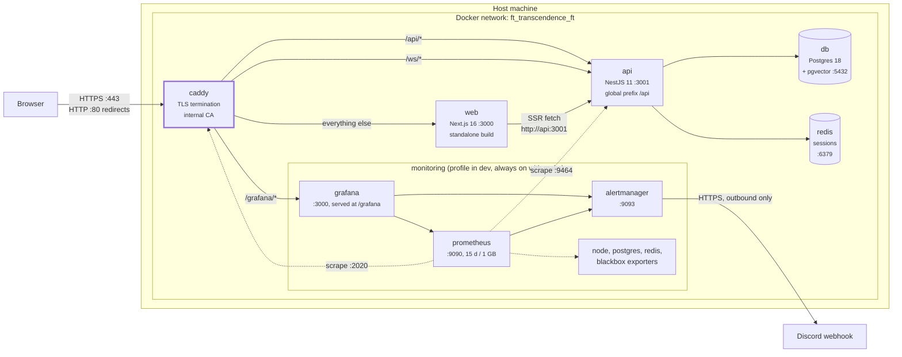
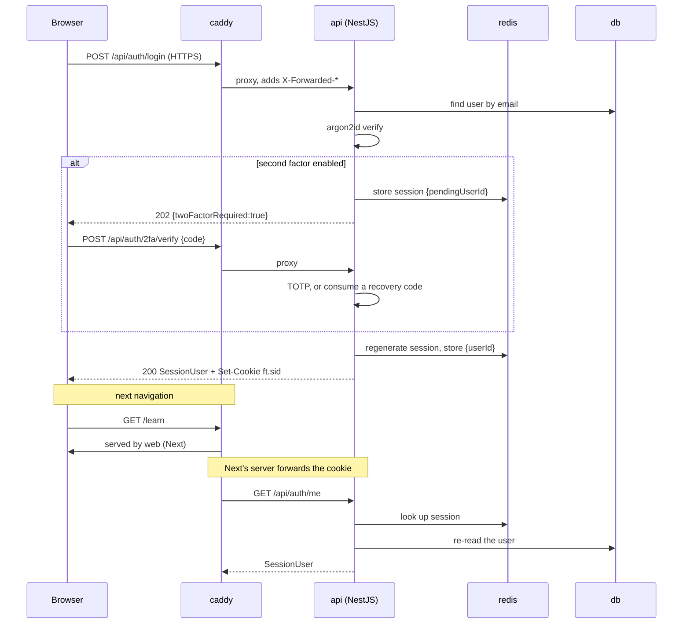
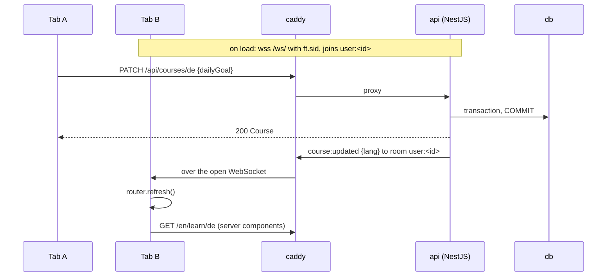
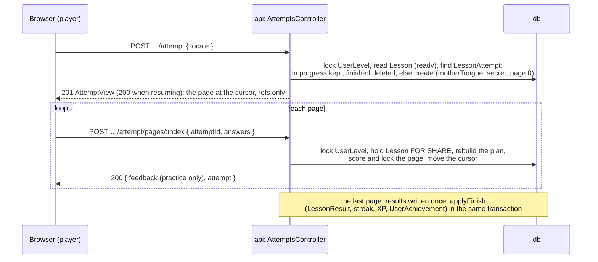
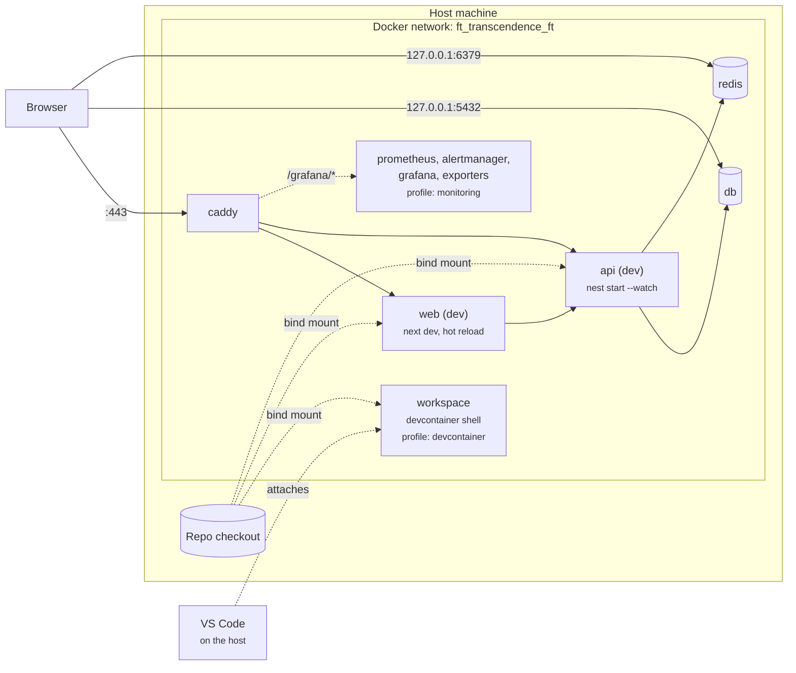
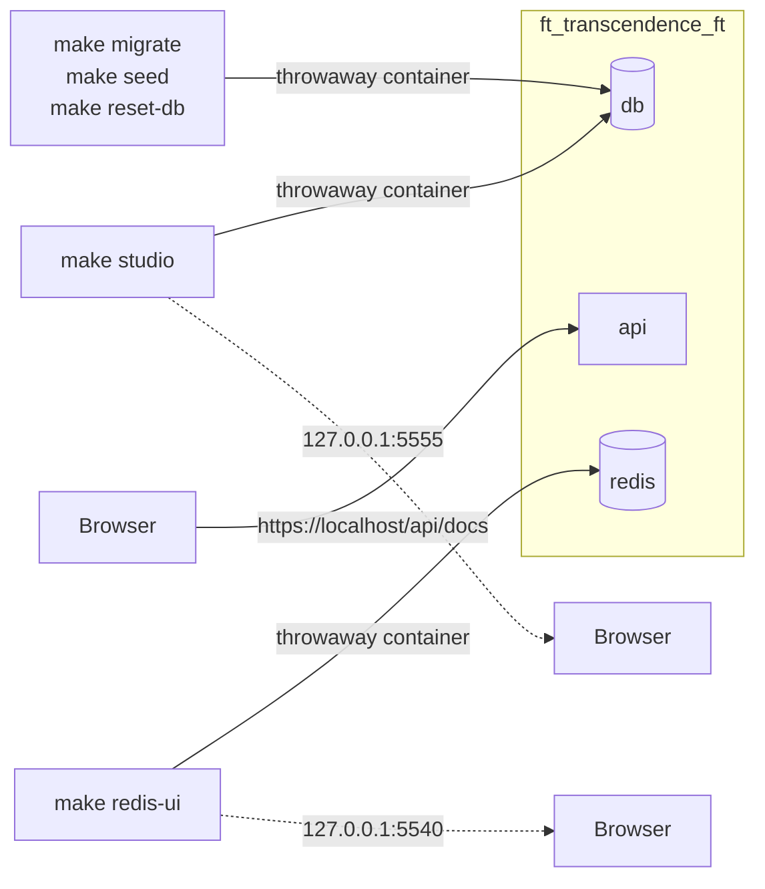
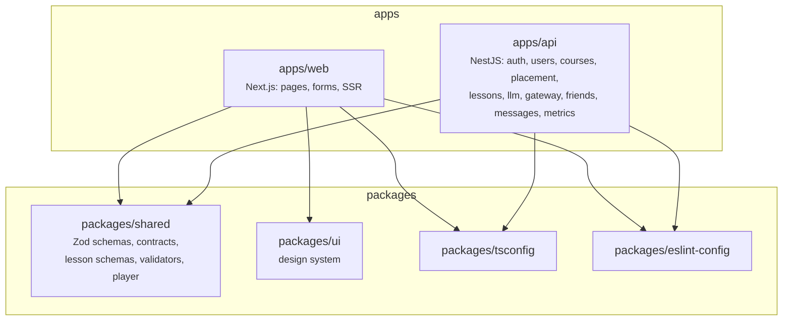

# Architecture

How the containers fit together, in production and in development.
Companions: [architecture/technical-plan.md](technical-plan.md) (decisions and rationale),
[operations/versions.md](../operations/versions.md) (what moves together, what is held back), [subject/summary.md](../subject/summary.md) (requirements).

Every diagram below is generated from the compose files as they actually are. If
you change a port or a route, change the diagram in the same commit.

---

## 1. The rule that explains the rest

> **NestJS owns all business logic and data access. Next.js does presentation and
> SSR only.** No Prisma client in `apps/web`, no domain logic in server actions.

Next's server calls NestJS over the internal network, exactly like the browser
does, only without leaving Docker. At defence, "which runtime owns what" has to
be a one-sentence answer, and this is it.

---

## 2. Production (`make`, `make run`, `make up`)

Files: `compose.yml` + `compose.prod.yml`. Images are built at the `prod` stage,
no source is bind-mounted, and every service carries `restart: unless-stopped`.
The monitoring stack is always on here ([operations/monitoring.md](../operations/monitoring.md)).



**Only caddy publishes a port.** `web`, `api`, `db`, `redis` and the monitoring
services are unreachable from outside the network, which is what the subject
permits for internal traffic while still requiring HTTPS at the edge.

| Published | Service | Purpose |
|---|---|---|
| `:80` | caddy | Redirects to HTTPS |
| `:443` tcp + udp | caddy | The only way in. udp is HTTP/3 |

Monitoring adds listeners on the network only. None of them is in a `ports:` list,
and `scripts/check-monitoring-config.sh` fails if one ever is:

| Internal only | What | Reached by |
|---|---|---|
| `api:9464` | the api's metrics listener, outside Nest | Prometheus |
| `caddy:2020` | Caddy's request metrics, a site of its own | Prometheus |
| `prometheus:9090` | Prometheus | Grafana |
| `alertmanager:9093` | Alertmanager | Prometheus, Grafana |
| `grafana:3000` | Grafana | caddy at `/grafana`, the blackbox probe |
| `node-exporter:9100` | host metrics | Prometheus |
| `blackbox-exporter:9115` | HTTP probes of web and Grafana | Prometheus |
| `redis-exporter:9121` | Redis metrics | Prometheus |
| `postgres-exporter:9187` | Postgres metrics | Prometheus |

### Why one origin matters

Because `/` and `/api` are the same origin, the session cookie is first-party:
no CORS configuration, no `SameSite=None`, and `httpOnly` costs nothing. Routing
happens in `infra/caddy/Caddyfile`:

| Path | Goes to | Note |
|---|---|---|
| `/api`, `/api/*` | `api:3001` | Prefix forwarded intact; `handle_path` would strip it and every route would 404. The lesson discussion streams through here as `text/event-stream`, flushed as it comes (§5) |
| `/ws`, `/ws/*` | `api:3001` | socket.io. Caddy detects the Upgrade handshake inside `reverse_proxy` |
| `/grafana/metrics`, `/grafana/metrics/*` | nothing, 404 | Grafana's metrics are off, and would be unauthenticated if on. Caddy refuses them too, and this matcher must stay above the next one |
| `/grafana`, `/grafana/*` | `grafana:3000` | Prefix forwarded intact, like `/api`: Grafana serves itself under `/grafana` |
| everything else | `web:3000` | Next.js |

`/api/metrics` is not a route. The api serves its metrics on `:9464`, which Caddy
never proxies, so that path reaches Nest and answers 404.

---

## 3. A request through the stack

Signing in touches every layer, so it is the useful one to trace.



Two details worth knowing:

- **`trust proxy` is 1, not `true`.** Caddy terminates TLS and forwards plain
  HTTP, so Express only learns the request was secure from `X-Forwarded-Proto`.
  Trusting exactly one hop means a client-supplied `X-Forwarded-For` never
  becomes `req.ip`, which is what the login throttler counts.
- **The guard re-reads the user on every request** rather than trusting a copy in
  the session, so a deleted account loses access immediately instead of at expiry.

---

## 4. A live update over the gateway

A goal or level change in one tab shows in the account's other open tabs. The
gateway is socket.io on `/ws`, inside the api and on its http server, so Caddy's
`/ws/*` route above is all the plumbing.



- **The cookie is the only credential.** engine.io answers `/ws` before Express
  does, so `SessionIoAdapter` hands it the same express-session middleware:
  same cookie, same store, nothing parsed by hand. A socket.io middleware then
  refuses a page of another origin, a session with no `userId` and a deleted
  account, all with `auth.sessionRequired`. The Origin check matters because
  `ft.sid` is `SameSite=Lax`, and same-site is not same-origin: a page on a
  sibling subdomain would send it too. The account check also reads
  `User.lastActiveDay`, and writes today's UTC date when it is not today: the
  first tab of the day writes, the others only read. Recently active on
  /friends lists who was active in the last 7 days, by name: polling it shows
  someone coming back after a week away, and nothing finer.
- **Refused quietly.** A refusal is a CONNECT_ERROR over a WebSocket that opened
  fine, which the browser does not log; an HTTP 401 on the upgrade would be a
  console error.
- **Rooms, never a broadcast.** Each socket joins `user:<id>` and
  `session:<sid>` before its CONNECT reply. `SocketsService.toUser()` is the
  only way to reach a user. Acks aside, the gateway writes to one socket only
  twice: to the socket that sent a bad event, and to a socket that just
  connected, with the presence of each friend and the unread counts (below).
- **Sockets close with their session**: on logout (that session's sockets
  only), on every session id change (signup, login, 2FA verify, 2FA enable and
  disable), and when a session ends any other way, through a sweep every 60 s
  that asks Redis for each open socket's `sess:<sid>` (known keys, never a scan).
  A handshake checks its session once more after joining its rooms, so a logout
  that ran while it was under way cannot miss it.
- **One screen for every inbound event**: 20 of each event name per 10 s per
  socket, frames capped at 16 KiB, one payload besides the ack, a zod parse from
  `CLIENT_EVENT_SCHEMAS`. Each name counts in its own window, and unknown names
  share one, so a burst of `dm:read` cannot use up the budget for `dm:send`. A
  refused event is dropped, never a crash, and its code is an `ERROR_CODES`
  entry: `server.rateLimited` past the limit, else the failed rule's own
  (`message.empty`, `message.tooLong`), else `request.invalid`. Sent with an
  ack, it gets `{ ok: false, code }` there, every time, since its caller is
  waiting on it. Without one it gets `app:error { code }`, and past the limit
  only the first of the window is told. A session holds at most 20 sockets,
  checked before the user write: one per tab is far below it, and a client
  opening sockets in a loop costs no query. More sockets still mean more
  events; what bounds the work they cause is the per-account budgets of
  `dm:send` and `dm:read` (below).
- **A catch-all filter for the handlers.** Global guards, pipes and filters
  never reach a gateway in Nest 11, which is why the screen validates and
  limits. What a handler throws goes to `SocketExceptionFilter`, declared with
  `@UseFilters` on each gateway that handles events: a service's coded
  `HttpException` keeps its code (`message.notFriends`), anything else is
  logged and answered `server.unexpected`, through the ack when there is one,
  else `app:error`. The gateways share one server, so they share one options
  object, `GATEWAY_OPTIONS`.
- **Sent after the commit.** `course:updated { lang }` means "read this course
  again": the page is rendered on the server, so the tab calls
  `router.refresh()` rather than keeping a second copy of the course.
  `RefreshOn` takes the list of events that refresh a page.
- **Friend events** (`friend:request`, `friend:accepted`, `friend:removed`)
  go to both users of the pair, so the actor's other tabs follow too. They carry
  `{ userId }`, the other user, and /friends and /users/[id] refresh on any of
  them. Decline and cancel send `friend:removed`: the row between the two is
  gone.
- **Presence** (`presence:update { userId, status, at }`, `online` or
  `offline`), in `PresenceService` (`apps/api/src/presence/`):
  - **A counter per user** in Redis, `presence:<id>`: `INCR` when a socket
    opens, `DECR` when it closes. Online on the first socket.
  - **A 10 s grace period** (`PRESENCE_GRACE_MS`): a closed socket comes off
    the count only after it. A reload's new socket makes the count 2, not 1,
    so friends hear nothing. Offline goes out 10 s after the *last* close,
    and `isOnline` keeps saying online until then, so the REST routes agree
    with the friends already watching. The wait is unref'd: it never holds
    the process open on a stop.
  - **Friends only**: the updates go to the `user:<id>` room of each accepted
    friend (`friendIds()`, `status: 'accepted'`). Someone who has only sent a
    request hears nothing, as /privacy promises. The friends are looked up
    again at offline time, since a friendship may have begun or ended since.
  - **A snapshot on connect**: the new socket, and only it, gets one
    `presence:update` per friend, because the page may have been rendered a
    moment before one of them came or went. `GET /api/friends` gives each
    friend `online`, from `isOnline(ids)` (one `MGET`).
  - **In the tab**: `tab-socket.ts` keeps a presence map for as long as the
    socket. It is fed by the snapshot and every `presence:update`. A friend is
    dropped on `friend:removed`, and on `friend:accepted` too, so a new friend
    starts from the refreshed render: no update comes for someone already
    online. Each connect clears the map, since its snapshot replaces it, and
    an entry left by an event missed while away cannot outlive a fresh render.
    `PresenceDot` reads it and uses the rendered
    `online` only for a friend the tab has heard nothing about. A page Next
    restores from its client cache on Back still shows what happened while it
    was away.
  - **A boot reset**: no socket survives a restart, but Redis keeps the counts
    a crash never took back, so `onApplicationBootstrap` deletes every
    `presence:*` key (`SCAN`, never `KEYS`). A count that still goes below
    zero is put back to zero.
  - **One API instance assumed** (below): the counts hold across instances,
    but the boot reset would wipe the other instances' counts.
- **Direct messages** between friends (`dm:send`, `dm:message`, `dm:unread`,
  `dm:read`), in `MessagesService` (`apps/api/src/messages/`). In every payload
  `userId` is the other person of the conversation, as in a friend event:
  - **Sent over the socket, read over REST.** `dm:send { userId, text }` comes
    with an ack. Only accepted friends may send (`areFriends()`), so a pending
    request, or yourself, gets `message.notFriends`. An account may send 30 a
    minute across all its sockets, counted in the HTTP throttler's storage;
    past that the ack answers `server.rateLimited`. The conversation upsert
    and the message insert are one transaction; then
    `dm:message { userId, message }` goes to both rooms, the sending tab's
    included, and the ack answers `{ ok: true, data: message }`. The thread
    dedupes by id. `GET /api/conversations` lists the conversations, latest
    first, with their unread counts, and
    `GET /api/conversations/:userId/messages?cursor=` pages the history, 50 at
    a time on `(createdAt, id)`. Reading needs no friendship: the history stays
    readable by both after unfriending.
  - **Unread counts are snapshots.** `dm:unread { counts, at }` holds every
    conversation's count, keyed by the other user, never a change to apply. It
    goes to the recipient after each message, without holding up the ack (a
    failure is logged); to the reader after each `dm:read`, changed or not, so
    a read always converges; and to each new socket after the presence
    snapshot, empty included, so the tab can tell "nothing unread" from "not
    heard yet". `at` is taken before the count, so of two snapshots that cross
    (a read and a new message at once) the later stamp counted every write the
    other saw: the tab keeps the latest `at`, whatever order they land in.
  - **`dm:read { userId }`** sets `readAt` on what that user sent you. No ack:
    the answer is the snapshot, to every tab of the reader. The open thread
    sends it while the tab is visible and connected and the conversation has
    unread messages, and each snapshot re-arms it. An account may read 100 a
    minute across all its sockets, what an HTTP route allows
    (`RATE_LIMIT_PER_MINUTE`), since each read costs two queries and a snapshot
    to every tab; past that it gets `app:error` with `server.rateLimited`, and
    the counts stay until the next snapshot. `readAt` never leaves the server.
    The index on `(pairKey, readAt)` keeps the counts and a read at the cost
    of what is unread, not of the whole history.
  - **In the tab**: `tab-socket.ts` keeps the last snapshot for as long as the
    socket, like the presence map, and drops it on sign-out. The account menu's
    Messages badge shows its total, 99+ past 99, and nothing before the first
    snapshot.
    `sendMessage()` refuses at once with `network.unreachable` when not
    connected: socket.io would buffer the event and deliver it long after the
    thread said it failed. A lost ack (10 s, or the socket closing) says the
    same, though the message may have been stored: sending it again can then
    show it twice, accepted, as nothing tells two sends of the same text apart.
  - **Catching up after a reconnect**: events sent while away are lost, so the
    open thread fetches the newest page on every connect, the first included,
    and merges it by id. When that page does not meet what the thread holds,
    more than a page came meanwhile, and the thread starts again from it. The
    connect snapshot puts the counts right.
- **One API instance.** Rooms live in the memory of the process holding the
  socket, so `toUser()` reaches only that process's sockets: with two `api`
  replicas, a message sent through one would miss a friend connected to the
  other. Several replicas would need `@socket.io/redis-adapter`, which carries
  room emits through Redis (`InterServerEvents` waits for it), and a presence
  boot reset that leaves the other instances' counts alone. The api runs one
  replica by design ([architecture/product.md](product.md) §4).
- **One connection per tab**, held in module scope (`components/tab-socket.ts`)
  and opened by `SessionNav` for a signed-in user, so a route group remount or a
  locale switch never drops it and an anonymous page never opens one. WebSocket
  transport only: a long poll keeps a request open, and a polled 502 is a
  console error.
- **Reconnecting without console noise.** A failed WebSocket dial is a console
  error no code can hide, so each retry (1, 2, 4, 8, then every 10 s, jittered)
  first asks `/healthz/api`, a web route that always answers 200, and dials only
  once the api answers. "Reconnecting…" shows meanwhile, and coming back
  refreshes the page, since events sent while away are lost.
- **What the probe cannot hide**: the api dying between a probe and the dial
  (one line), and the probe's own failure when web restarts too or the laptop
  goes offline.
- **In dev**, every save in `apps/api` restarts the process, so sockets drop and
  the badge flashes; Fast Refresh of `tab-socket.ts` leaves the old socket open
  until a reload.
- **No CSP today.** If one is added, `connect-src 'self'` covers same-origin
  `wss:` in current engines.

---

## 5. A lesson: the attempt routes and the discussion stream

A lesson is played over plain REST, and its discussion streams over Server-Sent Events on one
`POST`. Both live in `LessonsModule` (`apps/api/src/lessons/`), which also holds the daily view,
the search and the achievements:

| Controller | Routes, under `/api/courses/:lang` | Service |
|---|---|---|
| `LessonsController` | `GET today`, `GET lessons`, `GET lessons/:id`, `GET achievements` | `LessonsService`: the reads, the in-memory search, `applyFinish` |
| `AttemptsController` | `GET lessons/:id/attempt`, `POST lessons/:id/attempt`, `POST lessons/:id/attempt/pages/:index` | `AttemptsService`: stores the `LessonAttempt` and runs the pure functions of `lessons.player` |
| `DiscussionController` | `POST lessons/:id/discussion`, answered as `text/event-stream` | `DiscussionService`: the checks, the limits and the prompt, then `LlmProvider.streamText` |

Every route sits behind the global `AuthGuard` and validation pipe and answers 404 for an unknown
course. The attempt and discussion routes also answer 404 for a lesson that is not ready, and every
route but `GET lessons/:id` (a lesson card opens before placement too, ready or not) answers 409
`course.notPlaced` before placement. The web app
calls them from three pages, `/{locale}/learn/{lang}/lessons/{id}`, `…/play` and `…/results`
([content/lessons.md](../content/lessons.md) §11).

### The attempt



- **`LessonAttempt` is the only state.** One row per course and lesson: the mother tongue, a
  32-byte secret, the cursor, the exam deadline, the locked answers and, once finished, the
  results. The plan is rebuilt from the `Lesson` row with `buildPlan` on every request and never
  stored, so a change of code never strands a stored plan.
- **Refs, never ids.** Every unit, option and token the browser sees is named by
  HMAC-SHA256(secret, path), base64url, 16 characters (`attempt-ref.ts`). A ref from another
  attempt is a 400.
- **One transaction per write**, locking the course row first (`FOR UPDATE`), then holding the
  lesson row `FOR SHARE` so a reseed waits; the course lock alone means two tabs submitting the
  same page give one lock and one finish. A stale index, an old `attemptId` or a
  finished attempt is 409 `attempt.stale`.
- **The server owns the exam clock**: the deadline is set when an exam page is sent, with 2 s of
  grace.

### The discussion stream

```mermaid
sequenceDiagram
    participant B as Browser (discussion window)
    participant C as caddy
    participant A as api: DiscussionController
    participant R as redis
    participant G as Gemini

    B->>C: POST …/lessons/:id/discussion { attemptId, message, history }
    C->>A: proxy
    A->>A: course, ready lesson, cursor on the discussion page?<br/>else 404 / 409, as JSON
    A->>R: count the message in three windows<br/>else 429 + Retry-After, as JSON
    A-->>B: 200, text/event-stream; cache-control: no-cache, no-transform
    A->>G: streamGenerateContent?alt=sse
    loop as Gemini writes
        G-->>A: a piece of text
        A-->>B: event: delta / data: {"text":"…"}
    end
    A-->>B: event: done (or event: error {"code":"llm.…"})
    Note over A,B: ": heartbeat" comment every 15 s while open
```

- **Two halves, because of HTTP.** `DiscussionService.open()` runs every check that can still answer
  with a status, then `countMessage()` the rate limits. Only then does `openEventStream()`
  (`event-stream.ts`) send the 200 and its headers. After that a failure can only be an event:
  `error { code }`, with an `llm.*` code from the `LlmError`'s reason (`llm.unavailable`,
  `llm.rateLimited`, `llm.blocked`, `llm.incomplete`, `llm.disabled`), or `unknown` for a bug.
- **Cancelled with the page.** When the browser closes the response, an `AbortSignal` cancels the
  Gemini call, also when it left during the checks. Stop in the window does the same.
- **Stateless.** The body carries the last 10 turns; the server builds the system prompt from the
  lesson's brief and the attempt's wrong practice answers (`discussion-prompt.ts`) and stores
  nothing.
- **The browser** reads it with `fetch` and a stream reader (`apps/web/lib/discussion-client.ts`),
  since `EventSource` only sends `GET`. A refusal before the stream arrives as the usual JSON error,
  with `retryAfter` on a 429.

### SSE through Caddy, and the `encode` exclusion

Caddy compresses every route (`encode zstd gzip` in both Caddyfiles). A compressor holds bytes back
until it has enough to compress, which would turn a stream of small `delta` events into a few late
bursts. Issue #150 planned to exclude `text/event-stream` from `encode` if that happened. **The
Caddyfiles carry no exclusion**: the API marks the stream `Cache-Control: no-cache, no-transform`,
and Caddy's `encode` leaves a `no-transform` response uncompressed, while `reverse_proxy` flushes
an event stream as it comes. Checked by hand through Caddy against Gemini in PR #201: the pieces
arrive one by one. The heartbeat keeps any proxy on the way from closing a quiet stream. If a
future Caddy version changes either behaviour, the fix is a matcher on the `encode` directive, not
a change in the API.

---

## 6. Development (`make dev`)

Files: `compose.yml` + `compose.override.yml`, which loads automatically. Images
are built at the `dev` stage, source is bind-mounted, and both apps hot reload.



Dev publishes two more ports, both **loopback only**, so a database is never
exposed to the room:

| Published | Service |
|---|---|
| `127.0.0.1:5432` | db, for a local SQL client |
| `127.0.0.1:6379` | redis, for `redis-cli` |

### node_modules and generated output

Source is bind-mounted, but dependencies live in the image. Each `node_modules`
path is masked by a named volume, and so is anything a container writes as root:

| Masked path | Volume | Why |
|---|---|---|
| every `*/node_modules` | `api-node-modules-*`, `web-node-modules-*` | Host and container dependencies would otherwise collide |
| `apps/api/dist` | `api-dist` | `nest start --watch` compiles as root |
| `apps/api/src/generated` | `api-generated` | `prisma generate` runs as root at container start |
| `apps/web/.next` | `web-next` | Same reasoning |

Without those, a `make dev` leaves uid 0 files in the checkout and the next
`make` fails with `EACCES`.

### The devcontainer

`workspace` sits behind `profiles: [devcontainer]`, so a plain `docker compose up`
skips it while `.devcontainer/devcontainer.json` naming the service activates it.
`shutdownAction: none` is deliberate: the default would stop the whole stack when
the editor window closes.

Who the session runs as depends on the Docker daemon, and `.devcontainer/initialize.sh`
decides it on the host before every open: `node` on a rootful daemon, `root` on a
rootless one (the 42 clusters), where root inside a container is your own user on the
host and `node` could not write the repo. The same script hands the container the
daemon's socket and moves published ports the daemon cannot bind.

> **Ports inside the devcontainer.** Compose publishes to the *host's* loopback,
> and the devcontainer is just another container on the network. From a terminal
> inside it, reach the stack by service name, `https://caddy/api/health` rather than
> `https://localhost`. From your browser on the host, `https://localhost` is right,
> with `:<HTTPS_PORT>` when that is not 443 (a 42 machine).

### The monitoring profile

The seven monitoring services are defined in `compose.yml` with no profile, and
`compose.override.yml` puts each one behind `profiles: [monitoring]`. So `make dev`
and the devcontainer stay as light as before, `make monitoring-up` opts in, and the
prod overlay, which never loads the override, always runs them. Without the profile
`/grafana` answers 502. `make down`, `make clean` and `make logs` pass the profile,
so they reach the monitoring containers too. Day to day:
[operations/development.md](../operations/development.md).

---

## 7. Tools that are not services

None of them runs as part of the stack. Swagger UI is served by the api itself.
Prisma Studio and the migrate and seed commands are throwaway containers on the
same network, built from the api `build` stage (`ft_transcendence/api-tooling`),
and RedisInsight is a throwaway container of its upstream image.



| Tool | Reach it at | Notes |
|---|---|---|
| **Swagger UI** | `https://localhost/api/docs` | Served by the api itself, so it arrives through Caddy on the same origin. `/api/docs-json` is the raw OpenAPI document. Signed in? The `ft.sid` cookie rides along, so "Try it out" works on guarded routes with nothing to paste. |
| **Prisma Studio** | `http://127.0.0.1:5555` after `make studio` | Loopback only: it is unauthenticated read-write access to the whole database. `STUDIO_PORT=5556` if the port is taken. Restart it after `make` or `make reset-db`, since db gets a new container and Studio keeps the old connection. |
| **RedisInsight** | `http://127.0.0.1:5540` after `make redis-ui` | Loopback only, for the same reason: it reads and deletes any key, with no login. Shows sessions and placement runs live. `REDIS_UI_PORT=5541` if the port is taken. Nothing is kept between runs; the connection comes from the environment. |

There is no Adminer or pgAdmin service in this project; Prisma Studio is the
database browser, and it already knows the schema.

### The tooling image and the content it carries

The migrate and seed containers run the api Dockerfile's `build` stage: locally
as `ft_transcendence/api-tooling` (`make tooling-image`), on a server as
`ghcr.io/victorbro/ft_transcendence/tooling`, built and pushed by images.yml.
That stage is `COPY . .` of the repo minus `Dockerfile.dockerignore` (no `docs`,
`infra`, `.git`, no `*.md`), so it carries the Prisma CLI, the migrations, the
seed and every authored file under `content/`:

| Directory | What the seed does with it |
|---|---|
| `content/items/` | The question bank: one `QuestionBank` row per authored question, matched on `sourceId` |
| `content/outlines/` | One `Lesson` row per entry, 3,990 in all, with its position |
| `content/briefs/` | The brief of each written lesson, 216 today |
| `content/lessons/` | The content file of each written lesson that is not vocabulary, 108 today |

The image only **carries** them. Nothing in it writes or generates content: the
`migrate` service runs `prisma migrate deploy`, then `db:seed`, which validates
the files and sets `Lesson.ready` ([content/lessons.md](../content/lessons.md) §4). The authoring
kit's scripts are in the image too, since they live in `apps/api/scripts`, but
nothing runs them there. The `api` runtime image (`prod` stage) has neither the
Prisma CLI, the migrations nor `content/`: at runtime the api reads lessons from
Postgres only.

---

## 8. What CI runs

Five workflows. `ci` and `e2e` are the ones that gate a merge on behaviour;
`devcontainer` runs only when the devcontainer image changes, or the compose
files that start it.

```mermaid
flowchart TB
    pr["Pull request"] --> ci & e2e & hygiene & images & devcontainer

    subgraph ci["ci.yml"]
        c1["format · lint · typecheck<br/>TS version assert"] --> c2["unit tests + coverage"] --> c3["Supertest against<br/>real Postgres + Redis"]
        c4["monitoring config<br/>promtool · amtool · caddy validate"]
    end

    subgraph e2e["e2e.yml, two jobs per browser (lesson, rest)"]
        e1["build prod images<br/>compose up"] --> e2["Playwright in its own image<br/>one engine, one part"] --> e3["console gate<br/>legal pages"] --> em["monitoring check<br/>every target up"] --> e4["API restart run"]
        e4 --> eg["gate<br/>playwright (production stack)"]
    end

    subgraph hygiene["hygiene.yml"]
        h1["gitleaks · commitlint<br/>.env drift · migrate diff"]
    end

    subgraph images["images.yml"]
        i1["multi-arch build<br/>amd64 + arm64 → GHCR"]
    end

    subgraph devcontainer["devcontainer.yml, devcontainer paths only"]
        d1["build the image<br/>Node and pnpm match the pins<br/>entrypoint as root and as node<br/>host preflight on a rootless daemon"]
    end
```



Each engine gets two e2e jobs, each with its own stack: `lesson.spec.ts` alone
is about half of the suite's time, so it is one part and every other spec the
other. The monitoring check and the API restart run once, in the Chromium
`rest` job, after its suite. The gate job carries the required check.

Two of those checks are **subject rejection criteria**, which is why they run
against production images rather than a dev server:

- **console gate**: zero console errors, warnings, uncaught exceptions or failed
  requests, on every route, including client-side navigation.
- **legal pages**: `/privacy` and `/terms` answer 200 with real content.

`make ci` runs the same checks natively, and `make` runs all of it plus the
production stack, the live monitoring check and Playwright.

---

## 9. Where the code lives



`packages/shared` is the reason validation cannot drift: the signup form and the
signup endpoint apply the *same* `CreateUserSchema`, which is what the subject
means by validating in both frontend and backend. The one rule that keeps it
honest is that `passwordHash` never appears in any schema there.

The same holds for lessons: `@ft/shared`'s `lessons` namespace holds the lesson
file schemas and `validateLesson` (run by the seed, the specs and the authoring
kit), and the pure player (`buildPlan`, scoring, the views the browser may see),
run by `AttemptsService` on the server. The web app imports its view schemas
and types, plus a few pure helpers and constants for the forms (the article and
plural checks, which item types skip feedback when right, the practice weight,
the reading order separator), so the player pages and the API parse the same
shapes. It never builds a plan or scores an answer outside the tests.
