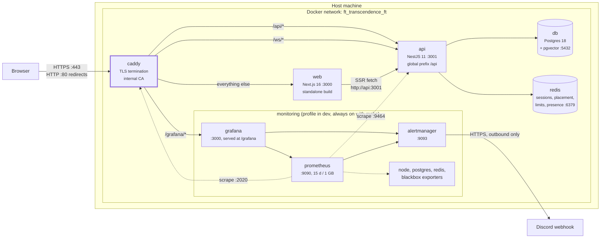
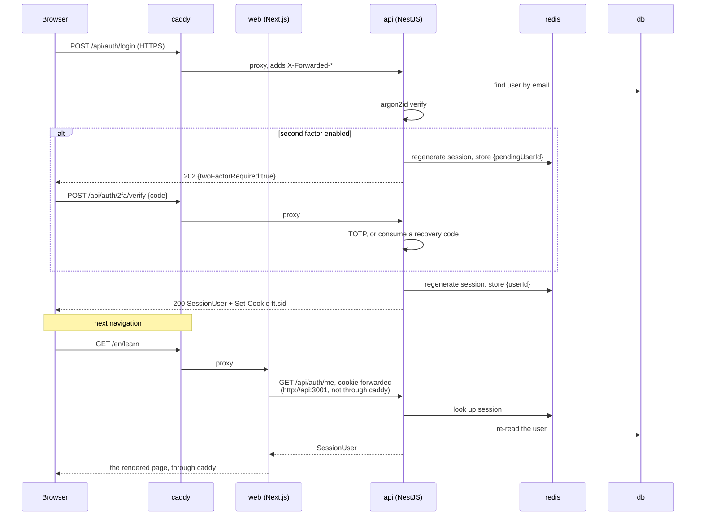
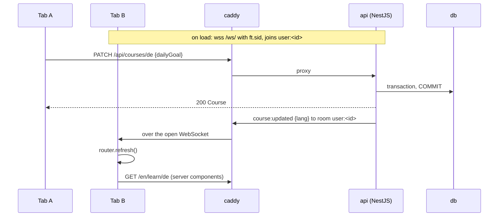
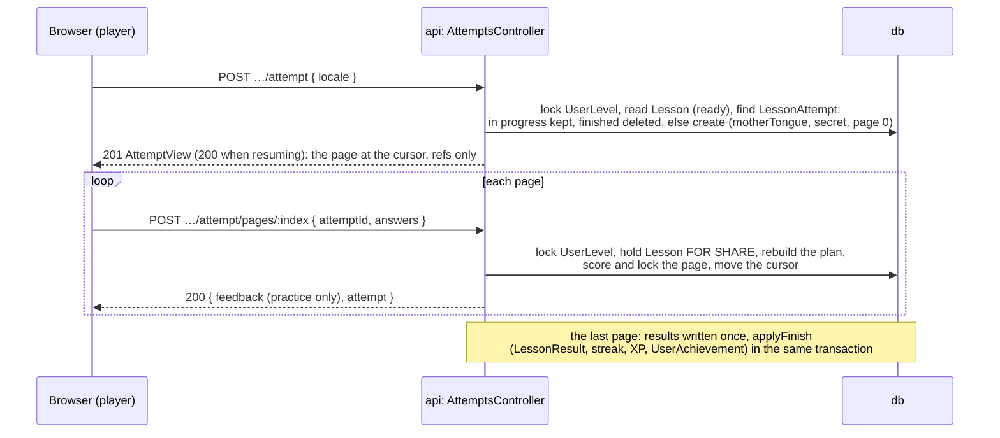
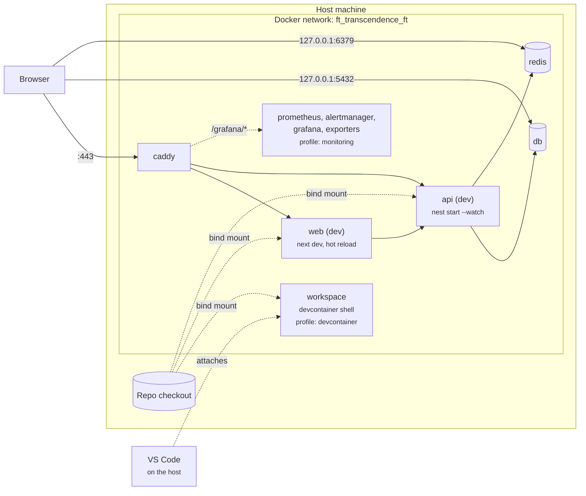
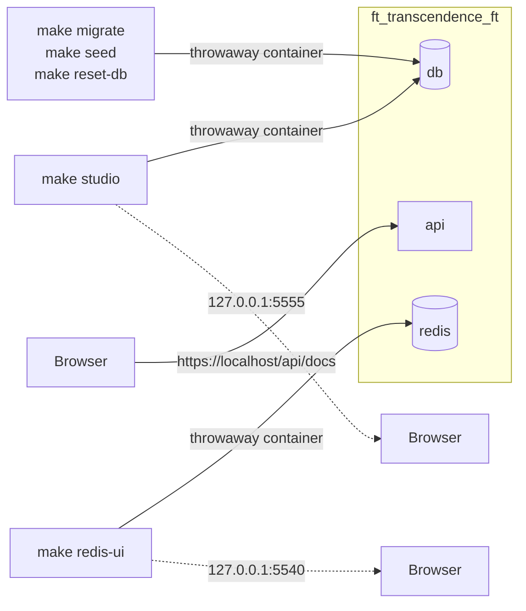
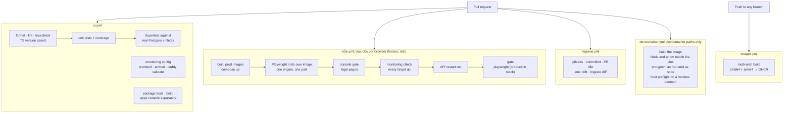
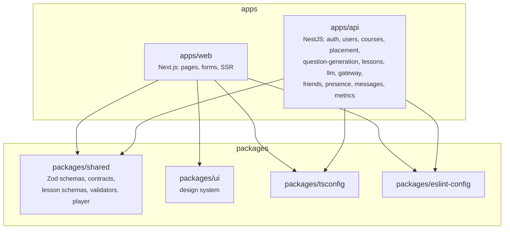

# Architecture

How the containers fit together, in production and in development. The server deployment
(`compose.deploy.yml`) is in [operations/deployment.md](../operations/deployment.md).
Companions: [architecture/technical-plan.md](technical-plan.md) (decisions and rationale),
[operations/versions.md](../operations/versions.md) (what moves together, what is held back), [subject/summary.md](../subject/summary.md) (requirements).

Every diagram below is drawn from the compose files as they actually are. If
you change a port or a route, change the diagram in the same commit.

---

## 1. The rule that explains the rest

> **NestJS owns all business logic and data access. Next.js does presentation and
> SSR only.** No Prisma client in `apps/web`, no domain logic in server actions.

Next's server calls NestJS over the internal network, exactly like the browser
does, only without leaving Docker. At defence, "which runtime owns what" has to
be a one-sentence answer, and this is it.

---

## 2. Production (`make`, `make run`, `make up`)

Files: `compose.yml` + `compose.prod.yml`. Images are built at the `prod` stage,
no source is bind-mounted, and every service carries `restart: unless-stopped`.
The monitoring stack is always on here ([operations/monitoring.md](../operations/monitoring.md)).

**Only caddy publishes a port.** `web`, `api`, `db`, `redis` and the monitoring
services are unreachable from outside the network, which is what the subject
permits for internal traffic while still requiring HTTPS at the edge.

| Published | Service | Purpose |
|---|---|---|
| `:80` | caddy | Redirects to HTTPS |
| `:443` tcp + udp | caddy | The only way in. udp is HTTP/3 |

Monitoring adds listeners on the network only. None of them is in a `ports:` list,
and `scripts/check-monitoring-config.sh` fails if one ever is:

| Internal only | What | Reached by |
|---|---|---|
| `api:9464` | the api's metrics listener, outside Nest | Prometheus |
| `caddy:2020` | Caddy's request metrics, a site of its own | Prometheus |
| `prometheus:9090` | Prometheus | Grafana |
| `alertmanager:9093` | Alertmanager | Prometheus, Grafana |
| `grafana:3000` | Grafana | caddy at `/grafana`, the blackbox probe |
| `node-exporter:9100` | host metrics | Prometheus |
| `blackbox-exporter:9115` | HTTP probes of web and Grafana | Prometheus |
| `redis-exporter:9121` | Redis metrics | Prometheus |
| `postgres-exporter:9187` | Postgres metrics | Prometheus |

### Why one origin matters

Because `/` and `/api` are the same origin, the session cookie is first-party:
no CORS configuration, no `SameSite=None`, and `httpOnly` costs nothing. Routing
happens in `infra/caddy/Caddyfile`:

| Path | Goes to | Note |
|---|---|---|
| `/api`, `/api/*` | `api:3001` | Prefix forwarded intact; `handle_path` would strip it and every route would 404. The lesson discussion streams through here as `text/event-stream`, flushed as it comes ([architecture/realtime.md](realtime.md) §4) |
| `/ws`, `/ws/*` | `api:3001` | socket.io. Caddy detects the Upgrade handshake inside `reverse_proxy` |
| `/grafana/metrics`, `/grafana/metrics/*` | nothing, 404 | Grafana's metrics are off, and would be unauthenticated if on. Caddy refuses them too, and this matcher must stay above the next one |
| `/grafana`, `/grafana/*` | `grafana:3000` | Prefix forwarded intact, like `/api`: Grafana serves itself under `/grafana` |
| everything else | `web:3000` | Next.js |

`/api/metrics` is not a route. The api serves its metrics on `:9464`, which Caddy
never proxies, so that path reaches Nest and answers 404.

---

## 3. A request through the stack

Signing in touches every layer, so it is the useful one to trace.

Two details worth knowing:

- **`trust proxy` is 1, not `true`.** Caddy terminates TLS and forwards plain
  HTTP, so Express only learns the request was secure from `X-Forwarded-Proto`.
  Trusting exactly one hop means a client-supplied `X-Forwarded-For` never
  becomes `req.ip`, which is what the login throttler counts.
- **The guard re-reads the user on every request** rather than trusting a copy in
  the session, so a deleted account loses access immediately instead of at expiry.

---

## 4. A live update over the gateway

A goal or level change in one tab shows in the account's other open tabs. The
gateway is socket.io on `/ws`, inside the api and on its http server, so Caddy's
`/ws/*` route above is all the plumbing.

The gateway in a few lines (all of it, with the reasons, is in
[architecture/realtime.md](realtime.md) §3):

- **The session cookie is the only credential.** `SessionIoAdapter` runs the same
  express-session middleware on the handshake, and a socket.io middleware refuses
  another origin, a session with no `userId` and a deleted account.
- **Rooms, never a broadcast.** Each socket joins `user:<id>` and `session:<sid>`;
  `SocketsService.toUser()` is the only way to reach a user. Sockets close with
  their session.
- **Every inbound event is screened**: a rate limit per socket and event name, a
  16 KiB frame cap and a zod parse from `CLIENT_EVENT_SCHEMAS`, before any handler.
- **The events**: `course:updated` after the commit, the friend events, presence
  (a counter per user in Redis, with a 10 s grace period) and direct messages
  (sent over the socket, read over REST).
- **One API instance.** Rooms live in the memory of the process holding the
  socket, so the api runs one replica ([architecture/product.md](product.md) §4).
- **One connection per tab** (`components/tab-socket.ts`), WebSocket transport
  only, and each reconnect first asks `/healthz/api` so a failed dial does not
  reach the console.

---

## 5. A lesson: the attempt routes and the discussion stream

A lesson is played over plain REST, and its discussion streams over Server-Sent Events on one
`POST`. Both live in `LessonsModule` (`apps/api/src/lessons/`), which also holds the daily view,
the search and the achievements:

| Controller | Routes, under `/api/courses/:lang` | Service |
|---|---|---|
| `LessonsController` | `GET today`, `GET lessons`, `GET lessons/:id`, `GET achievements` | `LessonsService`: the reads, the in-memory search, `applyFinish` |
| `AttemptsController` | `GET lessons/:id/attempt`, `POST lessons/:id/attempt`, `POST lessons/:id/attempt/pages/:index` | `AttemptsService`: stores the `LessonAttempt` and runs the pure functions of `lessons.player` |
| `DiscussionController` | `POST lessons/:id/discussion`, answered as `text/event-stream` | `DiscussionService`: the checks, the limits and the prompt, then `LlmProvider.streamText` |

Every route sits behind the global `AuthGuard` and validation pipe and answers 404 for an unknown
course. The attempt and discussion routes also answer 404 for a lesson that is not ready, and every
route but `GET lessons/:id` (a lesson card opens before placement too, ready or not) answers 409
`course.notPlaced` before placement. The web app
calls them from three pages, `/{locale}/learn/{lang}/lessons/{id}`, `…/play` and `…/results`
([content/lessons.md](../content/lessons.md) §11).

### The attempt

- **`LessonAttempt` is the only state.** One row per course and lesson: the mother tongue, a
  32-byte secret, the cursor, the exam deadline, the locked answers and, once finished, the
  results. The plan is rebuilt from the `Lesson` row with `buildPlan` on every request and never
  stored, so a change of code never strands a stored plan.
- **Refs, never ids.** Every unit, option and token the browser sees is named by
  HMAC-SHA256(secret, path), base64url, 16 characters (`attempt-ref.ts`). A ref from another
  attempt is a 400.
- **One transaction per write**, locking the course row first (`FOR UPDATE`), then holding the
  lesson row `FOR SHARE` so a reseed waits; the course lock alone means two tabs submitting the
  same page give one lock and one finish. A stale index, an old `attemptId` or a
  finished attempt is 409 `attempt.stale`.
- **The server owns the exam clock**: the deadline is set when an exam page is sent, with 2 s of
  grace.

### The discussion stream

- **Every check first.** Every check that can answer with a status (404, 409,
  then the 429 of the rate limits) runs before `openEventStream()` sends the 200.
  After that a failure can only be an `error { code }` event.
- **Cancelled with the page**, and **stateless**: closing the response cancels the
  Gemini call, and the server stores nothing of the discussion.
- **Through Caddy** with no change to the Caddyfiles: the stream is marked
  `Cache-Control: no-cache, no-transform`, so `encode` leaves it uncompressed.

Why it is SSE and not the socket, the events in detail, the browser client and
the `encode` question are in [architecture/realtime.md](realtime.md) §4.

---

## 6. Development (`make dev`)

Files: `compose.yml` + `compose.override.yml`, which loads automatically. Images
are built at the `dev` stage, source is bind-mounted, and both apps hot reload.

Dev publishes two more ports, both **loopback only**, so a database is never
exposed to the room:

| Published | Service |
|---|---|
| `127.0.0.1:5432` | db, for a local SQL client |
| `127.0.0.1:6379` | redis, for `redis-cli` |

### node_modules and generated output

Source is bind-mounted, but dependencies live in the image. Each `node_modules`
path is masked by a named volume, and so is anything a container writes as root:

| Masked path | Volume | Why |
|---|---|---|
| every `*/node_modules` | `api-node-modules-*`, `web-node-modules-*` | Host and container dependencies would otherwise collide |
| `apps/api/dist` | `api-dist` | `nest start --watch` compiles as root |
| `apps/api/src/generated` | `api-generated` | `prisma generate` runs as root at container start |
| `apps/web/.next` | `web-next` | Same reasoning |

Without those, a `make dev` leaves uid 0 files in the checkout and the next
`make` fails with `EACCES`.

### The devcontainer

`workspace` sits behind `profiles: [devcontainer]`, so a plain `docker compose up`
skips it while `.devcontainer/devcontainer.json` naming the service activates it.
`shutdownAction: none` is deliberate: the default would stop the whole stack when
the editor window closes.

Who the session runs as depends on the Docker daemon, and `.devcontainer/initialize.sh`
decides it on the host before every open: `node` on a rootful daemon, `root` on a
rootless one (the 42 clusters), where root inside a container is your own user on the
host and `node` could not write the repo. The same script hands the container the
daemon's socket and moves published ports the daemon cannot bind.

> **Ports inside the devcontainer.** Compose publishes to the *host's* loopback,
> and the devcontainer is just another container on the network. From a terminal
> inside it, reach the stack by service name, `https://caddy/api/health` rather than
> `https://localhost`. From your browser on the host, `https://localhost` is right,
> with `:<HTTPS_PORT>` when that is not 443 (a 42 machine).

### The monitoring profile

The seven monitoring services are defined in `compose.yml` with no profile, and
`compose.override.yml` puts each one behind `profiles: [monitoring]`. So `make dev`
and the devcontainer stay as light as before, `make monitoring-up` opts in, and the
prod overlay, which never loads the override, always runs them. Without the profile
`/grafana` answers 502. `make down`, `make clean` and `make logs` pass the profile,
so they reach the monitoring containers too. Day to day:
[operations/development.md](../operations/development.md).

---

## 7. Tools that are not services

None of them runs as part of the stack. Swagger UI is served by the api itself.
Prisma Studio and the migrate and seed commands are throwaway containers on the
same network, built from the api `build` stage (`ft_transcendence/api-tooling`),
and RedisInsight is a throwaway container of its upstream image.

| Tool | Reach it at | Notes |
|---|---|---|
| **Swagger UI** | `https://localhost/api/docs` | Served by the api itself, so it arrives through Caddy on the same origin. `/api/docs-json` is the raw OpenAPI document. Signed in? The `ft.sid` cookie rides along, so "Try it out" works on guarded routes with nothing to paste. |
| **Prisma Studio** | `http://127.0.0.1:5555` after `make studio` | Loopback only: it is unauthenticated read-write access to the whole database. `STUDIO_PORT=5556` if the port is taken. Restart it after `make` or `make reset-db`, since db gets a new container and Studio keeps the old connection. |
| **RedisInsight** | `http://127.0.0.1:5540` after `make redis-ui` | Loopback only, for the same reason: it reads and deletes any key, with no login. Shows sessions and placement runs live. `REDIS_UI_PORT=5541` if the port is taken. Nothing is kept between runs; the connection comes from the environment. |

There is no Adminer or pgAdmin service in this project; Prisma Studio is the
database browser, and it already knows the schema.

### The tooling image and the content it carries

The migrate and seed containers run the api Dockerfile's `build` stage: locally
as `ft_transcendence/api-tooling` (`make tooling-image`), on a server as
`ghcr.io/victorbro/ft_transcendence/tooling`, built and pushed by images.yml.
That stage is `COPY . .` of the repo minus `Dockerfile.dockerignore` (no `docs`,
`infra`, `.git`, no `*.md`), so it carries the Prisma CLI, the migrations, the
seed and every authored file under `content/`:

| Directory | What the seed does with it |
|---|---|
| `content/items/` | The question bank: one `QuestionBank` row per authored question, matched on `sourceId` |
| `content/outlines/` | One `Lesson` row per entry, 3,990 in all, with its position |
| `content/briefs/` | The brief of each written lesson, 216 today |
| `content/lessons/` | The content file of each written lesson that is not vocabulary, 108 today |

The image only **carries** them. Nothing in it writes or generates content: the
`migrate` service of `compose.deploy.yml` (locally, `make migrate` then `make seed`) runs
`prisma migrate deploy`, then `db:seed`, which validates
the files and sets `Lesson.ready` ([content/lessons.md](../content/lessons.md) §4). The authoring
kit's scripts are in the image too, since they live in `apps/api/scripts`, but
nothing runs them there. The `api` runtime image (`prod` stage) has neither the
Prisma CLI, the migrations nor `content/`: at runtime the api reads lessons from
Postgres only.

---

## 8. What CI runs

Five workflows. `ci` and `e2e` are the ones that gate a merge on behaviour;
`devcontainer` runs only when the devcontainer image changes, or the compose
files that start it.

Each engine gets two e2e jobs, each with its own stack: `lesson.spec.ts` alone
is about half of the suite's time, so it is one part and every other spec the
other. The monitoring check and the API restart run once, in the Chromium
`rest` job, after its suite. The gate job carries the required check.

Two of those checks are **subject rejection criteria**, which is why they run
against production images rather than a dev server:

- **console gate**: zero console errors, warnings, uncaught exceptions or failed
  requests, on every route, including client-side navigation.
- **legal pages**: `/privacy` and `/terms` answer 200 with real content.

`make ci` runs the same checks natively, and `make` runs all of it plus the
production stack, the live monitoring check and Playwright.

---

## 9. Where the code lives

`packages/shared` is the reason validation cannot drift: the signup endpoint
applies `CreateUserSchema`, and the signup form applies `SignUpFormSchema`, which
is the same schema plus the password confirmation. That is what the subject
means by validating in both frontend and backend. The one rule that keeps it
honest is that `passwordHash` never appears in any schema there.

The same holds for lessons: `@ft/shared`'s `lessons` namespace holds the lesson
file schemas and `validateLesson` (run by the seed, the specs and the authoring
kit), and the pure player (`buildPlan`, scoring, the views the browser may see),
run by `AttemptsService` on the server. The web app imports its view schemas
and types, plus a few pure helpers and constants for the forms (the article and
plural checks, which item types skip feedback when right, the practice weight,
the reading order separator), so the player pages and the API parse the same
shapes. It never builds a plan or scores an answer outside the tests.
