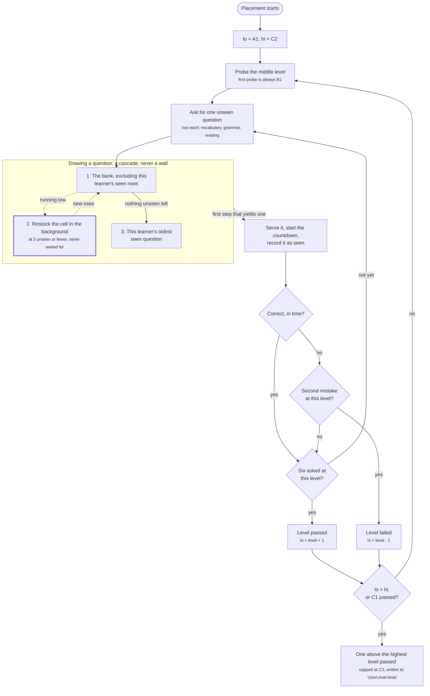
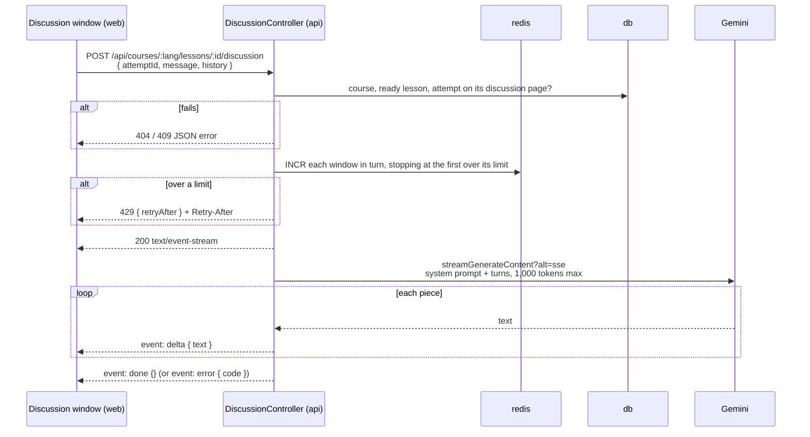

# Product Architecture

The product, the AI layer, Redis and throttling, as built on this branch.
[architecture/technical-plan.md](technical-plan.md) covers the infrastructure around it (repository layout,
containers, CI and build order), [architecture/overview.md](overview.md) the containers and the request
paths, and [content/lessons.md](../content/lessons.md) the lesson content, its seeding and the lesson player.

The subject lists this project by name in chapter V.6:

> **Language Learning Platform**: Lessons, exercises, progress tracking, and peer practice.
> Point potential: 15+ points.

---

## 1. The learner journey

The product is one loop, repeated. Everything in this document exists to serve it.

```
sign up / log in  →  onboarding  →  placement   →    daily goal    →    lesson    →  results  →  daily goal …
                     (2 questions)  (binary search)  (today's lessons)  (practice → discussion
                                                                          → exam)
```

| Step | What the learner sees | What the system does |
|---|---|---|
| **Onboarding** | Two questions: which language to learn, and a daily goal (10, 30 or 60 minutes). Repeated per language, so adding a second course starts here again | Creates a `UserLevel` row for that `(user, language)`. `level` stays null until placement sets it. No AI call. |
| **Placement** | One question at a time, each with its own countdown, then a red and green report. Skippable by a learner who already knows their level, and overridable if they disagree with the result | Binary search over the six CEFR levels, in **our code**. Questions are multiple choice, so scoring is a string comparison, and the LLM restocks a cell in the background once a learner is down to 3 unseen questions in it. Writes `UserLevel.level`. See §1.2 |
| **Daily goal** | Today's lessons from the level's syllabus: the ones that meet the goal, three extra, the streak, the level's progress, XP and rank, and the daily challenge. Nothing is locked: any ready lesson of the course language can be played, and the all lessons page lists the whole level, "Coming soon" rows included | Reads the seeded `Lesson` catalogue for (language, level) and the course's `LessonResult` rows, and proposes the lowest **ready** lessons not yet passed (§1.3). Writes nothing. No AI call. How the syllabus is sized, written and seeded is in [content/lessons.md](../content/lessons.md) |
| **Lesson** | The lesson's start page, then the player: presentation and practice pages one at a time, each practice page corrected as soon as it is checked, a discussion with the lesson's tutor, then a timed exam (§1.4) | Plays a lesson written ahead and committed to the repo. The server runs the attempt in `LessonAttempt`: it sends only the page at the cursor, checks every answer and owns the exam timer. One LLM call per discussion message, streamed. Nothing else in a lesson calls the LLM |
| **Results** | The score, every answer with its correction, the lesson counted toward today's goal pass or fail, and the XP, challenge and achievements it earned | Score computed **in code** from the answers the server stored, written once when the last page locks. The course's `LessonResult` keeps the best score, the streak moves when the goal becomes met, and the gamification columns and `UserAchievement` are written in the same transaction. No AI call |

### The rule that makes this work

> **The LLM writes individual items and explains. Our code owns state, scoring and
> progression.**

In Milestone 2 the LLM does exactly two things at runtime: it restocks the placement bank when a
cell runs low (§1.2), and it answers the learner on a lesson's discussion page (§1.4). It never
writes a lesson, never scores an answer and never decides a level.

This is the spine of the whole design, and it is worth defending in one place because every
other decision follows from it:

- **It is explainable.** The subject requires you to explain your AI implementation at
  evaluation. "A binary search over the six CEFR levels, six questions per level, a second
  mistake ends the level" is explainable in one breath. "We asked the model to decide the level"
  is not.
- **It is testable.** With `LLM_PROVIDER=fixture` the entire progression is deterministic and
  unit-testable. Ask the LLM to own progression and nothing is testable without spending money.
  The proposal, the streak and level completion are pure functions with no clock and no database.
- **It is cheap.** Proposing today's lessons, scoring an attempt, keeping the best score, moving
  the streak, deciding that a level is complete, none of that needs a token.
- **It cannot embarrass you in a demo.** A model that decides to award B2 for a blank answer is
  a live failure. A binary search in TypeScript cannot.

### 1.2 Placement is a binary search, and never the same question twice

A placement run answers exactly one question: which of the six CEFR levels is this learner at.
It is a search in our code, not a judgment by the model.

**The search.** Keep the range of levels still possible, `lo = A1` and `hi = C2`, and probe the
middle of it. The first probe is therefore always B1.

- **Level passed:** everything above is still in play, so `lo = level + 1`.
- **Level failed:** everything below it is, so `hi = level - 1`.
- **`lo > hi`:** the search is over. The result is `lo`, the level to learn: one above the highest
  level passed, capped at C2, or A1 if none was passed.
- **C1 passed:** the search is over too, at C2. C2 is not probed: passed or failed, the result
  would be C2.

Three probes settle six levels, so a run is at most three levels deep.

**A worked run.** B1 is always the first probe. Six questions there, one of them wrong: that is
still a pass, so `lo` becomes B2 and the next probe is the middle of B2 to C2, which is **C1**.
Two wrong at C1: the level stops there, `hi` becomes B2, and the last probe is B2 itself. The
result is C1 if it passes and B2 if it does not, one above the highest level passed.

**What passing a level means.** Six questions at that level, two from each category:
`vocabulary`, `grammar` and `reading`. **One mistake is allowed; the second ends the level.**
A learner who is out of their depth stops after two questions instead of sitting through six,
and a single slip does not cost them a level.

Every question carries its own countdown (`QuestionBank.timeLimitS`), and running out of time
counts as a wrong answer. Without that, a stalled tab is an unbounded test.

**Drawing a question is a cascade, never a wall.** Every step draws from one cell, the
`(lang, level, category)` being probed, so a French B1 grammar probe can only ever serve a French
B1 grammar question:

1. **The bank**, excluding everything this learner has already been served (`UserSeenQuestion`).
   Written rows, the ones with a `sourceId`, go first: a generated row is drawn only once the
   learner has no unseen written row left in the cell.
2. **Down to 3 unseen in the cell, so restock it in the background.** One structured LLM call
   returns a batch for the cell (13 grammar, 10 vocabulary or 5 reading). It is schema-validated,
   deduplicated against the cell and written to `QuestionBank` with no `sourceId`. The draw never
   waits for it: the new rows reach this learner and the next ones through step 1. **The bank
   grows as it is used**, and a null `sourceId` is what marks the rows no human reviewed.
3. **Nothing unseen left** (generation failed, has not landed yet, or there is no key): serve the
   question this learner saw longest ago at that level, never one already asked in this run.
   This is the one path that repeats a question. A repeat after months is a weak measurement,
   and an abandoned exam is no measurement at all.

Bank first rather than generate every time buys three things. **Quality:** a seeded question was
reviewed by a human once, a live one cannot be. **Cost:** near zero on the common path.
**Provability:** the exclusion is a `NOT EXISTS` over `UserSeenQuestion`, not a hope about
sampling temperature.

**The clock belongs to the server.** Each question carries its own `timeLimitS`, and the server
stamps the moment it served the question. It stamps that once: a refresh re-reads the question
with the time that is actually left, never a fresh limit. When the answer arrives the server
recomputes the elapsed time and decides lateness itself, whatever the request claims, with a
couple of seconds of grace for the network. The countdown in the browser is there so the learner
can see it, and is never the thing that judges.

**Skipping, overriding and retaking.** A learner who already knows their level skips the exam and
sets their level directly. A learner who disagrees with the result can change it on the spot. A
retake is the same search run again, drawing against the same `UserSeenQuestion` rows, so it asks
new questions unless step 3 fires. All three end in the same write, `CoursesService.setLevel`, and only the
current level is stored, never a history of runs. A run where every answer timed out writes
nothing: a learner who walked away measured nothing, so the course keeps the level it had, or
stays without one, and the result says so with `applied: false`.

**The report is red and green.** At the end the learner sees every question they were asked,
their answer in red and the correct one in green. No explanations: nothing in the bank holds one.
It is built from the run state and dies with it.

**The run itself is not a table.** The bounds, the level being probed, the tally per category, the
mistakes so far and the report live in Redis under the learner, `user:<id>:eval`, with a
one-hour TTL (§4). A learner who signs in again within the hour comes back to the exam they left;
after that the run is gone. Two things outlive it: the `UserSeenQuestion` rows, and the final level.

**The whole run, drawn.** A thick border is an LLM call. There is one, off the draw's path: a
cell is restocked in the background once a learner is down to 3 unseen questions in it.



### 1.3 The daily goal shapes the session, never the syllabus

**Ten, thirty or sixty minutes.** Picked at onboarding, changeable afterwards on the daily goal
page. A lesson is written to take about ten minutes, so **the goal counts lessons**: 10 means one
lesson finished that day, 30 means three, 60 means six. That is why those three values and not
others; ten divides all of them evenly. A finish counts pass or fail, from any list, and a lesson
finished twice in a day counts once. Nothing tracks minutes, and `DailyStat` is not built.

> **Open, for the team: how long a lesson takes.** The goal counts lessons at
> `LESSON_MINUTES = 10`, but the 216 ready lessons are planned at 8 to 37 minutes
> (`estimatedMinutes`, median 17.5), so the six lessons of the 60-minute goal can take well over an
> hour. Either the
> goal keeps counting 1, 3 or 6 lessons and the minutes are a rough label, or the authoring kit
> ([#83](https://github.com/VictorBro/ft_transcendence/issues/83)) keeps lessons nearer ten
> minutes. The code does the first today.

The goal does two things:

- **Sizes today's plan.** The daily goal page proposes as many lessons as the goal still needs,
  then three extra. They come from a queue over the current level's ready lessons: the ones not finished
  today, first the ones not yet passed in syllabus order (failed ones included), then passed
  ones as review, least recently finished first. Once the goal is met, only the three extra
  remain. The next day, the proposal starts again at the lowest lesson not yet passed.
- **Defines the streak.** Three columns on `UserLevel`, so one streak per course: `streak`,
  `bestStreak` and `lastGoalDay`. The streak moves when the day's goal becomes met, by a finish
  or by lowering the goal: if `lastGoalDay` is already today nothing changes, if it is yesterday
  the streak grows by one, otherwise it restarts at 1. It shows while `lastGoalDay` is today or
  yesterday, and 0 after that. Raising the goal never cancels a day already met, so a learner
  can lower the goal, meet it, raise it again and still keep the day. We accept that.
  `lastGoalDay` is the only stored day: there is no day history, so no calendar and no "days
  met this week".

Gamification also reads the goal: meeting it earns XP, and one daily challenge asks for a lesson
beyond it ([#94](https://github.com/VictorBro/ft_transcendence/issues/94),
[#95](https://github.com/VictorBro/ft_transcendence/issues/95)).

**Gamification, per course.** XP (10 for a lesson's first finish of the day plus every point it
adds to that lesson's best score, 20 for meeting the goal, 30 for the challenge) and ranks (rank
n to n + 1 needs n × 100 more XP); one daily challenge out of six, picked by a hash of the course
and the day, so nothing stores it; and 16 achievements, earned once and never lost. The rules are
pure functions (`gamification.rules.ts`), the awards run inside the finish transaction
(`gamification.ts`), and the course page, the results and `/learn/{lang}/achievements` show them
(#97). Leaderboards, badges and rewards are not built.

**The day is the learner's.** `User.timeZone` (an IANA zone sent by the browser, UTC by default)
decides when a day ends, so a learner in Tokyo and one in New York each get their own midnight. A
finish that arrives after local midnight counts for the new day. A course's day never goes
backwards: it is never before its `lastGoalDay` or its newest result's day, so a flight west
cannot undo a day that was already met.

**A level is complete when every ready lesson was attempted and at least 80% are passed.** A
lesson is passed when its best score is 70 or more. With 12 ready lessons per level today, that is
all 12 attempted and 10 passed; the bar moves as more lessons become ready. Only a complete level offers "Start B1": attempting
every lesson means the whole syllabus was seen, and 80% means it was learned, without asking for a
perfect score on each one. The learner can still change level, or retake placement, at any time.
**Switching level keeps all progress**: nothing is reset, and switching back continues where the
learner stopped.

**The syllabus is keyed by `(language, level)` and never by the goal.** Changing the goal
regenerates nothing and moves no progress: the same list of lessons is simply walked faster or
slower. A syllabus per goal would mean three copies of every level to generate and review, and a
learner dropping from 60 to 10 would need their finished lessons mapped onto a different list.
Every language has the same number of outline entries per level, from 120 at A1 to 320 at C2:
3,990 `Lesson` rows in all, of which **216 are ready, the first 12 of each language and level**.
How many there are and how they are split by kind is in [content/lessons.md](../content/lessons.md) §0 to §3, how the
seed sets `ready` in §4, and how they are written in §7.

What it must never do is gate content. A learner past their goal keeps going if they want; it
is a target, not a cap, and a cap would punish exactly the behaviour the product exists for.
**No lesson is locked either.** The order only decides which lessons are proposed: the learner can
open any ready lesson of the course language, of any level, and every finish counts.

### 1.4 Anatomy of a lesson

A lesson is **written ahead, not generated**: its exercises, answer keys, exam and scoring are in
one or two committed JSON files, checked by the validators of the lesson prototype and copied into
`Lesson.brief` and `Lesson.content` by the seed ([content/lessons.md](../content/lessons.md) §4). The Milestone 2
replan ([#137](https://github.com/VictorBro/ft_transcendence/issues/137)) replaced the earlier
plan, where a tutor turned a short brief into exercises at runtime with RAG grounding and caches.
None of that was built.

**The four lesson pages.** Each kind has its own player (#146 to #149), on three routes under
`/{locale}/learn/{lang}/lessons/{id}`: the start page, `/play` and `/results`.

| Kind | What the learner does | Web player |
|---|---|---|
| Grammar | Explanations, then exercises (matching, gaps to choose or type, word order, spot the error), then a timed exam | on `main` (#146) |
| Vocabulary | Each group's introduction and flashcards, matching, a gender overview, practice, then a translation exam. No listening (below) | on `main` (#147) |
| Functions | A situation with two roles, expressions, listening replies with **Show the text**, a dialogue, then an exam in parts | on `main` (#149) |
| Reading | Two documents of one genre: one to learn with, a new one in the exam | on `main` (#148) |

A learner with a 10-minute goal who opens a grammar lesson from today's proposal:

| Moment | What the learner sees | What the system does |
|---|---|---|
| Start page | The title, the objective, the minutes and the numbered learning points | `GET …/attempt` reads the lesson row and the attempt, if any. Nothing is written |
| Start | The first page | `POST …/attempt { locale }` creates the `LessonAttempt`: the mother tongue fixed from the interface locale, a new 32-byte secret, the cursor at 0 |
| Each practice page | Its correction, as soon as it is checked | `POST …/attempt/pages/:index` locks that page's answers, scores them and moves the cursor. The keys of that page only are sent back |
| Discussion page | A chat with the lesson's tutor, optional | `POST …/discussion` streams the tutor's answer as Server-Sent Events. Unscored, and nothing of it is stored (§5) |
| Exam pages | A countdown per page, no correction | The deadline is set when the page is sent; a late page locks blank |
| Results | The score, every answer and its correction, XP, the challenge and achievements | The last page locks: the results are written once, and the finish (best score, goal, streak, XP, achievements) runs in the same transaction |

Two rules shape every page ([content/lessons.md](../content/lessons.md) §11):

- **The mother tongue.** The help around the lesson is in the interface language, unless that is
  the course language, then in the first other of en, fr, de. It is fixed on the attempt at its
  start.
- **Vocabulary without listening.** The vocabulary player drops the prototype's listening choice
  and dictation, so its exam is the translation only. Functions keep their listening replies, read
  by the browser's speech synthesis, with **Show the text** for a browser that has no voice.

**The discussion step replaces the tutor walkthrough.** It is the only place a learner talks to
the LLM in a lesson: one page, right before the exam info page, where the tutor knows the lesson's
teaching fields and the learner's wrong practice answers, but never the exam or its answers. How it
is built is in [content/lessons.md](../content/lessons.md) §12 and [architecture/realtime.md](realtime.md) §4.

### 1.5 Not built: cross-language chat

An early idea paired two learners, each writing their own language, with one LLM call per message
correcting the sender and translating for the other. It is not built. Direct messages between
friends (#158) are plain text with no AI in the middle, and no table stores a correction or a
mistake.

---

## 2. Modules and points

The modules we claim, their type and points, and the total are in
[modules/README.md](../modules/README.md), with one file per module that explains what was built
and where the code is. That table is the only copy, so it cannot drift from this document.

---

## 3. Transport: REST, Server-Sent Events and a WebSocket

Most of the product is request and response over REST. The socket.io gateway on `/ws` carries what
several clients must see at once: live course and friend updates, online status and direct
messages. The lesson discussion streams one answer over Server-Sent Events on a `POST`.
[architecture/realtime.md](realtime.md) says which feature uses which, why, and how the gateway and
the stream work.

---

## 4. Redis: what it holds

Redis is already in the stack. It is not one thing but several, with different lifetimes.

**Redis is here for expiry, not for sharing.** The api runs as a single replica and is meant to:
one machine, one `docker compose up`, no orchestrator. Nothing below is in Redis so that a second
process can read it. Every key is hot, disposable and expiring, which is a shape that wants a
store with a TTL however many replicas there are. The rule of thumb, when something new comes up:
if it has to survive from one request to the next, it is Redis or Postgres, and losing it costs a
redo rather than data; if it does not, it is a plain constant or a per-request value in code.

| Job | Keys | Why Redis and not Postgres | Status |
|---|---|---|---|
| **Session store** (`connect-redis`) | `sess:<sid>` | Sessions are hot, short-lived and disposable. Restarting the api must not log everyone out | in use |
| **Placement run state** | `user:<id>:eval`, `user:<id>:eval_questions`, `user:<id>:eval_lock` | The search bounds, the level being probed, the tally per category, the mistakes so far, the current question's deadline and the report. **Always with a TTL**: one hour (`PLACEMENT_REDIS_KEY_TTL`) for `eval` and `eval_questions`, and 5 s (`PLACEMENT_LOCK_TTL_SECONDS`) for `eval_lock`, the `SET NX EX` lock that keeps two starts or two answers of one learner from racing. Keyed by the user, not by the session as first planned, so a learner who signs in again within the hour comes back to the exam they left. It lives exactly as long as the exam, so a table would be a row deleted minutes after it was written, and the TTL doubles as the abandoned-exam cleanup | in use (#48) |
| **Lesson discussion limits** | `discussion:user:<id>:minute`, `discussion:user:<id>:day`, `discussion:global:minute` | Fixed-window counters: the first message creates the key with its TTL (60 s or 24 h), `INCR`, `EXPIRE … NX` and `TTL` in one `MULTI`, so a crash never leaves a counter without expiry. The TTL is also the `Retry-After` | in use (#150) |
| **Presence** | `presence:<id>` | A socket count per user: `INCR` on connect, `DECR` 10 s after a disconnect, so a reload never shows as leaving. Every count is deleted at boot, since a crash never took its sockets back (one API instance assumed). See [architecture/realtime.md](realtime.md) §3 | in use (#157) |
| **Throttler counters** | none | `@nestjs/throttler` runs without a storage adapter, so its counters sit in process memory. Correct for one replica; the only cost is that a restart clears everyone's limit | not in Redis, by choice |

Not built, and no longer planned: an LLM response cache and a per-user token budget. Lessons are
authored, so there is no generated explanation or exercise set to cache, and the discussion's
limits stand in for the budget (§5).

---

## 5. The AI layer

### Provider

`LLM_PROVIDER` picks the implementation of `LlmProvider` once, at boot (`createLlmProvider` in
`apps/api/src/llm/llm.factory.ts`), and a bad value stops the start:

| `LLM_PROVIDER` | Placement restock | Lesson discussion | Used by |
|---|---|---|---|
| `fixture` (default) | Writes no question: the draw falls back to the oldest question seen | One canned answer, streamed. Special messages (`#fail-midstream`, `#timeout`, `#blocked`, `#quota-day`) trigger each failure, for the specs | Development, CI, every test |
| `gemini` | One structured call per cell running low | Gemini's answer, streamed | A server with a key |
| `disabled` | Like the fixture | Every message ends with `error { code: "llm.disabled" }` | A server that runs no LLM at all |

`LLM_API_KEY` is required with `gemini`, and the api refuses to start without it. `LLM_MODEL` is
the Gemini model id; **empty means `gemini-3.6-flash`** (`DEFAULT_GEMINI_MODEL`). The provider and
model in use are exported as `ft_llm_provider_info{provider, model}`. The deployment compose file
requires `LLM_PROVIDER` to be set: there is no silent fallback on a server
([operations/deployment.md](../operations/deployment.md) §5).

**The key.** It lives in `.env` as `LLM_API_KEY` and nowhere else, and is sent in a request header,
never in a URL. A key that has been pasted into a chat, a doc or a ticket is burned: rotate it.
gitleaks guards commits, not conversations.

**What reaches Google.** The discussion sends the learner's messages, the earlier turns, the
lesson's teaching fields and the learner's wrong practice answers. Never an email, a display name or
a user id.

**A free key, decided 2026-11-20 (#204).** Verified 2026-08-22: Gemini's free tier allows roughly
30 requests a minute and 1,500 a day per key. In practice the key refused calls after fewer than 10
in two minutes. `LLM_DISCUSSION_GLOBAL_PER_MINUTE` defaults to 10, which needs a quota of at least
12 a minute (Google AI Studio shows the current quota). If it shows about 5, set the global limit
to 5 and `LLM_DISCUSSION_USER_PER_MINUTE` to 3.
On the free tier **Google may use prompts and outputs for
training and human review**; paid tiers are not used for training. The Privacy Policy says so
(`/privacy`, section 4), and it is a rejection criterion in its own right. Moving to a paid key,
a few tens of euros for the whole project at our volume, is therefore a policy change: section 4
in en, fr and de, and its `lastUpdated`, in the same pull request as the key.

### Two call shapes

Structured output and streaming pull in opposite directions: you cannot validate JSON until it
is complete. The interface resolves it with two of its methods rather than in every call site. From
[apps/api/src/llm/llm.provider.ts](../../apps/api/src/llm/llm.provider.ts), without its comments:

```ts
export interface StreamRequest {
  purpose: LlmPurpose;
  system: string;
  messages: LlmMessage[];
  maxOutputTokens: number;
  signal: AbortSignal;
}

export interface LlmProvider {
  generateStructured<S extends z.ZodType>(request: StructuredRequest<S>): Promise<z.output<S>>;

  streamText(request: StreamRequest): AsyncIterable<string>;

  readonly info: TutorInfo;

  check(): Promise<LlmCheck>;
}
```

| Step | Shape | Purpose label | Why |
|---|---|---|---|
| Placement bank restock | structured | `question-batch:<category>` | It has fields: question, options, answer. Schema-validated, deduplicated, then written to `QuestionBank` |
| Lesson discussion | **stream** | `lesson-discussion` | It is prose, and reading it as it is written is the point |
| Scoring an attempt | computed in code | none | Not an LLM call at all |

Gemini's `streamText` calls `streamGenerateContent?alt=sse` and yields each text part as it
arrives. A failure is an `LlmError` with a fixed `reason` (`unreachable`, `rate_limited`,
`http_error`, `blocked`, `incomplete`, `invalid`, `disabled`), which the metrics count and the
discussion route turns into an `llm.*` error code. The learner leaving aborts the call, so Google
stops writing an answer nobody reads, and counts no outcome. Every call times out after 90 s.

### The lesson discussion, end to end



### Cost control

1. `LLM_PROVIDER=fixture` in CI and in every unit and e2e test. No test spends money.
2. **Lessons are authored offline**, with Claude Code on members' own subscriptions
   ([content/lessons.md](../content/lessons.md) §7). The app's key never writes one.
3. **The discussion's limits**, counted in Redis before any LLM call: per learner 5 a minute and 150
   a day, and 10 a minute for everyone together, all changeable in `.env`. Over one: 429, with
   `retryAfter`.
4. **Capped answers**: 1,000 output tokens, a 500-character message, the last 10 turns.
5. **Visible spend**: `ft_llm_requests_total`, `ft_llm_tokens_total` and
   `ft_llm_discussion_limited_total` on the Learning dashboard, and the `LlmErrorRateHigh` alert
   ([operations/monitoring.md](../operations/monitoring.md)). No table records LLM calls.

**Placement items are not cached by content.** Caching them would hand every learner the same
test and break §1.2. Their reuse mechanism is the item bank plus per-user exclusion.

---

## 6. Throttling: four separate jobs

`@nestjs/throttler` is installed and globally bound. Four jobs, and only the first is obvious:

| Where | Against what | How |
|---|---|---|
| **Auth endpoints** | Credential stuffing and TOTP brute force | Per address: `LOGIN_LIMIT_PER_MINUTE` (20), `SIGNUP_LIMIT_PER_MINUTE` (20), tighter than the global `RATE_LIMIT_PER_MINUTE` (100) per account or address |
| **The lesson discussion** | Money, and the shared key's quota | Its own Redis windows, after every 404 and 409 check, so a refused request uses up nothing: `LLM_DISCUSSION_USER_PER_MINUTE` (5), `LLM_DISCUSSION_USER_PER_DAY` (150), `LLM_DISCUSSION_GLOBAL_PER_MINUTE` (10). Each hit counts in `ft_llm_discussion_limited_total{limit}` |
| **Socket events** | `dm:send`, `dm:read`. **The HTTP guard does not cover these**: a socket connection is one HTTP upgrade, so a client can emit thousands of events through a single allowed request | The gateway's own screen limits each socket to 20 of each event per 10 s, and each has a budget per account: 30 `dm:send` and 100 `dm:read` a minute ([architecture/realtime.md](realtime.md) §3) |
| **Public API** | The module *requires* rate limiting | Not claimed ([modules/README.md](../modules/README.md)) |

Every limit is read once at boot; anything but a whole number stops the api (the HTTP limits also refuse 0).

---

## 7. Data model

Twelve tables, all migrated, from `User` to `Message`. Every model with its columns, keys and
indexes, what it is for and which feature uses it, the Redis keys, and the tables of the old plan
that were dropped are in [architecture/data-model.md](data-model.md).
`apps/api/prisma/schema.prisma` is the source of truth.

## 8. What the skeleton already gives you

Nothing below needs rebuilding. This is what each piece is for, so nobody removes something
load-bearing.

| Piece | Purpose | Verdict |
|---|---|---|
| pnpm workspace + Turborepo | Cached per-package tasks, strict `node_modules` | keep |
| `apps/api` NestJS | All business logic and data access | keep, half a Major |
| `apps/web` Next.js | Presentation and SSR only | keep, half a Major |
| `packages/shared` | Zod contracts. One schema, validated on both sides | keep, **mandatory requirement**, and the socket contract already lives here |
| `packages/ui` | Component library | keep; the design system Minor is not claimed ([modules/README.md](../modules/README.md)) |
| `packages/{eslint-config,tsconfig}` | Shared presets. The two tsconfigs differ deliberately | keep |
| Caddy + internal CA | Single TLS entry, one origin, no CORS | keep, **HTTPS is mandatory** |
| Postgres 18 + pgvector | Relational data. pgvector is installed in the image and unused since RAG was dropped ([modules/README.md](../modules/README.md)) | keep |
| Redis | Sessions, placement runs, discussion limits, presence, see §4 | keep |
| Prisma 7 | ORM Minor; `schema.prisma` doubles as the README's schema section | keep |
| argon2 + express-session + connect-redis | Mandatory hashed/salted auth | keep |
| otpauth + qrcode-generator | 2FA Minor | keep, done |
| `@nestjs/swagger` | API docs at `/api/docs`, the SSE route included | keep |
| `@nestjs/throttler` | Four jobs, see §6 | keep |
| Playwright + console gate | The zero-console-errors **rejection criterion** | keep |
| CI: ci / e2e / hygiene / images / devcontainer | gitleaks, commitlint, `.env` hygiene, Prisma drift | keep |
| `LLM_PROVIDER` fixture / gemini / disabled | Free CI, deterministic tests, swappable vendor (§5) | keep |

## 9. Two things that will quietly cost you points

**SSR has to be demonstrable, not incidental.** App Router server-renders by default, but a page
built entirely from `'use client'` components ships an empty shell. To claim the Minor: keep the
marketing page, the daily goal page, the all lessons page and the profile pages as server
components fetching from the api, give them real `<title>`/meta, and check `view-source` shows
content. The all lessons page is a plain GET form, so it filters, sorts and pages with JavaScript
off. A demo where the evaluator disables JavaScript and still sees text is the whole argument.

**"Multi-user simultaneous support" is mandatory, not a module.** Two tabs finishing lessons at
the same moment, or many learners at once, must not corrupt each other's state. That means: a
row lock on the course (`SELECT ... FOR UPDATE` on its `UserLevel` row) around every attempt write (the last one is the finish) and goal
changes, so two finishes that both reach the goal meet the day once and move the streak once;
`LessonResult`'s primary key `(userLevelId, lessonId)`, so a double-click cannot create two
results; and an e2e test that drives **two browser contexts at once** on one account. Write that
test early, it is the cheapest possible proof of a rejection-criterion requirement.

---

## 10. Build order, as it happened

The original plan built the lesson loop on an LLM tutor, then RAG. The Milestone 2 replan (#137)
swapped both for authored lessons and one streamed discussion. What was built, in order:

1. **Domain migration** and the seeded catalogues: `QuestionBank` from `content/items/`, then one
   `Lesson` row per outline entry (#79, #134).
2. **`LlmProvider` + fixture**, `generateStructured` first, with the Zod schemas in `@ft/shared`.
3. **Onboarding and placement** (Milestone 1): the binary search and bank sampling excluding
   `UserSeenQuestion`, on fixtures, then Gemini restocking the bank (#54).
4. **The roadmap** (Milestone 2): the rules as pure functions (#80), the reads and the search
   (#81), the finish and the streak (#82), the daily goal and all lessons pages (#86, #87).
5. **The lesson model and content**: the prototype's schemas and validators (#135, #136), the
   authoring kit (#83), French A1 and the ready flag (#84), then 12 lessons per level everywhere
   (#91 to #93).
6. **The lesson loop**: the player domain (#144), attempts scored on the server (#145), the lesson
   pages (#146 to #149), the discussion stream (#150) and its window (#151). `streamText` lands
   with #150.
7. **Gamification**: rules (#94), awards (#95), pages (#97).
8. **Socket gateway and social** (Milestone 3): gateway, friends, profiles, presence, messages
   (#154 to #158).

Every step before the first real Gemini call ran on fixtures, with no API key and no network, and
CI still does.
