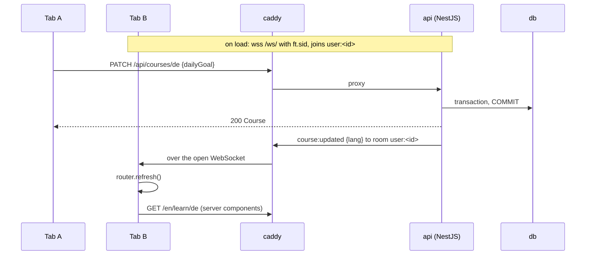
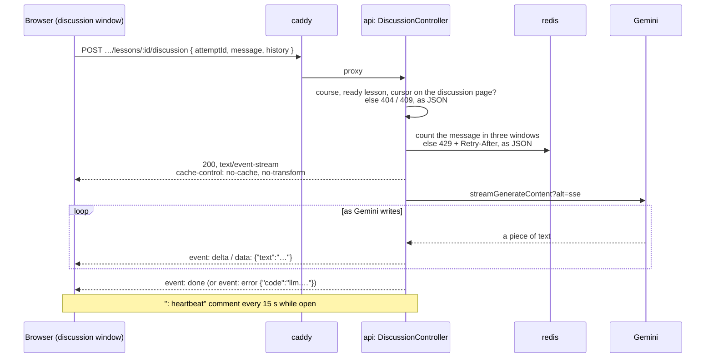

# REST, WebSocket and Server-Sent Events

The api talks to the browser in three ways. This page says which feature uses which, and why.

- **REST**: one request, one JSON answer. Almost everything.
- **WebSocket** (socket.io on `/ws`): the server pushes events to the browser, to several tabs and
  several users at once. Live course and friend updates, online status and direct messages.
- **Server-Sent Events** (SSE): one request, one answer sent in pieces as it is written. Only the
  lesson discussion.

[architecture/overview.md](overview.md) shows the containers and how Caddy routes `/api` and `/ws`.
[architecture/data-model.md](data-model.md) has the tables these routes and events write. The
socket contract is in
[packages/shared/src/events/socket.ts](../../packages/shared/src/events/socket.ts).

---

## 1. The split

| | Transport | Examples |
| --- | --- | --- |
| **Everything CRUD** | REST, Nest controllers, documented in Swagger | `POST /api/courses`, `GET /api/courses/:lang/today`, `GET /api/courses/:lang/lessons`, `GET` and `POST /api/courses/:lang/lessons/:id/attempt`, `POST …/attempt/pages/:index`, `GET /api/friends`, `GET /api/conversations` |
| **One answer, streamed** | Server-Sent Events on a `POST` | `POST /api/courses/:lang/lessons/:id/discussion`: `delta`, `done` or `error`, and a heartbeat |
| **Everything live** | socket.io on `/ws` | `course:updated`, `friend:request`, `friend:accepted`, `friend:removed`, `presence:update`, `dm:message`, `dm:unread` and `app:error` from the server; `dm:send` (with an ack) and `dm:read` from the browser |

### Why most of it is REST

Onboarding, today's lessons, starting a lesson, submitting a page, reading progress: each is one
question from one learner with one answer, so each is HTTP. A tutor that answers one learner is not
"real-time" in the sense the subject means; the module asks for _"real-time updates across
clients"_ and _"handle connection/disconnection gracefully"_, which is a multi-client claim.

### Why some of it is a socket

The socket has to earn its place on surfaces that really involve several clients. It does, on
three:

| Surface | Why it must be a socket | Serves module |
| --- | --- | --- |
| **Direct messages** between friends | Two clients, one conversation, sub-second echo, unread counts | Real-time (Major), User interaction (Major) |
| **Presence**, friends' online status | Server pushes state changes nobody polled for | User management (Major) |
| **Live course and friend updates** | A change in one tab shows in the account's other tabs, and on the friend's | Real-time (Major) |

Even there, reading stays on REST. A direct message is sent over the socket, but the conversation
list and the history are `GET /api/conversations` and `GET /api/conversations/:userId/messages`. A
`course:updated` or friend event carries no data: it tells the tab to read the page again.

### Why the discussion is SSE, not the socket

One learner, one request, one answer read as it is written: a `POST` whose response is
`text/event-stream`. It reuses the REST route's session cookie, guards, validation pipe and error
codes, every check that can fail answers with a status before the stream opens, and closing the
response cancels the Gemini call. A socket would add a second authentication, validation and error
path for a one-to-one exchange. The browser reads it with `fetch` and a stream reader, since
`EventSource` only sends `GET`.

### The API is language-neutral, and takes no score

**No read route takes a `locale` parameter.** A lesson is written in one language, the course's,
like a question in the bank, so the response is the same for every interface language. The web app
translates the page around the lesson. Two places use the interface locale on purpose:
`POST …/attempt { locale }` sends it to fix the attempt's mother tongue, and the discussion, whose
body carries no locale, reads the session user's `User.locale` and answers in it.

**No route takes a score.** The server runs every lesson attempt under
`/api/courses/:lang/lessons/:id/attempt`: it sends only the page the learner is on, checks every
answer, owns the exam timer, and when the last page locks it records the score from the answers it
stored ([content/lessons.md](../content/lessons.md) §10).

---

## 2. Through Caddy

Both Caddyfiles ([infra/caddy/Caddyfile](../../infra/caddy/Caddyfile) and
[infra/caddy/Caddyfile.prod](../../infra/caddy/Caddyfile.prod)) send `/api` and `/api/*`, and `/ws`
and `/ws/*`, to `api:3001`. There is no websocket directive: Caddy 2 detects the Upgrade handshake
inside `reverse_proxy`. The gateway has to be mounted on `/ws` rather than socket.io's default
`/socket.io`, or the request would fall through to `web`. Because the page, `/api` and `/ws` share
one origin, the session cookie is first-party and nothing needs CORS.

The SSE stream goes through the `/api` route like any other request.

---

## 3. The WebSocket gateway

The gateway is socket.io on `/ws`, inside the api and on its HTTP server
([apps/api/src/gateway/](../../apps/api/src/gateway/)). `SocketGateway` authenticates, screens every
inbound event and handles presence; `MessagesGateway`
([messages.gateway.ts](../../apps/api/src/messages/messages.gateway.ts)) handles `dm:send` and
`dm:read`. They share one server, so they share one options object, `GATEWAY_OPTIONS`: path `/ws`,
WebSocket transport only, frames capped at 16 KiB.

### Four rules

1. **Mount with `path`, not `namespace`.** `path` is the HTTP endpoint engine.io listens on;
   `namespace` is a logical channel multiplexed over it. The gateway is mounted with
   `path: '/ws'` and the client is `io({ path: '/ws' })`. Namespaces are for later, if two kinds of
   traffic ever need separating.
2. **Authenticate the handshake.** The same express-session middleware the REST side runs reads the
   signed session cookie, the Origin must be ours (same-site is not same-origin), and the socket
   gets `SocketData { userId, sessionId }`. An unauthenticated socket is refused at the handshake,
   never connected.
3. **Parse every inbound payload with the shared Zod schema** (`CLIENT_EVENT_SCHEMAS`). Anything
   arriving on a gateway is untrusted, including from our own client.
4. **Rate-limit per socket.** `@nestjs/throttler`'s guard is HTTP-only; socket events bypass it
   entirely ([product.md](product.md) §6).

### A live update, end to end

A goal or level change in one tab shows in the account's other open tabs. Finishing a lesson sends
the same event.

### The handshake

- **The cookie is the only credential.** engine.io answers `/ws` before Express does, so
  `SessionIoAdapter` hands it the same express-session middleware: same cookie, same store, nothing
  parsed by hand. A socket.io middleware then refuses a page of another origin, a session with no
  `userId` and a deleted account, all with `auth.sessionRequired`. The Origin check matters because
  `ft.sid` is `SameSite=Lax`, and same-site is not same-origin: a page on a sibling subdomain would
  send it too. The account check also reads `User.lastActiveDay`, and writes today's UTC date when
  it is not today: the first tab of the day writes, the others only read. Recently active on
  /friends lists who was active in the last 7 days, by name: polling it shows someone coming back
  after a week away, and nothing finer.
- **Refused quietly.** A refusal is a CONNECT_ERROR over a WebSocket that opened fine, which the
  browser does not log; an HTTP 401 on the upgrade would be a console error.
- **Rooms, never a broadcast.** Each socket joins `user:<id>` and `session:<sid>` before its
  CONNECT reply. `SocketsService.toUser()` is the only way to reach a user. Acks aside, the gateway
  writes to one socket only twice: to the socket that sent a bad event, and to a socket that just
  connected, with the presence of each friend and the unread counts (below).
- **Sockets close with their session**: on logout (that session's sockets only), on every session
  id change (signup, login, 2FA verify, 2FA enable and disable), and when a session ends any other
  way, through a sweep every 60 s that asks Redis for each open socket's `sess:<sid>` (known keys,
  never a scan). A handshake checks its session once more after joining its rooms, so a logout that
  ran while it was under way cannot miss it.

### Every inbound event

- **One screen for every inbound event**: 20 of each event name per 10 s per socket, frames capped
  at 16 KiB, one payload besides the ack, a zod parse from `CLIENT_EVENT_SCHEMAS`. Each name counts
  in its own window, and unknown names share one, so a burst of `dm:read` cannot use up the budget
  for `dm:send`. A refused event is dropped, never a crash, and its code is an `ERROR_CODES` entry:
  `server.rateLimited` past the limit, else the failed rule's own (`message.empty`,
  `message.tooLong`), else `request.invalid`. Sent with an ack, it gets `{ ok: false, code }` there,
  every time, since its caller is waiting on it. Without one it gets `app:error { code }`, and past
  the limit only the first of the window is told. A session holds at most 20 sockets, checked
  before the user write: one per tab is far below it, and a client opening sockets in a loop costs
  no query. More sockets still mean more events; what bounds the work they cause is the
  per-account budgets of `dm:send` and `dm:read` (below).
- **A catch-all filter for the handlers.** Global guards, pipes and filters never reach a gateway
  in Nest 11, which is why the screen validates and limits. What a handler throws goes to
  `SocketExceptionFilter`, declared with `@UseFilters` on each gateway that handles events: a
  service's coded `HttpException` keeps its code (`message.notFriends`), anything else is logged
  and answered `server.unexpected`, through the ack when there is one, else `app:error`.

### The events

- **Course updates, sent after the commit.** `course:updated { lang }` means "read this course
  again". It is sent by `CoursesService` after a goal or level change and by `AttemptsService` when
  an attempt closes. The page is rendered on the server, so the tab calls `router.refresh()` rather
  than keeping a second copy of the course. `RefreshOn` takes the list of events that refresh a
  page.
- **Friend events** (`friend:request`, `friend:accepted`, `friend:removed`) go to both users of the
  pair, so the actor's other tabs follow too. They carry `{ userId }`, the other user, and /friends,
  /users/[id] and /chat refresh on any of them. Decline and cancel send `friend:removed`: the row between
  the two is gone.
- **Presence** (`presence:update { userId, status, at }`, `online` or `offline`), in
  `PresenceService` ([apps/api/src/presence/](../../apps/api/src/presence/)):
  - **A counter per user** in Redis, `presence:<id>`: `INCR` when a socket opens, `DECR` when it
    closes. Online on the first socket.
  - **A 10 s grace period** (`PRESENCE_GRACE_MS`): a closed socket comes off the count only after
    it. A reload's new socket makes the count 2, not 1, so friends hear nothing. Offline goes out
    10 s after the _last_ close, and `isOnline` keeps saying online until then, so the REST routes
    agree with the friends already watching. The wait is unref'd: it never holds the process open
    on a stop.
  - **Friends only**: the updates go to the `user:<id>` room of each accepted friend
    (`friendIds()`, `status: 'accepted'`). Someone who has only sent a request hears nothing, as
    /privacy promises. The friends are looked up again at offline time, since a friendship may have
    begun or ended since.
  - **A snapshot on connect**: the new socket, and only it, gets one `presence:update` per friend,
    because the page may have been rendered a moment before one of them came or went.
    `GET /api/friends` gives each friend `online`, from `isOnline(ids)` (one `MGET`).
  - **In the tab**: `tab-socket.ts` keeps a presence map for as long as the socket. It is fed by
    the snapshot and every `presence:update`. A friend is dropped on `friend:removed`, and on
    `friend:accepted` too, so a new friend starts from the refreshed render: no update comes for
    someone already online. Each connect clears the map, since its snapshot replaces it, and an
    entry left by an event missed while away cannot outlive a fresh render. `PresenceDot` reads it
    and uses the rendered `online` only for a friend the tab has heard nothing about. A page Next
    restores from its client cache on Back still shows what happened while it was away.
  - **A boot reset**: no socket survives a restart, but Redis keeps the counts a crash never took
    back, so `onApplicationBootstrap` deletes every `presence:*` key (`SCAN`, never `KEYS`). A count
    that still goes below zero is put back to zero.
- **Direct messages** between friends (`dm:send`, `dm:message`, `dm:unread`, `dm:read`), in
  `MessagesService` ([apps/api/src/messages/](../../apps/api/src/messages/)). In every payload
  `userId` is the other person of the conversation, as in a friend event:
  - **Sent over the socket, read over REST.** `dm:send { userId, text }` comes with an ack. Only
    accepted friends may send (`areFriends()`), so a pending request, or yourself, gets
    `message.notFriends`. An account may send 30 a minute across all its sockets, counted in the
    HTTP throttler's storage; past that the ack answers `server.rateLimited`. The conversation
    upsert and the message insert are one transaction; then `dm:message { userId, message }` goes
    to both rooms, the sending tab's included, and the ack answers `{ ok: true, data: message }`.
    The thread dedupes by id. `GET /api/conversations` lists the conversations, latest first, with
    their unread counts, and `GET /api/conversations/:userId/messages?cursor=` pages the history, 50
    at a time on `(createdAt, id)`. Reading needs no friendship: the history stays readable by both
    after unfriending.
  - **Unread counts are snapshots.** `dm:unread { counts, at }` holds the count of every conversation
    with unread messages, keyed by the other user (one with none is left out): always the whole
    picture, never a change to apply. It goes to the recipient after each message,
    without holding up the ack (a failure is logged); to the reader after each `dm:read`, changed
    or not, so a read always converges; and to each new socket after the presence snapshot, empty
    included, so the tab can tell "nothing unread" from "not heard yet". `at` is taken before the
    count, so of two snapshots that cross (a read and a new message at once) the later stamp
    counted every write the other saw: the tab keeps the latest `at`, whatever order they land in.
  - **`dm:read { userId }`** sets `readAt` on what that user sent you. No ack: the answer is the
    snapshot, to every tab of the reader. The open thread sends it while the tab is visible and
    connected and the conversation has unread messages, and each snapshot re-arms it. An account
    may read 100 a minute across all its sockets, what an HTTP route allows
    (`RATE_LIMIT_PER_MINUTE`), since each read costs two queries and a snapshot to every tab; past
    that it gets `app:error` with `server.rateLimited`, and the counts stay until the next
    snapshot. `readAt` never leaves the server. The index on `(pairKey, readAt)` keeps the counts
    and a read at the cost of what is unread, not of the whole history.
  - **In the tab**: `tab-socket.ts` keeps the last snapshot for as long as the socket, like the
    presence map, and drops it on sign-out. The badge on the header menu's button and on its Messages
    link shows its total (#220), 99+ past 99, and nothing before the first snapshot. `sendMessage()` refuses at once with
    `network.unreachable` when not connected: socket.io would buffer the event and deliver it long
    after the thread said it failed. A lost ack (10 s, or the socket closing) says the same, though
    the message may have been stored: sending it again can then show it twice, accepted, as nothing
    tells two sends of the same text apart.
  - **Catching up after a reconnect**: events sent while away are lost, so the open thread fetches
    the newest page on every connect, the first included, and merges it by id. When that page does
    not meet what the thread holds, more than a page came meanwhile, and the thread starts again
    from it. The connect snapshot puts the counts right.

### One API instance

Rooms live in the memory of the process holding the socket, so `toUser()` reaches only that
process's sockets: with two `api` replicas, a message sent through one would miss a friend
connected to the other. Several replicas would need `@socket.io/redis-adapter`, which carries room
emits through Redis (`InterServerEvents` waits for it), and a presence boot reset that leaves the
other instances' counts alone. The api runs one replica by design ([product.md](product.md) §4).

### The browser side

- **One connection per tab**, held in module scope
  ([apps/web/components/tab-socket.ts](../../apps/web/components/tab-socket.ts)) and opened by
  `SessionNav` for a signed-in user, so a route group remount or a locale switch never drops it and
  an anonymous page never opens one. WebSocket transport only: a long poll keeps a request open,
  and a polled 502 is a console error.
- **Reconnecting without console noise.** A failed WebSocket dial is a console error no code can
  hide, so each retry (1, 2, 4, 8, then every 10 s, jittered) first asks `/healthz/api`, a web route
  that always answers 200, and dials only once the api answers
  ([apps/web/lib/reconnect.ts](../../apps/web/lib/reconnect.ts)). "Reconnecting…" shows meanwhile,
  and coming back refreshes the page, since events sent while away are lost.
- **What the probe cannot hide**: the api dying between a probe and the dial (one line), and the
  probe's own failure when web restarts too or the laptop goes offline.
- **In dev**, every save in `apps/api` restarts the process, so sockets drop and the badge flashes;
  Fast Refresh of `tab-socket.ts` leaves the old socket open until a reload.
- **No CSP today.** If one is added, `connect-src 'self'` covers same-origin `wss:` in current
  engines.

---

## 4. The lesson discussion stream

The route is `DiscussionController`
([discussion.controller.ts](../../apps/api/src/lessons/discussion.controller.ts)), in its own
controller because it answers with a stream of events on one HTTP response rather than one JSON
reply. [content/lessons.md](../content/lessons.md) §12 explains what the tutor knows and what the
discussion page shows.

- **Two halves, because of HTTP.** `DiscussionService.open()` runs every check that can still
  answer with a status, then `countMessage()` the rate limits. Only then does `openEventStream()`
  ([event-stream.ts](../../apps/api/src/lessons/event-stream.ts)) send the 200 and its headers.
  After that a failure can only be an event: `error { code }`, with an `llm.*` code from the
  `LlmError`'s reason (`llm.unavailable`, `llm.rateLimited`, `llm.blocked`, `llm.incomplete`,
  `llm.disabled`), or `unknown` for a bug.
- **Cancelled with the page.** When the browser closes the response, an `AbortSignal` cancels the
  Gemini call, also when it left during the checks. Stop in the window does the same.
- **Stateless.** The body carries the last 10 turns; the server builds the system prompt from the
  lesson's brief and the attempt's wrong practice answers (`discussion-prompt.ts`) and stores
  nothing.
- **The browser** reads it with `fetch` and a stream reader
  ([apps/web/lib/discussion-client.ts](../../apps/web/lib/discussion-client.ts)), since
  `EventSource` only sends `GET`. A refusal before the stream arrives as the usual JSON error, with
  `retryAfter` on a 429.

### SSE through Caddy, and the `encode` exclusion

Caddy compresses every route (`encode zstd gzip` in both Caddyfiles). A compressor holds bytes back
until it has enough to compress, which would turn a stream of small `delta` events into a few late
bursts. Issue #150 planned to exclude `text/event-stream` from `encode` if that happened. **The
Caddyfiles carry no exclusion**: the API marks the stream `Cache-Control: no-cache, no-transform`,
and Caddy's `encode` leaves a `no-transform` response uncompressed, while `reverse_proxy` flushes an
event stream as it comes. Checked by hand through Caddy against Gemini in PR #201: the pieces arrive
one by one. The heartbeat keeps any proxy on the way from closing a quiet stream. If a future Caddy
version changes either behaviour, the fix is a matcher on the `encode` directive, not a change in
the API.
