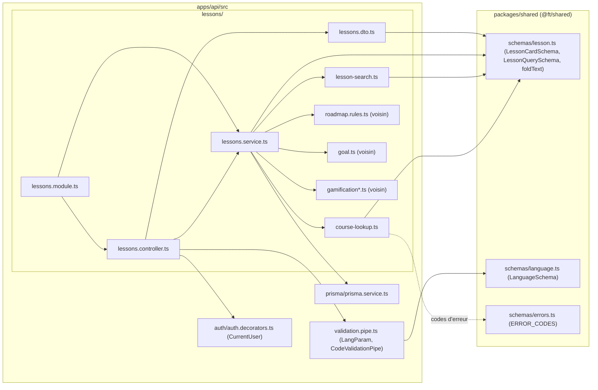
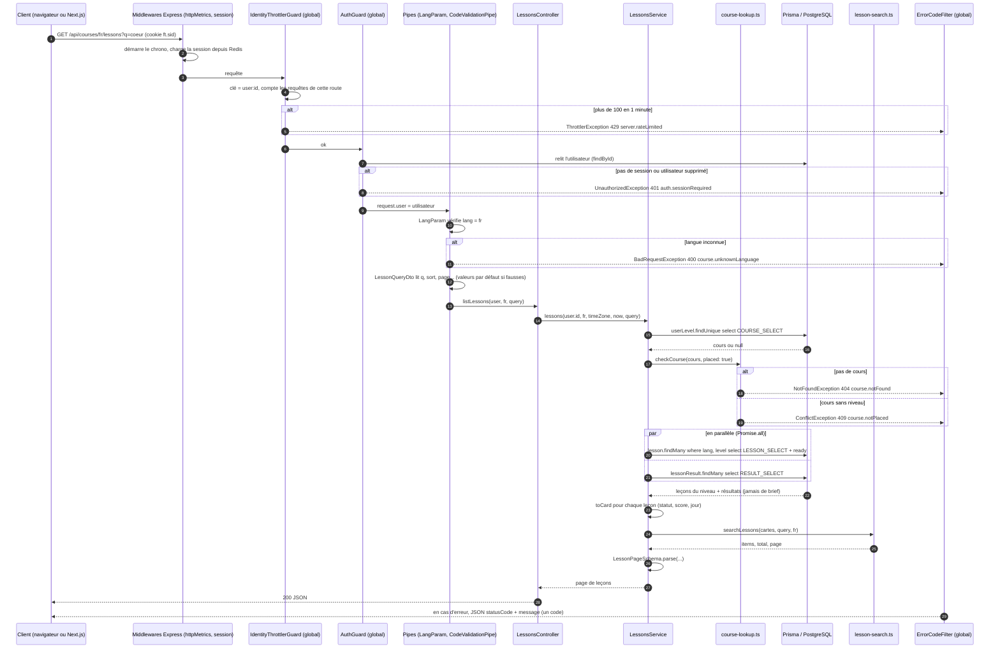
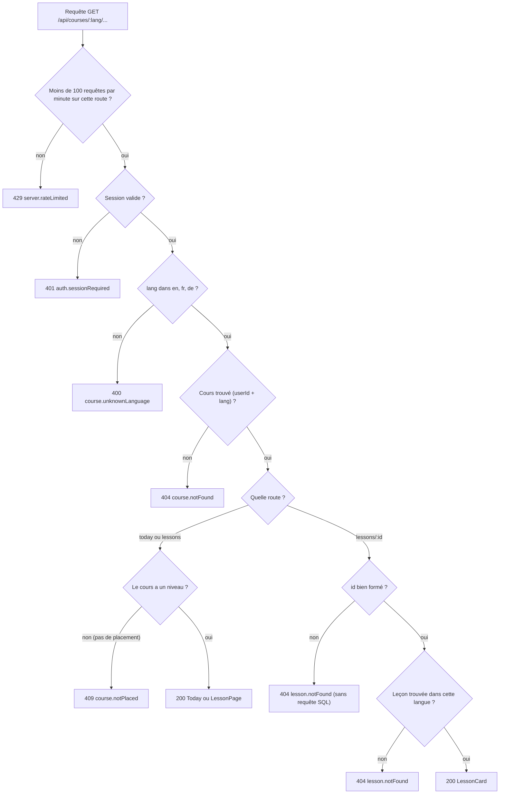
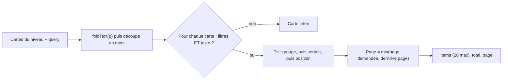
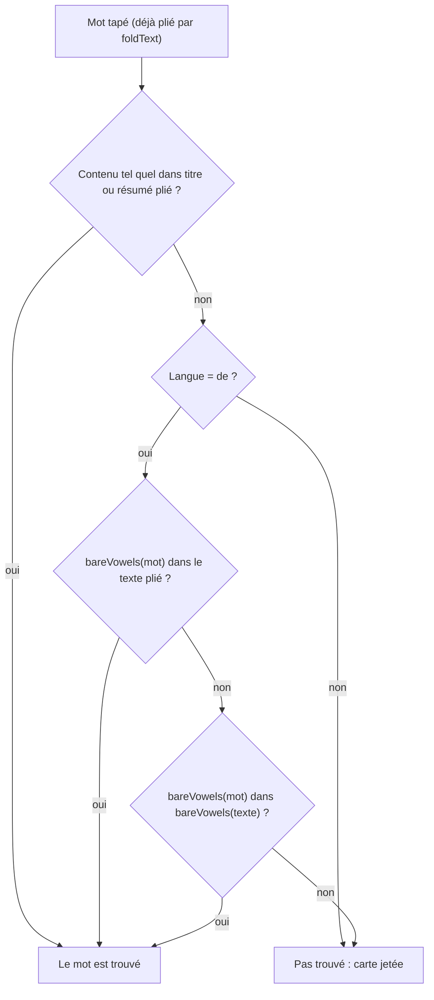

# API des leçons (`apps/api/src/lessons/`)

> PR concernées : **#128** (today, liste, détail, recherche) et **#178** (outil `lessons:author`, dont deux tests vivent dans ce dossier).
> Pour le chemin complet d'une requête (throttler, pipe, filtre), lis aussi [request-lifecycle.md](request-lifecycle.md).

## 1. À quoi sert ce module

Un apprenant a **un cours par langue** (table `UserLevel`). Chaque cours a un **niveau** (A1 … C2), fixé par le test de placement.

Ce module répond à trois questions du front :

1. **« Qu'est-ce que je fais aujourd'hui ? »** → `GET /api/courses/:lang/today`
2. **« Montre-moi toutes les leçons de mon niveau, avec recherche, filtres, tri et pages »** → `GET /api/courses/:lang/lessons`
3. **« Montre-moi une seule leçon »** → `GET /api/courses/:lang/lessons/:id`

Deux règles importantes :

- **Le `brief` ne sort jamais de la base.** Le `brief` est une colonne de `Lesson` qui contient tout le contenu de la leçon. Ces routes ne doivent pas l'envoyer. Chaque requête Prisma a donc un **`select` explicite** (la liste exacte des colonnes à lire).
- **Les erreurs sont des codes, pas des phrases.** Pas de cours → `404 course.notFound`. Cours sans niveau (avant le placement) → `409 course.notPlaced`.

### Mots techniques utilisés ici

| Mot | Explication simple |
|---|---|
| **Controller** | La classe qui reçoit la requête HTTP. Elle dit « telle URL appelle telle méthode ». Ici elle ne calcule rien : elle passe la main au service. |
| **Service** | La classe qui fait le vrai travail (lire la base, calculer). Nest la crée et la donne au controller (injection de dépendances). |
| **Module** | La boîte Nest qui déclare « ces controllers + ces services vont ensemble ». |
| **DTO** (Data Transfer Object) | La forme des données qui entrent ou sortent. Ici, une classe fabriquée à partir d'un schéma Zod de `@ft/shared`. |
| **Pipe** | Un contrôleur de douane : il vérifie (et peut transformer) un paramètre **avant** que la méthode du controller le reçoive. |
| **Guard** | Un vigile : il décide si la requête a le droit de passer (session valide ? trop de requêtes ?). |
| **Filtre d'exception** | Le service après-vente : il attrape une erreur et fabrique la réponse JSON d'erreur. |
| **Prisma** | L'ORM : il traduit `prisma.lesson.findMany(...)` en SQL pour PostgreSQL. |
| **`select`** | La « liste de courses » donnée à Prisma : « lis seulement ces colonnes ». Une colonne non demandée ne peut pas fuiter. |
| **Zod** | Une bibliothèque de schémas : elle vérifie qu'un objet a la bonne forme (`.parse()` lance une erreur sinon). |

## 2. Les fichiers

### Ce que j'ai écrit (ou co-écrit)

| Fichier | Rôle |
|---|---|
| [lessons.controller.ts](../../../apps/api/src/lessons/lessons.controller.ts) | Les routes `today`, `lessons`, `lessons/:id`. Chaque méthode fait une ligne : elle appelle le service. Elle crée `new Date()` une fois par requête, pour que le service reçoive l'heure en paramètre (plus facile à tester). |
| [lessons.service.ts](../../../apps/api/src/lessons/lessons.service.ts) | `LessonsService` : lit le cours, les leçons du niveau, les résultats, et construit les réponses. Définit `COURSE_SELECT` et `RESULT_SELECT`. Chaque réponse est validée par son schéma partagé (`TodaySchema`, `LessonPageSchema`, `LessonCardSchema`) avant de partir. |
| [lesson-search.ts](../../../apps/api/src/lessons/lesson-search.ts) | `searchLessons` (garder → trier → couper en pages) et `bareVowels` (astuce allemande `ae`/`oe`/`ue`). Fonctions pures, sans base de données. |
| [course-lookup.ts](../../../apps/api/src/lessons/course-lookup.ts) | `checkCourse` (404 / 409), `findLesson` (404 `lesson.notFound`), et `LESSON_SELECT` (les colonnes d'une carte de leçon, sans `brief`). Fonctions simples, réutilisées par d'autres fichiers. |
| [lessons.dto.ts](../../../apps/api/src/lessons/lessons.dto.ts) | Les DTO créés avec `createZodDto(...)`. `LessonQueryDto` valide les paramètres `?q=…&sort=…`. Les autres documentent les réponses dans Swagger (`/api/docs`). |
| [lessons.module.ts](../../../apps/api/src/lessons/lessons.module.ts) | Déclare `LessonsController`, `AttemptsController`, `LessonsService`, `AttemptsService`. Exporte `LessonsService`. |
| [lesson-search.spec.ts](../../../apps/api/src/lessons/lesson-search.spec.ts) | Tests unitaires de la recherche : texte, accents, allemand, filtres, tri, groupes, pages. |
| [course-lookup.spec.ts](../../../apps/api/src/lessons/course-lookup.spec.ts) | Tests de `checkCourse` et `findLesson` (avec un faux client Prisma). |
| [lesson-complete.spec.ts](../../../apps/api/src/lessons/lesson-complete.spec.ts), [lesson-edits.spec.ts](../../../apps/api/src/lessons/lesson-edits.spec.ts) | (#178) Ils testent l'outil `scripts/lessons/` (`lessons:author`), pas les routes HTTP. Ils sont rangés ici car ils parlent de leçons. |
| [lessons.e2e-spec.ts](../../../apps/api/test/lessons.e2e-spec.ts) | Test de bout en bout : vraie app Nest, vraie base, requêtes HTTP avec Supertest. Vérifie 401, 400, 404, 409, 200, et que le `brief` n'apparaît jamais (un marqueur `brief-secret-marker` est cherché dans les réponses). |

### Les voisins (pas écrits par moi)

| Fichier | Auteur / PR | Lien avec mon code |
|---|---|---|
| [roadmap.rules.ts](../../../apps/api/src/lessons/roadmap.rules.ts) | ninisse (#80) | `plan`, `levelProgress`, `courseDay`, `statusOf`… : les règles que `today` appelle. |
| [goal.ts](../../../apps/api/src/lessons/goal.ts) et `applyFinish` dans `lessons.service.ts` | luca-mattei (#141) | La fin de leçon et l'objectif quotidien. Ils réutilisent `checkCourse` et `findLesson`. |
| [gamification.ts](../../../apps/api/src/lessons/gamification.ts), [gamification.rules.ts](../../../apps/api/src/lessons/gamification.rules.ts), route `GET achievements` | #95 / #180 | XP, rang, défi, succès. Ajoutés ensuite dans `today` (`xp`, `challenge`, `earnedToday`). |
| [attempts.controller.ts](../../../apps/api/src/lessons/attempts.controller.ts) | ninisse (#145) | Le lecteur de leçon (tentatives), sous le même préfixe `courses/:lang`. |
| Champ `ready` et option `readyOnly` | bastian-schnitzler (#84) | Une leçon pas encore prête est listée mais jamais proposée. |

### Diagramme des fichiers et de leurs dépendances



## 3. Les routes HTTP

Le préfixe global est `api` (posé dans [app.setup.ts](../../../apps/api/src/app.setup.ts)), donc l'URL réelle commence par `/api`.
`:lang` vaut `en`, `fr` ou `de` (`LEARNABLE_LANGUAGES`). Toutes les routes demandent une session (cookie `ft.sid`).

### Erreurs communes aux trois routes

| Statut | `message` | Quand |
|---|---|---|
| 401 | `"auth.sessionRequired"` | Pas de session (le `AuthGuard` global refuse). |
| 400 | `["course.unknownLanguage"]` | `:lang` n'est pas `en`/`fr`/`de` (le pipe `LangParam` refuse). C'est un **tableau**, car le pipe renvoie toujours une liste de codes. |
| 404 | `"course.notFound"` | L'utilisateur n'a pas de cours dans cette langue. |
| 429 | `"server.rateLimited"` | Plus de 100 requêtes par minute sur cette route pour ce compte (voir [../throttler/README.md](../throttler/README.md)). |

### `GET /api/courses/:lang/today`

- **Paramètres** : `lang` (chemin).
- **Réponses** : `200` (`TodaySchema`), `401`, `400`, `404`, **`409 course.notPlaced`** (cours sans niveau).
- **Contenu** : le jour du cours, l'objectif (`target`), les leçons faites (`done`), proposées (`proposed`) et en plus (`extra`), la série de jours (`streak`), la progression dans le niveau, le niveau suivant, puis l'XP, le défi et les succès du jour (ajoutés par la gamification, #95).

Exemple (raccourci) :

```json
{
  "day": "2026-11-15",
  "target": 3,
  "met": false,
  "done": [
    {
      "id": "fr-greetings-and-goodbyes", "level": "A1", "position": 1,
      "kind": "functions", "topic": null, "theme": "daily_life",
      "title": "Bonjour, au revoir", "summary": "Saluer et prendre congé.",
      "status": "done", "score": 85, "day": "2026-11-15",
      "finishedAt": "2026-11-15T08:12:00.000Z"
    }
  ],
  "proposed": [],
  "extra": [],
  "streak": { "current": 4, "best": 9, "today": false },
  "progress": { "total": 120, "attempted": 12, "passed": 10, "needed": 96, "comingSoon": 0, "complete": false },
  "levelAfter": "A2",
  "xp": { "total": 340, "rank": 2, "rankStart": 300, "nextRankAt": 600 },
  "challenge": { "code": "vocabulary", "done": false },
  "earnedToday": []
}
```

> Les valeurs sont inventées pour l'exemple. La **forme** est celle de `TodaySchema` ([packages/shared/src/schemas/lesson.ts](../../../packages/shared/src/schemas/lesson.ts)).

### `GET /api/courses/:lang/lessons`

- **Paramètres** : `lang` (chemin) + paramètres de recherche (query string), tous facultatifs :

| Paramètre | Valeurs | Défaut | Si la valeur est fausse |
|---|---|---|---|
| `q` | texte libre (coupé à 100 caractères) | `''` | `''` |
| `status` | liste `todo,done,failed` | `[]` (pas de filtre) | valeurs inconnues ignorées |
| `kind` | liste `grammar,vocabulary,functions,reading` | `[]` | ignorées |
| `topic`, `theme` | listes | `[]` | ignorées |
| `sort` | `position`, `score`, `finishedAt` | `position` | `position` |
| `dir` | `asc`, `desc` | `asc` | `asc` |
| `group` | `none`, `status`, `day`, `kind` | `none` | `none` |
| `page` | entier ≥ 1 (chiffres seulement) | `1` | `1` |

  Chaque champ de `LessonQuerySchema` a un `.catch(...)` : **une URL mal écrite ne donne jamais 400**, elle retombe sur la valeur par défaut.
- **Réponses** : `200` (`LessonPageSchema`), `401`, `400` (langue), `404`, **`409 course.notPlaced`**.

Exemple pour `GET /api/courses/fr/lessons?q=coeur&page=1` :

```json
{
  "day": "2026-11-15",
  "levelTotal": 120,
  "items": [
    {
      "id": "fr-le-coeur", "level": "A1", "position": 7,
      "kind": "vocabulary", "topic": null, "theme": "health",
      "title": "Le cœur", "summary": "…",
      "status": "todo", "score": null, "day": null, "finishedAt": null
    }
  ],
  "total": 1,
  "page": 1,
  "pageSize": 20
}
```

> `id`, `theme` et `title` sont inventés. `levelTotal` = toutes les leçons du niveau, `total` = celles qui passent les filtres, `pageSize` = `LESSONS_PAGE_SIZE` = 20.

### `GET /api/courses/:lang/lessons/:id`

- **Paramètres** : `lang`, `id` (ex. `fr-verb-etre-present`).
- **Pas de 409 ici** : on peut ouvrir une leçon même avant le placement.
- **Réponses** : `200` (`LessonCardSchema`), `401`, `400` (langue), `404 course.notFound` (pas de cours), `404 lesson.notFound` (id inconnu, mal formé, ou leçon d'une autre langue).

Exemple (tiré du test e2e, avant placement) :

```json
{
  "id": "fr-test-alpha", "level": "A1", "position": 9001,
  "kind": "grammar", "topic": "nouns_and_determiners", "theme": null,
  "title": "Le cœur du testeur", "summary": "Une leçon de test.",
  "status": "todo", "score": null, "day": null, "finishedAt": null
}
```

> La route `GET /api/courses/:lang/achievements` est dans le même controller, mais elle vient de la gamification (#95), pas de moi.

## 4. Diagrammes

### 4.1 Chemin complet d'une requête `GET /api/courses/fr/lessons?q=coeur`



### 4.2 Les décisions (quel statut sort ?)



### 4.3 La recherche `searchLessons` (garder, trier, couper)



Pour le texte, chaque mot tapé doit se trouver dans le titre **ou** le résumé (après `foldText`). En allemand seulement, on essaie aussi `bareVowels`.



## 5. Les points clés du code, expliqués

### 5.1 Le `select` explicite (pourquoi le brief ne sort jamais)

Sans `select`, Prisma lit **toutes** les colonnes. La table `Lesson` a une colonne `brief` (le contenu complet). On donne donc toujours une liste :

```ts
// course-lookup.ts
export const LESSON_SELECT = {
  id: true, level: true, position: true, kind: true,
  topic: true, theme: true, title: true, summary: true,
} as const;
```

- `as const` dit à TypeScript que les valeurs sont exactement `true`. Grâce à ça, `Prisma.LessonGetPayload<{ select: typeof LESSON_SELECT }>` calcule le type exact de la ligne (`LessonRow`).
- `COURSE_SELECT` et `RESULT_SELECT` (dans le service) font pareil pour `UserLevel` et `LessonResult`. `RESULT_SELECT` lit aussi la leçon liée… mais via `LESSON_SELECT`, donc toujours sans `brief`.
- **Deuxième ceinture de sécurité** : `LessonCardSchema` est un `z.strictObject`. Si un champ en trop (comme `brief`) arrivait, `.parse()` échouerait (500) au lieu de l'envoyer.
- Le test e2e met un marqueur `brief-secret-marker` dans un brief et vérifie qu'il n'apparaît dans aucune réponse.

### 5.2 `checkCourse` et `findLesson` (course-lookup.ts)

- Ce sont des **fonctions simples**, pas un service. Raison : la fin de leçon (#141) les appelle à l'intérieur d'une transaction, avec son `tx`. Une fonction qui reçoit le client Prisma en paramètre marche avec `this.prisma` et avec `tx`.
- `checkCourse(row, { placed: true })` : `null` → 404 `course.notFound`. `level === null` → 409 `course.notPlaced`. Les **surcharges TypeScript** (les deux premières signatures) disent : avec `placed: true`, le `level` renvoyé n'est jamais `null`.
- `findLesson(db, lang, id)` : vérifie d'abord le format de l'id avec `LessonIdSchema.safeParse`. Mal formé → 404 **sans requête SQL**. Sinon `findFirst({ where: { id, lang }, select: LESSON_SELECT })`. Pas trouvé → 404 `lesson.notFound`.
- **Ordre** : on appelle `checkCourse` avant `findLesson`. Sans cours, la réponse doit être `course.notFound`, pas `lesson.notFound`.
- **Pourquoi 404 et pas 400 pour un id mal formé ?** Le front affiche un 404 comme « pas là », un 400 comme une erreur.

### 5.3 404 ou 409 ?

- **404 Not Found** : la ressource n'existe pas (pas de cours dans cette langue).
- **409 Conflict** : la ressource existe, mais son **état** empêche l'action (le cours existe, mais n'a pas encore de niveau). Sans niveau, on ne sait pas quelles leçons montrer.
- `lessons/:id` n'exige pas de niveau : on peut ouvrir une leçon isolée avant le placement.

### 5.4 La recherche insensible aux accents

`foldText` vient de `@ft/shared` ([lesson.ts](../../../packages/shared/src/schemas/lesson.ts)) :

```ts
s.normalize('NFC').toLowerCase()
 .replace(/[ßœæ]/g, …)   // ß → ss, œ → oe, æ → ae
 .normalize('NFD')        // "é" devient "e" + accent séparé
 .replace(/\p{M}/gu, '')  // on supprime les accents séparés
```

- **NFD** (normalisation Unicode « décomposée ») coupe une lettre accentuée en lettre de base + signe diacritique. `\p{M}` = « tous les signes diacritiques ». On les retire.
- `ß`, `œ`, `æ` ne se décomposent pas : on les remplace à la main.
- Résultat : `"Éléphant"` → `"elephant"`, `"Mädchen"` → `"madchen"`, `"cœur"` → `"coeur"`.

`bareVowels` (allemand seulement) : `text.replace(/([aou])e/g, '$1')`. Quelqu'un sans clavier allemand tape `maedchen` pour `Mädchen`. `bareVowels("maedchen")` = `"madchen"` → trouvé.
Pas en français : `coeur` deviendrait `cour`, un autre mot.

### 5.5 Tri et pages

- Trois règles enchaînées avec `||` : le **groupe**, puis le **tri** choisi, puis la **position**. `0` (égalité) vaut `false`, donc `||` passe à la règle suivante.
- `nullsLast` : une leçon jamais commencée (score `null`) est toujours à la fin, en ordre croissant **et** décroissant.
- Page trop grande (`page=99`) → on renvoie la dernière page. Zéro résultat → page 1 vide.
- `.sort()` est appelé sur le tableau renvoyé par `.filter()` (une copie) : l'entrée n'est pas modifiée (un test le vérifie).

### 5.6 Pourquoi `new Date()` dans le controller ?

Le service reçoit l'heure en paramètre. Un test peut donc lui donner n'importe quelle date. Le jour du cours est calculé dans le **fuseau horaire de l'utilisateur** (`user.timeZone`), et jamais avant le dernier jour connu (`latestDay`) : quelqu'un qui voyage vers l'ouest ne revient pas à un jour déjà fini.

### 5.7 `Promise.all`

Dans `load()`, la lecture des leçons et celle des résultats ne dépendent pas l'une de l'autre. `Promise.all` les lance **en même temps** : moins d'attente.

## 6. Que se passe-t-il concrètement ?

Scénario : Alice est connectée, elle a un cours de français au niveau A1. Le front appelle :

```
GET /api/courses/fr/lessons?q=Coeur&sort=score&page=0
Cookie: ft.sid=...
```

1. **Middlewares Express.** `httpMetrics` démarre un chrono (pour Prometheus). `express-session` lit le cookie `ft.sid` et charge la session depuis Redis : `req.session.userId = "alice-id"`.
2. **`IdentityThrottlerGuard`.** Alice a un `userId`, donc la clé est `user:alice-id` (pas son IP). C'est sa 3ᵉ requête de la minute sur cette route : limite 100, ça passe.
3. **`AuthGuard`.** La route n'est pas `@Public()`. Il relit Alice en base (`findById`). Elle existe : `request.user = { id, timeZone: "Europe/Paris", … }`.
4. **Pipes.** `LangParam` vérifie `"fr"` avec `LanguageSchema` : OK. Le pipe global `CodeValidationPipe` valide `@Query()` avec `LessonQueryDto` : `q` devient `"Coeur"`, `sort` = `"score"`, `page=0` est invalide (minimum 1) → `.catch(1)` le remplace par `1`. Pas de 400.
5. **Controller.** `listLessons` appelle `this.lessons.lessons("alice-id", "fr", "Europe/Paris", new Date(), query)`.
6. **Service, `load()`.**
   - `userLevel.findUnique({ where: { userId_lang }, select: COURSE_SELECT })` → `{ id: "c1", level: "A1", … }`.
   - `checkCourse(..., { placed: true })` : il y a un cours et un niveau → on continue.
   - En parallèle : les 120 leçons `fr` A1 (avec `LESSON_SELECT` + `ready`) et tous les résultats du cours (`RESULT_SELECT`).
   - Calcul du jour du cours dans le fuseau d'Alice.
7. **Cartes.** Chaque leçon devient une carte : avec un résultat, statut `done` (score ≥ 70) ou `failed`. Sans résultat, `todo` avec `score/day/finishedAt` à `null`.
8. **`searchLessons`.** `foldText("Coeur")` = `"coeur"`. On garde les cartes dont le titre ou le résumé plié contient `"coeur"` (ex. « Le cœur » → `"le coeur"`). Tri par score croissant, `null` à la fin, égalités départagées par la position. Page 1 : les 20 premières.
9. **Validation de sortie.** `LessonPageSchema.parse(...)`. Chaque carte est un objet strict : pas de `brief` possible.
10. **Réponse.** `200` avec `{ day, levelTotal: 120, items, total, page: 1, pageSize: 20 }`. `httpMetrics` arrête le chrono quand la réponse est fermée.

Variante : Bob a un cours de français, mais n'a pas fait le placement. Étape 6 : `level === null` → `checkCourse` lance `ConflictException('course.notPlaced')`. Le filtre global voit un code valide et laisse Nest répondre :

```json
{ "statusCode": 409, "message": "course.notPlaced", "error": "Conflict" }
```

## 7. Les tests

| Test | Ce qu'il prouve |
|---|---|
| `lesson-search.spec.ts` | `CAFE` trouve « Au café » ; `coeur` trouve « Le cœur » mais jamais « La cour » ; `maedchen` trouve « Das Mädchen » en allemand seulement ; tous les mots doivent être trouvés ; filtres combinés ; tri avec `null` à la fin ; `page=99` → dernière page. |
| `course-lookup.spec.ts` | 404 / 409 de `checkCourse` ; `findLesson` cherche dans la bonne langue avec `LESSON_SELECT` ; un id mal formé ne touche pas la base (`findFirst` jamais appelé). |
| `lessons.e2e-spec.ts` | 401 anonyme ; 400 pour `klingon` ; 404 sans cours allemand ; 409 avant placement ; une leçon s'ouvre quand même avant placement ; recherche, filtres, tri, pages par HTTP ; on ne voit jamais les résultats des autres ; après passage en A2, seules les leçons A2 sont listées ; **jamais de brief** ; Swagger documente les routes. |

Commandes (scripts de `apps/api/package.json`) : `pnpm --filter @ft/api test` pour les tests unitaires, `pnpm --filter @ft/api test:e2e` pour les e2e (base de données nécessaire).

## 8. Questions possibles à l'oral

**Q : Pourquoi un `select` sur chaque requête Prisma ?**
R : Sans `select`, Prisma lit toutes les colonnes, dont `brief` (le contenu complet de la leçon). Avec une liste explicite, une colonne non demandée ne peut pas fuiter. En plus, `LessonCardSchema` est strict : un champ en trop ferait échouer la réponse.

**Q : Quelle différence entre 404 et 409 ici ?**
R : 404 = pas de cours dans cette langue. 409 = le cours existe mais n'a pas de niveau (placement pas fait), donc on ne sait pas quelles leçons montrer.

**Q : Pourquoi `lessons/:id` ne renvoie jamais 409 ?**
R : Une leçon isolée peut être ouverte avant le placement. On appelle `checkCourse` sans `placed: true`.

**Q : Comment marche la recherche sans accents ?**
R : `foldText` met en minuscules, remplace `ß/œ/æ`, puis normalise en NFD (la lettre et l'accent sont séparés) et supprime les accents avec `\p{M}`. On plie le texte tapé et le titre/résumé de la même façon, puis on fait un `includes`.

**Q : C'est quoi `bareVowels` et pourquoi seulement en allemand ?**
R : Elle enlève le `e` après `a/o/u` : `maedchen` → `madchen`, pour trouver `Mädchen`. En français, `coeur` deviendrait `cour`, un autre mot.

**Q : Pourquoi la recherche se fait en JavaScript et pas en SQL ?**
R : Un niveau a au plus 320 leçons, déjà chargées pour calculer les statuts. Filtrer en mémoire permet d'utiliser exactement le même `foldText` que le reste du projet. *(C'est mon interprétation du code : il charge toutes les leçons du niveau puis appelle `searchLessons`.)*

**Q : Que se passe-t-il avec `?page=0&sort=foo` ?**
R : Rien de grave : chaque champ de `LessonQuerySchema` a un `.catch(...)`. `page` retombe à 1, `sort` à `position`. Jamais de 400.

**Q : Pourquoi `checkCourse` et `findLesson` sont des fonctions et pas des méthodes de service ?**
R : La fin de leçon les appelle dans une transaction avec `tx`. Une fonction qui reçoit le client Prisma en paramètre marche avec les deux.

**Q : Pourquoi `checkCourse` avant `findLesson` ?**
R : Sans cours, la bonne réponse est `course.notFound`. Si on cherchait la leçon d'abord, on pourrait répondre `lesson.notFound`.

**Q : Le controller fait quoi exactement ?**
R : Il lie une URL à une méthode, récupère l'utilisateur (`@CurrentUser`), la langue validée (`LangParam`) et les paramètres (`LessonQueryDto`), puis appelle le service. Il ne contient pas de logique.

**Q : Pourquoi valider la réponse avec Zod avant de l'envoyer ?**
R : Pour garantir que le front reçoit exactement la forme promise. Une carte invalide = donnée corrompue = 500 visible dans les logs, plutôt qu'une réponse fausse cachée.

**Q : Qu'est-ce que tu n'as pas écrit dans ce dossier ?**
R : Les règles de la feuille de route (`roadmap.rules.ts`), la fin de leçon et l'objectif (`goal.ts`, `applyFinish`, #141), la gamification (#95) et les tentatives (`attempts.*`, #145).
