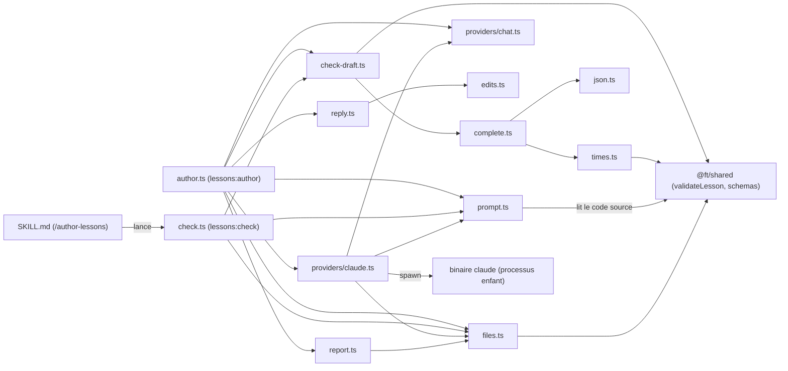
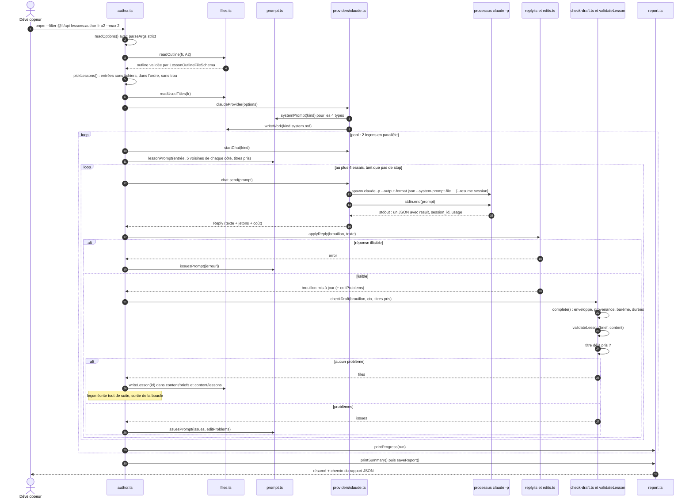
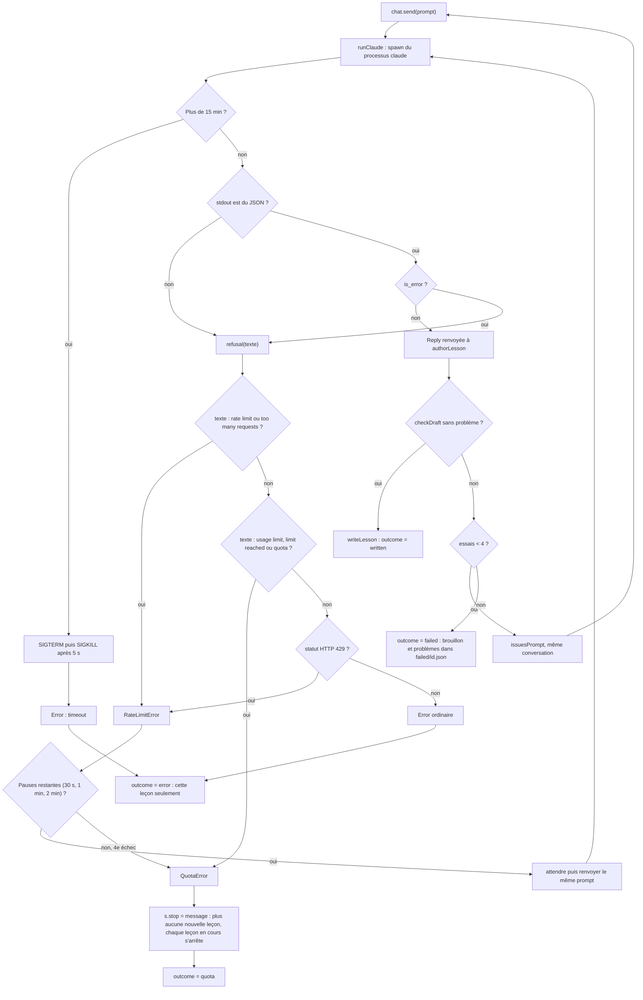

# Module annexe · `lessons:author` : écrire les leçons avec un modèle (PR #178)

> Fichiers de ce dossier :
> - **README.md** (ce fichier) : le rôle, les fichiers, les diagrammes, un exemple réel, les questions d'oral.
> - [CONCEPTS.md](CONCEPTS.md) : les notions techniques expliquées simplement
>   (`child_process`, prompts versionnés, backoff exponentiel, quota, 429).

---

## 1. À quoi sert ce module ?

Notre application propose des **leçons** (vocabulaire, grammaire, « functions » = situations
de communication, lecture). Chaque leçon est un **fichier JSON** dans `content/`. Il y en a
des centaines : on ne peut pas toutes les écrire à la main.

`lessons:author` est un **outil en ligne de commande** (un script, pas une route de l'API).
Il demande à un modèle d'IA (Claude, via le programme `claude` installé sur la machine)
d'écrire les leçons, **vérifie** chaque leçon avec nos validateurs, et **renvoie les erreurs**
au modèle jusqu'à ce que la leçon soit valide.

**Analogie : un élève et un correcteur automatique.**
- L'élève (le modèle) rend une copie (le brouillon de leçon).
- Le correcteur (nos validateurs zod de `packages/shared/src/lessons`) rend la liste des fautes.
- L'élève corrige **sur la même copie**, dans la même conversation.
- Au bout de 4 essais maximum, soit la copie est acceptée et rangée dans le classeur
  (`content/`), soit elle part dans le bac « à revoir » (`failed/`).

Points clés à retenir pour l'oral :
- **Rien n'est généré au runtime ni au déploiement.** Les leçons sont écrites une fois, puis
  committées dans le dépôt (`docs/LESSONS.md` §7).
- **Pas de clé API.** Le script lance le binaire `claude` en mode non interactif (`claude -p`)
  sur l'abonnement Claude Code du membre de l'équipe.
- **Les règles ne sont pas recopiées dans le prompt « à la main »** : le prompt système contient
  le **code source** des schémas et validateurs. Une règle qui change arrive donc
  automatiquement au prochain lancement.
- **Un fichier existant n'est jamais écrasé.** Pour refaire une leçon, on supprime ses fichiers.

---

## 2. Entrée et sorties

| Quoi | Où | Rôle |
|---|---|---|
| **Entrée** : le plan (outline) | `content/outlines/<lang>-<level>.json` (ex. [fr-a2.json](../../../content/outlines/fr-a2.json)) | La liste ordonnée des leçons à écrire : `id`, `kind`, `theme`/`topic`, `workingTitle`, `intent` |
| **Sortie** : le brief | `content/briefs/<id>.json` | Le plan détaillé de la leçon. Pour le vocabulaire, c'est **le seul** fichier : l'app construit la leçon jouable à partir de lui |
| **Sortie** : le contenu | `content/lessons/<id>.json` | La leçon jouable (pages, exercices). Pour grammaire, functions, lecture |
| Fichiers de travail (pas committés) | `$TMPDIR/ft-lessons-author/` (`WORK_DIR`) | Prompts système par type, brouillons ratés (`failed/<id>.json`), rapports `report-<date>.json` |

Chaque fichier écrit porte une **provenance** : quel outil, quel modèle, **quelle version du
prompt**, quand, et un hash (empreinte sha256) de l'entrée de l'outline. Exemple réel dans
[fr-re-verbs-present.json](../../../content/briefs/fr-re-verbs-present.json) :

```json
"provenance": {
  "generator": "ft lessons:author",
  "model": "sonnet",
  "promptVersion": "author-2",
  "generatedAt": "2026-11-01T18:35:56.300Z",
  "inputHashes": { "outline": "ea1e49ea…" }
}
```

Aujourd'hui dans le dépôt : 144 briefs portent `author-2` et 72 portent `author-3` (la version
actuelle de `PROMPT_VERSION`).

---

## 3. Les commandes (scripts `package.json`)

Dans [apps/api/package.json](../../../apps/api/package.json) :

```json
"lessons:author": "pnpm --filter @ft/shared run build && tsx scripts/lessons/author.ts",
"lessons:check":  "pnpm --filter @ft/shared run build && tsx scripts/lessons/check.ts"
```

- `pnpm --filter @ft/shared run build` : on **compile d'abord le paquet partagé**, car les
  validateurs viennent de `@ft/shared`.
- `tsx` : exécute un fichier TypeScript directement, sans étape de compilation séparée.
- Les scripts tournent depuis `apps/api` (c'est pnpm qui s'y place). C'est pour ça que
  `files.ts` remonte de deux dossiers pour trouver `content/`.

### `lessons:author` (mode automatique)

```bash
pnpm --filter @ft/api lessons:author fr a1                    # les 12 prochaines leçons sans fichiers
pnpm --filter @ft/api lessons:author fr a1 --max 3            # seulement 3
pnpm --filter @ft/api lessons:author fr a1 --only fr-subject-pronouns --model opus
```

| Option | Défaut | Sens |
|---|---|---|
| `--only <id,id…>` | — | seulement ces leçons |
| `--max <n>` | 12 | leçons par lancement |
| `--concurrency <n>` | 2 | leçons écrites en parallèle |
| `--model` | `sonnet` | `sonnet`, `opus`, `haiku` ou un id complet |
| `--effort` | celui du modèle | `low` … `max` |
| `--attempts <n>` | 4 | réponses par leçon, la première comprise |
| `--timeout <min>` | 15 | temps max d'une réponse |
| `--claude-bin <path>` | trouvé tout seul | chemin du binaire `claude` |

Les options sont lues avec `parseArgs` de Node en mode `strict` : une option inconnue est une
**erreur**, pas ignorée.

### `lessons:check` (vérifier une leçon)

```bash
pnpm --filter @ft/api lessons:check <id> --rules                     # affiche le prompt que lessons:author enverrait
pnpm --filter @ft/api lessons:check <id> --draft draft.json          # vérifie un brouillon, liste les problèmes
pnpm --filter @ft/api lessons:check <id> --draft draft.json --write  # et l'écrit dans content/ s'il passe
pnpm --filter @ft/api lessons:check <id>                             # vérifie les fichiers déjà committés
```

C'est **le même contrôle** (`checkDraft`) que `lessons:author`, mais à la main. Il sert à la
skill `author-lessons` et à quelqu'un qui écrit avec n'importe quel autre modèle (on colle le
résultat de `--rules` dans ce modèle). Code de sortie 1 s'il reste un problème.

Détail : `--draft` est lu depuis le dossier où on a **tapé** la commande (`INIT_CWD`, variable
mise par pnpm), pas depuis `apps/api`.

### La skill `author-lessons` (mode interactif)

[.claude/skills/author-lessons/SKILL.md](../../../.claude/skills/author-lessons/SKILL.md) : une
**skill** est une fiche d'instructions pour une session Claude Code. On tape
`/author-lessons fr a2` dans Claude Code. La session écrit elle-même chaque brouillon dans son
dossier temporaire, lance `lessons:check --draft`, corrige (4 tours max), relit une fois pour les
erreurs grossières, puis lance `--write`.

| | Skill `/author-lessons` | `lessons:author` |
|---|---|---|
| Qui écrit | la session Claude Code | `claude -p` lancé par notre script, coupé du dépôt |
| Qui vérifie | `lessons:check` | `checkDraft` directement |
| Relecture humaine-like | la session relit chaque leçon | non : relire quelques leçons avant la PR |
| Échecs | listés à la fin | `$TMPDIR/ft-lessons-author/failed/` |

---

## 4. Les fichiers et leur rôle

Tout est dans [apps/api/scripts/lessons/](../../../apps/api/scripts/lessons/) (et pas dans
`scripts/lessons/` à la racine).

| Fichier | Rôle en une phrase |
|---|---|
| [author.ts](../../../apps/api/scripts/lessons/author.ts) | Le point d'entrée : lit les options, choisit les leçons (`pickLessons`), lance la boucle par leçon (`authorLesson`) dans un **pool** de 2 en parallèle, affiche le résumé |
| [prompt.ts](../../../apps/api/scripts/lessons/prompt.ts) | Construit les textes envoyés au modèle : `systemPrompt(kind)`, `lessonPrompt(...)`, `issuesPrompt(...)`, et `PROMPT_VERSION = 'author-3'` |
| [providers/chat.ts](../../../apps/api/scripts/lessons/providers/chat.ts) | Le **contrat** d'un fournisseur de modèle (`Provider`, `Chat`, `Reply`), les erreurs `QuotaError` / `RateLimitError`, `refusal()` qui classe un refus, `retryRateLimits()` qui réessaie |
| [providers/claude.ts](../../../apps/api/scripts/lessons/providers/claude.ts) | L'implémentation Claude : trouve le binaire (`findClaude`), le lance avec `spawn` (`runClaude`), reprend la conversation avec `--resume` |
| [reply.ts](../../../apps/api/scripts/lessons/reply.ts) | Lit la réponse du modèle : extrait le premier objet JSON (`parseReply`) et l'applique au brouillon (`applyReply`) |
| [edits.ts](../../../apps/api/scripts/lessons/edits.ts) | Applique des **modifications ciblées** (`{"edits":[…]}`) au lieu de renvoyer toute la leçon |
| [check-draft.ts](../../../apps/api/scripts/lessons/check-draft.ts) | Le contrôle partagé : `complete()` puis `validateLesson`, puis vérifie que le titre n'est pas déjà pris |
| [complete.ts](../../../apps/api/scripts/lessons/complete.ts) | Ajoute ce que le modèle n'a pas à écrire : l'enveloppe (id, lang, level…), la provenance, le barème, les durées |
| [times.ts](../../../apps/api/scripts/lessons/times.ts) | Calcule **toutes les durées** avec les formules de `@ft/shared`, pour qu'elles soient toujours justes |
| [check.ts](../../../apps/api/scripts/lessons/check.ts) | La commande `lessons:check` |
| [files.ts](../../../apps/api/scripts/lessons/files.ts) | Lit l'outline, sait quels fichiers existent (`filesOf`), lit les titres pris, écrit les leçons formatées par prettier, écrit dans `WORK_DIR` |
| [json.ts](../../../apps/api/scripts/lessons/json.ts) | Petits outils JSON : `isObject`, `canonicalJson`, `sha256` (pour la provenance) |
| [report.ts](../../../apps/api/scripts/lessons/report.ts) | Affiche une ligne par leçon, le résumé final, et sauve un rapport JSON |
| [SKILL.md](../../../.claude/skills/author-lessons/SKILL.md) | La skill `/author-lessons` pour une session Claude Code |
| [validateLesson.ts](../../../packages/shared/src/lessons/validateLesson.ts) | (dans `@ft/shared`) Le validateur final que tout le monde utilise, aussi les tests et le seed |

### Diagramme des dépendances entre fichiers



---

## 5. Le chemin d'exécution complet

### 5.1 Diagramme de séquence



### 5.2 Les décisions : réessai, quota, rate limit, abandon



À retenir :
- **RateLimitError** = refus **court** (HTTP 429). On attend et on renvoie **le même** prompt
  dans **la même** session (rien n'a été ajouté à la conversation).
- **QuotaError** = refus **qui dure** (la limite d'usage de l'abonnement). La leçon suivante
  serait refusée aussi, donc **tout le lancement s'arrête proprement** au lieu de faire
  échouer toutes les leçons restantes.
- Une **erreur ordinaire** (crash, timeout, réponse d'erreur) fait échouer **une seule leçon**.
- Le code de sortie du processus est **1** si une leçon n'est pas écrite, si des leçons n'ont pas
  démarré, ou si un quota a arrêté le lancement.

---

## 6. Que se passe-t-il concrètement ? Exemple pas à pas

Commande : `pnpm --filter @ft/api lessons:author fr a2 --max 2`

1. **pnpm** se place dans `apps/api`, compile `@ft/shared`, puis lance `tsx scripts/lessons/author.ts fr a2 --max 2`.
2. **`readOptions`** valide `fr` (avec `LanguageSchema`) et `a2` → `A2` (avec `LevelSchema`).
   Défauts : 2 en parallèle, 4 essais, `sonnet`, 15 min.
3. **`readOutline('fr', 'A2')`** lit `content/outlines/fr-a2.json` et le valide avec zod.
4. **`pickLessons`** garde les entrées **sans aucun fichier**, dans l'ordre. Aujourd'hui, les 12
   premières de fr A2 existent, donc il prend la 13e et la 14e : `fr-adverb-position-past`
   (grammaire) et `fr-life-events` (vocabulaire). Si on avait demandé `--only fr-life-events`
   seul, le script aurait **refusé** : la 13e resterait sans fichiers avant la 14e (un « trou »),
   or les leçons d'un niveau doivent être les premières de l'outline (#84).
5. **`claudeProvider`** trouve le binaire `claude` (dans le `PATH`, sinon celui de l'extension
   VS Code), et écrit 4 fichiers `vocabulary.system.md`, `grammar.system.md`… dans
   `$TMPDIR/ft-lessons-author/`. Chaque fichier contient le **code source** des schémas et
   validateurs du type, plus **une leçon complète qui passe**, plus le format de réponse.
6. Le **pool** lance les 2 leçons en même temps.
7. Pour `fr-adverb-position-past`, **`lessonPrompt`** écrit : l'entrée de l'outline en JSON, les
   5 leçons avant et après (pour ne pas les répéter), et tous les titres déjà pris en français.
8. **Essai 1.** `runClaude` lance
   `claude -p --output-format json --model sonnet --tools "" --setting-sources "" --strict-mcp-config --system-prompt-file …/grammar.system.md`,
   écrit le prompt sur son **stdin**, et lit son **stdout**. Le modèle répond par un objet
   `{"brief":{…},"content":{…}}` sur une ligne. Le JSON de sortie de `claude` donne aussi un
   `session_id`, gardé pour la suite.
9. **`applyReply`** extrait le premier objet JSON (même s'il est dans un bloc de code ou suivi de
   texte) et remplace le brouillon.
10. **`checkDraft`** : `complete()` ajoute `schemaVersion`, `id`, `lang`, `level`, `provenance`
    (avec `promptVersion: "author-3"`), le barème (35 % pratique, 65 % examen), et calcule
    `estimatedMinutes` et les `timeLimitS` des pages d'examen. Puis `validateLesson` répond, par
    exemple, 3 problèmes du type `brief.blocks.1.exercises.0: …`.
11. **`issuesPrompt`** liste ces 3 problèmes et propose de répondre seulement avec
    `{"edits":[…]}`.
12. **Essai 2.** Même commande, plus `--resume <session_id>` : le modèle **voit sa réponse
    précédente** et corrige. Il répond
    `{"edits":[{"file":"brief","path":"blocks.1.exercises.0.items.2","value":…}]}`.
    `applyEdits` applique les remplacements dans l'ordre, puis les suppressions de l'index le plus
    grand au plus petit.
13. **`checkDraft`** ne trouve plus rien. Le titre est enregistré dans `usedTitles` (sans `await`
    entre la vérification et l'enregistrement, pour que deux leçons en parallèle ne prennent pas
    le même titre), puis **`writeLesson`** écrit `content/briefs/fr-adverb-position-past.json` et
    `content/lessons/fr-adverb-position-past.json`, formatés par prettier.
14. **`printProgress`** affiche par exemple :
    `✓ [1/2] fr-adverb-position-past  grammar  2 attempts  5 min 10 s  out 9.3k tok`
15. Quand les 2 leçons sont finies, **`printSummary`** affiche : écrites / ratées / non faites,
    temps total et par type, jetons, « équivalent API en dollars » (pas facturé sur un abonnement,
    c'est une mesure du quota consommé), et une estimation du temps pour le reste du niveau.
    **`saveReport`** écrit `report-<date>.json` dans `WORK_DIR`.
16. Le développeur relit quelques leçons, lance les tests (`lesson-files.spec.ts`), et ouvre une
    PR avec les nouveaux fichiers de `content/`.

(Les durées et le nombre de problèmes de cet exemple sont illustratifs ; le déroulé, lui, suit
exactement le code.)

---

## 7. Détails importants du code

- **Une conversation par leçon** (`startChat`). Le premier message envoie la leçon, les suivants
  envoient seulement les problèmes. Le modèle **corrige sa propre leçon** au lieu de recommencer.
- **Le prompt système est le même pour toutes les leçons d'un type** : il est écrit une fois dans
  un fichier, et Claude Code le **met en cache** à partir de la 2e leçon (moins de jetons).
- **Le modèle est isolé** : `--tools ""` (aucun outil), `--setting-sources ""` (pas de réglages
  ni de CLAUDE.md), `--strict-mcp-config` (aucun serveur MCP), notre prompt système à la place de
  celui de Claude Code, et le processus tourne dans `WORK_DIR` (ses sessions ne polluent pas la
  liste de sessions du membre).
- **Le modèle n'écrit pas ce que le code sait calculer** (`complete.ts`, `times.ts`) : les
  durées sont recalculées avec les formules de `@ft/shared`, donc une leçon complétée est
  toujours d'accord avec son validateur.
- **Ce que les validateurs ne voient pas** (une seule bonne réponse par trou, accords, etc.) est
  écrit en toutes lettres dans le prompt système, section « What the checks cannot see ».
- **Sécurité des edits** : les clés `__proto__`, `constructor`, `prototype` sont refusées
  (pollution de prototype). Un chemin qui n'existe pas n'est **jamais deviné** : il est renvoyé
  au modèle comme problème.
- **Une leçon est écrite dès qu'elle passe** : si on coupe le script, on ne perd que les leçons
  en cours. Le lancement suivant reprend là où on s'est arrêté (il saute les leçons qui ont des
  fichiers).
- **Une leçon « partial »** (un seul de ses deux fichiers) est laissée telle quelle, avec un
  avertissement.

---

## 8. Questions possibles à l'oral

**Q : Pourquoi ne pas générer les leçons à la volée quand l'utilisateur les demande ?**
R : Parce qu'on veut un contenu **vérifié et stable** : chaque leçon passe les validateurs, est
relue, puis committée. Pas de coût ni d'attente au runtime, et le jury voit toujours la même leçon.

**Q : Comment ton script parle-t-il au modèle ?**
R : Il lance le programme `claude` comme **processus enfant** avec `spawn`, écrit le prompt sur
son entrée standard (stdin), et lit sa sortie standard (stdout) au format JSON.

**Q : Comment le modèle se souvient-il de sa réponse précédente ?**
R : `claude` renvoie un `session_id`. Les appels suivants ajoutent `--resume <session_id>`.

**Q : Que se passe-t-il si le modèle répond n'importe quoi ?**
R : `parseReply` cherche le premier objet JSON. S'il n'y en a pas, c'est un problème renvoyé au
modèle (« your reply is not one JSON object »). Ça compte comme un essai.

**Q : Combien d'essais ?**
R : 4 par défaut (`--attempts`). Après, le dernier brouillon et ses problèmes vont dans
`$TMPDIR/ft-lessons-author/failed/<id>.json`.

**Q : Différence entre `QuotaError` et `RateLimitError` ?**
R : Rate limit = refus court (429) : on réessaie après 30 s, 1 min, 2 min. Quota = limite
d'usage de l'abonnement : on arrête tout le lancement. Un rate limit qui dure après les 3 pauses
devient un quota.

**Q : Pourquoi `PROMPT_VERSION` ?**
R : Chaque fichier enregistre la version du prompt qui l'a écrit. Si une série de leçons a un
défaut, on sait quel prompt l'a produit et lesquelles refaire.

**Q : Pourquoi mettre le code source des validateurs dans le prompt ?**
R : C'est la **vérité** : pas de résumé qui pourrait être faux ou en retard. Si une règle change,
le prochain lancement l'envoie automatiquement.

**Q : Comment évites-tu deux leçons avec le même titre ?**
R : `readUsedTitles` lit tous les titres de la langue, « pliés » (`foldText` : sans casse ni
accents). `checkDraft` refuse un titre déjà pris. En parallèle, le titre est réservé sans `await`
entre le test et l'enregistrement, donc sans course possible (Node exécute ce bout d'un seul trait).

**Q : Pourquoi le modèle n'écrit-il pas les durées ?**
R : Parce que le validateur les recalcule à la seconde près avec des formules. Le code les calcule
avec les **mêmes** formules (`times.ts`), donc elles sont toujours justes.

**Q : C'est quoi `lessons:check` ?**
R : Le même contrôle, à la main, pour une leçon : afficher les règles (`--rules`), vérifier un
brouillon (`--draft`), l'écrire s'il passe (`--write`). C'est l'outil de la skill
`/author-lessons`.

**Q : Pourquoi `--tools ""` ?**
R : Le modèle n'a besoin que de répondre du texte. Sans outils, il ne peut ni lire ni modifier le
dépôt : c'est plus sûr et plus reproductible.

**Q : Que se passe-t-il si `claude` reste bloqué ?**
R : Après 15 min, on envoie `SIGTERM`, puis `SIGKILL` 5 s plus tard s'il ne s'arrête pas. La
leçon passe en `error`.

**Q : Comment le parallélisme est-il géré ?**
R : Une petite fonction `pool` lance N « workers » (2 par défaut) qui prennent la leçon suivante
dans une file. Avant d'en prendre une, chacun vérifie qu'aucun quota n'a demandé l'arrêt.
