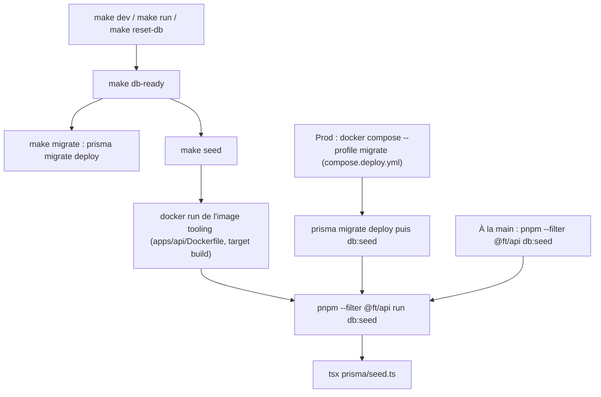
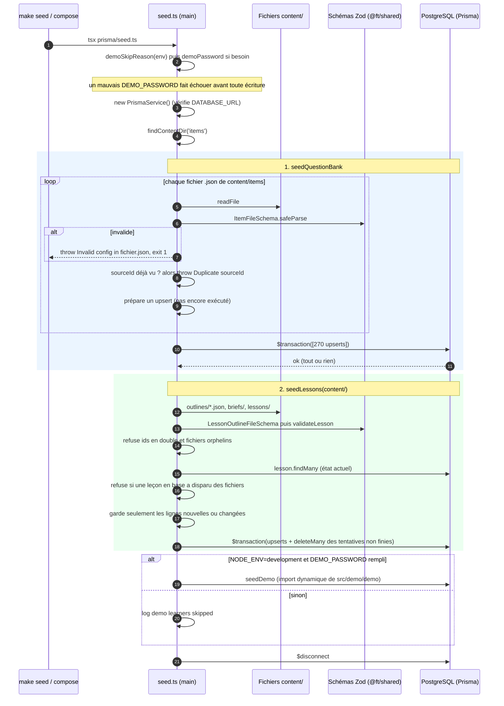
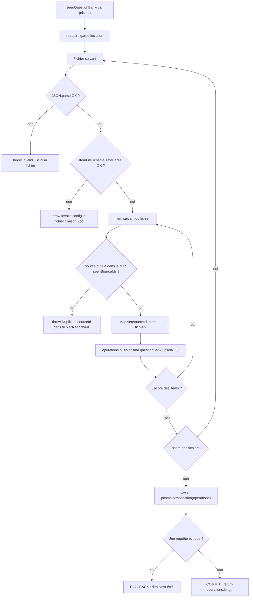
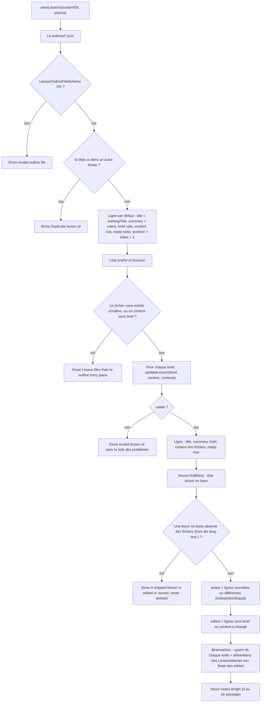
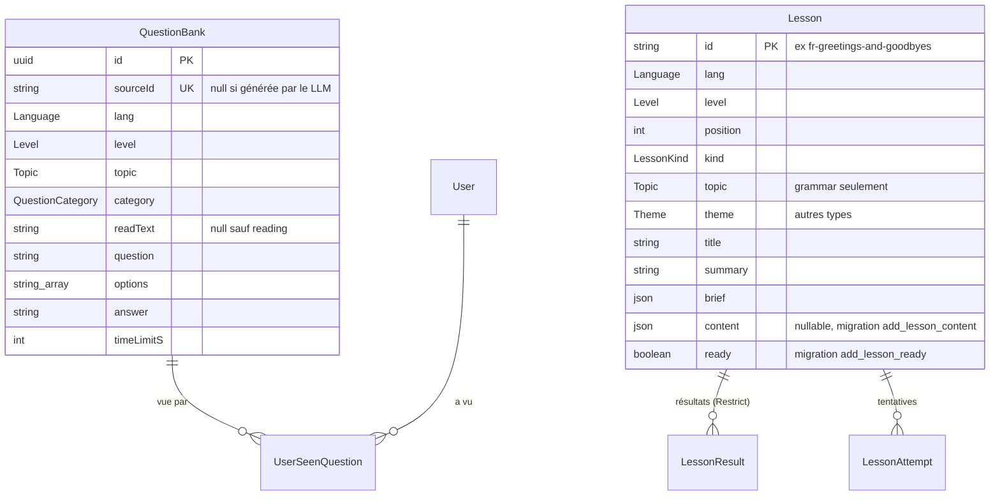

# Module : le seed de la base (`apps/api/prisma/seed.ts`)

> Fichier principal : [apps/api/prisma/seed.ts](../../../apps/api/prisma/seed.ts).
> Tests : [apps/api/test/seed.e2e-spec.ts](../../../apps/api/test/seed.e2e-spec.ts).
> Schéma : [apps/api/prisma/schema.prisma](../../../apps/api/prisma/schema.prisma).
> Guides voisins : [docs/ITEM_BANK.md](../../ITEM_BANK.md) (écrire des questions),
> [docs/LESSONS.md](../../LESSONS.md) (écrire des leçons).

---

## 1. À quoi sert le seed, en mots simples

**Seed** veut dire « graine ». Seeder une base, c'est la **remplir avec les données de départ**
dont l'application a besoin pour fonctionner.

Dans notre projet, deux choses sont écrites par des humains, **dans des fichiers JSON** du dossier
[`content/`](../../../content/), et pas dans la base :

- les **questions du test de placement** (`content/items/*.json`, 270 questions) → table `QuestionBank` ;
- les **leçons** (`content/outlines/*.json` + `content/briefs/*.json` + `content/lessons/*.json`) → table `Lesson`.

Le script `seed.ts` lit ces fichiers, les **vérifie**, puis les **copie** dans PostgreSQL.
En plus, sur une stack de développement, il crée des **apprenants de démo** (#143).

### L'analogie : la bibliothèque et le catalogue officiel

- Les fichiers `content/` sont le **catalogue officiel**, rangé dans Git, relu en PR.
- La base de données est la **bibliothèque** elle-même.
- Le seed est le **bibliothécaire** qui, chaque matin, compare les rayons au catalogue :
  - un livre du catalogue absent des rayons → il l'**ajoute** ;
  - un livre présent mais avec une nouvelle édition → il le **met à jour** (même place, même cote) ;
  - un livre déjà à jour → il ne touche à rien.
- La **cote** du livre, c'est l'identifiant stable : `sourceId` (ex. `fr-gram-0001`) pour une
  question, `id` (ex. `fr-greetings-and-goodbyes`) pour une leçon.
- Si le catalogue contient **deux livres avec la même cote**, le bibliothécaire **refuse de
  commencer** : il ne range rien du tout, et il dit quels deux fichiers se contredisent.
- Il range tout **d'un coup** (transaction) : jamais une bibliothèque à moitié rangée.

Le bibliothécaire peut passer **autant de fois qu'on veut** : le résultat est le même.
C'est l'**idempotence** (voir §7.1).

---

## 2. Qui a écrit quoi (historique `git log`)

| PR | Auteur (git) | Ce qui a été fait |
|---|---|---|
| #58 | EA | Création de `seed.ts` : `seedQuestionBank`, `findItemsDir` (ancêtre de `findContentDir`), détection des `sourceId` en double **avant** la transaction, `upsert` sur `sourceId`, `$transaction`. Création de `seed.e2e-spec.ts`. |
| #123 | luca-mattei | Tables `Lesson` et `LessonResult` (migration `add_lessons`), première version de `seedLessons` (depuis des « drafts »), `findItemsDir` généralisé en `findContentDir(kind)`. |
| #140 | EA | Les leçons sont seedées **depuis les outlines** (`content/outlines/<lang>-<level>.json`) : `LessonOutlineFileSchema`, `workingTitle` → `title`, `intent` → `summary`, `brief: {}`. |
| #142 | EA | Migration `add_lesson_content` (colonne `content JSONB`). Le seed lit `briefs/` et `lessons/`, valide chaque leçon avec `lessons.validateLesson`, refuse les fichiers « orphelins ». |
| #143 | EA | Apprenants de démo, seulement si `NODE_ENV=development` **et** `DEMO_PASSWORD` rempli (`demoSkipReason`, `demoPassword`). |
| #171 | bastian-schnitzler | Colonne `ready` (migration `add_lesson_ready`) mise à jour par le seed à chaque passage. |
| #190 | ninisse | Quand le brief ou le contenu d'une leçon change, le seed supprime les **tentatives non finies** de cette leçon, dans la même transaction. |

---

## 3. Les fichiers et leur rôle

| Fichier | Rôle |
|---|---|
| [prisma/seed.ts](../../../apps/api/prisma/seed.ts) | Le script. Exporte `findContentDir`, `seedQuestionBank`, `seedLessons`, `demoSkipReason`, `demoPassword`. Se lance seulement s'il est le point d'entrée (`require.main === module`). |
| [prisma/schema.prisma](../../../apps/api/prisma/schema.prisma) | Les modèles `QuestionBank` (avec `sourceId @unique`) et `Lesson` (avec `content Json?` et `ready`). |
| [migrations/20260913184446_question_bank_source_id_unique](../../../apps/api/prisma/migrations/20260913184446_question_bank_source_id_unique/migration.sql) | `CREATE UNIQUE INDEX "QuestionBank_sourceId_key"` : permet `upsert where: { sourceId }`. |
| [migrations/20261007134739_add_lessons](../../../apps/api/prisma/migrations/20261007134739_add_lessons/migration.sql) | Crée `Lesson`, `LessonResult`, les enums `LessonKind` et `Theme`. |
| [migrations/20261024122424_add_lesson_content](../../../apps/api/prisma/migrations/20261024122424_add_lesson_content/migration.sql) | `ALTER TABLE "Lesson" ADD COLUMN "content" JSONB;` (nullable). |
| [migrations/20261028175100_add_lesson_ready](../../../apps/api/prisma/migrations/20261028175100_add_lesson_ready/migration.sql) | `ready BOOLEAN NOT NULL DEFAULT false`. |
| [packages/shared/src/schemas/item.ts](../../../packages/shared/src/schemas/item.ts) | `ItemFileSchema` : valide un fichier de questions (format du `sourceId`, 4 options, réponse dans les options, `readText` seulement en lecture…). |
| [packages/shared/src/schemas/lesson.ts](../../../packages/shared/src/schemas/lesson.ts) | `LessonOutlineFileSchema` : valide un fichier d'outline. |
| [packages/shared/src/lessons/validateLesson.ts](../../../packages/shared/src/lessons/validateLesson.ts) | `validateLesson(brief, content, context)` : valide une leçon écrite. |
| [src/prisma/prisma.service.ts](../../../apps/api/src/prisma/prisma.service.ts) | Le client Prisma. Le seed l'utilise hors de Nest. Vérifie `DATABASE_URL`. |
| [src/demo/demo.ts](../../../apps/api/src/demo/demo.ts) | `seedDemo` : les apprenants de démo, importé **seulement** en dev. |
| [test/seed.e2e-spec.ts](../../../apps/api/test/seed.e2e-spec.ts) | Tests sur une **vraie** base Postgres. |
| [test/fixtures/seed-valid, seed-invalid, seed-duplicate](../../../apps/api/test/fixtures/) | Petits dossiers de faux fichiers pour les tests. |

---

## 4. Comment le seed est lancé



- Le script npm, dans [apps/api/package.json](../../../apps/api/package.json) :
  `"db:seed": "tsx prisma/seed.ts"`. `tsx` exécute du TypeScript directement, sans compiler avant.
- Dans le [Makefile](../../../Makefile), la cible `db-ready` fait `migrate` **puis** `seed`.
  Le commentaire dit : « chaque chemin qui démarre une base passe par ici, pour qu'aucun
  environnement ne soit migré avec une banque de questions vide. Les deux moitiés sont idempotentes. »
- En production, le service `migrate` de [compose.deploy.yml](../../../compose.deploy.yml) lance
  `prisma migrate deploy && ... db:seed` **à chaque déploiement**. C'est sans danger **parce que** le
  seed est idempotent (« Both upsert on the authored ids, so running the seed on every deploy is safe »).
- Ordre important : **migrer d'abord**, seeder ensuite. Le seed a besoin que les tables et colonnes
  (ex. `content`, `ready`) existent.

---

## 5. Le chemin d'exécution complet (diagramme de séquence)



Les étapes sont enchaînées avec `.then(...)`. Une erreur n'importe où va dans `.catch` :
`console.error` puis `process.exit(1)`. Le code de sortie 1 fait échouer `make` ou le déploiement.

---

## 6. Les décisions (flowcharts)

### 6.1 `seedQuestionBank` : lecture → vérif doublons → transaction → upsert



Point clé : `prisma.questionBank.upsert(...)` **sans `await`** ne lance pas la requête. Prisma
renvoie une requête « en attente ». On les met dans un tableau, et c'est `$transaction` qui les
exécute toutes. Donc **toutes les vérifications (JSON, Zod, doublons) ont lieu avant la première
écriture**.

### 6.2 `seedLessons` : outlines + fichiers → lignes → diff → transaction



---

## 7. Les concepts à savoir expliquer

### 7.1 Idempotence

**Idempotent** : lancer l'opération 1 fois ou 10 fois donne **le même état final**.

Comment le seed y arrive :

- **`upsert`** = « update or insert ». On cherche la ligne par une clé unique :
  - elle existe → `update` avec les valeurs des fichiers ;
  - elle n'existe pas → `create`.
- La clé est un identifiant **stable écrit par un humain** : `sourceId` pour les questions,
  `id` pour les leçons. Jamais l'`id` UUID généré par la base (il change à chaque `create`).
- Donc relancer le seed ne crée **pas** de doublons, et une question **garde son `id`**. C'est
  crucial : `UserSeenQuestion` pointe vers `QuestionBank.id`. Si l'id changeait, l'historique
  « déjà vu » des apprenants serait perdu.

Les tests le prouvent : *« running it twice leaves the same row count and id (idempotent
upsert) »* et *« re-seeding after editing the JSON updates the row and keeps its id »*.

Petite différence entre les deux fonctions :

| | `seedQuestionBank` | `seedLessons` |
|---|---|---|
| Que fait un 2e passage ? | Refait les 270 `upsert` (mêmes valeurs) | **N'écrit rien** : compare d'abord, n'écrit que ce qui a changé |
| Valeur renvoyée | toujours le nombre d'items (270) | le nombre de lignes **écrites** (0 au 2e passage) |
| `updatedAt` | bougé par Prisma à chaque `update` | inchangé si rien n'a changé (test *« writes nothing on a second run »*) |

### 7.2 Transaction Prisma

Une **transaction** = un groupe de requêtes SQL exécuté en **tout ou rien**. Si une seule échoue,
la base revient à l'état d'avant (**rollback**). Sinon tout est validé ensemble (**commit**).

```ts
await prisma.$transaction(operations); // operations = tableau de requêtes Prisma
```

C'est la forme « tableau » de `$transaction` : Prisma ouvre une transaction, exécute les requêtes
dans l'ordre, et commit à la fin.

Pourquoi c'est important ici : sans transaction, une erreur à la question 150 laisserait
149 questions mises à jour et 120 anciennes. Une base **à moitié seedée**, difficile à comprendre.

Pour les leçons, la transaction regroupe aussi les `upsert` **et** la suppression des tentatives
non finies : on ne peut pas avoir une leçon modifiée avec une tentative qui pointe dans l'ancien
contenu.

### 7.3 Pourquoi refuser les doublons de `sourceId` **avant** la transaction

On pourrait croire que l'index unique `QuestionBank_sourceId_key` suffit. **Non** :

- avec `upsert`, deux items avec le même `sourceId` ne provoquent **pas** d'erreur SQL ;
- le 1er fait un `create`, le 2e fait un `update` **par-dessus** ;
- résultat : une question **écrase silencieusement** l'autre, et le seed dit « OK ».

D'où la `Map seenSourceIds` (sourceId → nom du fichier) : au 2e passage du même `sourceId`, on
lance une erreur qui **nomme les deux fichiers**. Exemple réel du test (dossier `seed-duplicate`) :

```text
Duplicate sourceId "en-gram-9002" in en-grammar-a.json and en-grammar-b.json
```

Et comme tout ça se passe **pendant la préparation**, avant `$transaction`, **rien** n'est écrit.
Le test vérifie que la ligne `en-gram-9002` n'existe pas après l'échec.

À noter : `ItemFileSchema` refuse déjà les doublons **dans un même fichier**. La `Map` du seed
attrape les doublons **entre deux fichiers**, que le schéma d'un seul fichier ne peut pas voir.

Même idée pour les leçons : `Duplicate lesson id "..." in fichierA and fichierB`.

### 7.4 `findContentDir` : trouver `content/` d'où qu'on lance

```ts
export function findContentDir(kind: 'items' | 'lessons' | 'outlines'): string
```

Le script peut être lancé depuis la **racine** du dépôt ou depuis **`apps/api`** (c'est le cas
avec `pnpm --filter @ft/api`, qui se place dans `apps/api`). La fonction essaie :

1. `<dossier courant>/content/<kind>` ;
2. `<dossier courant>/../../content/<kind>` ;
3. sinon : erreur qui donne les **deux chemins essayés** et dit d'où lancer.

`seedLessons` reçoit `dirname(findContentDir('outlines'))`, c'est-à-dire le dossier `content/`
lui-même, car il lit trois sous-dossiers (`outlines`, `briefs`, `lessons`).

### 7.5 Valider avant d'écrire (Zod)

Chaque fichier passe par un **schéma Zod** de `@ft/shared` avant d'être utilisé. Le **même**
schéma sert dans la CI et au seed : une erreur est vue par celui qui écrit le contenu, pas par
celui qui déploie. Le message d'erreur **nomme le fichier** (test : *« fails loudly, naming the
file and the reason »*).

### 7.6 `require.main === module`

```ts
if (require.main === module) { ... }
```

Vrai seulement si `seed.ts` est **le fichier lancé** (`tsx prisma/seed.ts`). Faux si un autre
fichier l'**importe**. Les tests importent `seedQuestionBank` et `seedLessons` sans déclencher le
seed de la vraie base.

### 7.7 La migration `add_lesson_content` et `Prisma.DbNull`

```sql
ALTER TABLE "Lesson" ADD COLUMN "content" JSONB;
```

- `JSONB` : du JSON stocké en binaire par Postgres. Une leçon a un contenu riche (exercices,
  textes) : une colonne JSON évite des dizaines de tables.
- **Nullable** (pas de `NOT NULL`) : une leçon **pas encore écrite** n'a pas de contenu, et une
  leçon de **vocabulaire** n'a jamais de fichier `lessons/<id>.json` (son contenu est construit
  depuis son brief). Côté Prisma : `content Json?`.
- Pour écrire un vrai `NULL` SQL dans une colonne `Json?`, Prisma exige `Prisma.DbNull` (il
  distingue le `NULL` SQL de la valeur JSON `null`). Le seed garde `null` pour **comparer** avec la
  base, et ne le transforme en `Prisma.DbNull` qu'au moment d'écrire. Sinon chaque passage verrait
  une différence et réécrirait tout.

### 7.8 Les règles de sécurité de `seedLessons`

- **Aucune suppression** : une leçon en base mais absente des fichiers fait **échouer** le seed
  (« A shipped lesson is edited or moved, never deleted »). Les résultats des apprenants
  (`LessonResult`, en `onDelete: Restrict`) ne peuvent donc pas disparaître.
- Exception : les ids `<lang>-test-...` laissés par un test interrompu sont ignorés.
- **`position`** = rang dans le fichier d'outline (1, 2, 3…). Réordonner le fichier réordonne les
  leçons **sans changer leur `id`**, donc les résultats restent attachés.
- **`ready`** est recalculé à chaque passage, depuis les fichiers seuls : ajouter les fichiers
  d'une leçon et reseeder la rend disponible ; les retirer la rend indisponible. Pas de migration.

---

## 8. Que se passe-t-il concrètement : un exemple pas à pas

### 8.1 Une question

Extrait réel de [content/items/fr-grammar.json](../../../content/items/fr-grammar.json) :

```json
{
  "lang": "fr",
  "category": "grammar",
  "items": [
    {
      "sourceId": "fr-gram-0001",
      "level": "A1",
      "topic": "verbs_morphology",
      "question": "Je ___ étudiante à Lyon.",
      "options": ["suis", "es", "est", "être"],
      "answer": "suis",
      "timeLimitS": 30
    }
  ]
}
```

1. `readFile` puis `JSON.parse`.
2. `ItemFileSchema.safeParse` : `sourceId` respecte `fr-gram-XXXX`, il commence bien par la langue
   et la catégorie du fichier, 4 options différentes, `"suis"` est dans les options, pas de
   `readText` (ce n'est pas de la lecture). OK.
3. `seenSourceIds` ne contient pas `fr-gram-0001` → on l'ajoute avec la valeur `"fr-grammar.json"`.
4. On prépare :

   ```ts
   prisma.questionBank.upsert({
     where:  { sourceId: 'fr-gram-0001' },
     create: { sourceId: 'fr-gram-0001', lang: 'fr', category: 'grammar', level: 'A1',
               topic: 'verbs_morphology', readText: null, question: 'Je ___ étudiante à Lyon.',
               options: ['suis', 'es', 'est', 'être'], answer: 'suis', timeLimitS: 30 },
     update: { /* les mêmes champs, sans sourceId */ },
   })
   ```

   `lang` et `category` viennent du **fichier**, le reste de l'**item**. `readText ?? null` :
   absent → `NULL` en base.
5. Après les 9 fichiers : `$transaction` des 270 upserts.
   - **1er seed** (base vide) : 270 `INSERT`. Log : `seeded 270 questions from /.../content/items`.
   - **2e seed** : 270 `UPDATE` avec les mêmes valeurs. Mêmes `id`, toujours 270 lignes.
   - Quelqu'un corrige la phrase en `"Je ___ étudiante à Paris."` et reseede : la ligne
     `fr-gram-0001` est mise à jour, **même `id`**, et l'historique `UserSeenQuestion` reste valide.

### 8.2 Une leçon

Extrait réel de [content/outlines/fr-a1.json](../../../content/outlines/fr-a1.json) :

```json
{
  "lang": "fr",
  "level": "A1",
  "entries": [
    {
      "id": "fr-greetings-and-goodbyes",
      "kind": "functions",
      "theme": "relations",
      "workingTitle": "Saluer et dire au revoir",
      "intent": "Saluer et prendre congé à tout moment de la journée avec bonjour, bonsoir, salut, au revoir, à bientôt, et demander « Ça va ? »."
    }
  ]
}
```

1. Ligne par défaut : `id`, `lang: 'fr'`, `level: 'A1'`, `position: 1` (1re entrée),
   `kind: 'functions'`, `theme: 'relations'`, `topic: null`, `title: "Saluer et dire au revoir"`,
   `summary: <intent>`, `brief: {}`, `content: null`, `ready: false`.
2. Si `content/briefs/fr-greetings-and-goodbyes.json` existe (et `lessons/...json` pour ce type) :
   `validateLesson` les vérifie, puis `title`, `summary`, `brief`, `content` viennent des fichiers
   et `ready: true`.
3. Comparaison avec la base : si la ligne est identique (`isDeepStrictEqual`, qui ignore l'ordre
   des clés comme le fait `jsonb`), elle n'est **pas** écrite.
4. Si le **brief** a changé : `upsert` de la leçon **et** `deleteMany` des `LessonAttempt` de cette
   leçon avec `completedAt: null`, dans la même transaction. Les tentatives finies et les
   résultats restent.

---

## 9. Le schéma Prisma concerné



- `sourceId String? @unique` : **optionnel** car les questions **générées par le LLM** n'en ont
  pas (`null`). En Postgres, plusieurs `NULL` ne violent pas un index unique : seuls les
  `sourceId` écrits doivent être uniques. Lien avec le module
  [../llm-question-generation/](../llm-question-generation/README.md) : le seed ne touche
  **jamais** aux questions générées, puisqu'il travaille par `sourceId`.
- `Lesson.id` est un **texte choisi par un humain**, pas un UUID : c'est lui la clé de l'`upsert`.

---

## 10. Les tests (`seed.e2e-spec.ts`)

Ce sont des tests **e2e** : ils tournent sur une **vraie** base Postgres. Le commentaire du
fichier explique pourquoi : les critères de l'issue #43 portent sur **ce qui reste dans
`QuestionBank` après deux lancements**, ce qu'un faux client Prisma ne peut pas montrer.
Lancer : `pnpm --filter @ft/api test:e2e`.

| Test | Ce qu'il prouve |
|---|---|
| loads every item from the fixture directory, with every column mapped | Chaque champ arrive dans la bonne colonne (pas seulement le bon nombre de lignes). |
| running it twice leaves the same row count and id (idempotent upsert) | Idempotence. |
| re-seeding after editing the JSON updates the row and keeps its id | `update` et non `create` ; l'`id` ne change pas. |
| fails loudly, naming the file and the reason, on a malformed item file | Message clair : nom du fichier + raison Zod. |
| fails before writing when two files share a sourceId | Doublon détecté, les deux fichiers nommés, **rien** écrit. |
| loads all 270 authored items from the real content directory | Les vrais fichiers passent ; couvre `findContentDir`. |
| writes nothing on a second run, so updatedAt stays the same | Leçons : rien n'est réécrit sans changement. |
| fails on an entry removed from the outlines, names it, and writes nothing | Pas de suppression silencieuse. |
| deletes the unfinished attempts on a lesson whose brief changes, and keeps the rest | La règle de #190. |
| makes a lesson not ready when its files are removed, and ready again when they are back | Le flag `ready`. |
| demoSkipReason / demoPassword | Les démos seulement en `development` avec un mot de passe valide. |

---

## 11. Questions possibles à l'oral

**Q : C'est quoi le seed ?**
R : Un script qui remplit la base avec les données de départ écrites dans `content/` : les
270 questions du placement et les leçons. Il les valide, puis les copie dans Postgres.

**Q : Pourquoi les questions sont dans des fichiers JSON et pas directement en base ?**
R : Elles sont versionnées dans Git, relues en PR, validées par la CI. La base est reconstruite
depuis les fichiers. Les fichiers sont la source de vérité.

**Q : Que veut dire idempotent ? Comment ton seed l'est ?**
R : Le lancer plusieurs fois donne le même état. On fait des `upsert` sur une clé stable écrite à
la main (`sourceId`, `id` de leçon) : la ligne est créée la 1re fois, mise à jour ensuite.

**Q : Pourquoi c'est important d'être idempotent ?**
R : Le seed tourne à chaque `make dev`, `make run` et à chaque déploiement. S'il créait des
doublons, la base grossirait à chaque déploiement.

**Q : Pourquoi garder le même `id` à la mise à jour ?**
R : `UserSeenQuestion` pointe vers `QuestionBank.id`. Si l'id changeait, on perdrait l'historique
« déjà vu » des apprenants.

**Q : Pourquoi une transaction ?**
R : Tout ou rien. Si une écriture échoue, aucune n'est gardée : jamais de base à moitié seedée.

**Q : L'index unique sur `sourceId` ne suffit pas pour les doublons ?**
R : Non : avec `upsert`, le 2e item ferait juste un `update` sur le 1er, sans erreur. Une question
en écraserait une autre en silence. La `Map` détecte le doublon et nomme les deux fichiers.

**Q : Pourquoi vérifier avant la transaction et pas pendant ?**
R : Pour ne rien écrire du tout en cas de problème, et donner un message clair (les deux noms de
fichiers) au lieu d'une erreur SQL.

**Q : Comment le seed est lancé ?**
R : `pnpm --filter @ft/api db:seed` (= `tsx prisma/seed.ts`). Via `make seed` / `make db-ready`
en dev, et via le service `migrate` de `compose.deploy.yml` en prod, **après** `prisma migrate deploy`.

**Q : Pourquoi `findContentDir` essaie deux chemins ?**
R : Le script peut être lancé depuis la racine ou depuis `apps/api`. Il essaie `content/` puis
`../../content/`, et sinon donne une erreur qui liste les deux chemins.

**Q : À quoi sert la migration `add_lesson_content` ?**
R : Elle ajoute la colonne `content JSONB`, nullable, où le seed stocke le contenu d'une leçon
écrite. Nullable car une leçon pas encore écrite, ou de vocabulaire, n'en a pas.

**Q : Que se passe-t-il si on supprime une leçon d'un fichier ?**
R : Le seed refuse et n'écrit rien : une leçon livrée se modifie ou se déplace, jamais ne se
supprime, sinon on perdrait les résultats des apprenants.

**Q : Le seed touche-t-il aux questions générées par le LLM ?**
R : Non. Il travaille par `sourceId`, et les questions générées ont `sourceId = null`.

**Q : Pourquoi `require.main === module` ?**
R : Pour que le seed ne s'exécute que si on lance le fichier. Les tests l'importent sans seeder
la vraie base.

**Q : Pourquoi les apprenants de démo ne sont pas créés en production ?**
R : `demoSkipReason` exige `NODE_ENV === 'development'` (une liste blanche) et un `DEMO_PASSWORD`
non vide. Le serveur public n'a pas `NODE_ENV` à `development`, donc il saute cette étape.
