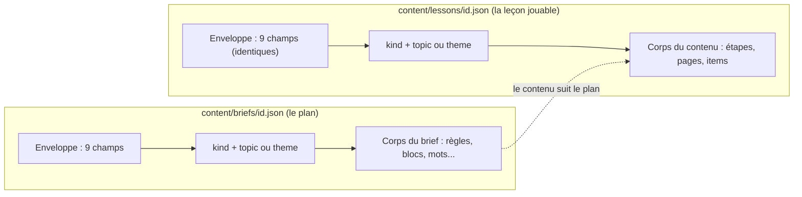
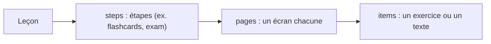
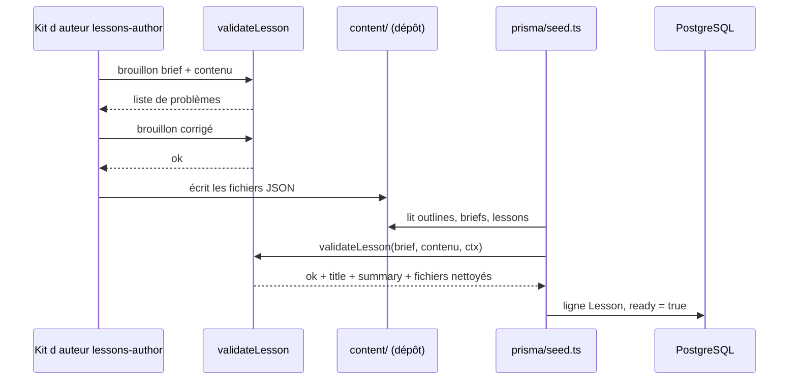
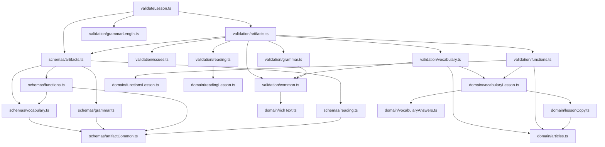

# Les leçons partagées : `packages/shared/src/lessons/`

> Ce dossier explique le code du dossier
> [`packages/shared/src/lessons/`](../../../packages/shared/src/lessons/), en français simple.
> Tu as écrit ce code (PR #142 : portage depuis le prototype ; PR #162 : allemand et anglais).
> Le but : pouvoir l'expliquer à l'oral, avec tes mots.
>
> Le sous-dossier `player/` (le lecteur de leçon) n'est **pas** couvert ici.

## Plan de ce dossier

| Fichier | Ce que tu y trouves |
|---|---|
| [README.md](README.md) | La vue d'ensemble (ce fichier) |
| [schemas.md](schemas.md) | Chaque schéma Zod, champ par champ |
| [validation.md](validation.md) | Ce que vérifie chaque validateur, et dans quel ordre |
| [domain.md](domain.md) | Les fonctions de calcul (`parseRichText`, `vocabularyLesson`…) |
| [questions-oral.md](questions-oral.md) | Les questions probables du correcteur, avec réponses |

---

## 1. C'est quoi une leçon ?

Notre application apprend des langues (français, allemand, anglais).
Une **leçon** est un petit cours de 10 à 20 minutes : on apprend, on s'entraîne, puis on passe un examen chronométré.

Une leçon, c'est **un ou deux fichiers JSON**, écrits à l'avance et rangés dans le dépôt :

| Fichier | Nom | Rôle | Pour quels types |
|---|---|---|---|
| `content/briefs/<id>.json` | le **brief** | le **plan** de la leçon : quoi enseigner, combien d'exercices | les 4 types |
| `content/lessons/<id>.json` | le **contenu** | la **leçon jouable** : étapes, pages, exercices, réponses | grammaire, fonctions, lecture |

**Analogie.** Le brief, c'est la **recette** (« 3 œufs, 200 g de farine, 20 min au four »).
Le contenu, c'est le **gâteau** fait en suivant la recette.
Le validateur vérifie que le gâteau respecte bien la recette.

Exception : une leçon de **vocabulaire** n'a **pas** de fichier contenu.
Le brief contient déjà tout (les mots, les phrases à trous…).
Le code fabrique la leçon jouable tout seul avec
[`vocabularyLesson()`](../../../packages/shared/src/lessons/domain/vocabularyLesson.ts).

Exemples réels du dépôt :

- vocabulaire : [`content/briefs/fr-classroom-objects.json`](../../../content/briefs/fr-classroom-objects.json) (pas de contenu) ;
- grammaire : [`content/briefs/fr-er-verbs-present.json`](../../../content/briefs/fr-er-verbs-present.json) + [`content/lessons/fr-er-verbs-present.json`](../../../content/lessons/fr-er-verbs-present.json) ;
- fonctions : [`content/briefs/fr-greetings-and-goodbyes.json`](../../../content/briefs/fr-greetings-and-goodbyes.json) + [`content/lessons/fr-greetings-and-goodbyes.json`](../../../content/lessons/fr-greetings-and-goodbyes.json) ;
- lecture : [`content/briefs/fr-reading-a-magazine-portrait.json`](../../../content/briefs/fr-reading-a-magazine-portrait.json) + [`content/lessons/fr-reading-a-magazine-portrait.json`](../../../content/lessons/fr-reading-a-magazine-portrait.json).

### Les 4 types (« kinds »)

| Type | Ce qu'il enseigne | Exemple | Classé par | Fichiers |
|---|---|---|---|---|
| `vocabulary` | une liste de mots sur un thème | « les objets de la classe » | `theme` | brief seul |
| `grammar` | un point de grammaire | « les verbes en -er au présent » | `topic` | brief + contenu |
| `functions` | quoi dire dans une situation | « commander au café » | `theme` | brief + contenu |
| `reading` | comprendre un petit texte réel | « lire un SMS » | `theme` | brief + contenu |

### Les deux fichiers ont la même « enveloppe »

Tous les fichiers commencent par les **mêmes 9 champs** : l'enveloppe
(`schemaVersion`, `id`, `lang`, `level`, `locales`, `title`, `objective`, `estimatedMinutes`, `provenance`).
Ensuite vient `kind`, puis `topic` ou `theme`, puis le **corps** propre au type.

### Une leçon jouable = étapes → pages → items

### Trois langues partout

- Ce qu'on **apprend** (mots, phrases, réponses) est dans la **langue du cours** (`lang`).
- L'**aide** (objectif, consignes, corrections) est écrite **en anglais, français et allemand** (`{ en, fr, de }`),
  pour que la leçon marche quelle que soit la langue de l'interface.
- Les **traductions** sont dans toutes les langues **sauf** celle du cours.
  Un cours de français traduit en `{ en, de }`, un cours d'allemand en `{ en, fr }`.

---

## 2. À quoi sert ce package partagé ?

`packages/shared` est une bibliothèque TypeScript commune au front (Next.js) et au back (NestJS).
On l'importe avec `import { lessons } from '@ft/shared'`.

Le dossier `lessons/` répond à une seule question : **« ce fichier de leçon est-il correct ? »**
Il a trois parties :

| Dossier | Rôle | En une phrase |
|---|---|---|
| [`schemas/`](../../../packages/shared/src/lessons/schemas/) | la **forme** des fichiers | « le champ `title` existe et fait moins de 300 caractères » |
| [`validation/`](../../../packages/shared/src/lessons/validation/) | le **sens** des fichiers | « chaque règle citée existe, l'examen couvre toutes les règles » |
| [`domain/`](../../../packages/shared/src/lessons/domain/) | les **calculs** | « une page de 4 cartes dure 40 s », « découper le Markdown » |

Et un chef d'orchestre : [`validateLesson.ts`](../../../packages/shared/src/lessons/validateLesson.ts),
qui vérifie une leçon entière (brief + contenu) et renvoie soit `ok`, soit **la liste de tous les problèmes**.

**Pourquoi « partagé » ?** Parce que **plusieurs programmes** doivent appliquer **exactement les mêmes règles** :
si le script d'écriture des leçons accepte une leçon, le seed doit l'accepter aussi.
Une seule source de vérité, pas de copie.

### Qui l'importe ?

[`index.ts`](../../../packages/shared/src/lessons/index.ts) n'exporte que ce dont les applis ont besoin, sous le nom `lessons`
(jamais `export *`, car des noms comme `Issue` ou `Block` entreraient en conflit avec le reste du package).

| Qui | Fichier | Ce qu'il utilise | Pourquoi |
|---|---|---|---|
| Le **seed** (remplit la base) | [`apps/api/prisma/seed.ts`](../../../apps/api/prisma/seed.ts) | `lessons.validateLesson` | une leçon invalide **arrête le seed** ; une leçon valide devient `ready: true` avec son titre et son résumé |
| Le **kit d'auteur** (écrit les leçons avec un modèle) | [`apps/api/scripts/lessons/check-draft.ts`](../../../apps/api/scripts/lessons/check-draft.ts) | `lessons.validateLesson` | renvoie les problèmes au modèle jusqu'à ce que la leçon passe |
| | [`apps/api/scripts/lessons/times.ts`](../../../apps/api/scripts/lessons/times.ts) | `vocabularyLesson`, `vocabularyMinutes`, `functionsPageEstimate`, `readingSkimSeconds`, `readingMinutes` | calcule les durées au lieu de laisser le modèle les inventer |
| | [`apps/api/scripts/lessons/complete.ts`](../../../apps/api/scripts/lessons/complete.ts), [`files.ts`](../../../apps/api/scripts/lessons/files.ts), [`check.ts`](../../../apps/api/scripts/lessons/check.ts) | `ARTIFACT_SCHEMA_VERSION`, `hasContentFile` | remplit l'enveloppe, sait si un fichier contenu est attendu |
| Les **tests de l'API** | [`apps/api/src/lessons/lesson-files.spec.ts`](../../../apps/api/src/lessons/lesson-files.spec.ts), [`lesson-complete.spec.ts`](../../../apps/api/src/lessons/lesson-complete.spec.ts) | `validateLesson`, `hasContentFile` | vérifient **tous** les fichiers de `content/` en CI |
| Le **front** | [`apps/web/components/lesson/rich-text.tsx`](../../../apps/web/components/lesson/rich-text.tsx) | `lessons.parseRichText` | affiche les explications en Markdown simple |
| Le lecteur de leçon | `packages/shared/src/lessons/player/` | types des schémas, `vocabularyLesson`, `functionsTerms`, `COPY` | (hors périmètre) |

---

## 3. L'arborescence des fichiers

```mermaid
flowchart TD
  R["lessons/"] --> IDX["index.ts : ce qui est exporté"]
  R --> VL["validateLesson.ts : vérifie une leçon entière"]
  R --> VLT["validateLesson.test.ts"]
  R --> SC["schemas/ : la forme"]
  R --> VA["validation/ : le sens"]
  R --> DO["domain/ : les calculs"]
  R --> PL["player/ : hors périmètre"]

  SC --> SC1["artifactCommon.ts : enveloppe, textes, ids, durées"]
  SC --> SC2["artifacts.ts : aiguillage par type"]
  SC --> SC3["vocabulary.ts"]
  SC --> SC4["grammar.ts"]
  SC --> SC5["functions.ts"]
  SC --> SC6["reading.ts"]

  VA --> VA1["artifacts.ts : validateBrief, validateContent"]
  VA --> VA2["issues.ts : classe Issues"]
  VA --> VA3["common.ts : sum, sameSet, checkMinutes, checkRichText"]
  VA --> VA4["vocabulary.ts : checkVocabularyBrief"]
  VA --> VA5["grammar.ts : checkGrammarBrief, checkGrammarContent"]
  VA --> VA6["grammarLength.ts : règles de longueur"]
  VA --> VA7["functions.ts : checkFunctionsBrief, checkFunctionsContent"]
  VA --> VA8["reading.ts : checkReadingBrief, checkReadingContent"]

  DO --> DO1["richText.ts : parseRichText"]
  DO --> DO2["articles.ts : un, une, der, die, das"]
  DO --> DO3["vocabularyLesson.ts : fabrique la leçon de vocabulaire"]
  DO --> DO4["vocabularyAnswers.ts : réponses acceptées à l'examen"]
  DO --> DO5["functionsLesson.ts : durées des fonctions"]
  DO --> DO6["readingLesson.ts : mots, durées de la lecture"]
  DO --> DO7["lessonCopy.ts : textes fixes en/fr/de"]
```

## 4. Qui dépend de qui

Une flèche `A --> B` veut dire « A importe B ».

À retenir pour l'oral : **les flèches descendent toujours**.
`schemas/` ne connaît pas `validation/`. `domain/` ne connaît pas `validation/`.
Seul `validation/` utilise les deux. Il n'y a pas de dépendance circulaire.

---

## 5. Le chemin en 30 secondes (à savoir réciter)

1. On reçoit le brief et le contenu, déjà lus depuis le JSON, mais **pas encore vérifiés** (`unknown`).
2. **Le schéma Zod** vérifie la **forme** du brief. S'il casse, on s'arrête : impossible d'aller plus loin.
3. **Les vérifications du type** (grammaire, vocabulaire…) vérifient le **sens** du brief.
   Elles **collectent tous les problèmes**, pas seulement le premier.
4. Si le brief est bon, on fait pareil avec le contenu, **en le comparant au brief**.
5. On ajoute quelques règles « base de données » : titre ≤ 80 caractères, résumé ≤ 200.
6. Résultat : `{ ok: true, brief, content, title, summary }` ou `{ ok: false, issues: [...] }`,
   chaque problème avec son chemin (`brief.targets.3.examForms`) et son message.

Détails dans [validation.md](validation.md).

## 6. Lexique rapide

| Mot | Sens |
|---|---|
| **Zod** | bibliothèque TypeScript qui décrit la forme attendue d'une donnée et la vérifie à l'exécution (version 4 ici) |
| **schéma** | la description d'une forme : « un objet avec un champ `id` texte… » |
| **parse / safeParse** | passer une donnée dans un schéma ; `safeParse` ne lance pas d'exception, il renvoie `{ success, data }` ou `{ success, error }` |
| **strict** | un objet strict refuse les champs inconnus (une faute de frappe dans un nom de champ est détectée) |
| **outline** | le plan d'un niveau : la liste ordonnée des leçons (`content/outlines/fr-a1.json`) |
| **entry** | une ligne de l'outline : `{ id, kind, topic?, theme?, workingTitle, intent }` |
| **issue** | un problème trouvé : `{ path, message }` |
| **locale** | une langue d'interface : `en`, `fr`, `de` |
| **mother tongue / native** | la langue de l'apprenant, dans laquelle on traduit |
