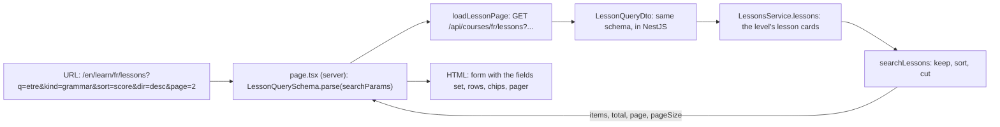

# Advanced search (Minor, 1 point)

**Type:** Minor. **Points:** 1. **Status:** done.

The all lessons page lists every lesson of the learner's current level. The learner can search
it by words, filter it by status, kind, topic and theme, sort it, group it, and move through it
page by page. Every view is a web address, so it can be shared, reloaded or bookmarked, and the
page works with JavaScript turned off.

## What the subject asks

The module is one line in the Web table of [../subject/summary.md](../subject/summary.md):

> | Minor | Advanced search: filters, sorting, pagination |

The PDF ([../subject/ft_transcendence.pdf](../subject/ft_transcendence.pdf), chapter IV, Web)
words it like this:

> Minor: Implement advanced search functionality with filters, sorting, and pagination.

No dependency rule in the subject applies to this module.

## How we meet it

| The subject asks | What we built | Where |
| --- | --- | --- |
| Advanced search | A text search box. Every typed word must be found, in any order, in the lesson's title or summary. Case and accents do not matter ("etre" finds "être"), a part of a word is enough, and in German "ae", "oe", "ue" also find "ä", "ö", "ü". The search runs in NestJS, behind `GET /api/courses/:lang/lessons`. | [`lesson-search.ts`](../../apps/api/src/lessons/lesson-search.ts) (`searchLessons`, `matchesText`, `bareVowels`), [`foldText`](../../packages/shared/src/schemas/lesson.ts), [`lessons.controller.ts`](../../apps/api/src/lessons/lessons.controller.ts) |
| Filters | Four filters, all checkboxes: **Status** (Not started, Not passed yet, Passed, Coming soon), **Kind** (Grammar, Vocabulary, Everyday phrases, Reading), **Topics** (13) and **Themes** (14). Inside one filter, a lesson passes if it has any of the ticked values. Across filters, it must pass all of them, and the text search too. Each active filter shows as a chip that removes it, and **Clear filters** removes them all. | [`lesson-search.ts`](../../apps/api/src/lessons/lesson-search.ts) (`matchesFilters`), [`lesson-list.tsx`](<../../apps/web/app/[locale]/(dashboard)/learn/[lang]/lessons/lesson-list.tsx>) (`LessonFilters`, `ActiveFilters`) |
| Sorting | **Sort** by Order (the lesson's place in the level), Score or Last finished, with **Direction** Ascending or Descending. Lessons never started always go last, in both directions. Ties are broken by the lesson's order. **Group** (None, Status, Day, Kind) adds a header wherever the group changes. | [`lesson-search.ts`](../../apps/api/src/lessons/lesson-search.ts) (`compareFor`, `GROUPS`, `nullsLast`), [`lesson-list.tsx`](<../../apps/web/app/[locale]/(dashboard)/learn/[lang]/lessons/lesson-list.tsx>) (`LessonToolbar`, `LessonRows`) |
| Pagination | 20 lessons a page (`LESSONS_PAGE_SIZE`). The API answers the page, the total of matching lessons and the page size. The page shows "1 to 20 of N", **Previous**, one link per page number, and **Next**. Every page link keeps the search, filters and sort. A page past the end gives the last page. | [`lesson-search.ts`](../../apps/api/src/lessons/lesson-search.ts), [`lesson.ts`](../../packages/shared/src/schemas/lesson.ts) (`LESSONS_PAGE_SIZE`, `LessonPageSchema`), [`lesson-list.tsx`](<../../apps/web/app/[locale]/(dashboard)/learn/[lang]/lessons/lesson-list.tsx>) (`LessonPager`) |

## How it works

1. **The URL holds the whole view.** The parameters are `q`, `status`, `kind`, `topic`,
   `theme`, `sort`, `dir`, `group` and `page`. Lists are comma separated (`kind=grammar,reading`)
   or the key repeated (`kind=grammar&kind=reading`, which is what a form of checkboxes sends).
   A default value is left out of the URL, so the bare page is the default view
   ([`lesson-list.ts`](../../apps/web/lib/lesson-list.ts), `lessonQueryParams` and
   `lessonsHref`).
2. **One schema, on both sides.** `LessonQuerySchema` in
   [`packages/shared/src/schemas/lesson.ts`](../../packages/shared/src/schemas/lesson.ts) reads
   the parameters. It never fails: an unknown value falls back to its default (`sort=foo`
   becomes `position`, `page=0` becomes 1), unknown list values are dropped, and `q` is trimmed
   and cut to 100 characters. The page uses it to fill the form, and NestJS uses it through
   `LessonQueryDto` ([`lessons.dto.ts`](../../apps/api/src/lessons/lessons.dto.ts)). So a
   hand-edited URL is never a 400 error, and the form always shows what the API applied.
3. **The server renders the page.**
   [`lessons/page.tsx`](<../../apps/web/app/[locale]/(dashboard)/learn/[lang]/lessons/page.tsx>)
   is a server component. It checks the session and the course, then calls `loadLessonPage()`
   in [`lib/lessons.ts`](../../apps/web/lib/lessons.ts), which calls the API.
4. **NestJS searches.** `listLessons` in
   [`lessons.controller.ts`](../../apps/api/src/lessons/lessons.controller.ts) answers
   `GET /api/courses/:lang/lessons`. `lessons()` in
   [`lessons.service.ts`](../../apps/api/src/lessons/lessons.service.ts) builds one card per
   lesson of the current level, with the learner's result on it. `searchLessons()` in
   [`lesson-search.ts`](../../apps/api/src/lessons/lesson-search.ts) then does three steps:
   - **keep** the cards that pass every filter and contain every typed word;
   - **sort** them: first by group, then by the chosen sort and direction, then by order;
   - **cut** one page of 20. A page past the end gives the last page; no match gives page 1,
     empty.
5. **The answer.** `LessonPageSchema` has `day` (the course day, for the Today and Yesterday
   labels), `items`, `total` (matching lessons), `levelTotal` (all lessons of the level), `page`
   (the page really shown) and `pageSize`. The page renders
   the rows, the count ("N lessons"), the chips and the pager from it.
6. **Without JavaScript**, the filters, the search box and the selects are one plain
   `<form method="get">`. **Apply** (inside `<noscript>`) sends it, and the browser loads the
   new URL. Chips, **Clear filters** and the pager are plain links.
7. **With JavaScript**,
   [`live-form.tsx`](<../../apps/web/app/[locale]/(dashboard)/learn/[lang]/lessons/live-form.tsx>)
   applies each change as it happens: a box or a select at once, the search 250 ms after the
   typing stops. Each change pushes a new URL, so **Back** undoes one change. The rows fade
   while the server renders the next view. The **Apply** button is not shown.
8. **On a phone**, the filters open as a sheet with the **Filters** link (it shows
   "Filters · N" when N filters are on), and close with **Close** or **Show the lessons**. The
   sheet opens with the CSS `:target` selector on `#filters`, so it needs no JavaScript either.

The course page links to this page with "See all N A1 lessons". When the day's challenge is a
lesson kind, it links to this page with a filter already set, for example
`?kind=grammar&group=status` ([`gamification.tsx`](../../apps/web/components/gamification.tsx)).

## Where the code is

| Path | What it does |
| --- | --- |
| [`packages/shared/src/schemas/lesson.ts`](../../packages/shared/src/schemas/lesson.ts) | `LessonQuerySchema`, `LessonPageSchema`, `LESSONS_PAGE_SIZE`, the sort, direction and group lists, `foldText` |
| [`apps/api/src/lessons/lesson-search.ts`](../../apps/api/src/lessons/lesson-search.ts) | The search: text match, filters, sort, groups, pages |
| [`apps/api/src/lessons/lessons.dto.ts`](../../apps/api/src/lessons/lessons.dto.ts) | `LessonQueryDto` (the query parameters) and `LessonPageDto` (the answer), from the shared schemas |
| [`apps/api/src/lessons/lessons.controller.ts`](../../apps/api/src/lessons/lessons.controller.ts) | `GET /api/courses/:lang/lessons`, documented in Swagger |
| [`apps/api/src/lessons/lessons.service.ts`](../../apps/api/src/lessons/lessons.service.ts) | Builds the level's cards with the learner's results, calls `searchLessons` |
| [`apps/web/app/[locale]/(dashboard)/learn/[lang]/lessons/page.tsx`](<../../apps/web/app/[locale]/(dashboard)/learn/[lang]/lessons/page.tsx>) | The all lessons page, rendered on the server from the URL |
| [`apps/web/app/[locale]/(dashboard)/learn/[lang]/lessons/lesson-list.tsx`](<../../apps/web/app/[locale]/(dashboard)/learn/[lang]/lessons/lesson-list.tsx>) | Filters, toolbar, chips, rows, pager |
| [`apps/web/app/[locale]/(dashboard)/learn/[lang]/lessons/live-form.tsx`](<../../apps/web/app/[locale]/(dashboard)/learn/[lang]/lessons/live-form.tsx>) | The GET form, applied as it changes when JavaScript is on |
| [`apps/web/app/[locale]/(dashboard)/learn/[lang]/lessons/fold-details.tsx`](<../../apps/web/app/[locale]/(dashboard)/learn/[lang]/lessons/fold-details.tsx>) | The folds for Topics and Themes, open while one of their boxes is ticked |
| [`apps/web/lib/lesson-list.ts`](../../apps/web/lib/lesson-list.ts) | URL building (`lessonQueryParams`, `lessonsHref`) and group headers (`groupRows`) |
| [`apps/web/lib/lessons.ts`](../../apps/web/lib/lessons.ts) | `loadLessonPage`: the server-side call to the API |
| [`apps/web/messages/en.json`](../../apps/web/messages/en.json) | The `Lessons` labels (and their French and German versions) |

## How to show it at the defence

1. Start the app with `make run` (or `make`) and open `https://localhost`. If port 443 was not
   free, use the address that `make run` prints (for example `https://localhost:8443` on a 42
   machine).
2. Create an account at `/en/signup`: fill **Email**, **Display name**, **Password** and
   **Confirm password**, then click **Create account**. You land on `/en/onboarding`.
3. Under "Language to learn" pick **Français**, pick a "Daily goal", and click **Next**. Click
   **I already know my level**, pick **A0**, and click **Start learning**. You land on
   `/en/learn/fr`.
4. Click **See all N A1 lessons** (N is the number of lessons in the level). You are on
   `/en/learn/fr/lessons`, "All A1 lessons". Under the list: "1 to 20 of N" and the page
   numbers.
5. **Pagination.** Click **Next**. The URL becomes `/en/learn/fr/lessons?page=2`, and the page
   shows "21 to 40 of N". Click **Previous** or a page number to move again.
6. **Filters.** Under **Kind**, tick **Grammar**. The list changes at once, the URL gets
   `kind=grammar`, and a **Grammar** chip appears above the list. Under **Status**, tick
   **Coming soon**: only the grammar lessons not written yet are left, greyed and not
   clickable. Click the **Coming soon** chip to remove that filter. Open **Topics** and tick
   **Pronouns**: only the grammar lessons about pronouns are left.
7. **Search.** Click **Clear filters**. Type `etre` in the box "Search a title or a word". After
   a short pause the list shows "Le verbe être au présent": accents do not matter. Type
   `nombres` instead: the number lessons show.
8. **Sorting.** Clear the search. Set **Sort** to **Order** and **Direction** to
   **Descending**: the last lesson of the level comes first. Set **Sort** to **Score** or
   **Last finished**: with a new account no lesson has a result yet, so they keep their order.
   Finish one lesson first to see it move to the top.
9. **Groups.** Set **Group** to **Kind**: the rows now come kind by kind, under a **Grammar**
   header. The grammar lessons fill the first pages; page 3 shows where the **Vocabulary** header
   starts. Set it to **Status**: "Not started", then "Coming soon".
10. **The URL is the view.** Copy the URL, open it in a new tab: the same boxes, selects and
    rows. Press **Back** in the first tab: it undoes one change.
11. **A hand-edited URL.** Open `/en/learn/fr/lessons?sort=foo&page=0`: no error, the default
    view. Open `/en/learn/fr/lessons?page=99`: the last page.
12. **Without JavaScript.** In Chrome's developer tools, press Ctrl+Shift+P (Cmd+Shift+P on a
    Mac), run "Disable JavaScript", and reload. An **Apply** button now shows next to the
    selects. Tick **Grammar**, set **Direction** to **Descending**, click **Apply**: the URL
    and the list follow. The pager links still work.
13. **On a phone width** (the device toolbar in the developer tools): click **Filters**, tick a
    box, then **Show the lessons**.
14. Optional: open `https://localhost/api/docs`, find `GET /api/courses/{lang}/lessons` under
    `lessons`. It lists the parameters `q`, `status`, `kind`, `topic`, `theme`, `sort`, `dir`,
    `group` and `page`.

## Tests that prove it

| Test | What it checks |
| --- | --- |
| [`apps/api/src/lessons/lesson-search.spec.ts`](../../apps/api/src/lessons/lesson-search.spec.ts) | `searchLessons` alone. Text: case and accents, part of a word, "finds Mädchen from maedchen in German only", "keeps oe in French, so coeur finds cœur and never cour", "needs every word, in any order". Filters: any of the listed values, "needs every filter to match", soon and todo. Sort: by score and finishedAt "never started last in both directions", "breaks ties by position ascending, whatever the dir". Groups: status, day and kind order. Pages: "returns one page of LESSONS_PAGE_SIZE and the total", "clamps a page past the end to the last page", "counts the total after the filters, not before", "is page 1 with no matches" |
| [`apps/api/test/lessons.e2e-spec.ts`](../../apps/api/test/lessons.e2e-spec.ts) | The real route with a database: 401 without a session, 400 for an unknown language, 409 before placement; "lists only the current level"; the search on the title and the summary; statuses, a repeated key, topic and theme; sort by score; groups; "falls back on the defaults for unknown values, never a 400"; "brings a page past the end back to the last one"; "answers an empty page when nothing matches"; Swagger documents the parameters |
| [`packages/shared/src/schemas/lesson.test.ts`](../../packages/shared/src/schemas/lesson.test.ts) | `LessonQuerySchema`: "defaults every field", "reads page from digits only", "falls back to the defaults and drops unknown list values", "reads a repeated key like one comma list", `q` cut to 100 |
| [`apps/web/lib/lesson-list.test.ts`](../../apps/web/lib/lesson-list.test.ts) | The URL leaves the defaults out; group headers start wherever the key changes |
| [`e2e/tests/lessons.spec.ts`](../../e2e/tests/lessons.spec.ts) | In a real browser: "a direct load renders exactly the view in its URL", "pages of 20 over the whole level, with a working pager", "a hand-edited URL renders the default view", "groups put a header wherever the group changes", "a box applies as soon as it is checked, and its chip takes it off", "Back undoes one change, not all of them", "a search applies once the typing stops", the phone sheet, "without JavaScript, the form still filters and the pager still pages", "a search without accents finds a title with them, in every interface language", and who can open the page |
| [`e2e/tests/roadmap.spec.ts`](../../e2e/tests/roadmap.spec.ts) | "the all lessons page: the Passed filter, page 2 by URL, and no JavaScript", after real lessons are played |

The unit and Supertest tests run in [`.github/workflows/ci.yml`](../../.github/workflows/ci.yml).
The Playwright tests run in [`.github/workflows/e2e.yml`](../../.github/workflows/e2e.yml).

## Limits and choices

- **The search is done in memory, not in the database.** NestJS loads the lessons of the
  current level (between 120 and 320, as
  [#196](https://github.com/VictorBro/ft_transcendence/pull/196) says) with the learner's
  results, then filters, sorts and cuts them in TypeScript. This keeps the search a plain
  function with no database, which is why `lesson-search.spec.ts` can test every rule on its
  own. It would not scale to a very large catalogue; one level never is.
- **One level at a time.** The page lists the current level only. To see another level, the
  learner changes level (**Change level**).
- **Fixed page size.** 20 lessons a page; the learner cannot change it.
- **Text search is "contains", not ranked.** Every word must appear; there is no relevance
  score and no spelling correction. In French, "oe" is not changed, so "coeur" never finds
  "cour".
- **Lenient on purpose.** A bad parameter never gives an error. It falls back to its default,
  so an old or hand-edited link still opens a working page.
- **Other searches in the app.** The friends page has a user search by name (see
  [user-interaction.md](user-interaction.md)). We claim this module through the all lessons
  page only.

## Who built it

| Member | GitHub | What they built | Issues and PRs |
| --- | --- | --- | --- |
| Endrit | [VYAntares](https://github.com/VYAntares) | The API side: `GET /api/courses/:lang/lessons`, `searchLessons` (text, filters, sort, groups, pages), the German "ae/oe/ue" match, the DTOs and the Swagger docs, with their unit and Supertest tests. | [#81](https://github.com/VictorBro/ft_transcendence/issues/81), [#128](https://github.com/VictorBro/ft_transcendence/pull/128) |
| Luca | [luca-mattei](https://github.com/luca-mattei) | The all lessons page: the GET form, the live form, filters, chips, sort, groups, pager and phone sheet. On the API side, the `soon` status for lessons not written yet. The e2e tests in `lessons.spec.ts`. | [#87](https://github.com/VictorBro/ft_transcendence/issues/87), [#196](https://github.com/VictorBro/ft_transcendence/pull/196) |
