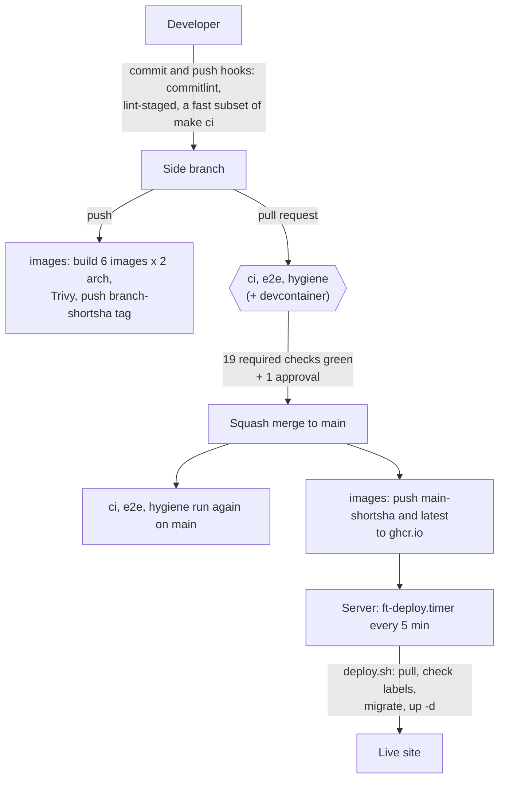

# CI/CD (custom Major, 2 points)

**Type:** Major (custom module). **Points:** 2. **Status:** done.

Every change to the app goes through the same automatic path. A teammate opens a pull
request. GitHub runs 41 checks on it, from the commit message to a full browser test on
the production build, and the merge button stays locked until the required checks pass
and another teammate approves. After the merge, the container images are built for two
kinds of processor, scanned for known security holes and published. Within minutes the
server finds the new images and updates itself, with nobody logging in.

CI means "continuous integration": checking every change automatically. CD means
"continuous delivery": shipping every accepted change automatically.

## What the subject asks

From "Modules of choice" in chapter IV of
[../subject/ft_transcendence.pdf](../subject/ft_transcendence.pdf) (summary in
[../subject/summary.md](../subject/summary.md)):

> Major: Implement a custom module that is not listed above.
>
> - The module must be substantial and demonstrate technical complexity.
> - You must provide proper justification in your README.md explaining:
>   - Why you chose this module.
>   - What technical challenges it addresses.
>   - How it adds value to your project.
>   - Why it deserves Major module status (2 points).
> - Taking shortcuts or implementing trivial features will result in rejection.
> - Be creative and think outside the box.
> - The module should be relevant to your project context.

CI/CD is not in the subject's module list. The DevOps section lists ELK, Prometheus and
Grafana, microservices, and a health check page with backups. None of them builds,
tests or ships the code.

## How we meet it

A custom module has no fixed list of requirements, so this table lists what we claim and
where the proof is.

| What we claim | What we built | Where |
| ------------- | ------------- | ----- |
| Every change is checked before it can merge | Four workflows run on every pull request and again on `main` after the merge: `ci`, `e2e`, `hygiene`, `images`. A fifth, `devcontainer`, runs when the development container's files change. On pull request #212 that made 41 checks. | [`.github/workflows/`](../../.github/workflows) |
| Nobody can skip the checks | A GitHub ruleset on `main`: no direct push, no force push, no deletion, squash merge only, 1 approving review, approvals dismissed on a new push, every review thread resolved, 19 named checks required and the branch up to date with `main`. The API reports `current_user_can_bypass: never`. | Ruleset `ci` (id 20536130), read with `gh api repos/VictorBro/ft_transcendence/rulesets/20536130` |
| Tests run in the same environment as production | Unit tests and the NestJS Supertest suite run inside the `ci` stage of each app's Dockerfile, against real PostgreSQL and Redis containers | `unit-tests` job in [`ci.yml`](../../.github/workflows/ci.yml), `ci` stage in [`apps/api/Dockerfile`](../../apps/api/Dockerfile) and [`apps/web/Dockerfile`](../../apps/web/Dockerfile) |
| Browser tests on the production build | The production compose stack starts in CI, then Playwright runs every spec on Chromium, Firefox and WebKit, in 6 parallel jobs | [`e2e.yml`](../../.github/workflows/e2e.yml) |
| The subject's rejection rules are checked by a machine | Zero console errors and warnings, real legal pages, no committed `.env` | [`e2e/tests/console.spec.ts`](../../e2e/tests/console.spec.ts), [`e2e/tests/legal.spec.ts`](../../e2e/tests/legal.spec.ts), `env-example` job in [`hygiene.yml`](../../.github/workflows/hygiene.yml) |
| Clean history and no leaked secrets | gitleaks over the full history, commitlint on every commit, a pull request title check that renames bad titles, a Prisma migration drift check | [`hygiene.yml`](../../.github/workflows/hygiene.yml), [`scripts/pr-title.sh`](../../scripts/pr-title.sh), [`.github/commitlint.config.mjs`](../../.github/commitlint.config.mjs) |
| Images for two processor types | 6 images (`api`, `web`, `tooling`, `prometheus`, `alertmanager`, `grafana`), each built natively on `amd64` and on `arm64`, then joined into one multi-arch image | [`images.yml`](../../.github/workflows/images.yml) |
| Known security holes are reported | Trivy scans each production image before it is pushed. Results go to the job log and to the repository's Security tab | Trivy steps in [`images.yml`](../../.github/workflows/images.yml) |
| Every build can be found again | Tags: `<branch>-<shortsha>` on a side branch, `main-<shortsha>` and `latest` on `main`, `X.Y.Z`, `X.Y`, `X` on a `vX.Y.Z` tag | `merge` job in [`images.yml`](../../.github/workflows/images.yml), [`../architecture/technical-plan.md`](../architecture/technical-plan.md) section 5 |
| Automatic deploy | A systemd timer on the server runs `deploy.sh` every five minutes. It pulls, migrates and restarts only when an image moved | [`infra/deploy/`](../../infra/deploy) |
| Rollback | Pin `IMAGE_TAG` to an older `main-<shortsha>` in the server's `.env` | [`../operations/deployment.md`](../operations/deployment.md) "Redeploying" |
| The same checks before pushing | Git hooks and `make ci` / `make all` run the same scripts on the developer's machine | [`.husky/`](../../.husky), [`Makefile`](../../Makefile) |

## How it works



### 1. On the developer's machine

Three git hooks in [`.husky/`](../../.husky) run before anything reaches GitHub.
`commit-msg` runs commitlint with the same config CI uses. `pre-commit` refuses a commit
on `main` and formats the staged files. `pre-push` runs a fast subset of `make ci`
(the TypeScript pin, `.env.example`, the app boundaries, lint and typecheck). A hook can
be skipped with `--no-verify`, so every one of these checks also runs in CI.

`make ci` runs everything the `ci` workflow runs, natively. `make all` runs `make ci`,
then starts the production stack and runs Playwright on Chromium. The pull request
template asks for `make all` to be green
([`.github/pull_request_template.md`](../../.github/pull_request_template.md)).

### 2. On every pull request

Each workflow has a `concurrency` group per branch, so a new push cancels the older run
of the same pull request. Push events are filtered to `main`, so a pull request commit
does not run the same checks twice.

- **[`ci.yml`](../../.github/workflows/ci.yml).** The plan calls it "hybrid"
  ([`technical-plan.md`](../architecture/technical-plan.md) section 5). Checks that only
  read files run directly on the runner, because they are fast: `format:check`, `lint`,
  `typecheck`, the TypeScript 6.0.3 pin
  ([`scripts/assert-ts-version.sh`](../../scripts/assert-ts-version.sh)), the check that
  `apps/web` and `apps/api` compile separately
  ([`scripts/check-app-boundaries.sh`](../../scripts/check-app-boundaries.sh)), and the
  monitoring config check
  ([`scripts/check-monitoring-config.sh`](../../scripts/check-monitoring-config.sh)).
  Anything that runs project code runs inside the Docker `ci` stage: the unit tests with
  coverage for `api` and `web`, and the Supertest suite against PostgreSQL (pgvector) and
  Redis service containers. Coverage under 60% lines or functions fails the test command
  (the `thresholds` in each `vitest.config.mts`). Then `build` builds the whole
  workspace.
- **[`e2e.yml`](../../.github/workflows/e2e.yml).** A matrix of 3 browsers times 2
  parts. Each job starts the production stack with
  `docker compose -f compose.yml -f compose.prod.yml up -d --build --wait`, waits until
  Caddy answers `/healthz`, applies the migrations with `make db-ready`, and runs
  Playwright inside Playwright's own image
  ([`scripts/playwright-in-image.sh`](../../scripts/playwright-in-image.sh)). One job
  (Chromium, `rest`) also checks that Prometheus scrapes every target
  ([`scripts/check-monitoring.sh`](../../scripts/check-monitoring.sh)) and restarts the
  API under an open page ([`e2e/tests/restart.spec.ts`](../../e2e/tests/restart.spec.ts)).
  On failure the job uploads the Playwright report and prints the container logs. A last
  job, `playwright (production stack)`, is the one the ruleset requires: it fails unless
  every matrix job passed.
- **[`hygiene.yml`](../../.github/workflows/hygiene.yml).** `gitleaks` scans the full
  history. `commitlint` checks every commit of the pull request. `pr title` checks the
  title, because GitHub uses it as the squash commit subject.
  [`scripts/pr-title.sh`](../../scripts/pr-title.sh) renames a bad title from the only
  commit's subject, or from a branch name such as `ci/lint-pr-title`. `.env hygiene`
  fails if any `.env` file is tracked, and
  [`scripts/check-env-example.sh`](../../scripts/check-env-example.sh) checks that
  `.env.example`, the compose files and the code name the same variables.
  `prisma migration drift` replays the migrations into a throwaway database and fails if
  they do not match `schema.prisma`.
- **[`devcontainer.yml`](../../.github/workflows/devcontainer.yml).** Only when
  `.devcontainer/`, `.nvmrc`, `package.json`, a compose file or `.env.example` changes.
  It builds the development image, checks Node and pnpm against the repo's pins, starts
  it as root and as `node`, and runs the host preflight script against a fake rootless
  Docker daemon.

All jobs that need Node share one setup step,
[`.github/actions/setup/action.yml`](../../.github/actions/setup/action.yml): pnpm from
`packageManager`, Node from `.nvmrc`, a pnpm store cache, and
`pnpm install --frozen-lockfile`.

### 3. Building and publishing the images

[`images.yml`](../../.github/workflows/images.yml) runs on every push to any branch, so a
broken Dockerfile shows up on the pull request, not after the merge.

1. **Build, 12 jobs.** Each of the 6 images builds on a native `ubuntu-24.04` runner
   (`amd64`) and a native `ubuntu-24.04-arm` runner (`arm64`), with a build cache per
   image and per architecture.
2. **Scan.** For the production images (`api`, `web` and the three monitoring images),
   the job first loads the image locally, then Trivy scans it for CRITICAL and HIGH
   problems that have a fix. Results go to the log as a table and to the Security tab as
   SARIF (one category per image and architecture).
3. **Push by digest.** Each job pushes its image to `ghcr.io` with no tag, and passes the
   digest (the image's content hash) to the next job as an artifact.
4. **Merge, 6 jobs.** One job per image joins the two digests into one manifest list
   (one name that serves the right image to each processor) with
   `docker buildx imagetools create`, adds the tags, then inspects the result.

Every image carries the label `org.opencontainers.image.revision`, the commit it was
built from. The deploy uses it.

### 4. Deploying

The server runs [`compose.deploy.yml`](../../compose.deploy.yml). Our images there use
the tag `${IMAGE_TAG:-latest}`, so by default the server follows `main`.

[`infra/deploy/ft-deploy.timer`](../../infra/deploy/ft-deploy.timer) starts
[`ft-deploy.service`](../../infra/deploy/ft-deploy.service) 3 minutes after boot and then
every 5 minutes, with up to 60 seconds of random delay. The service runs
[`deploy.sh`](../../infra/deploy/deploy.sh):

1. `docker compose pull` every image.
2. Read the `revision` label of each of our images. If they do not all name the same
   commit, the release is still being published: print `release still publishing` and
   stop.
3. Compare the local image ids with the ones saved in `.deployed` after the last good
   deploy. If nothing changed, print `no change` and stop.
4. Run the one-shot `migrate` service from the `tooling` image
   (`prisma migrate deploy`, then the seed). If it fails, the script stops and the
   running stack is left as it was.
5. `docker compose up -d`, then save the new image ids to `.deployed`, then remove the
   old images.

The server pulls; GitHub never connects to the server. So there is no SSH key or deploy
password stored in GitHub.

## Where the code is

| Path | What it does |
| ---- | ------------ |
| [`.github/workflows/ci.yml`](../../.github/workflows/ci.yml) | Format, lint, typecheck, TypeScript pin, app boundaries, monitoring config, unit and Supertest tests in Docker, package tests, build |
| [`.github/workflows/e2e.yml`](../../.github/workflows/e2e.yml) | Production stack plus Playwright on 3 browsers, monitoring check, API restart test, the required gate job |
| [`.github/workflows/hygiene.yml`](../../.github/workflows/hygiene.yml) | gitleaks, commitlint, pull request title, `.env` hygiene, Prisma drift |
| [`.github/workflows/images.yml`](../../.github/workflows/images.yml) | Multi-arch build, Trivy, push by digest, manifest lists and tags |
| [`.github/workflows/devcontainer.yml`](../../.github/workflows/devcontainer.yml) | Builds and starts the development container |
| [`.github/actions/setup/action.yml`](../../.github/actions/setup/action.yml) | Shared Node, pnpm and install step |
| [`.github/commitlint.config.mjs`](../../.github/commitlint.config.mjs) | The commit message rules used by CI and the `commit-msg` hook |
| [`.github/pull_request_template.md`](../../.github/pull_request_template.md) | What every pull request must say and check |
| [`.github/CODEOWNERS`](../../.github/CODEOWNERS) | Asks the whole team for review on every path |
| [`.husky/`](../../.husky) | `commit-msg`, `pre-commit` and `pre-push` hooks |
| [`scripts/`](../../scripts) | The check scripts that CI, the hooks and `make` share |
| [`Makefile`](../../Makefile) | `make ci` and `make all`: the pipeline on a laptop |
| [`apps/api/Dockerfile`](../../apps/api/Dockerfile), [`apps/web/Dockerfile`](../../apps/web/Dockerfile) | The `ci` stage for tests, the `prod` stage that ships, the api `build` stage that becomes `tooling` |
| [`infra/monitoring/*/Dockerfile`](../../infra/monitoring) | Prometheus, Alertmanager and Grafana with our config inside, so a rule merged to `main` deploys like code |
| [`infra/deploy/deploy.sh`](../../infra/deploy/deploy.sh) | Pull, check the release, migrate, restart |
| [`infra/deploy/ft-deploy.service`](../../infra/deploy/ft-deploy.service), [`ft-deploy.timer`](../../infra/deploy/ft-deploy.timer) | Run `deploy.sh` every five minutes |
| [`compose.deploy.yml`](../../compose.deploy.yml) | What the server runs, with `IMAGE_TAG` |

## How to show it at the defence

You need a teammate with write access to the repository, and SSH access to the server
for steps 9 and 10.

1. Make a small, safe change on a branch. The branch name follows the `type/slug` rule:
   ```bash
   git switch main && git pull
   git switch -c docs/defence-demo
   # change one line in a doc
   git commit -am "docs: defence demo"
   git push -u origin docs/defence-demo
   ```
   The hooks run during `commit` and `push`. Show that `git commit` on `main` is refused.
2. Open the pull request with a title GitHub would write itself:
   `gh pr create --title "Defence demo" --fill`. The `pr title` job
   renames it to `docs: defence demo` (the commit subject). Show the job log, which ends
   with `Renamed to: ...`.
3. Open the **Checks** tab of the pull request, or run `gh pr checks <number>`. Show the
   workflows running in parallel: about 40 checks.
4. Show that the merge button is locked. Open **Settings > Rules > Rulesets > ci**, or
   run `gh api repos/VictorBro/ft_transcendence/rulesets/20536130`. Point at the 19
   required checks, the one approval, squash only, and `current_user_can_bypass: never`.
5. Open the `images` run of the branch. Show the 12 `build ... (amd64/arm64)` jobs and the
   6 `manifest ...` jobs. Open a `build api (amd64)` job and the **Trivy scan (log)**
   step: the table of findings.
6. Show the image the branch produced, on both architectures:
   ```bash
   docker buildx imagetools inspect ghcr.io/victorbro/ft_transcendence/api:docs-defence-demo-<shortsha>
   ```
   The output lists `linux/amd64` and `linux/arm64`.
7. Open one `playwright (...)` job of the `e2e` run. Show the steps: start the production
   stack, wait for the proxy, apply migrations, run the suite.
8. Have a teammate approve, then **Squash and merge**. Show the four workflows starting
   again on `main`, and the `images` run adding `main-<shortsha>` and `latest`.
9. On the server, a few minutes later:
   ```bash
   journalctl -u ft-deploy.service -n 50
   ```
   Look for `deploying <sha>` with the merge commit. Or start it at once with
   `sudo systemctl start ft-deploy.service`. Then show which commit is running:
   ```bash
   docker image inspect -f '{{index .Config.Labels "org.opencontainers.image.revision"}}' \
     ghcr.io/victorbro/ft_transcendence/api:latest
   ```
10. Open <https://transcendence.dpdns.org> and show the change live.

If there is no time to wait for a run, open the last merged pull request (for example
[#212](https://github.com/VictorBro/ft_transcendence/pull/212)) and its runs on `main`
in the **Actions** tab instead.

## Tests that prove it

The pipeline is tested by running it: every pull request is a test of it. These are the
checks that prove the pipeline itself does its job.

| Test | What it checks |
| ---- | -------------- |
| [`e2e/tests/console.spec.ts`](../../e2e/tests/console.spec.ts) | On the production build: zero console errors, warnings, uncaught exceptions and failed requests on every route |
| [`e2e/tests/legal.spec.ts`](../../e2e/tests/legal.spec.ts) | `/privacy` and `/terms` answer 200 with real content |
| [`e2e/tests/smoke.spec.ts`](../../e2e/tests/smoke.spec.ts) | The production stack the pipeline started serves the app, the API and the health routes |
| [`e2e/tests/restart.spec.ts`](../../e2e/tests/restart.spec.ts) | A real API restart under an open page, run once after the suite |
| [`scripts/check-monitoring.sh`](../../scripts/check-monitoring.sh) | After the suite: Prometheus scrapes every target, every rule is healthy, Alertmanager is found |
| `playwright (production stack)` in [`e2e.yml`](../../.github/workflows/e2e.yml) | Fails unless every one of the 6 browser jobs passed |
| "Inspect the published manifest" in [`images.yml`](../../.github/workflows/images.yml) | The multi-arch image exists under its new tag after the merge job |
| [`devcontainer.yml`](../../.github/workflows/devcontainer.yml) | The development image builds, has the pinned Node and pnpm, and starts as root and as `node` |

The run history, from `gh run list` on 2026-11-22, counting since the first run on
2026-08-07:

| Workflow | Runs | Success | Failure | Cancelled |
| -------- | ---- | ------- | ------- | --------- |
| `ci` | 624 | 548 | 31 | 45 |
| `e2e` | 624 | 527 | 32 | 65 |
| `images` | 682 | 621 | 2 | 59 |

Most cancelled runs are older runs replaced by a newer push to the same branch. On the
merge of #212 (commit `e0ba88c`), `hygiene` took about 1 minute, `ci` and `images` about
3.5 minutes, and `e2e` about 10.5 minutes.

## Why we chose it

- **The subject's rejection rules are easy to break and easy to miss.** One console
  warning, a missing legal page or a committed `.env` can fail the whole project. A
  reviewer cannot see a console warning in a diff. So we made a machine check them on
  the production build, on every change, on three browsers.
- **Five people push to one repository.** Without a gate, `main` breaks for everyone.
  The ruleset makes "tested and reviewed" a rule GitHub enforces, not a habit.
- **Commits are graded.** The subject grades commits from every member with clear
  messages. commitlint, the pull request title check and squash-only merges keep the
  history of `main` readable.
- **The app runs on a real server.** It runs at <https://transcendence.dpdns.org> (see
  [custom-cloud-deploy.md](custom-cloud-deploy.md)). Updating it by hand after each merge
  would be slow and would go wrong. CD makes `main` and the live site the same thing.

## The technical challenges

Each of these is a problem we met, and the comment in the file that solves it explains
it.

1. **Two processor types without emulation.** Building `arm64` images on an `amd64`
   machine through QEMU (an emulator) is slow, and the comment in `images.yml` says it
   "occasionally miscompile[s] native addons" (the api uses `argon2`, a native addon).
   We build on native runners of each type. Then a new problem: if each job tagged its
   own image, the last job to finish would own the tag, and half the machines would pull
   the wrong architecture. So the build jobs push by digest only, pass the digests as
   artifacts (a matrix job cannot pass outputs), and a separate job joins them and tags
   once.
2. **A half-published release.** The 6 manifest jobs run in parallel, so the server can
   pull a new `api` next to an old `tooling`. `deploy.sh` reads the commit label of every
   image and waits until they agree. It saves "deployed" only after a successful
   `up -d`, so a failed deploy is tried again at the next tick instead of being marked as
   done. It migrates before it restarts, and stops on a failed migration with the old
   stack still running.
3. **Deploy without a deploy key.** The usual way is for GitHub Actions to SSH into the
   server. That puts a key that can run anything on the server into GitHub. We chose the
   other way: the server pulls public images from `ghcr.io`. The cost is up to five
   minutes of delay and a server that must handle every case on its own.
4. **Tests in the same environment as production, but fast.** Tests run inside the
   Dockerfile's `ci` stage, so they use the image's Node and system libraries. Inside a
   `docker run`, `127.0.0.1` is the container itself, not the runner where the database
   service listens, so the job runs the container with `--network host`. Checks that only
   read files stay native, since Docker adds nothing to them.
5. **A browser suite that fits in the time.** Three browsers, each against its own
   production stack. Playwright's own `--shard` cuts by test count, which put almost
   every slow test in one half. We split by file instead (`E2E_PART`: `lesson.spec.ts`
   alone, then the rest; see [`e2e/playwright.config.ts`](../../e2e/playwright.config.ts)).
   Each stack keeps its own signup count, because `POST /auth/signup` is rate limited
   (`e2e/support/signup-budget.ts`). Playwright runs inside its own image, because
   installing WebKit's system packages from the runner's mirror sometimes took long
   enough to time the job out.
6. **A required check that cannot lie.** In GitHub, a skipped job counts as passed. With
   a matrix of 6 jobs, requiring each one by name is fragile. So one gate job runs
   `if: always()` and fails unless the whole matrix succeeded. The ruleset requires
   that job.
7. **The supply chain.** In March 2026, 76 of the 77 tags of `aquasecurity/trivy-action`
   were force-pushed to malicious commits (comment in `images.yml`, and
   [`../operations/versions.md`](../operations/versions.md)). We pin that action by
   commit hash and set the scanner version. Trivy pulls its database with the job's token,
   so rate limits do not look like security findings. The scan reports and does not
   block, because a new advisory published tomorrow would turn yesterday's green pull
   request red without any change.
8. **Safe automation on user text.** The `pr title` job renames pull requests, so it has
   write access. The title is text anyone can write, so it is passed through an
   environment variable and never pasted into the shell script, which would allow shell
   injection.
9. **Small traps found and fixed.** `pnpm --filter ... exec` hid Prisma's exit code 2
   (drift) behind a 1, so the drift job `cd`s into `apps/api` instead. A re-run of the
   title job replays the old title, so the workflow also listens to `edited`. Pushes from
   a fork cannot write packages, so a fork builds but does not push (`PUSH` in
   `images.yml`).

## The value it adds

- **`main` always works.** 93 pull requests were merged by 2026-11-22. Every commit on
  `main` after the initial one is a squashed pull request. The ruleset was created on
  2026-08-07, right after the scaffold (#2), and since then it allows no direct push.
- **The rejection rules are tested, not hoped for.** The console gate, the legal pages
  and the `.env` rule run on every change, on the build the evaluator will run.
- **A merge reaches the live site with nobody on the server.** About 4 minutes of
  `images`, then at most 5 minutes until the next timer tick. This also covers the
  monitoring config: a new alert rule merged to `main` deploys like code.
- **Any release can be found and rolled back.** Every `main` commit has a
  `main-<shortsha>` image. Pinning `IMAGE_TAG` to it in the server's `.env` holds or
  rolls back the server.
- **The same images run on both processor types.** One image name serves `amd64` and
  `arm64` machines, so the server can be either kind without a change.
- **New teammates get fast, local feedback.** The hooks and `make all` run the same
  scripts as CI, so most problems are found before a push.

## Why it deserves its size

A trivial CI is one workflow that runs `npm test`. This module is a pipeline from the
developer's machine to the live server:

- **5 workflows and 1 shared action**, plus **10 scripts** in [`scripts/`](../../scripts)
  shared by CI, `make` and **3 git hooks**.
- **41 checks** on a typical pull request (#212), of which the ruleset **requires 19**.
- **A full production stack started 6 times per run**, for **3 browser engines**.
- **18 image jobs per push**: 6 images on 2 architectures, then 6 manifest lists.
  Security scanning with results tracked in the Security tab.
- **A deploy agent** (`deploy.sh` with a systemd service and timer) that handles a release
  still being published, failed migrations, retries and rollback, with no credential in
  GitHub.
- **It has been running for the whole project:** more than 600 runs each of `ci`, `e2e`
  and `images` since 2026-08-07.

It is also relevant to this project in particular. The subject rejects the project for a
console warning or a missing legal page, and grades the commit history. This pipeline
checks exactly those things on every change.

## Limits and choices

- **Trivy reports, it does not block.** A new advisory can appear without any change in
  our code. Blocking would make old green pull requests red and stop the image push. The
  findings are in the Security tab, and the pull request template asks the author to
  check new dependencies. The `tooling` image is not scanned: it only migrates and seeds
  ([`../operations/versions.md`](../operations/versions.md)).
- **Not every image build is required.** The ruleset requires `build api` and
  `build web` on both architectures. The `tooling` and monitoring builds, the manifest
  jobs and `monitoring config` run on every pull request but are not in the required
  list. `devcontainer` only runs on some paths, so it cannot be required.
- **No release tags yet.** The `vX.Y.Z` tags are set up in `images.yml`, but no release
  tag has been pushed. The server follows `latest`, and `main-<shortsha>` is the version
  we roll back to.
- **Old images pile up.** Every push to any branch publishes images. A scheduled clean-up
  of untagged images and of tags whose branch is gone is still a `TODO` at the end of
  `images.yml`.
- **Some server files are copied by hand.** A change to `compose.deploy.yml` or
  `Caddyfile.prod` is not deployed by the timer: it needs `scp` and a restart
  ([`../operations/deployment.md`](../operations/deployment.md) "Automatic deploys").
  Only images move automatically.
- **Review is required, code owners are not.** CODEOWNERS asks the whole team on every
  path, and the ruleset needs one approval from anyone. "Require review from Code
  Owners" is off (`require_code_owner_review: false`). The CODEOWNERS file keeps a
  commented-out plan for named owners of `.github/`, `scripts/` and `infra/`.
- **Up to 5 minutes of delay.** The price of a pull-based deploy without a deploy key.

## Who built it

| Member | GitHub | What they built | Issues and PRs |
| ------ | ------ | --------------- | -------------- |
| Victor | [VictorBro](https://github.com/VictorBro) | Almost all of the module. The five workflows and the shared setup action in the scaffold; the git hooks, the app boundary check and the pull request title check; the Prisma format and drift checks; the deployment stack and the `tooling` image; the automatic deploy (`deploy.sh` and the timer); the monitoring images in `images.yml`; one e2e job per browser; Playwright in its own image; the `devcontainer` workflow. 15 of the 29 commits that touch `.github/`, `scripts/` and `infra/deploy/`. | [#2](https://github.com/VictorBro/ft_transcendence/pull/2), [#23](https://github.com/VictorBro/ft_transcendence/pull/23), [#29](https://github.com/VictorBro/ft_transcendence/pull/29) (his commit in that PR), [#65](https://github.com/VictorBro/ft_transcendence/pull/65), [#66](https://github.com/VictorBro/ft_transcendence/pull/66), [#130](https://github.com/VictorBro/ft_transcendence/pull/130), [#131](https://github.com/VictorBro/ft_transcendence/pull/131), [#189](https://github.com/VictorBro/ft_transcendence/pull/189), [#198](https://github.com/VictorBro/ft_transcendence/pull/198), [#200](https://github.com/VictorBro/ft_transcendence/pull/200), [#210](https://github.com/VictorBro/ft_transcendence/pull/210) |
| Bastian | [bastian-schnitzler](https://github.com/bastian-schnitzler) | Firefox and WebKit in the `e2e` matrix, and a commitlint ignore rule for commits written by Copilot Autofix. | [#159](https://github.com/VictorBro/ft_transcendence/issues/159), [#169](https://github.com/VictorBro/ft_transcendence/pull/169), [#114](https://github.com/VictorBro/ft_transcendence/pull/114) |
| Endrit | [VYAntares](https://github.com/VYAntares) | The e2e migration step now also loads the question bank (`make db-ready`), and new server variables in `infra/deploy/.env.example`. | [#58](https://github.com/VictorBro/ft_transcendence/pull/58), [#69](https://github.com/VictorBro/ft_transcendence/pull/69), [#206](https://github.com/VictorBro/ft_transcendence/pull/206) |
| Anaïs | [avarrett](https://github.com/avarrett) (commits as ninisse) | Small changes that came with her features: `ci.yml`, `scripts/assert-ts-version.sh`, `scripts/check-env-example.sh` and `infra/deploy/.env.example`. | [#104](https://github.com/VictorBro/ft_transcendence/pull/104), [#190](https://github.com/VictorBro/ft_transcendence/pull/190) |
| Luca | [luca-mattei](https://github.com/luca-mattei) | Small changes that came with his features: one variable in `ci.yml`, and new server variables in `infra/deploy/.env.example`. | [#141](https://github.com/VictorBro/ft_transcendence/pull/141), [#201](https://github.com/VictorBro/ft_transcendence/pull/201) |

The commit counts come from `git shortlog -sn --no-merges HEAD -- .github infra/deploy
scripts` (Endrit's commits appear as "EA" and "VYAntares"). Every member uses the
pipeline: all of their pull requests went through it.
