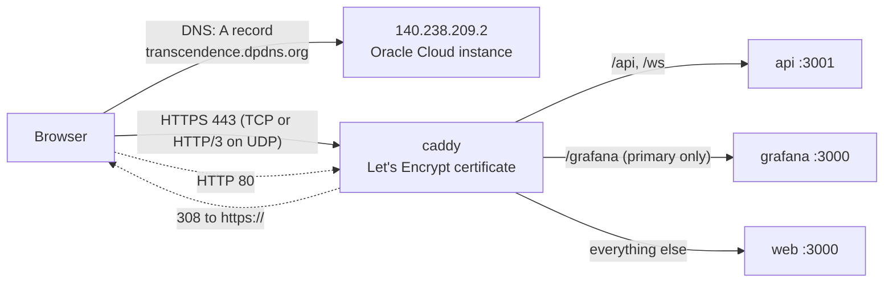

# Cloud deployment with DNS and Let's Encrypt (custom Minor, 1 point)

**Type:** Minor (custom module). **Points:** 1. **Status:** done.

The app does not only run on a laptop. It runs on public servers under real domain
names, with certificates from Let's Encrypt (a free certificate authority that every
browser trusts). Anyone on the internet can open <https://trans.vyantares.ch>, the
primary deployment, and see a green lock, with no warning to click through. That
server also runs monitoring, and another web server there already owns the HTTPS
ports. A secondary copy runs on an Oracle Cloud instance we set up, at
<https://transcendence.dpdns.org>, behind its own firewall, where our own Caddy gets
the certificate. That copy is this module's proof. It runs without monitoring: the
small free-tier VM does not have the memory for it.

## What the subject asks

The module is a row in the Modules of choice table of
[../subject/summary.md](../subject/summary.md):

> | Type  | Module                                                                                                                                                            |
> | ----- | ----------------------------------------------------------------------------------------------------------------------------------------------------------------- |
> | Major | Custom module, substantial and technically complex, justified in the README (why chosen, what challenges, what value, why 2 points). Trivial features = rejection |
> | Minor | Same, smaller scope, still requires justification                                                                                                                 |

The Minor builds on the Major ("Same as the major module"), so both are quoted below.

The PDF ([../subject/ft_transcendence.pdf](../subject/ft_transcendence.pdf), chapter IV.10, Modules of
choice) words it like this:

> Major: Implement a custom module that is not listed above.
>
> - The module must be substantial and demonstrate technical complexity.
> - You must provide proper justification in your README.md explaining:
>   - Why you chose this module.
>   - What technical challenges it addresses.
>   - How it adds value to your project.
>   - Why it deserves Major module status (2 points).
> - Taking shortcuts or implementing trivial features will result in rejection.
> - Be creative and think outside the box.
> - The module should be relevant to your project context.

> Minor: Same as the major module but smaller in scope and less complex.
>
> - Must still demonstrate technical skill and creativity.
> - Should add meaningful value to your project.
> - Requires justification in README.md (similar to Major, but for 1 point).

The README rules (chapter VI, Readme Requirements) add, for the Modules section:

> - Modules:
>   - List of all chosen modules (Major and Minor).
>   - Point calculation (Major = 2pts, Minor = 1pt).
>   - Justification for each module choice, especially for custom "Modules of choice".
>   - How each module was implemented.
>   - Which team member(s) worked on each module.

The mandatory part (chapter III.3, Technical requirements) already says: "Any connection to the
backend, from a browser, from a script, from an external API, etc., must use HTTPS."
We meet that rule on every machine with Caddy's own local certificate
authority ([`infra/caddy/Caddyfile`](../../infra/caddy/Caddyfile), `local_certs`). This
module is what comes on top: a public server, a public name, and a certificate the
browser trusts without being told to.

## How we meet it

A custom module has no fixed list of requirements, so this table lists what we claim and
where the proof is.

| What we claim | What we built | Where |
| ------------- | ------------- | ----- |
| A server in a public cloud | The secondary copy's Oracle Cloud instance (Ubuntu 24.04) in the `eu-zurich-1` region, set up with the settings in the runbook and reached with the OCI command-line tool, with Docker installed at first boot by cloud-init | [`../operations/deployment.md`](../operations/deployment.md) sections 1 and 2 |
| A firewall that opens only what is needed | The cloud security list opens 22/tcp (SSH, for the team), 80/tcp, 443/tcp and 443/udp. Nothing else: Grafana, Prometheus and Alertmanager are never opened (3000, 9090, 9093) | [`../operations/deployment.md`](../operations/deployment.md) section 2 |
| Real domain names | `A` records: `transcendence.dpdns.org` to `140.238.209.2`, TTL 300, for the Oracle copy, and `trans.vyantares.ch` to the shared VPS, for the primary | [`../operations/deployment.md`](../operations/deployment.md) section 4, and "The primary, behind another reverse proxy" |
| A certificate from Let's Encrypt, obtained and renewed with no manual step | On the Oracle copy, our Caddy gets it on its own for `SITE_DOMAIN`, with `ACME_EMAIL` as the contact address, and stores it in the `caddy-data` volume. On the primary, the front proxy does | [`infra/caddy/Caddyfile.prod`](../../infra/caddy/Caddyfile.prod), [`compose.deploy.yml`](../../compose.deploy.yml) |
| HTTPS only | Plain HTTP answers `308 Permanent Redirect` to `https://`. HSTS (a header that tells the browser to use only HTTPS for a year) is sent on every answer | `Strict-Transport-Security` in [`Caddyfile.prod`](../../infra/caddy/Caddyfile.prod) |
| A server that needs no copy of the repo | Three files on the host. Every image is pulled from the public `ghcr.io` registry, so no build and no registry login happen on the server | [`compose.deploy.yml`](../../compose.deploy.yml) (header comment) |
| Production secrets that cannot fall back to a public value | `SESSION_SECRET`, `POSTGRES_PASSWORD`, `LLM_PROVIDER` and, with monitoring, the two Grafana keys have no default: compose refuses to start without them. The one template keeps each of them empty, and a hygiene check fails if one gets a value. `deploy.sh` also refuses the dev and CI values this repo publishes | `${...:?...}` in [`compose.deploy.yml`](../../compose.deploy.yml) and [`compose.deploy.monitoring.yml`](../../compose.deploy.monitoring.yml), [`.env.example`](../../.env.example), check 5 of [`scripts/check-env-example.sh`](../../scripts/check-env-example.sh), [`infra/deploy/deploy.sh`](../../infra/deploy/deploy.sh) |
| The primary host, behind another reverse proxy | An overlay file: our Caddy publishes no port and is routed by the host's own proxy, which holds the certificate | [`compose.deploy.proxy.yml`](../../compose.deploy.proxy.yml), [`../operations/deployment.md`](../operations/deployment.md) "The primary, behind another reverse proxy" |

## How it works

### The path of a request

This is a request to the Oracle copy, where every step is ours. On the primary, the
host's front proxy comes before our Caddy (see below).



1. **DNS.** The browser asks for `transcendence.dpdns.org` and gets one `A` record, the
   public address of the Oracle instance. There is no `AAAA`, no `www` and no `MX`
   record, on purpose ([`deployment.md`](../operations/deployment.md) section 4).
2. **The cloud firewall.** Oracle's security list lets in only 22/tcp (SSH),
   80/tcp, 443/tcp and 443/udp. On the instance, Docker publishes only Caddy's ports. The instance's own
   `iptables` is left alone: Docker publishes ports through the `FORWARD` chain, and
   flushing the rules with the stack up breaks container networking (section 2).
3. **Caddy.** The `caddy` service in [`compose.deploy.yml`](../../compose.deploy.yml)
   (image `caddy:2.11.9-alpine`) is the only container with published ports: `80:80`,
   `443:443` and `443:443/udp`. The UDP port is for HTTP/3: the live site answers
   with `alt-svc: h3=":443"`.
4. **Routing.** [`Caddyfile.prod`](../../infra/caddy/Caddyfile.prod) has one site,
   `{$SITE_DOMAIN}`. It sends `/api` and `/ws` to the NestJS `api`, `/grafana` to
   Grafana on the primary (the Oracle copy, without monitoring, answers 503), and the
   rest to the Next.js `web` container. It also adds the security headers (`X-Frame-Options DENY`,
   `X-Content-Type-Options nosniff`, a `Referrer-Policy`, a `Permissions-Policy` and
   HSTS) and removes the `Server` header from HTTPS answers.

### The certificate

- The site address in `Caddyfile.prod` is a real name (`{$SITE_DOMAIN}`), and the global
  options set `email {$ACME_EMAIL}`. With these two lines, Caddy uses ACME (the
  protocol Let's Encrypt speaks) to prove it controls the name and get a certificate.
  No `certbot`, no cron job, no script of ours: Caddy's
  [automatic HTTPS](https://caddyserver.com/docs/automatic-https) does the request and
  the renewal.
- Caddy proves control of the name by answering a challenge from Let's Encrypt on port
  80 or 443. This is why the DNS record must point to the server **before** the stack
  starts: a failed check still counts against Let's Encrypt's rate limit
  ([`deployment.md`](../operations/deployment.md) section 4, and the `SITE_DOMAIN`
  comment in [`.env.example`](../../.env.example)).
- The certificate and the ACME account are kept in the `caddy-data` volume, mounted at
  `/data`. The comment in `compose.deploy.yml` gives the reason: "Lose it and every
  restart asks the CA again, which is rate limited to a handful per domain per week."
- The dev file [`infra/caddy/Caddyfile`](../../infra/caddy/Caddyfile) uses
  `local_certs` instead. Its comment says why: "there is no public domain to validate". The header of
  `Caddyfile.prod` lists the four differences between the two files: the real domain,
  the Let's Encrypt certificate, HSTS, and the visitor's address resolved through a
  front proxy.

Both public names have a Let's Encrypt certificate that lasts 90 days. On
`trans.vyantares.ch`, the primary, the host's front proxy requests and renews it (see
below). On `transcendence.dpdns.org`, the Oracle copy, our Caddy does. Neither the repo nor
[`deployment.md`](../operations/deployment.md) has a step that requests or renews a
certificate by hand. The defence steps show the dates the live certificate has.

### The primary host, behind another reverse proxy

The primary deployment runs on a shared Infomaniak VPS, with monitoring. That VPS
already runs `caddy-docker-proxy`, which owns 80 and 443 for several projects and
routes by Docker labels. [`compose.deploy.proxy.yml`](../../compose.deploy.proxy.yml)
adapts our stack to it:

- `ports: !reset []`: our Caddy publishes nothing.
- `SITE_DOMAIN: http://${SITE_DOMAIN}`: our Caddy serves plain HTTP on the hop from the
  front proxy. The file's comment explains why: "an https site here would redirect that
  hop to https and loop."
- Two labels, `caddy` and `caddy.reverse_proxy`, tell the front proxy to route the name
  to our Caddy, which joins its network (`PROXY_NETWORK`, default `web`). The front
  proxy gets the certificate.
- `CADDY_TRUSTED_PROXIES: private_ranges`: our Caddy believes the front proxy's
  `X-Forwarded-For`, so `{client_ip}` is the visitor and not the proxy. Without this,
  every visitor would share one rate limit in the API and one login lockout in Grafana.
  It is safe only because this Caddy publishes no port.

The primary shows both hops: its answers carry `via: 1.1 Caddy` twice.
[`infra/deploy/deploy.sh`](../../infra/deploy/deploy.sh) adds the overlay on its own
when the file sits next to `compose.deploy.yml`, and the monitoring overlay the same way.

### Where this module stops and CI/CD starts

The two custom modules share files, so the line between them is drawn here once.

| This module (cloud deployment) | The CI/CD module ([custom-ci-cd.md](custom-ci-cd.md)) |
| ------------------------------ | ----------------------------------------------------- |
| The Oracle instance, cloud-init, the firewall, the IP | The workflows in [`.github/workflows/`](../../.github/workflows) |
| The DNS record | Building, scanning and publishing the images to `ghcr.io` (`images.yml`) |
| Caddy, `Caddyfile.prod`, the Let's Encrypt certificate, HSTS | The automatic deploy: `deploy.sh`, `ft-deploy.service`, `ft-deploy.timer` |
| `compose.deploy.yml`, `compose.deploy.monitoring.yml` and `compose.deploy.proxy.yml`: what runs on the server, with which secrets and memory limits | Image tags (`latest`, `main-<sha>`) and how a release is held or rolled back |

This module counts the first manual deploy (the three files and the three `docker
compose` commands of [`deployment.md`](../operations/deployment.md) section 5). Anything
that happens without a person, after a merge, belongs to CI/CD.

## Where the code is

| Path | What it does |
| ---- | ------------ |
| [`compose.deploy.yml`](../../compose.deploy.yml) | The server's stack: pulls released images, never builds; Caddy with ports 80, 443 and 443/udp and the `caddy-data` volume; required secrets |
| [`compose.deploy.monitoring.yml`](../../compose.deploy.monitoring.yml) | Overlay for a host that runs monitoring: the seven services and their memory limits |
| [`compose.deploy.proxy.yml`](../../compose.deploy.proxy.yml) | Overlay for a host where another reverse proxy owns 80 and 443 |
| [`infra/caddy/Caddyfile.prod`](../../infra/caddy/Caddyfile.prod) | The production Caddy config: the domain, the ACME email, HSTS and the security headers, the routes, the trusted proxies |
| [`infra/caddy/Caddyfile`](../../infra/caddy/Caddyfile) | The dev config, with `local_certs`, to compare against |
| [`.env.example`](../../.env.example) | The one `.env` template, for a checkout and for a server. Its server-only section has `SITE_DOMAIN`, `ACME_EMAIL`, `IMAGE_TAG`, `PROXY_NETWORK`, `COMPOSE_PROJECT_NAME`; every secret is empty |
| [`scripts/align-env.sh`](../../scripts/align-env.sh) | Rewrites an existing `.env` in the template's order and comments, keeping every value |
| [`docs/operations/deployment.md`](../operations/deployment.md) | The runbook: the two hosts, OCI CLI, the instance, cloud-init, the IP, DNS, the first deploy, memory, monitoring on a server, the primary behind another proxy |
| [`scripts/check-monitoring-config.sh`](../../scripts/check-monitoring-config.sh) | Validates both Caddyfiles and the three deploy topologies (see the tests) |

## How to show it at the defence

From any machine with internet access. The commands only read. Steps 1 to 3 work on
either public name: set `HOST=transcendence.dpdns.org` (the secondary copy on the Oracle
instance, where our own Caddy holds the certificate) or `HOST=trans.vyantares.ch` (the
primary, on the shared VPS, where the front proxy holds it). Show the copy first, since
its certificate is the one our Caddy got itself, then the primary.

1. **The DNS record.**

   ```bash
   dig "$HOST" A +noall +answer
   ```

   It shows one `A` record with the host's address; for `transcendence.dpdns.org` it is
   `transcendence.dpdns.org. 300 IN A 140.238.209.2`. Then `dig +short AAAA "$HOST"`
   prints nothing: there is only the `A` record. Without `dig`,
   `getent ahostsv4 "$HOST"` gives the address.

2. **The certificate.**

   ```bash
   echo | openssl s_client -connect "$HOST:443" -servername "$HOST" 2>/dev/null \
     | openssl x509 -noout -issuer -subject -dates -ext subjectAltName
   ```

   The issuer is `O=Let's Encrypt`, the subject is `CN=` the name, and `notBefore` to
   `notAfter` is 90 days. The same with curl:

   ```bash
   curl -sv -o /dev/null "https://$HOST/" 2>&1 | grep -A6 'Server certificate'
   ```

   It shows the subject, the start and expire dates, the Let's Encrypt issuer and
   `SSL certificate verify ok.`

3. **HTTPS only.**

   ```bash
   curl -sI "http://$HOST/"
   curl -sI "https://$HOST/"
   ```

   The first answers `308 Permanent Redirect` to `https://`. The second shows
   `strict-transport-security: max-age=31536000; includeSubDomains`, `via: 1.1 Caddy`
   and `alt-svc: h3=":443"`. On the primary, `trans.vyantares.ch`, `via: 1.1 Caddy` comes
   twice: the front proxy, then ours. Open the site in a browser and click the lock: no warning, and
   the certificate is from Let's Encrypt.

4. **The config behind it.** Open [`Caddyfile.prod`](../../infra/caddy/Caddyfile.prod):
   show `email {$ACME_EMAIL}`, the `{$SITE_DOMAIN}` site and the HSTS header. Open
   [`compose.deploy.yml`](../../compose.deploy.yml): show the three ports and the
   `caddy-data` volume. That is the whole certificate setup. Open
   [`compose.deploy.proxy.yml`](../../compose.deploy.proxy.yml) to show how the primary
   differs: no ports, plain HTTP behind the front proxy, the two labels.

5. **The servers** (a team member with the SSH key). On the Oracle copy:

   ```bash
   ssh ubuntu@140.238.209.2
   ls -a                                     # compose.deploy.yml, Caddyfile, .env among others
   docker compose -f compose.deploy.yml ps
   docker compose -f compose.deploy.yml exec caddy find /data/caddy/certificates -name '*.crt'
   docker compose -f compose.deploy.yml logs caddy | grep -i certificate
   ```

   `ps` shows Caddy as the only service with published ports, and no monitoring
   service. `find` shows the certificate our Caddy stored in its volume. On the
   primary, the shared VPS, the files are in `~/ft_transcendence`, and
   `docker compose -f compose.deploy.yml -f compose.deploy.monitoring.yml -f compose.deploy.proxy.yml ps`
   shows the seven monitoring services next to the app, and no published port at all,
   since the front proxy owns 80 and 443
   ([`deployment.md`](../operations/deployment.md) "The primary, behind another reverse
   proxy").

6. **The cloud side** (optional, needs an OCI session, see
   [`deployment.md`](../operations/deployment.md) section 1): the instance list command
   of section 2 shows the instance. Its ingress rules are the ones of section 2: 22/tcp,
   80/tcp, 443/tcp and 443/udp.

## Tests that prove it

There is no unit test for a DNS record or a certificate. The live site is the proof
(steps 1 to 3 above). What can be checked before a deploy is checked in CI.

| Test | What it checks |
| ---- | -------------- |
| [`scripts/check-monitoring-config.sh`](../../scripts/check-monitoring-config.sh), section 5 | `caddy validate` on `Caddyfile` and `Caddyfile.prod` with the pinned Caddy image, and on `Caddyfile.prod` again with the values the proxy overlay gives (`http://` site, `CADDY_TRUSTED_PROXIES=private_ranges`) |
| same script, section 7 | `compose.deploy.yml` resolves alone with no Grafana key and no monitoring service, with `compose.deploy.monitoring.yml`, and with both overlays. In each deploy stack without the proxy overlay only `caddy` publishes ports, and only 80 and 443. Behind a proxy no service publishes a port, and `caddy` joins the proxy network with its site label. Every service in every deploy stack keeps the log caps |
| same script, `PINNED_SERVICES` | The `caddy`, `db`, `redis` and exporter images in the deploy files are the same versions as in `compose.yml` |
| [`scripts/check-env-example.sh`](../../scripts/check-env-example.sh), checks 3 and 5 | Every variable the deploy files read is in `.env.example`, and every one they require with `:?` is empty there, so a server started on a copy of the template stops instead of running on a published value |

The first script runs in the `monitoring config` job of
[`.github/workflows/ci.yml`](../../.github/workflows/ci.yml), and in `make`
([`Makefile`](../../Makefile)). The second runs in
[`.github/workflows/hygiene.yml`](../../.github/workflows/hygiene.yml), in `make` and in the
`pre-push` hook.

## Why we chose it

- **The subject asks for HTTPS, and a local certificate only half proves it.** On a
  laptop, our HTTPS uses Caddy's own certificate authority, which each browser must be
  told to trust ([`infra/caddy/Caddyfile`](../../infra/caddy/Caddyfile)). On the public
  server, the evaluator, a teammate's phone or any visitor gets a certificate the
  browser already trusts.
- **A language-learning platform is meant to be used.** A public address lets the team
  test on real devices and networks, and lets anyone open the app without cloning the
  repo.
- **It completes the work of the CI/CD module.** CI/CD publishes images; this module is
  the place they run. Without a server and a domain, the published images have nowhere
  to go.

## The technical challenges

- **A very small server.** The Oracle copy runs on a small free-tier instance. The
  shape the runbook sets up is `VM.Standard.E2.1.Micro`: 1 GB of RAM and a part of one
  shared core. The running server shows 954 MiB of RAM and 2 vCPUs (measured on 2026-11-27). The larger
  `VM.Standard.A1.Flex` is "usually out of host capacity". The app takes about 450 MB
  and monitoring adds an estimated 330 to 450 MB, more than that VM can spare. We
  answered with an overlay
  ([`compose.deploy.monitoring.yml`](../../compose.deploy.monitoring.yml)) that the copy
  leaves out, to run the app alone, while the primary runs it. There, every monitoring
  service has a hard `mem_limit` (800 MB together), and Prometheus and Grafana get
  `cpu_shares: 256` so they yield to the app. A 2 GB swapfile covers the rest
  ([`deployment.md`](../operations/deployment.md), "Memory"). The CI/CD module builds
  the images for both `amd64` and `arm64`
  ([`images.yml`](../../.github/workflows/images.yml)), so either shape can run them.
- **A certificate authority with rate limits.** Let's Encrypt allows only a few
  certificates per domain per week. Two rules protect us: the DNS record must resolve
  before the first start, and the certificate lives in a named volume so a restart
  does not ask again.
- **An address that can change.** Oracle gives an ephemeral IP, which is released when
  the instance stops, and cannot turn it into a reserved one in place. The runbook
  gives the command that shows the current IP, and the two ways out: reserve a new
  address, or update the `A` record (section 3). The TTL of 300 seconds keeps a change
  short.
- **Cloud-init that fails in silence.** If `#cloud-config` is not the first line, the
  file "is silently ignored", and the instance boots without Docker (section 2).
- **A server with no checkout.** `compose.yml` has `build:` sections that need the
  source code, so it cannot be the base on the server. `compose.deploy.yml` is
  standalone and pulls everything. Each production secret has no fallback, and the
  database password must be hex, because a `/` from base64 breaks `DATABASE_URL`.
  The server and a checkout share one `.env.example`, so it leaves every secret empty:
  a checkout falls back to its local values, a server refuses to start.
- **A host where the HTTPS ports are taken.** On the primary's shared VPS, our Caddy cannot bind
  80 and 443, and a second HTTPS layer would loop. The overlay turns our Caddy into a
  plain HTTP backend and trusts only the private ranges, so the visitor's address still
  reaches the API's rate limits and Grafana's lockout. A second trap there: a checkout
  of the repo on the same host would share the compose project name and its volumes,
  database included. So every server uncomments `COMPOSE_PROJECT_NAME=ft_transcendence_prod`
  from the server section of `.env.example`, and our two hosts share one `.env`,
  `SITE_DOMAIN` aside.
- **Monitoring that must stay private on a public server.** Grafana is reached only
  through Caddy at `/grafana`, its metrics path is refused with `404`, and Caddy's own
  metrics site (`:2020`) is not published ([`Caddyfile.prod`](../../infra/caddy/Caddyfile.prod)).

## The value it adds

- The evaluator can open the app on any device, with a trusted certificate, at
  <https://trans.vyantares.ch>, the primary, and at the copy,
  <https://transcendence.dpdns.org>.
- The browser is told to use HTTPS only (HSTS), and the security headers are on every
  answer from the public site.
- HTTP/3 works, because 443/udp is open and published.
- A fresh server needs three files and three commands, and one more file to run
  monitoring. The same files run on two very different hosts: the primary on a shared
  VPS behind another proxy, with monitoring, and the copy on a bare cloud instance,
  without it.
- The monitoring module sees real traffic, not only test traffic, because the primary
  runs it in public, always on, from the monitoring overlay.

## Why it deserves its size

It is a **Minor**, not a Major, and we claim only 1 point for it.

What makes it more than a trivial feature:

- Real infrastructure outside the repo: a cloud account, an instance, a firewall, a DNS
  zone, and a certificate trusted by every browser. All of it is live and checkable
  from outside in a minute (see the defence steps).
- Two deployment targets that work differently: one where our Caddy owns TLS, one where
  it must not.
- Constraints we had to design for, each with its answer in the files: 1 GB of RAM,
  ACME rate limits, an ephemeral IP, no checkout on the server, secrets with no
  defaults, the visitor's address through two proxies.

Why it is not a Major:

- The hardest part of the certificate, the ACME protocol and the renewal, is done by
  Caddy. Our work is the config around it, not a certificate client.
- There is almost no application code in it. It is configuration, compose files and a
  runbook.
- The parts that are technically harder and fully automatic (building, scanning and
  publishing multi-arch images, and the pull-based automatic deploy) are claimed by the
  CI/CD module, and we do not count them twice.

## Limits and choices

- **No failover.** If the primary stops, `trans.vyantares.ch` is down until it is back.
  The copy at `transcendence.dpdns.org` is separate, with its own database and no
  monitoring, not a backup. If its Oracle instance stops, its IP may change.
- **The IP is ephemeral.** We chose not to reserve one, because OCI cannot convert in
  place and a reserved IP is a different address. The fix is to update the `A` record.
- **IPv4 only.** There is no `AAAA` record.
- **Nothing in our monitoring watches the certificate's expiry date.** We rely on
  Caddy's renewal and on the `ACME_EMAIL` contact. The blackbox exporter probes the
  containers over plain HTTP inside Docker, not the public HTTPS name
  ([`prometheus.yml`](../../infra/monitoring/prometheus/prometheus.yml)).
- **Changes to the server's files are manual.** A change to `compose.deploy.yml`,
  `compose.deploy.monitoring.yml` or `Caddyfile.prod` needs `scp`, `up -d`, and a
  restart of Caddy, because Caddy reads its config only at start
  ([`deployment.md`](../operations/deployment.md), "Automatic deploys").
- **The instance is not described as code.** The runbook gives a table of settings and
  the cloud-init file; there is no Terraform or other infrastructure-as-code to
  rebuild it with one command.
- **On the primary, the certificate is not ours.** The front proxy requests it, and
  `ACME_EMAIL` is still required but unused there.

## Who built it

| Member | GitHub | What they built | Issues and PRs |
| ------ | ------ | --------------- | -------------- |
| Victor | [VictorBro](https://github.com/VictorBro) | `compose.deploy.yml`, `Caddyfile.prod` with Let's Encrypt and HSTS, the server's `.env.example`, and the Oracle Cloud runbook. Then the `/grafana` route and the memory limits for the server, and the overlay for the host behind another reverse proxy, with the trusted-proxy fix for the visitor's address. Later, new image versions and the rate-limit variables on the server. | [#65](https://github.com/VictorBro/ft_transcendence/pull/65), [#66](https://github.com/VictorBro/ft_transcendence/pull/66), [#130](https://github.com/VictorBro/ft_transcendence/pull/130), [#131](https://github.com/VictorBro/ft_transcendence/pull/131), [#198](https://github.com/VictorBro/ft_transcendence/pull/198) |
| Endrit | [VYAntares](https://github.com/VYAntares) | Made `LLM_PROVIDER` required in `compose.deploy.yml`, so the server never inherits a default AI provider. Capped and rotated the container logs on the server (`x-logging`). | [#69](https://github.com/VictorBro/ft_transcendence/pull/69), [#206](https://github.com/VictorBro/ft_transcendence/pull/206) |
| Luca | [luca-mattei](https://github.com/luca-mattei) | The seed step in the `migrate` service, and the discussion limits passed to the api. | [#123](https://github.com/VictorBro/ft_transcendence/pull/123), [#201](https://github.com/VictorBro/ft_transcendence/pull/201) |
| Bastian | [bastian-schnitzler](https://github.com/bastian-schnitzler) | The `keepalive 4s` setting on the `/api` and `/ws` routes of `Caddyfile.prod`, shorter than Node's keep-alive timeout. | [#192](https://github.com/VictorBro/ft_transcendence/pull/192) |

From `git log --follow` on `compose.deploy.yml`, `infra/caddy/Caddyfile.prod`,
`compose.deploy.proxy.yml` and `infra/deploy/.env.example` (merged into the root `.env.example` in
#237: `git log --follow` reads it from a commit before that), and `gh pr view` for the pull requests. Anaïs ([avarrett](https://github.com/avarrett), commits as ninisse) changed only
comments in these files ([#104](https://github.com/VictorBro/ft_transcendence/pull/104)).
