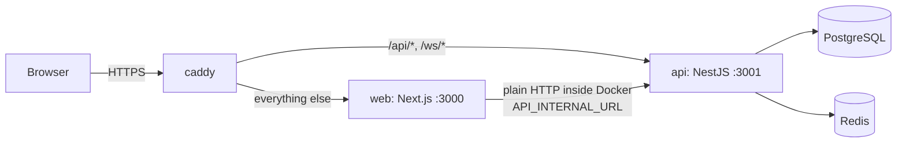

# Framework for frontend and backend (Major, 2 points)

**Type:** Major. **Points:** 2. **Status:** done.

The app is built on two frameworks. The part you see in the browser is made with
Next.js (a framework based on React). The part that holds the rules and the data is
made with NestJS (a framework for Node.js servers).

## What the subject asks

The module is one line in the Web modules table of
[../subject/summary.md](../subject/summary.md):

> | Major | Framework for both frontend and backend (a full-stack framework counts as both if you use its frontend and its backend) |

The subject also says what a framework is:

> Framework definition used by the subject: structured architecture + built-in features +
> full ecosystem. React, Vue, Angular, Svelte, Next.js are frameworks; Express, Fastify,
> NestJS, Django, Flask, Rails are frameworks. jQuery, Lodash, Axios are **not**.

## How we meet it

| The subject asks | What we built | Where |
| ---------------- | ------------- | ----- |
| A frontend framework | Next.js 16 with the App Router, on React 19. Every page is a Next.js page. | [`apps/web/package.json`](../../apps/web/package.json), [`apps/web/app/`](../../apps/web/app) |
| A backend framework | NestJS 11. Every API route is a method in a NestJS controller. | [`apps/api/package.json`](../../apps/api/package.json), [`apps/api/src/`](../../apps/api/src) |
| A full-stack framework counts as both, if you use its frontend and its backend | Not used as our proof. We do not count Next.js as our backend: NestJS is the backend. Next.js only renders pages and calls NestJS. | [`../architecture/overview.md`](../architecture/overview.md), section 1 |

Both frameworks are named as frameworks in the subject's own list, so neither one
needs an argument.

## How it works

Two separate apps run in two containers. A third container, Caddy (a web server),
is the only one open to the outside. It decides where each request goes, by its
path. So the browser sees one single address (one "origin"), and there is no
cross-origin setup (CORS) to write.

The routes are in [`infra/caddy/Caddyfile`](../../infra/caddy/Caddyfile). The
containers are in [`compose.yml`](../../compose.yml).

The rule the team follows is written in
[`../architecture/overview.md`](../architecture/overview.md): "NestJS owns all
business logic and data access. Next.js does presentation and SSR only." The code
keeps to it: no file in `apps/web` uses Prisma (the database library), and there
are no server actions (`'use server'`) in `apps/web`.

### The frontend: Next.js

- **Pages.** Each page is a `page.tsx` file under
  [`apps/web/app/[locale]/`](../../apps/web/app). There are 22. None of them starts
  with `'use client'`, so they all render on the server. The parts that react to
  clicks (forms, the lesson player, the chat) are client components in their own
  files.
- **Built-in features we use:** file-based routing, route groups such as `(main)`,
  `(dashboard)` and `(messages)`, a dynamic `[locale]` segment for the language,
  shared layouts, an error page per locale
  ([`error.tsx`](../../apps/web/app/[locale]/error.tsx)), a not-found page,
  `generateMetadata` for page titles, and route handlers for the health checks
  ([`apps/web/app/healthz/`](../../apps/web/app/healthz)).
- **The request hook.** [`apps/web/proxy.ts`](../../apps/web/proxy.ts) runs before
  each page. It adds the language to the URL (with `next-intl`) and saves the last
  opened course in a cookie.
- **Build.** [`apps/web/next.config.ts`](../../apps/web/next.config.ts) sets
  `output: 'standalone'`, so the production image ships only what Next.js needs to
  run.

### The backend: NestJS

- **Modules.** [`apps/api/src/app.module.ts`](../../apps/api/src/app.module.ts)
  joins the feature modules together (auth, users, friends, messages, courses,
  placement, lessons, the WebSocket gateway, health, metrics). There are 16 module
  files under `apps/api/src/`.
- **Controllers.** There are 10 controllers, for example
  [`friends.controller.ts`](../../apps/api/src/friends/friends.controller.ts). Each
  route is a method with a decorator such as `@Get()` or `@Post('requests/:userId')`.
- **Dependency injection.** NestJS builds each service and gives it to the classes
  that ask for it. For example,
  [`llm.module.ts`](../../apps/api/src/llm/llm.module.ts) builds the AI provider
  once at startup from the settings, and other modules ask for it by name. This
  is what lets the tests swap in a fake provider.
- **Built-in features we use:**
  - a guard on every route, `AuthGuard`
    ([`auth.guard.ts`](../../apps/api/src/auth/auth.guard.ts)), registered for the
    whole app in [`auth.module.ts`](../../apps/api/src/auth/auth.module.ts). A
    route is private unless it is marked `@Public()`.
  - a validation pipe for every request body
    ([`validation.pipe.ts`](../../apps/api/src/validation.pipe.ts)), with Zod
    schemas.
  - an exception filter that turns every error into an error code
    ([`error-code.filter.ts`](../../apps/api/src/error-code.filter.ts)).
  - rate limits with `@nestjs/throttler`, set in `app.module.ts`.
  - WebSocket gateways with `@nestjs/websockets` and socket.io, on the path `/ws`
    ([`socket.gateway.ts`](../../apps/api/src/gateway/socket.gateway.ts)).
  - an OpenAPI page made with `@nestjs/swagger`, served at `/api/docs`.
- **One setup for the app and the tests.** `configureApp()` in
  [`app.setup.ts`](../../apps/api/src/app.setup.ts) sets the global `/api` prefix,
  the session, the pipe, the filter and the Swagger page. Both
  [`main.ts`](../../apps/api/src/main.ts) and the Supertest tests call it, so the
  tests run the same request pipeline as production.

### How the two talk to each other

There are two paths, and both reach the same NestJS routes.

1. **From the Next.js server, while it renders a page.**
   [`apps/web/lib/api.ts`](../../apps/web/lib/api.ts) is "the only place apps/web
   talks to NestJS" (its own comment). It calls `http://api:3001` over the Docker
   network (`API_INTERNAL_URL`), passes on the browser's cookie and the visitor's
   address, and checks the answer with a Zod schema. A 401 means "signed out"; any
   other failure means "the API is unavailable" (a page can also ask for a 404 to
   mean "not found"), so a restart never logs anyone out. [`apps/web/lib/session.ts`](../../apps/web/lib/session.ts) uses it to load
   the signed-in user.
2. **From the browser, after the page has loaded.**
   [`apps/web/lib/api-client.ts`](../../apps/web/lib/api-client.ts) sends
   same-origin requests to `/api/...` (for example `/api/auth/login` in
   [`auth-client.ts`](../../apps/web/lib/auth-client.ts)). Caddy passes them to
   NestJS. The WebSocket client in
   [`tab-socket.ts`](../../apps/web/components/tab-socket.ts) connects to `/ws`
   the same way.

The two apps share their data shapes through
[`packages/shared`](../../packages/shared/package.json) ("Zod contracts shared by
@ft/api and @ft/web: one schema, validated on both sides"). For example, the signup
form checks `SignUpFormSchema` in the browser, and the API checks
`CreateUserSchema`, which `SignUpFormSchema` extends
([`user.ts`](../../packages/shared/src/schemas/user.ts),
[`auth.dto.ts`](../../apps/api/src/auth/auth.dto.ts)).

## Where the code is

| Path | What it does |
| ---- | ------------ |
| [`apps/web/`](../../apps/web) | The Next.js app: pages, layouts, components |
| [`apps/web/app/[locale]/`](../../apps/web/app) | All pages, one folder per route |
| [`apps/web/proxy.ts`](../../apps/web/proxy.ts) | Runs before each page: language prefix and course cookie |
| [`apps/web/next.config.ts`](../../apps/web/next.config.ts) | Next.js settings: standalone build, `next-intl` plugin |
| [`apps/web/lib/api.ts`](../../apps/web/lib/api.ts) | Server-side calls from Next.js to NestJS |
| [`apps/web/lib/api-client.ts`](../../apps/web/lib/api-client.ts) | Browser calls to `/api/...` |
| [`apps/web/lib/session.ts`](../../apps/web/lib/session.ts) | Loads the signed-in user for a page (`currentUser`, `requireUser`) |
| [`apps/web/app/healthz/`](../../apps/web/app/healthz) | Next.js route handlers: web health, and whether web can reach the API |
| [`apps/api/`](../../apps/api) | The NestJS app |
| [`apps/api/src/main.ts`](../../apps/api/src/main.ts) | Starts NestJS on port 3001 |
| [`apps/api/src/app.module.ts`](../../apps/api/src/app.module.ts) | The root module: joins every feature module |
| [`apps/api/src/app.setup.ts`](../../apps/api/src/app.setup.ts) | Global prefix, session, validation, error filter, Swagger |
| [`apps/api/src/validation.pipe.ts`](../../apps/api/src/validation.pipe.ts) | Validates bodies and route parameters with Zod |
| [`apps/api/src/error-code.filter.ts`](../../apps/api/src/error-code.filter.ts) | Makes every error reply carry an error code |
| [`apps/api/src/auth/auth.guard.ts`](../../apps/api/src/auth/auth.guard.ts) | The guard that protects every route by default |
| [`packages/shared/`](../../packages/shared) | Zod schemas and types used by both apps |
| [`infra/caddy/Caddyfile`](../../infra/caddy/Caddyfile) | Sends `/api` and `/ws` to NestJS, `/grafana` to Grafana, the rest to Next.js |
| [`compose.yml`](../../compose.yml) | The `caddy`, `web` and `api` containers |

## How to show it at the defence

1. Start the app with `make run` (or `make`, which also runs every check first). At
   the end it prints the app address and the API docs address.
2. Open [`apps/web/package.json`](../../apps/web/package.json) and
   [`apps/api/package.json`](../../apps/api/package.json). Show `next` and `react`
   in the first, `@nestjs/core` and the other `@nestjs/*` packages in the second.
3. Open <https://localhost/>. You are sent to a path with a language in it, such as
   `/en`. This page is rendered by Next.js.
4. Open <https://localhost/api/docs>. This is the Swagger page that NestJS builds
   from its controllers. Show the `friends` or `auth` group.
5. Open <https://localhost/healthz/upstream>. It answers
   `{"status":"ok","service":"web","upstream":"api"}`. This is a Next.js route that
   just reached NestJS over the internal network.
6. Open <https://localhost/api/health>. It answers with `"service":"api"`: this
   time NestJS answers directly, through Caddy.
7. Open the browser's developer tools, Network tab. Go to
   <https://localhost/en/signup>, fill in the form and click **Create account**.
   Show that the request is `POST /api/auth/signup` on the same address
   (`localhost`), and that you land on `/en/onboarding`.
8. In the code, show one route end to end: the page
   [`profile/page.tsx`](<../../apps/web/app/[locale]/(main)/profile/page.tsx>) (a
   server component that calls `requireUser()`), then
   [`session.ts`](../../apps/web/lib/session.ts) and
   [`api.ts`](../../apps/web/lib/api.ts), then `@Get('me')` in
   [`auth.controller.ts`](../../apps/api/src/auth/auth.controller.ts).

If the stack does not run on port 443, use the address that `make` prints
(`https://localhost:<HTTPS_PORT>`), as the README explains.

## Tests that prove it

| Test | What it checks |
| ---- | -------------- |
| [`e2e/tests/smoke.spec.ts`](../../e2e/tests/smoke.spec.ts) | On the production stack: the home page renders; `/healthz` and `/api/health` answer; "web reaches api over the internal network" (`/healthz/upstream`); "the OpenAPI document is served behind the same origin"; an unknown path gives 404 |
| [`apps/api/test/app.e2e-spec.ts`](../../apps/api/test/app.e2e-spec.ts) | Starts the real NestJS app with `configureApp()` and Supertest: `/api/health` matches the shared schema, and `/api/docs-json` is served |
| [`apps/api/test/error-codes.e2e-spec.ts`](../../apps/api/test/error-codes.e2e-spec.ts) | The pipe and the filter: invalid bodies, unknown routes, crashes and rate limits all answer with an error code |
| [`apps/api/src/auth/auth.guard.spec.ts`](../../apps/api/src/auth/auth.guard.spec.ts) | The global guard: a `@Public` route passes, a route without a session is refused |
| [`apps/web/lib/api.test.ts`](../../apps/web/lib/api.test.ts) | The server-side client: URL building, cookie and address forwarding, 401 read as signed out, 429, 500 and timeouts read as unavailable |
| [`apps/web/lib/api-client.test.ts`](../../apps/web/lib/api-client.test.ts) | The browser client: same-origin credentials, JSON and FormData bodies, schema checks, network errors as codes |
| [`apps/web/lib/session.test.ts`](../../apps/web/lib/session.test.ts) | `currentUser` and `requireUser`: redirect to `/login` on 401, throw (not redirect) when the API is down |

The NestJS Supertest suite runs in CI in
[`.github/workflows/ci.yml`](../../.github/workflows/ci.yml) (`test:e2e`). The
Playwright suite, including the smoke test, runs in
[`.github/workflows/e2e.yml`](../../.github/workflows/e2e.yml).

## Limits and choices

- **Two frameworks, not one full-stack framework.** Next.js could also be a backend.
  We chose to keep all rules and data in NestJS, so that "which part owns what"
  has a one-sentence answer
  ([`../architecture/overview.md`](../architecture/overview.md), section 1). The
  cost is an extra hop: a page render calls NestJS over the network instead of
  reading the database directly.
- **Next.js uses only a small part of its server side.** It has route handlers
  only for health checks (`/healthz`, `/healthz/api`, `/healthz/upstream`) and no
  server actions. This is on purpose, and it is why we claim the module through
  NestJS and not through the "full-stack counts as both" rule.
- **Why NestJS.** The README's stack table gives the reason: dependency injection
  makes the AI provider easy to replace in tests, and it comes with guards,
  validation pipes, WebSocket gateways and Swagger.
- **One origin through Caddy.** Because the browser only talks to one address, the
  session cookie stays first-party and there is no CORS setup. The price is that
  Caddy must know every path that belongs to NestJS (`/api` and `/ws`).

## Who built it

| Member | GitHub | What they built | Issues and PRs |
| ------ | ------ | --------------- | -------------- |
| Victor | [VictorBro](https://github.com/VictorBro) | The project scaffold: the Next.js app, the NestJS app, the shared package, Caddy and compose. Then the first database-backed health check, and the auth pages with the session wiring between the two apps. 14 commits in `apps/web` and 14 in `apps/api`. | [#2](https://github.com/VictorBro/ft_transcendence/pull/2), [#3](https://github.com/VictorBro/ft_transcendence/pull/3), [#5](https://github.com/VictorBro/ft_transcendence/pull/5) |
| Bastian | [bastian-schnitzler](https://github.com/bastian-schnitzler) | The generic API clients: `apiGet` for Next.js server rendering, and `clientGet`, `clientPost`, `clientPut`, `clientPatch`, `clientDelete` for the browser, with their tests. 7 commits in `apps/web` and 8 in `apps/api`. | [#45](https://github.com/VictorBro/ft_transcendence/issues/45), [#57](https://github.com/VictorBro/ft_transcendence/pull/57) |
| Endrit | [VYAntares](https://github.com/VYAntares) | The error-code contract in NestJS: `ErrorCodeFilter` and the code-based validation pipe, so every error reply carries a code the browser translates. 11 commits in `apps/web` and 17 in `apps/api` (as EA and VYAntares). | [#108](https://github.com/VictorBro/ft_transcendence/issues/108), [#126](https://github.com/VictorBro/ft_transcendence/pull/126) |
| Anaïs | [avarrett](https://github.com/avarrett) (commits as ninisse) | Features built on both frameworks: 4 commits in `apps/web` and 8 in `apps/api`. | |
| Luca | [luca-mattei](https://github.com/luca-mattei) | Features built on both frameworks: 9 commits in `apps/web` and 6 in `apps/api`. | |

The commit counts come from `git shortlog -sn --no-merges HEAD -- apps/web` and
`-- apps/api`. Pull requests are squash-merged, so one commit is usually one pull
request.
