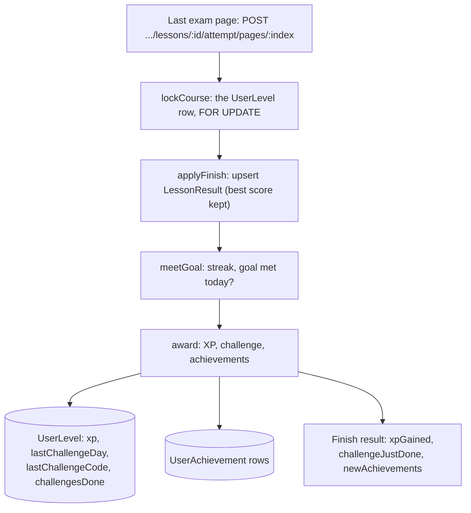

# Gamification (Minor, 1 point)

**Type:** Minor. **Points:** 1. **Status:** done.

Learners earn points (XP) for their lessons and climb ranks, get one small challenge each day, and
collect 16 achievements. Everything is stored per course (one language for one learner), and the
course page, the lesson results and an achievements page show it.

## What the subject asks

The module is one line in the Gaming and user experience table of
[../subject/summary.md](../subject/summary.md):

> | Minor | Gamification: ≥3 of achievements / badges / leaderboards / XP / daily challenges / rewards, persisted, with visual feedback |

The PDF ([../subject/ft_transcendence.pdf](../subject/ft_transcendence.pdf), chapter IV, Gaming
and user experience) words it like this:

> Minor: A gamification system to reward users for their actions.
>
> - Implement at least 3 of the following: achievements, badges, leaderboards, XP/level system,
>   daily challenges, rewards
> - System must be persistent (stored in database)
> - Visual feedback for users (notifications, progress bars, etc.)
> - Clear rules and progression mechanics
>
> While this is a Minor module (1 point), implementing a complete gamification system can be
> substantial. Focus on quality over quantity—three well-implemented features are better than six
> poorly done ones.

**This module without a game.** It is in the gaming chapter (IV.6), and our product is a
language-learning app, not a game. The subject itself suggests it for apps like ours. In
chapter V.6, "Specialized Projects", it lists:

> Language Learning Platform: Lessons, exercises, progress tracking, and peer practice.
>
> - Suggested modules: User interaction, Gamification, Multiple languages, Voice integration,
>   Analytics dashboard

It also suggests Gamification for two other apps that are not games: the "Fitness Tracker" (V.5)
and the "Forum Platform" (V.3).

The subject's rule on dependencies does not list it. In chapter IV, "Important - Module
Dependencies and Evaluation", it says:

> Gaming modules (AI Opponent, Tournament, Game customization, Spectator mode, Multiplayer 3+,
> Add another game) require that at least one game be implemented first.

And in the PDF, the Tournament, Game customization and Spectator modules around it each end with
"This module requires you to have implemented at least one game". The Gamification module has no
such sentence. Its own words, "reward users for their actions", fit any app. So we claim it, and
the "user actions" are finishing lessons and reaching the daily goal. This is our reading of the
subject. The team has written down that it must be confirmed with staff before the defence
([README.md](README.md#gamification-outside-a-game), "Gamification outside a game").

## How we meet it

| The subject asks | What we built | Where |
| ---------------- | ------------- | ----- |
| At least 3 of the six features | Three: **XP with ranks** (the subject's "XP/level system"), **daily challenges** (one a day out of six), and **achievements** (16). Badges, leaderboards and rewards are not built. | [`packages/shared/src/schemas/gamification.ts`](../../packages/shared/src/schemas/gamification.ts), [`apps/api/src/lessons/gamification.rules.ts`](../../apps/api/src/lessons/gamification.rules.ts) |
| Stored in the database | Four columns on the course row `UserLevel` (`xp`, `lastChallengeDay`, `lastChallengeCode`, `challengesDone`) and a `UserAchievement` table, one row per earned achievement. Written in the same transaction as the lesson result. | [`apps/api/prisma/schema.prisma`](../../apps/api/prisma/schema.prisma), [`migration.sql`](../../apps/api/prisma/migrations/20261107184854_add_gamification/migration.sql), [`apps/api/src/lessons/gamification.ts`](../../apps/api/src/lessons/gamification.ts) |
| Visual feedback | Progress bars for the rank, for each achievement and for the whole list; an XP card on the lesson results with each new achievement; a "New today" list and a "Today's challenge" card with a **Done** mark on the course page. | [`apps/web/components/gamification.tsx`](../../apps/web/components/gamification.tsx), [`achievements/page.tsx`](<../../apps/web/app/[locale]/(dashboard)/learn/[lang]/achievements/page.tsx>) |
| Clear rules and progression | A **How it works** panel on the achievements page lists the XP of each action, the XP each rank starts at, the six challenges and the achievement rules. The XP amounts, the rank thresholds and the pass mark on it come from the shared constants the API uses. Each achievement card says its own rule. | [`achievements/page.tsx`](<../../apps/web/app/[locale]/(dashboard)/learn/[lang]/achievements/page.tsx>) (`HowItWorks`), [`apps/web/lib/achievements.ts`](../../apps/web/lib/achievements.ts) |

## How it works

### The three features and their rules

All the numbers are constants in
[`packages/shared/src/schemas/gamification.ts`](../../packages/shared/src/schemas/gamification.ts),
so the API and the web pages read the same values.

- **XP.** A lesson finish earns `LESSON_XP` (10), once per lesson per day, plus every point it
  adds to that lesson's best score. Reaching the daily goal earns `GOAL_XP` (20). Doing the day's
  challenge earns `CHALLENGE_XP` (30). XP never goes down. Example from the tests: a first finish
  at 80 earns 90; the same lesson again that day at 95 earns 15, and at 60 earns 0.
- **Ranks.** Going from rank n to rank n + 1 costs n × `RANK_STEP` (100) XP, so ranks start at 0,
  100, 300, 600, 1000... `rankOf()` turns an XP total into a rank and the bounds of its bar. The
  code says "rank", never "level", because "level" already means the CEFR level (A1 to C2).
- **The daily challenge.** One of six: finish a grammar, vocabulary, everyday phrases or reading
  lesson; score 90% or more; or finish one lesson more than the daily goal. A lesson-kind challenge
  is only offered when the course's level has a ready lesson of that kind. `challengeFor()` picks
  the challenge from a hash of the course id and the day, so the same course and day always give
  the same challenge, and no table or midnight job is needed to store it. Once done, the code it
  was done under is saved (`lastChallengeCode`), so a level change later that day does not change
  it.
- **Achievements.** 16, in four groups: **Lessons** (first lesson, 10, 25 and 50 lessons passed),
  **Streaks** (3, 7, 30 and 100 days in a row), **Challenges** (10 and 50 done) and **Levels**
  (A1 to C2 complete). Each is earned once and kept for good, even if a level later gains lessons
  and its bar drops.

The rules are pure functions in
[`gamification.rules.ts`](../../apps/api/src/lessons/gamification.rules.ts): no clock, no
database, no randomness. That is what lets
[`gamification.rules.spec.ts`](../../apps/api/src/lessons/gamification.rules.spec.ts) test every
rule without a database.

### What happens when a lesson ends

1. The server scores the lesson itself from the answers it stored, so no browser can send a score
   ([`attempts.service.ts`](../../apps/api/src/lessons/attempts.service.ts)).
2. In one transaction, `applyFinish()` in
   [`lessons.service.ts`](../../apps/api/src/lessons/lessons.service.ts) saves the result, calls
   `meetGoal()`, then calls `award()` in
   [`gamification.ts`](../../apps/api/src/lessons/gamification.ts).
3. `award()` checks whether this finish does today's challenge for the first time, adds up the
   XP, and writes it as an increment on the course row. It then counts what the achievements read
   (finished and passed lessons, best streak, challenges done, the level's progress), asks
   `earned()` which ones are reached, and stores the new ones with `createMany`.
4. The course row is locked (`FOR UPDATE`, in [`goal.ts`](../../apps/api/src/lessons/goal.ts))
   for the whole transaction, so two finishes at the same moment cannot award the challenge twice.
   The `UserAchievement` primary key `(userLevelId, code)` also stores a code only once.
5. The answer carries `xpGained`, `challengeJustDone` and `newAchievements`, and the results page
   shows them.

Lowering the daily goal can also meet the day. So `setGoal()` in
[`courses.service.ts`](../../apps/api/src/courses/courses.service.ts) (`PATCH /api/courses/:lang`)
calls `award()` too, under the same lock: it can earn `GOAL_XP` and a streak achievement.

### What the learner reads

- `GET /api/courses/:lang/today` returns `xp` (total, rank and bar bounds), `challenge` (code and
  `done`) and `earnedToday` (codes earned on this course day).
- `GET /api/courses/:lang/achievements` returns all 16 achievements, in catalogue order, each with
  the day it was earned (or null) and its progress bar (`current`, `target`). Both routes are in
  [`lessons.controller.ts`](../../apps/api/src/lessons/lessons.controller.ts).

The API sends codes only. The web pages translate them, from the `Gamification` messages in
[`apps/web/messages/en.json`](../../apps/web/messages/en.json) and the other languages. All
gamification views are server components with no state, so they work with JavaScript off. The
course and achievements pages reload on the `course:updated` socket event (`RefreshOn`), so a
lesson finished in another tab shows up.

## Where the code is

| Path | What it does |
| ---- | ------------ |
| [`packages/shared/src/schemas/gamification.ts`](../../packages/shared/src/schemas/gamification.ts) | The XP prices, `RANK_STEP`, the six `CHALLENGES`, the 16 `ACHIEVEMENTS`, and the Zod schemas of what the API returns |
| [`apps/api/src/lessons/gamification.rules.ts`](../../apps/api/src/lessons/gamification.rules.ts) | Pure rules: `xpForFinish`, `rankOf`, `possibleChallenges`, `challengeFor`, `challengeMet`, `progress`, `earned` |
| [`apps/api/src/lessons/gamification.ts`](../../apps/api/src/lessons/gamification.ts) | `award()`: loads what the rules read and writes what they decide, inside the caller's transaction |
| [`apps/api/src/lessons/lessons.service.ts`](../../apps/api/src/lessons/lessons.service.ts) | `applyFinish()` calls `award()`; `today()` and `achievements()` read the stored state |
| [`apps/api/src/courses/courses.service.ts`](../../apps/api/src/courses/courses.service.ts) | `setGoal()`: a lower goal that meets the day calls `award()` |
| [`apps/api/src/lessons/lessons.controller.ts`](../../apps/api/src/lessons/lessons.controller.ts) | `GET /api/courses/:lang/achievements` |
| [`apps/api/prisma/schema.prisma`](../../apps/api/prisma/schema.prisma) | The gamification columns on `UserLevel`, and `UserAchievement` |
| [`apps/api/prisma/migrations/20261107184854_add_gamification/`](../../apps/api/prisma/migrations/20261107184854_add_gamification/migration.sql) | The migration that adds them |
| [`apps/web/components/gamification.tsx`](../../apps/web/components/gamification.tsx) | `RankLine`, `ChallengeCard`, `NewToday`, `FinishXp`, `DoneMark` |
| [`apps/web/app/[locale]/(dashboard)/learn/[lang]/achievements/page.tsx`](<../../apps/web/app/[locale]/(dashboard)/learn/[lang]/achievements/page.tsx>) | The achievements page: the 16 cards in four groups, and the **How it works** panel |
| [`apps/web/app/[locale]/(dashboard)/learn/[lang]/page.tsx`](<../../apps/web/app/[locale]/(dashboard)/learn/[lang]/page.tsx>) | The course page: rank, today's challenge, new today |
| [`apps/web/app/[locale]/(dashboard)/learn/[lang]/lessons/[id]/results/page.tsx`](<../../apps/web/app/[locale]/(dashboard)/learn/[lang]/lessons/[id]/results/page.tsx>) | The lesson results: the XP card at the top |
| [`apps/web/lib/achievements.ts`](../../apps/web/lib/achievements.ts) | Loads the achievements, and fills the numbers of each rule from the shared constants |
| [`apps/web/lib/xp-breakdown.ts`](../../apps/web/lib/xp-breakdown.ts) | Splits a finish's XP into lesson, goal and challenge rows |

## How to show it at the defence

The stack must be running (`make run`, or `make` to run every check first). The app is at
`https://localhost`; if port 443 was not free, use the address `make run` prints.

**A new learner (XP, challenge, first achievement)**

1. Open `https://localhost/en/signup`, create an account, pick **Français** under "Language to learn", pick a
   "Daily goal", and click **Next**. Click **I already know my level**, choose **A0** (a beginner, so
   the course is French A1) and click **Start learning**.
2. On the course page (`/en/learn/fr`), show under the title: "Rank 1 · 0 of 100 XP" with an empty
   bar, and the link **Achievements and rules**. Below it is the **Today's challenge** card with
   its rule and "+30 XP".
3. Open one of today's lessons, click **Start the lesson**, go through the pages and the exam, and
   click **Finish the exam**.
4. At the top of the results, a card shows "+N XP" with a **Lesson** row, then **New achievement**
   with **First lesson**, then the new rank line. If the lesson also did the challenge or reached
   the daily goal, the card has **Challenge done** and **Daily goal reached** rows with their XP.
5. Click **Back to course**. The rank bar has moved, and **New today** shows **First lesson**. If
   the challenge was done, its card shows **Done**.
6. Click **Achievements and rules**. The page shows "1 of 16 earned", four groups (**Lessons**,
   **Streaks**, **Challenges**, **Levels**), the **First lesson** card in green with "Earned on"
   and the date, and the other cards greyed, each with its progress bar.
   On the side, **How it works** lists the XP of each action and the XP each rank starts at.

**It is stored in the database**

7. Run `make studio` and open the address it prints. In `UserLevel`, the learner's French row has
   `xp` set. In `UserAchievement`, there is a `firstLesson` row for that course, with its `day`.
8. Reload the achievements page, or sign out and back in: the same state comes back from the
   database.

**A learner with more history (optional)**

If `DEMO_PASSWORD` is set in `.env`, the seed builds demo learners
([`.env.example`](../../.env.example), [`demo.data.ts`](../../apps/api/src/demo/demo.data.ts)).
They are replayed through the real services, so they earned their XP and achievements by the same
rules. Sign in at `https://localhost/en/login` as `demo-eva@example.com`: her French A1 is
complete, so `/en/learn/fr/achievements` shows **A1 complete** as earned. `demo-ben@example.com`
has a 12-day streak.

## Tests that prove it

| Test | What it checks |
| ---- | -------------- |
| [`apps/api/src/lessons/gamification.rules.spec.ts`](../../apps/api/src/lessons/gamification.rules.spec.ts) | Every rule: the XP of a finish and a retake, the rank thresholds (rank 2 at 100, rank 3 at 300), the challenge is the same for a course and day, spreads over the six codes, never picks a kind with no ready lesson, and its hash is pinned; `challengeMet` (89 does not meet score90, 90 does); `earned` and `progress` for streaks, counts and levels |
| [`packages/shared/src/schemas/gamification.test.ts`](../../packages/shared/src/schemas/gamification.test.ts) | Six challenge codes, sixteen achievement codes in a fixed order, one per CEFR level, the XP prices, and the schemas refusing a bar past its end or a total outside its rank |
| [`apps/api/test/gamification.e2e-spec.ts`](../../apps/api/test/gamification.e2e-spec.ts) | The real API on a database: the challenge is awarded once when two last pages arrive together; `GOAL_XP` once; a lower retake gains nothing; streak7 and levelA1 come from the right finish only; the achievements list with earned days; a done challenge keeps its code after a level change; achievements are removed with the user; the route is in Swagger |
| [`e2e/tests/gamification.spec.ts`](../../e2e/tests/gamification.spec.ts) | In the browser: a first finish shows its XP, **First lesson** and the rank on the results, the course page and the achievements page; doing the challenge shows **Done** and reaches rank 2; one click opens the rules; both pages render without JavaScript |
| [`apps/web/lib/xp-breakdown.test.ts`](../../apps/web/lib/xp-breakdown.test.ts) | The XP card's rows add up to `xpGained` |
| [`apps/web/lib/messages.test.ts`](../../apps/web/lib/messages.test.ts) | Every achievement and challenge code has a title and a rule in the messages |

## Limits and choices

- **Three features, not six.** No badges, no leaderboards, no rewards
  ([../architecture/product.md](../architecture/product.md)). The subject asks for three and says
  three done well are better than six done poorly.
- **No game.** The module is claimed on an app without a game, as explained above. It must be
  confirmed with staff before the defence.
- **Per course, not per user.** XP, the challenge and the achievements belong to one course. A
  learner with French and German has two ranks and two sets of achievements.
- **The challenge is derived, not stored.** Only the day it was done and its code are saved. A
  level change before it is done can change the day's challenge, because the choice depends on
  the level's ready lesson kinds.
- **Level achievements follow the ready lessons.** "A1 complete" reads the lessons that can be
  played today. While a level has only some lessons written, the achievement can be earned on
  those, and a lesson added later does not take it back (comment on `earned()` in
  [`gamification.rules.ts`](../../apps/api/src/lessons/gamification.rules.ts)).
- **Feedback is inline, not a pop-up.** The XP card is part of the results page, not a toast. We do not claim the notification module
  ([README.md](README.md#not-claimed)).
- **Old attempts.** An attempt finished before the awards existed (#95) earned nothing. Its
  results show no XP rows, only that the goal was met (`EARNED_NOTHING` in
  [`attempts.service.ts`](../../apps/api/src/lessons/attempts.service.ts), `legacyGoal` in
  [`xp-breakdown.ts`](../../apps/web/lib/xp-breakdown.ts)).

## Who built it

| Member | GitHub | What they built | Issues and PRs |
| ------ | ------ | --------------- | -------------- |
| Anaïs | [avarrett](https://github.com/avarrett) (commits as `ninisse`) | The whole module: the constants, schemas and pure rules; the database columns, `UserAchievement` and `award()` in the finish and goal transactions, with the API e2e tests; the course page parts, the results XP card, the achievements page and the Playwright test. | [#132](https://github.com/VictorBro/ft_transcendence/pull/132) (closes [#94](https://github.com/VictorBro/ft_transcendence/issues/94)), [#180](https://github.com/VictorBro/ft_transcendence/pull/180) (closes [#95](https://github.com/VictorBro/ft_transcendence/issues/95)), [#199](https://github.com/VictorBro/ft_transcendence/pull/199) (closes [#97](https://github.com/VictorBro/ft_transcendence/issues/97)) |
| Victor | [VictorBro](https://github.com/VictorBro) | Wrote the three issues that specify the feature. | [#94](https://github.com/VictorBro/ft_transcendence/issues/94), [#95](https://github.com/VictorBro/ft_transcendence/issues/95), [#97](https://github.com/VictorBro/ft_transcendence/issues/97) |
