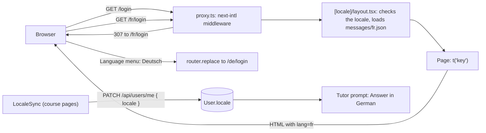

# Internationalization: at least 3 languages (Minor, 1 point)

**Type:** Minor. **Points:** 1. **Status:** done.

The whole website can be read in English, French or German. A menu in the header changes the
language, and the address of the page changes with it: `/en/...`, `/fr/...` or `/de/...`. The
server also remembers the language of a signed-in user, so the AI tutor answers in it.

## What the subject asks

The module is a Minor row in the Accessibility and Internationalization table of
[../subject/summary.md](../subject/summary.md):

> i18n with ≥3 complete languages, language switcher, all text translatable

The PDF ([../subject/ft_transcendence.pdf](../subject/ft_transcendence.pdf), chapter IV,
Accessibility and Internationalization) words it like this:

> Minor: Support for multiple languages (at least 3 languages).
>
> - Implement i18n (internationalization) system.
> - At least 3 complete language translations.
> - Language switcher in the UI.
> - All user-facing text must be translatable.

No dependency rule in the subject applies to this module.

## How we meet it

| The subject asks | What we built | Where |
| --- | --- | --- |
| Support for at least 3 languages | English (`en`), French (`fr`) and German (`de`). The list lives in one place, `SUPPORTED_LOCALES`. The routing and the API checks use it, and the database column `User.locale` is an enum with the same three values. A unit test fails if the list ever has fewer than three entries. | [locale.ts](../../packages/shared/src/schemas/locale.ts), [schemas.test.ts](../../packages/shared/src/schemas/schemas.test.ts), [schema.prisma](../../apps/api/prisma/schema.prisma) (`enum Locale`) |
| Implement an i18n system | The library `next-intl` (version 4.15.1). Every page sits under a `[locale]` folder, so the language is the first part of every address. A middleware (code that runs before each page) picks the language and redirects an address without one. Pages read their text with `t('key')` from a catalogue, never from text typed in the component. | [package.json](../../apps/web/package.json), [i18n/routing.ts](../../apps/web/i18n/routing.ts), [i18n/request.ts](../../apps/web/i18n/request.ts), [proxy.ts](../../apps/web/proxy.ts), [[locale]/layout.tsx](<../../apps/web/app/[locale]/layout.tsx>) |
| At least 3 complete translations | Three catalogues with the same 623 texts in 38 groups. A unit test fails if one catalogue has a key the others do not have, if a text is empty, or if an error code or an achievement has no text. The two legal pages are written in full in each language, in separate files. | [messages/en.json](../../apps/web/messages/en.json), [fr.json](../../apps/web/messages/fr.json), [de.json](../../apps/web/messages/de.json), [messages.test.ts](../../apps/web/lib/messages.test.ts), [lib/legal-content/](../../apps/web/lib/legal-content/index.ts) |
| Language switcher in the UI | A **Language** menu (a native `<select>`) in the header of every page group: the main pages (home, sign-in, profile, friends, legal pages), the course pages and the messages pages. A visitor sees it in the header row. A signed-in user finds it behind the header's menu button (#220). It shows the current language, and each language is named in its own language (English, Français, Deutsch). Choosing one keeps the user on the same page, in the new language. | [language-switcher.tsx](../../apps/web/components/language-switcher.tsx), [header-nav.tsx](../../apps/web/components/header-nav.tsx), [dashboard-nav.tsx](../../apps/web/components/dashboard-nav.tsx), [header-menu.tsx](../../apps/web/components/header-menu.tsx) |
| All user-facing text must be translatable | Every page, button, label, form hint, screen-reader label and tab title comes from the catalogues. The API never sends a sentence: it sends an error code, and the browser turns the code into a sentence in the reader's language. Lesson instructions and objectives are stored in the three languages and shown in the interface language. Four things stay in English: the page shown when the whole site fails to load, the tagline drawn inside the logo image, the fixed answer of the fixture tutor (the default without an LLM key), and the 404 for a missing address with a dot in it, like `/nope.txt`. See [Limits and choices](#limits-and-choices). | [error-message.ts](../../apps/web/lib/error-message.ts), [errors.ts](../../packages/shared/src/schemas/errors.ts), [localized.ts](../../apps/web/lib/localized.ts), [global-error.tsx](../../apps/web/app/global-error.tsx) |

The first four points are fully met. The last one is met for every text a user reaches in normal
use, with the four small exceptions named above.

## How it works

1. **The address carries the language.** Every route starts with the language, also English
   (`localePrefix: 'always'` in [routing.ts](../../apps/web/i18n/routing.ts)). A link to one page
   in French can be shared, and two tabs can show two languages.
2. **The middleware picks a language for an address without one.** [proxy.ts](../../apps/web/proxy.ts)
   runs the next-intl middleware. It sets a `NEXT_LOCALE` cookie to the language of the page the
   user visits. Next time, a request for `/login` is redirected (HTTP 307) to the remembered
   language, for example `/fr/login`. Without the cookie, the comment in
   [locale.ts](../../packages/shared/src/schemas/locale.ts) says the middleware reads the
   browser's `Accept-Language` header, and falls back to English (`DEFAULT_LOCALE`). `/api`,
   `/healthz` and files with a dot (like `favicon.ico`) skip the middleware. An address that starts
   with an unknown language is treated the same way: `/es/login` is redirected (307) to
   `/en/es/login` (or to the remembered language). No page matches it, so the catch-all
   [[...rest]/page.tsx](<../../apps/web/app/[locale]/[...rest]/page.tsx>) answers with the
   translated 404 page.
3. **The layout checks the language and loads the text.**
   [[locale]/layout.tsx](<../../apps/web/app/[locale]/layout.tsx>) refuses a language that is not
   in the list with a 404 (this only happens for paths the middleware skips, like
   `/es/file.txt`), sets `<html lang>` to the real language, and gives the
   catalogue to `NextIntlClientProvider`, so that client components can translate too. The tab
   title and the page description come from the catalogue (`generateMetadata`).
   [i18n/request.ts](../../apps/web/i18n/request.ts) loads `messages/<locale>.json`, and uses
   English if the language is unknown.
4. **Pages ask for text by key.** Server pages call `getTranslations('Group')`, client components
   call `useTranslations('Group')`. Dates use the reader's language too, for example
   `toLocaleDateString(locale)` on the profile page.
5. **Errors travel as codes.** The API and the form checks send a code such as
   `auth.invalidCredentials`. [error-message.ts](../../apps/web/lib/error-message.ts) is the one
   place a code becomes a sentence, from the `Errors` group. An unknown code shows one general
   sentence in the reader's language, never English text inside a French page.
6. **Long legal texts are kept apart.** The Privacy Policy and the Terms of Service are long texts.
   The layout sends the whole catalogue to the browser, so these two
   documents live in [lib/legal-content/](../../apps/web/lib/legal-content/index.ts) (`en.ts`,
   `fr.ts`, `de.ts`) and are only loaded by their own pages.
7. **Lesson text in three languages.** Lesson objectives, section titles and instructions are
   stored with an English, French and German version. `pick()` in
   [localized.ts](../../apps/web/lib/localized.ts) shows the one for the interface language. The
   language the learner studies is of course not translated: that is the lesson.
8. **The server remembers the language (#211).** On the course pages,
   [locale-sync.tsx](../../apps/web/components/locale-sync.tsx) compares the page language with
   the stored `User.locale`. When they differ, it sends one `PATCH /api/users/me { locale }`. The
   discussion tutor then reads `user.locale` and is told "Answer in German, the language of the
   learner's interface" ([discussion-prompt.ts](../../apps/api/src/lessons/discussion-prompt.ts)).
   When a lesson starts, the browser also sends the interface language, which fixes the
   "mother tongue" of the attempt: the language of its help texts. It is the interface language,
   or English (French on the English course) when the interface is in the language being learnt
   ([motherTongue.ts](../../packages/shared/src/lessons/player/motherTongue.ts)).

## Where the code is

| Path | What it does |
| --- | --- |
| [packages/shared/src/schemas/locale.ts](../../packages/shared/src/schemas/locale.ts) | `SUPPORTED_LOCALES = ['en', 'fr', 'de']`, `DEFAULT_LOCALE`, `LocaleSchema`. The one list every other part reads |
| [apps/web/i18n/routing.ts](../../apps/web/i18n/routing.ts) | next-intl routing: the languages, the default, a prefix on every address |
| [apps/web/i18n/request.ts](../../apps/web/i18n/request.ts) | Loads the catalogue of the request's language |
| [apps/web/i18n/navigation.ts](../../apps/web/i18n/navigation.ts) | `Link`, `useRouter`, `usePathname` that keep the current language |
| [apps/web/proxy.ts](../../apps/web/proxy.ts) | Runs the next-intl middleware on every page request |
| [apps/web/next.config.ts](../../apps/web/next.config.ts) | Adds the next-intl plugin to the Next.js build |
| [apps/web/app/[locale]/layout.tsx](<../../apps/web/app/[locale]/layout.tsx>) | Rejects an unknown language, sets `<html lang>`, translated title and description, passes the catalogue to the browser |
| [apps/web/messages/en.json](../../apps/web/messages/en.json), [fr.json](../../apps/web/messages/fr.json), [de.json](../../apps/web/messages/de.json) | The three catalogues: every text of the interface |
| [apps/web/lib/legal-content/](../../apps/web/lib/legal-content/index.ts) | The Privacy Policy and the Terms of Service in each language |
| [apps/web/components/language-switcher.tsx](../../apps/web/components/language-switcher.tsx) | The **Language** menu |
| [apps/web/components/header-menu.tsx](../../apps/web/components/header-menu.tsx) | The menu button of a signed-in header. It holds the course switcher, the **Language** menu and the account links |
| [apps/web/components/locale-sync.tsx](../../apps/web/components/locale-sync.tsx) | Saves the interface language in `User.locale` |
| [apps/web/lib/error-message.ts](../../apps/web/lib/error-message.ts) | Turns an error code into a sentence in the reader's language |
| [apps/web/lib/localized.ts](../../apps/web/lib/localized.ts) | `pick()` and `pickNative()`: choose the right language from a text stored in three |
| [apps/web/app/[locale]/error.tsx](<../../apps/web/app/[locale]/error.tsx>), [not-found.tsx](<../../apps/web/app/[locale]/not-found.tsx>), [[...rest]/page.tsx](<../../apps/web/app/[locale]/[...rest]/page.tsx>) | The translated error page and 404 page |
| [apps/api/prisma/schema.prisma](../../apps/api/prisma/schema.prisma) | `User.locale` (`enum Locale { en fr de }`, default `en`) |
| [packages/shared/src/schemas/user.ts](../../packages/shared/src/schemas/user.ts) | `locale` in the signup and the profile update schemas, checked by the API |
| [apps/api/src/lessons/discussion-prompt.ts](../../apps/api/src/lessons/discussion-prompt.ts) | Tells the tutor to answer in the user's language, and gives it the lesson text in that language |

## How to show it at the defence

Start the stack with `make run`. It prints the address, `https://localhost`. If port 443 was not
free, use the address that `make run` prints instead (for example `https://localhost:8443` on a 42
machine), in every address below.

**1. Three languages and the switcher.**

1. Open `https://localhost`. The address becomes `https://localhost/en` (or the language of your
   browser, if it is French or German).
2. In the header, open the **Language** menu and choose **Français**. The address becomes
   `/fr` and the title reads "Apprends une langue avec un tuteur qui s'adapte à toi !". The menu
   is now called **Langue**.
3. Choose **Deutsch**. The address becomes `/de` and the title reads "Lerne eine Sprache mit
   einem Tutor, der sich dir anpasst!". The menu is now called **Sprache** and still names each
   language in its own language.
4. Press the browser's back button: it does not undo the language change (the switcher replaces
   the address instead of adding one).

**2. The language stays when you move around.**

1. In the **Sprache** menu, choose **Français** again: the address becomes `/fr` and the `NEXT_LOCALE`
   cookie now remembers French. Click **politique de confidentialité** in the footer. You land on `/fr/privacy`:
   the whole policy is in French, and so is the tab title.
2. Type `https://localhost/login` in the address bar, without a language. You are sent to
   `/fr/login`, because the `NEXT_LOCALE` cookie remembers French.
3. Open `https://localhost/de/terms`: the Terms of Service in German ("Nutzungsbedingungen").
4. Open `https://localhost/es/login`. Spanish is not supported: the address becomes
   `/de/es/login` (step 3 left the cookie on German), and the server answers with the 404 page
   in German ("Seite nicht gefunden"), not a half-translated page.

**3. Error messages are translated too.**

1. Open `https://localhost/de/login`. Type any email address and a wrong password, then click
   **Anmelden**.
2. The error reads "E-Mail-Adresse oder Passwort ist falsch". The API only sent the code
   `auth.invalidCredentials`; the browser chose the German sentence.

**4. Every text comes from the catalogues.**

1. Show [apps/web/messages/](../../apps/web/messages/en.json): three files with the same keys.
2. Run the catalogue test from the repository root:
   `pnpm --filter @ft/shared run build && pnpm --filter @ft/web exec vitest run lib/messages.test.ts`
   (`make test` runs every unit test). It checks, for each language,
   that the keys match English, that no text is empty, and that every error code and achievement
   has a text.
3. Open any page in DevTools: `<html lang="fr">` on a French page.

**5. Optional: the server knows the language.**

1. Open `https://localhost/en/signup` (section 3 left the browser in German) and sign up.
   Finish the onboarding: pick a language and a daily goal, click **Next**, click **I already
   know my level**, pick a level, then **Start learning**. You land on the course page, `/en/learn/<lang>`.
2. Click the menu button at the right of the header (three lines). In its **Language** menu,
   choose **Deutsch**.
3. In the same browser, open `https://localhost/api/auth/me`. The JSON shows `"locale":"de"`.
4. With a real LLM provider set, open a lesson's discussion step and ask a question: the tutor
   answers in German.

## Tests that prove it

| Test | What it checks |
| --- | --- |
| [e2e/tests/i18n.spec.ts](../../e2e/tests/i18n.spec.ts): "the document declares its language" | `/en`, `/fr` and `/de` each set the right `<html lang>`, and the tab title is translated on `/fr/privacy` and `/de/terms` |
| [e2e/tests/i18n.spec.ts](../../e2e/tests/i18n.spec.ts): "an unsupported locale answers 404" | `/es/login` answers 404, after the redirect |
| [e2e/tests/i18n.spec.ts](../../e2e/tests/i18n.spec.ts): "content follows the locale" | The home page in French and in German, and the legal pages in their own language, not the English fallback |
| [e2e/tests/i18n.spec.ts](../../e2e/tests/i18n.spec.ts): "language switcher" | Choosing **fr** changes the address and the content; the menu shows the current language with its translated label |
| [e2e/tests/i18n.spec.ts](../../e2e/tests/i18n.spec.ts): "locale persistence" | The `NEXT_LOCALE` cookie is set, `/login` redirects (307) to `/fr/login`, and a click in the footer stays in French |
| [e2e/tests/locale.spec.ts](../../e2e/tests/locale.spec.ts): "locale sync" | A switch to German is saved in `User.locale` with one request only; a failed save is tried again on the next page; a save the server refuses (400) is not repeated |
| [apps/web/lib/messages.test.ts](../../apps/web/lib/messages.test.ts) | For `en`, `fr` and `de`: exactly the same keys, every error code translated, every achievement and challenge with a title and a rule, no empty text |
| [apps/web/lib/legal.test.ts](../../apps/web/lib/legal.test.ts) | For each language with legal text: both documents exist under unique slugs and keep the English section anchors |
| [apps/web/lib/localized.test.ts](../../apps/web/lib/localized.test.ts) | `pick()` reads the interface language, English for any other |
| [packages/shared/src/schemas/schemas.test.ts](../../packages/shared/src/schemas/schemas.test.ts): "locale" | At least three languages; an unknown value is refused |
| [apps/api/src/lessons/discussion-prompt.spec.ts](../../apps/api/src/lessons/discussion-prompt.spec.ts) | The tutor prompt names the language to answer in, and gives each help text in the interface language only |
| [packages/shared/src/lessons/player/plan.test.ts](../../packages/shared/src/lessons/player/plan.test.ts): "motherTongue" | The mother tongue of a lesson attempt is the interface language, or another one when the interface is in the language being learnt |

The e2e tests run in CI on Chromium, Firefox and WebKit
([e2e.yml](../../.github/workflows/e2e.yml)). To run the two i18n files against a running stack, from the devcontainer:
`E2E_BASE_URL=https://caddy pnpm --filter @ft/e2e run test:e2e tests/i18n.spec.ts tests/locale.spec.ts --project=chromium`.
Without `E2E_BASE_URL` the suite goes to `https://localhost`
([playwright.config.ts](../../e2e/playwright.config.ts)), which does not answer inside the container.

## Limits and choices

- **Four English texts remain.**
  - [global-error.tsx](../../apps/web/app/global-error.tsx) is shown only when the layout that
    loads the catalogue fails. Asking it for a translation would fail a second time, so it is
    written in English on purpose. Any error inside a page uses the translated
    [[locale]/error.tsx](<../../apps/web/app/[locale]/error.tsx>) instead.
  - The home page logo ([logo.webp](../../apps/web/public/logo.webp)) has the tagline "Learn
    languages. Transcend boundaries." drawn inside the image. Its `alt` text is translated, but
    the words in the picture are not. PR #26 already named this.
  - The fixture tutor, the default provider when there is no LLM key, streams the same English
    answer to everyone ([fixture.provider.ts](../../apps/api/src/llm/fixture.provider.ts)). It is
    a stand-in for development and tests. The real model is told to answer in the user's language
    ([discussion-prompt.ts](../../apps/api/src/lessons/discussion-prompt.ts)).
  - The middleware skips every address with a dot in it, because those are files (`logo.webp`,
    `robots.txt`; see `matcher` in [proxy.ts](../../apps/web/proxy.ts)). So a missing one, like
    `/nope.txt` or `/fr/nope.txt`, never reaches the translated 404: Next answers with its own
    page in English ("This page could not be found").
- **Some texts are the same in all three languages, on purpose.** The product name
  `ft_transcendence`, the names of the languages in the menu (each in its own language), and
  short formats like `+{xp} XP`. They still come from the catalogues.
- **Tools, not pages.** The API documentation at `/api/docs` (Swagger) and Grafana are developer
  tools, and are only in English.
- **No right-to-left language.** RTL is a separate module that we do not claim.
- **The rest of the e2e suite uses English only.** Every other spec is pinned to `/en`, so that
  its checks always see the same text ([routes.ts](../../e2e/support/routes.ts)).
  [i18n.spec.ts](../../e2e/tests/i18n.spec.ts) and [locale.spec.ts](../../e2e/tests/locale.spec.ts)
  are where French and German are tested.
- **`User.locale` is saved from the course pages only.** `LocaleSync` sits in the course layout.
  Signup does not send a language, so a new account is stored as `en` until its first course
  page. A language change on the profile or messages pages is saved on the next course page.
- **The tutor follows the saved language, not the tab** (#211). With two tabs in two languages,
  it answers in the one saved last. A language change in the middle of a lesson changes the
  tutor's language, but not the help texts of that attempt: they keep the mother tongue fixed at
  the start.
- **An unknown language is a 404, not a fallback.** `/es/...` could have shown English, but a
  404 is clearer than a page in the wrong language. The middleware first adds a language in
  front (`/en/es/...`), and that address matches no page.

## Who built it

| Member | GitHub | What they built | Issues and PRs |
| --- | --- | --- | --- |
| Luca | `luca-mattei` | The module itself: next-intl, the `[locale]` routes, `proxy.ts`, the three catalogues, the **Language** menu, the French and German legal pages, the catalogue test and `i18n.spec.ts`. Then `LocaleSync`, which saves the interface language in `User.locale`, with `locale.spec.ts`. | #26, #212 (closes #211) |
| Victor | `VictorBro` | Tidied the i18n shell: the shared header with the switcher, the legal footer, the layouts. Then showed the **Language** label next to the menu on wider screens. | #27, #64 (closes #51) |
| Endrit | `VYAntares` (commits as `EA`) | Rewrote the French catalogue to address learners with "tu". Made the API send an error code in every error message, so the browser can translate it. Folded the signed-in header, with the **Language** menu, behind one menu button. | #125 (closes #106), #126 (closes #108), #220 |
| Anaïs | `avarrett` (commits as `ninisse`) | Added the gamification texts in the three languages, and the catalogue test that every achievement and challenge has a title and a rule. | #199 (closes #97) |
| Bastian | `bastian-schnitzler` | Added the lesson page texts in the three languages, and fixed the wording on shipped pages. | #192 (closes #146), #197 (closes #147, #149), #173 (closes #153) |

Every member added the texts of their own features to all three catalogues: `git shortlog -sn
HEAD -- apps/web/messages/` lists all five.
