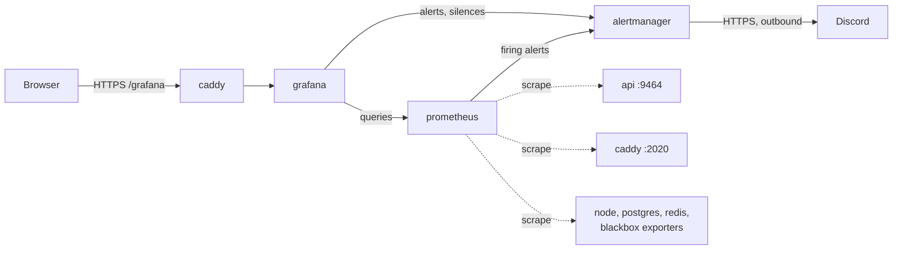

# Monitoring system with Prometheus and Grafana (Major, 2 points)

**Type:** Major. **Points:** 2. **Status:** done.

The app measures itself all the time. Prometheus (a program that stores numbers over
time) collects measurements from the app, the databases and the server. Grafana (a
program that draws graphs) shows them on four dashboards, behind a login. When
something goes wrong, an alert rule fires and a message can go to a Discord channel.

This file says what we built and why it meets the subject. The full guide (every
panel, every rule, every setting, how to change them) is
[../operations/monitoring.md](../operations/monitoring.md).

## What the subject asks

From the module list, DevOps section (see [../subject/summary.md](../subject/summary.md)
and chapter IV of [../subject/ft_transcendence.pdf](../subject/ft_transcendence.pdf)):

> Major | Prometheus + Grafana monitoring: exporters, custom dashboards, alerting rules,
> secured access

So there are five things to show: Prometheus, exporters, our own dashboards, alert
rules, and access that is protected.

## How we meet it

| The subject asks | What we built | Where |
| ---------------- | ------------- | ----- |
| Prometheus | Prometheus 3.13.5 (the LTS line). It reads 10 targets every 30 s, checks the rules every 30 s, and keeps 15 days or 1 GB of data. | [`prometheus.yml`](../../infra/monitoring/prometheus/prometheus.yml), [`Dockerfile`](../../infra/monitoring/prometheus/Dockerfile) |
| Exporters | Four exporters: node (the server: CPU, memory, disk), postgres, redis, and blackbox (it calls web's `/healthz`, `/healthz/upstream` and Grafana's health page from outside). The API and Caddy publish their own metrics too: the API has 18 metrics of its own in `metrics.ts`, plus 3 gauges read from the database when Prometheus asks, plus the Node.js defaults. | [`compose.yml`](../../compose.yml), [`apps/api/src/metrics/`](../../apps/api/src/metrics) |
| Custom dashboards | Four dashboards we wrote ourselves, with 79 panels in all: Overview (18), API (17), Learning (18), Infrastructure (26). They are loaded from the repo when Grafana starts. | [`grafana/dashboards/`](../../infra/monitoring/grafana/dashboards), [`dashboards.yml`](../../infra/monitoring/grafana/provisioning/dashboards/dashboards.yml) |
| Alerting rules | 25 rules in 6 groups (availability, api, learning, stores, host, monitoring): 7 critical, 18 warning. 10 unit tests run with `promtool`. Alertmanager groups the alerts and posts them to Discord. | [`alerts.yml`](../../infra/monitoring/prometheus/rules/alerts.yml), [`alerts.test.yml`](../../infra/monitoring/prometheus/tests/alerts.test.yml), [`alertmanager.yml`](../../infra/monitoring/alertmanager/alertmanager.yml) |
| Secured access | Grafana is the only monitoring service you can reach, at `/grafana`, and only with its login. No sign-up, no anonymous access, no default password, a lock after 5 wrong passwords. Prometheus, Alertmanager, the exporters and the API's metrics port have no route from outside and publish no port. | [`grafana.ini`](../../infra/monitoring/grafana/grafana.ini), [`entrypoint.sh`](../../infra/monitoring/grafana/entrypoint.sh), [`Caddyfile`](../../infra/caddy/Caddyfile) |

### Why it is worth 2 points

- **The dashboards are about our app, not only the machine.** Next to CPU and
  memory, they show sign-ins by result, latency per API route, WebSocket events,
  placement exams, the question bank per level, and the calls to the AI model.
  The API counts these itself
  ([`metrics.ts`](../../apps/api/src/metrics/metrics.ts)).
- **The alert rules are tested.** Each critical rule has a test that proves it
  fires, and some tests prove a rule stays quiet when it should (for example
  "Low RAM with free swap stays quiet").
- **Access is closed by default, and checked.** A script fails CI if any service
  other than Caddy publishes a port, and a Playwright test checks the login, the
  401 for anonymous reads and the 404 for the metrics paths.
- **It runs in production too.** The same three images run on the server
  ([`compose.deploy.yml`](../../compose.deploy.yml)), so the deployed app is
  monitored, not only a laptop.

## How it works

Prometheus pulls ("scrapes") numbers from each target over the internal Docker
network. Grafana asks Prometheus for them to draw its panels. Prometheus checks the
rules and sends firing alerts to Alertmanager, which sends them on to Discord. The
browser only ever reaches Grafana, through Caddy.



- **The API's metrics.** The API serves `GET /metrics` on its own port, 9464, from
  a small `node:http` server outside NestJS
  ([`metrics-server.ts`](../../apps/api/src/metrics/metrics-server.ts), started in
  [`main.ts`](../../apps/api/src/main.ts)). Caddy has no route to it, so
  `/api/metrics` does not exist. A middleware times every request by route
  ([`http-metrics.middleware.ts`](../../apps/api/src/metrics/http-metrics.middleware.ts)).
  `MetricsCollector` reads the number of users and the size of the question bank
  from the database, at most once a minute
  ([`metrics.collector.ts`](../../apps/api/src/metrics/metrics.collector.ts)).
- **Caddy's metrics** are on a second site, `http://:2020`, that only the internal
  network can reach ([`Caddyfile`](../../infra/caddy/Caddyfile)).
- **The config is inside the images.** The Prometheus, Alertmanager and Grafana
  Dockerfiles copy the config, rules and dashboards in. So a laptop, CI and the
  server run the same rules and dashboards. Dashboards cannot be saved from the
  browser (`allowUiUpdates: false`): the repo is the source of truth.
- **Grafana shows the rules too.** Its data sources
  ([`datasources.yml`](../../infra/monitoring/grafana/provisioning/datasources/datasources.yml))
  include Alertmanager, so the Alerting page lists the 25 rules, the alerts and
  the silences behind the login. That is why Prometheus and Alertmanager need no
  route of their own.
- **The Discord webhook is a secret.** It lives only in `.env` as
  `DISCORD_WEBHOOK_URL`. The Alertmanager entrypoint writes it to a file in memory
  and the config reads that file. When it is empty, Alertmanager loads
  [`silent.yml`](../../infra/monitoring/alertmanager/silent.yml) and sends nothing.
- **When it runs.** `make`, `make up` and the server always run monitoring. `make dev`
  leaves it off to keep laptops light; `make monitoring-up` turns it on
  ([`compose.override.yml`](../../compose.override.yml), `monitoring` profile).

## Where the code is

| Path | What it does |
| ---- | ------------ |
| [`infra/monitoring/prometheus/prometheus.yml`](../../infra/monitoring/prometheus/prometheus.yml) | The 8 scrape jobs (7 single targets and the blackbox job with 3 probes), intervals, retention |
| [`infra/monitoring/prometheus/rules/alerts.yml`](../../infra/monitoring/prometheus/rules/alerts.yml) | The 25 alert rules |
| [`infra/monitoring/prometheus/tests/alerts.test.yml`](../../infra/monitoring/prometheus/tests/alerts.test.yml) | The 10 rule unit tests |
| [`infra/monitoring/alertmanager/`](../../infra/monitoring/alertmanager) | Routing to Discord, inhibitions, the silent fallback, the message template, the entrypoint that hides the webhook |
| [`infra/monitoring/grafana/grafana.ini`](../../infra/monitoring/grafana/grafana.ini) | Grafana's security settings |
| [`infra/monitoring/grafana/entrypoint.sh`](../../infra/monitoring/grafana/entrypoint.sh) | Refuses to start with an empty password, the password `admin`, or an empty secret key |
| [`infra/monitoring/grafana/provisioning/`](../../infra/monitoring/grafana/provisioning) | The two data sources and the dashboard folder |
| [`infra/monitoring/grafana/dashboards/`](../../infra/monitoring/grafana/dashboards) | The four dashboards as JSON |
| [`apps/api/src/metrics/metrics.ts`](../../apps/api/src/metrics/metrics.ts) | Every API metric, on the API's own registry |
| [`apps/api/src/metrics/metrics-server.ts`](../../apps/api/src/metrics/metrics-server.ts) | The internal listener on port 9464 |
| [`apps/api/src/metrics/http-metrics.middleware.ts`](../../apps/api/src/metrics/http-metrics.middleware.ts) | Times every HTTP request by method, route and status |
| [`apps/api/src/metrics/metrics.collector.ts`](../../apps/api/src/metrics/metrics.collector.ts) | Users, active users and the question bank, read when Prometheus scrapes |
| [`compose.yml`](../../compose.yml), [`compose.deploy.yml`](../../compose.deploy.yml) | The seven monitoring services, with no published port |
| [`infra/caddy/Caddyfile`](../../infra/caddy/Caddyfile) | `/grafana` to Grafana, 404 for `/grafana/metrics`, the `:2020` metrics site |
| [`scripts/check-monitoring-config.sh`](../../scripts/check-monitoring-config.sh) | Static checks: config, rules, tests, routes, dashboards, published ports |
| [`scripts/check-monitoring.sh`](../../scripts/check-monitoring.sh) | Live checks on a running stack: targets up, rules healthy, series present |
| [`Makefile`](../../Makefile) | `monitoring-up`, `monitoring-check`, and `env-file`, which writes the Grafana secrets into `.env` |

## How to show it at the defence

1. Run `make`. It runs every check, starts the production stack and then
   `make monitoring-check`. The `run` step prints the Grafana address and the line
   to read the password.
2. Run `make monitoring-check` again on its own. It shows every target up, every
   rule healthy and one Alertmanager found.
3. Read the password with `grep GRAFANA_ADMIN_PASSWORD .env`. Open
   <https://localhost/grafana> (or `https://localhost:<HTTPS_PORT>/grafana` when
   `HTTPS_PORT` is not 443) and log in as `admin`. There is no other account.
4. The home page is the **Overview** dashboard: every "Is it up" stat is green, and
   there is traffic from the Playwright run. Open **Dashboards**, folder
   `ft_transcendence`: show **Learning** (the seeded question bank by level) and
   **API** (requests and latency by route).
5. Open **Alerting** and show the 25 rules, grouped as in `alerts.yml`.
6. Show what is closed, from a terminal:

   ```bash
   curl -sk -o /dev/null -w '%{http_code}\n' https://localhost/grafana/api/search    # 401
   curl -sk -o /dev/null -w '%{http_code}\n' https://localhost/grafana/metrics       # 404
   curl -sk -o /dev/null -w '%{http_code}\n' https://localhost/api/metrics           # 404
   docker ps --format '{{.Names}}\t{{.Ports}}'                                       # only caddy publishes ports
   ```

7. Make an alert fire: `docker compose stop api`. Under **Alerting**, `ApiDown`
   goes pending, then firing after about a minute. With `DISCORD_WEBHOOK_URL` set,
   Discord gets "[FIRING:1] ApiDown".
8. `docker compose start api`. The alert resolves within a minute or two, and
   Discord gets the "[RESOLVED]" message.

A small live change: edit a threshold or a `for` in `alerts.yml` and its test, run
`./scripts/check-monitoring-config.sh` and `make up`, and show the new rule under
**Alerting**. The other demo checks are in section 8 of
[../operations/monitoring.md](../operations/monitoring.md).

## Tests that prove it

| Test | What it checks |
| ---- | -------------- |
| [`infra/monitoring/prometheus/tests/alerts.test.yml`](../../infra/monitoring/prometheus/tests/alerts.test.yml) | 10 `promtool` tests: `ApiDown` fires after a minute and not before, the error rate needs real traffic, the fixture's restock failures stay quiet, low RAM with free swap stays quiet, and the other critical rules fire after their minute |
| [`scripts/check-monitoring-config.sh`](../../scripts/check-monitoring-config.sh) | `promtool check config` and `promtool test rules`, `amtool check-config` on both Alertmanager configs and the Discord route, `caddy validate`, checks on the dashboard JSON, and only Caddy publishing ports. Runs in [`ci.yml`](../../.github/workflows/ci.yml) (job `monitoring config`) and in `make ci` |
| [`scripts/check-monitoring.sh`](../../scripts/check-monitoring.sh) | On a running stack: every target up, every rule healthy, an Alertmanager found, every series in `REQUIRED_SERIES` present. Runs in [`e2e.yml`](../../.github/workflows/e2e.yml) and in `make` |
| [`e2e/tests/monitoring.spec.ts`](../../e2e/tests/monitoring.spec.ts) | Through Caddy: "an anonymous visitor only gets the login page", "the Grafana API refuses anonymous reads", "sign-up is off", "metrics endpoints stay internal", "the four dashboards are provisioned", "Prometheus feeds Grafana" |
| [`apps/api/test/metrics.e2e-spec.ts`](../../apps/api/test/metrics.e2e-spec.ts) | The real NestJS pipeline: a request is counted under its route template, never its URL; "serves no metrics at /api/metrics"; the bank and accounts are collected at scrape time |
| [`apps/api/src/metrics/*.spec.ts`](../../apps/api/src/metrics) | Unit tests of the listener, the middleware, the collector (it keeps its last values when the database fails or hangs) and the series that must exist at 0 from the start |

## Limits and choices

- **No logs.** This module is about metrics. There is no ELK or Loki;
  `docker compose logs` is the log tool.
- **Nothing watches Prometheus.** If Prometheus or Alertmanager stops, no alert
  fires and Grafana shows "No data". The usual answer is a "dead man's switch"
  outside the server, which we did not build.
- **No per-container memory.** We did not add cAdvisor: it needs extra privileges,
  breaks on multi-user rootless Docker and costs CPU on a shared core. Each scraped
  process reports its own memory, and `docker stats` covers the rest.
- **Web has no metrics endpoint.** Any web route would be public through Caddy, so
  the blackbox exporter checks web from outside instead.
- **Grafana shares the app's address.** It is served at `/grafana` on the same
  origin, behind the same certificate. The cost is that a flaw in one could act
  with the other's session in the same browser. A separate subdomain would remove
  that.
- **Config is baked, not mounted.** The server has no checkout, so the config goes
  into the images. The cost: a config edit in dev needs a rebuild, which
  `make monitoring-up` does.
- **A slow deploy can fire `ApiDown` once**, when the new API takes more than a
  minute to start.

These limits come from section 10 of
[../operations/monitoring.md](../operations/monitoring.md).

## Who built it

| Member | GitHub | What they built | Issues and PRs |
| ------ | ------ | --------------- | -------------- |
| Victor | [VictorBro](https://github.com/VictorBro) | The whole module: Prometheus, Alertmanager, Grafana and the exporters, the four dashboards, the 25 rules and their tests, the API metrics listener, the checks and the guide. Later, the WebSocket metrics and panels (in #181, which Endrit co-authored), and new versions of the monitoring images. | [#129](https://github.com/VictorBro/ft_transcendence/issues/129), [#130](https://github.com/VictorBro/ft_transcendence/pull/130), [#181](https://github.com/VictorBro/ft_transcendence/pull/181), [#198](https://github.com/VictorBro/ft_transcendence/pull/198) |
| Luca | [luca-mattei](https://github.com/luca-mattei) | The lesson discussion metric (`ft_llm_discussion_limited_total`) and its panel on the Learning dashboard. | [#201](https://github.com/VictorBro/ft_transcendence/pull/201) |
| Anaïs | [avarrett](https://github.com/avarrett) (commits as ninisse) | The lesson attempt metric, `ft_lesson_attempts_total`. | [#190](https://github.com/VictorBro/ft_transcendence/pull/190) |

From `git log --no-merges` on `infra/monitoring`, `apps/api/src/metrics`, the two
`check-monitoring` scripts and `e2e/tests/monitoring.spec.ts`. Pull requests are
squash-merged, so one commit is usually one pull request.
