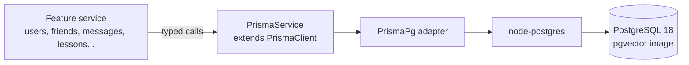

# ORM for the database (Minor, 1 point)

**Type:** Minor. **Points:** 1. **Status:** done.

An ORM (object-relational mapper) is a library that lets the code read and write the database
with normal function calls and typed objects, instead of writing SQL by hand. We use
[Prisma 7](../../apps/api/package.json) in the backend (`apps/api`) to talk to PostgreSQL.

## What the subject asks

The module is one line in the Web modules table of
[../subject/summary.md](../subject/summary.md):

> | Minor | ORM for the database |

The PDF ([../subject/ft_transcendence.pdf](../subject/ft_transcendence.pdf), chapter IV, Web) words it like this:

> Minor: Use an ORM for the database.

The subject gives no extra rule for this module. Two rules of the mandatory part touch the same
code, so this file also shows how the ORM helps with them. Chapter III.3, Technical
requirements, says:

> The database must have a clear schema and well-defined relations.

Chapter III.2, General requirements, says:

> Multi-user Support (Mandatory): Your website must support multiple users simultaneously. This
> is a core requirement of the project. Users should be able to interact with the application at
> the same time without conflicts or performance issues. This includes:
>
> - Multiple users can be logged in and active at the same time.
> - Concurrent actions by different users are handled properly.
> - Real-time updates are reflected across all connected users when applicable.
> - No data corruption or race conditions occur with simultaneous user actions.

## How we meet it

| The subject asks | What we built | Where |
| --- | --- | --- |
| An ORM | Prisma 7.10.1: the `prisma` command-line tool, the generated client `@prisma/client`, and the PostgreSQL adapter `@prisma/adapter-pg`, always at the same version. | [apps/api/package.json](../../apps/api/package.json), [../operations/versions.md](../operations/versions.md) |
| For the database | Every table is a `model` in one schema file. The api reaches the database through one service, `PrismaService`, which every feature that needs the database injects. The database schema is changed only by migrations that Prisma writes from that file. Three small queries are raw SQL sent through the same client (see [Limits and choices](#limits-and-choices)). | [schema.prisma](../../apps/api/prisma/schema.prisma), [prisma.service.ts](../../apps/api/src/prisma/prisma.service.ts), [migrations/](../../apps/api/prisma/migrations) |
| Clear schema, well-defined relations (mandatory part) | 12 models and 9 enums. Every relation names its foreign key and what happens on delete (`Cascade` or `Restrict`). Unique keys and indexes are declared in the schema. | [schema.prisma](../../apps/api/prisma/schema.prisma) |
| No data corruption or race conditions (mandatory part) | Writes that must happen together run in a Prisma transaction (`$transaction`). Unique constraints catch two requests that race, and the code turns the Prisma error into a clear HTTP error. | [Transactions](#transactions-and-races) below |

## How it works

### From the schema to the database

1. A developer edits [schema.prisma](../../apps/api/prisma/schema.prisma).
2. `make migrate-new NAME=<what_changed>` runs `prisma migrate dev`, which writes a new SQL
   file under [prisma/migrations/](../../apps/api/prisma/migrations) and applies it, then runs
   `db:generate` to rebuild the client ([Makefile](../../Makefile)). The SQL file is committed
   with the schema change. There are 15 migrations today, from `20260807022236_init_user` to
   `20261118210619_add_message_unread_index`.
3. `prisma generate` writes a typed TypeScript client into `apps/api/src/generated/prisma`. It
   is not committed ([apps/api/.gitignore](../../apps/api/.gitignore)). It is rebuilt in the
   Docker image ([apps/api/Dockerfile](../../apps/api/Dockerfile)) and when the dev container
   starts ([compose.override.yml](../../compose.override.yml)).
4. Every environment applies the committed migrations with `prisma migrate deploy`: `make migrate`
   locally, the `migrate` service on the server ([compose.deploy.yml](../../compose.deploy.yml)),
   and the api test job in CI ([.github/workflows/ci.yml](../../.github/workflows/ci.yml)).
5. The seed ([prisma/seed.ts](../../apps/api/prisma/seed.ts)) then loads the question bank and the
   lessons with Prisma `upsert` calls (insert or update), so it can run on every deploy.

[prisma.config.ts](../../apps/api/prisma.config.ts) tells the command-line tool where the schema,
the migrations and the seed are, and reads the connection string from `DATABASE_URL`.

### From a request to the database

- [prisma.service.ts](../../apps/api/src/prisma/prisma.service.ts) is the only place the client
  is created. It refuses to start if `DATABASE_URL` is empty. It connects when the api starts, not
  on the first request, so a wrong address stops the container at once.
- Prisma 7's `prisma-client` generator makes a client with no query engine of its own. It needs an
  adapter to reach the database, so the service passes `new PrismaPg({ connectionString })`.
- [prisma.module.ts](../../apps/api/src/prisma/prisma.module.ts) is marked `@Global()`, so every
  feature module can inject `PrismaService` without importing it again.
- Only the api has a Prisma client. The web app gets its data through the api
  ([../architecture/overview.md](../architecture/overview.md), "The rule that explains the rest"),
  and [scripts/check-app-boundaries.sh](../../scripts/check-app-boundaries.sh) fails if one app
  compiles the other's code.

### What the ORM gives us in the code

- **Typed queries.** A wrong column name or a wrong type is a compile error. Some files build their
  types from the query itself, for example `Prisma.LessonGetPayload<{ select: typeof LESSON_SELECT }>`
  in [course-lookup.ts](../../apps/api/src/lessons/course-lookup.ts) and
  `Prisma.MessageWhereInput` in [messages.service.ts](../../apps/api/src/messages/messages.service.ts).
- **Pagination without SQL.** The chat history is read newest first, one page at a time, with
  `findMany`, `orderBy` on `createdAt` and `id`, and `take`
  ([messages.service.ts](../../apps/api/src/messages/messages.service.ts)).
- **Relations and deletes in the schema.** For example, deleting a `User` deletes their friendships
  and messages (`onDelete: Cascade`), but a `Lesson` that has results cannot be deleted
  (`onDelete: Restrict` on `LessonResult`).

### Transactions and races

| Where | What runs together | Why |
| --- | --- | --- |
| [messages.service.ts](../../apps/api/src/messages/messages.service.ts) `send` | Upsert the conversation, then create the message. | A message never exists without its conversation, and the conversation order (`lastMessageAt`) moves with it. |
| [two-factor.service.ts](../../apps/api/src/auth/two-factor.service.ts) `issueRecoveryCodes`, `disable` | Delete the old recovery codes and create the new ones; or clear the secret and delete the codes. | Both changes are saved, or neither is: new codes replace the old ones, and turning 2FA off removes the codes with the secret. |
| [courses.service.ts](../../apps/api/src/courses/courses.service.ts) `setGoal` | Lock the course, change the goal, set the active language, award XP. | A goal change and a lesson finish at the same moment cannot meet the same day twice. |
| [courses.service.ts](../../apps/api/src/courses/courses.service.ts) `write` | Change the level, set the active language. | The two rows are updated together. |
| [attempts.service.ts](../../apps/api/src/lessons/attempts.service.ts) `start`, `submit` | Lock the course, hold the lesson row `FOR SHARE`, read and write the attempt, and on the last page record the score. | Two parallel starts make one attempt. Two parallel last pages make one finish. |
| [prisma/seed.ts](../../apps/api/prisma/seed.ts) | Upsert every lesson, and delete the unfinished attempts of lessons whose content changed. | An attempt never points into content that changed under it. |

The course lock is `lockCourse` in [goal.ts](../../apps/api/src/lessons/goal.ts). Its comment
says why it is raw SQL: "Prisma has no FOR UPDATE".

Some races are caught by the database instead of a lock. Prisma reports a broken unique
constraint as error `P2002`, a missing row as `P2025` and a broken foreign key as `P2003`. The code
catches these codes and answers with a clear error:

- Sign-up with a taken email or display name: `409 auth.identityTaken`
  ([auth.service.ts](../../apps/api/src/auth/auth.service.ts)). The comment explains why it does
  not check first: "a SELECT before INSERT still races another signup".
- Two friend requests that cross: the second one reads again and accepts the first
  ([friends.service.ts](../../apps/api/src/friends/friends.service.ts)).
- A taken display name on profile edit
  ([users.service.ts](../../apps/api/src/users/users.service.ts)).

Other writes put the check in the `where` of an `updateMany` and read the `count`, so the check
and the write are one statement. A recovery code is marked used only while `usedAt` is `null`,
and 2FA setup and enable write only while `totpEnabledAt` is `null`
([two-factor.service.ts](../../apps/api/src/auth/two-factor.service.ts), [#219](https://github.com/VictorBro/ft_transcendence/pull/219)).

### Checks that keep the schema and the migrations in step

| Check | What it does | Where it runs |
| --- | --- | --- |
| Prisma drift | `prisma migrate diff --from-migrations ... --to-schema ... --exit-code` replays every migration into an empty database and compares the result with `schema.prisma`. It fails if someone changed the schema without a migration. | `prisma-drift` job in [hygiene.yml](../../.github/workflows/hygiene.yml), and [scripts/check-prisma-drift.sh](../../scripts/check-prisma-drift.sh) in `make ci` |
| Prisma format | Formats a copy of the schema with `prisma format` and compares it with the real file. | [scripts/check-prisma-format.sh](../../scripts/check-prisma-format.sh) in `make ci` |

## Where the code is

| Path | What it does |
| --- | --- |
| [apps/api/prisma/schema.prisma](../../apps/api/prisma/schema.prisma) | The 12 models, 9 enums, relations, unique keys and indexes. |
| [apps/api/prisma/migrations/](../../apps/api/prisma/migrations) | The 15 SQL migrations Prisma generated, and `migration_lock.toml`. |
| [apps/api/prisma.config.ts](../../apps/api/prisma.config.ts) | Prisma 7 config: schema path, migrations path, seed command, `DATABASE_URL`. |
| [apps/api/prisma/seed.ts](../../apps/api/prisma/seed.ts) | Loads the question bank and the lessons with upserts in one transaction each. |
| [apps/api/src/prisma/prisma.service.ts](../../apps/api/src/prisma/prisma.service.ts) | The one Prisma client, with the pg adapter, connect and disconnect, and `ping()`. |
| [apps/api/src/prisma/prisma.module.ts](../../apps/api/src/prisma/prisma.module.ts) | Makes `PrismaService` available to every module. |
| [apps/api/src/lessons/goal.ts](../../apps/api/src/lessons/goal.ts) | `lockCourse`: the `FOR UPDATE` lock used inside transactions. |
| [apps/api/src/lessons/attempts.service.ts](../../apps/api/src/lessons/attempts.service.ts) | Lesson attempts: interactive transactions and the `FOR SHARE` lock. |
| [apps/api/src/health/health.service.ts](../../apps/api/src/health/health.service.ts) | `/api/health` reports the database status and latency from `ping()`. |
| [Makefile](../../Makefile) | `migrate`, `migrate-new`, `seed`, `db-ready`, `studio`, `reset-db`. |
| [scripts/check-prisma-drift.sh](../../scripts/check-prisma-drift.sh), [scripts/check-prisma-format.sh](../../scripts/check-prisma-format.sh) | The two schema checks. |

## How to show it at the defence

The stack must be running: `make run` starts it, and `make` (the default target, `all`) runs every check first. The app is at `https://localhost`. If port 443 was not free, use the address that `make run` prints.

1. **The schema.** Open [apps/api/prisma/schema.prisma](../../apps/api/prisma/schema.prisma).
   Show a model with relations, for example `Friendship` (two relations to `User`, both
   `onDelete: Cascade`) or `LessonResult` (`onDelete: Restrict`).
2. **The migrations.** Run `ls apps/api/prisma/migrations` and open one `migration.sql`, for
   example `20261116224104_add_messages`. Explain that Prisma wrote it from the schema.
3. **One client, one place.** Open
   [apps/api/src/prisma/prisma.service.ts](../../apps/api/src/prisma/prisma.service.ts): the
   `PrismaPg` adapter and the connection on start.
4. **A typed query.** Open [apps/api/src/auth/auth.service.ts](../../apps/api/src/auth/auth.service.ts),
   `signUp`: `this.prisma.user.create(...)`, and the `P2002` catch.
5. **See the data.** Run `make studio` and open `http://127.0.0.1:5555`. This is Prisma Studio, a
   web view of the database. It listens on this machine only, because it has no login.
6. **Write through the app, read in Studio.** In the browser, open `https://localhost/en/signup`.
   Fill in **Email**, **Display name**, **Password** and **Confirm password**, then click
   **Create account**. In Studio, open the `User` model and reload: the new row is there, with an
   argon2 hash in `passwordHash`, not the password.
7. **A unique constraint at work.** In a private window, open the sign-up page again and use the
   same email with another display name. The form shows "That email or display name is already taken". That is the database's
   unique key, caught as Prisma error `P2002`.
8. **The database is checked live.** Open `https://localhost/api/health`. The `dependencies` list
   has `{ "name": "database", "status": "ok", "latencyMs": ... }`, measured by Prisma's `ping()`.

Press Ctrl+C to stop Studio.

## Tests that prove it

| Test | What it checks |
| --- | --- |
| [prisma.service.spec.ts](../../apps/api/src/prisma/prisma.service.spec.ts) | The client connects on start and disconnects on shutdown; `ping` runs one query and reports the latency; a failing `ping` rejects, so the caller decides what it means. |
| [health.service.spec.ts](../../apps/api/src/health/health.service.spec.ts) | The health report says `down` without throwing when the database probe fails, and `degraded` when it is slow. |
| [test/auth.e2e-spec.ts](../../apps/api/test/auth.e2e-spec.ts) | "refuses a duplicate email with 409": the unique key on `User.email`. |
| [test/seed.e2e-spec.ts](../../apps/api/test/seed.e2e-spec.ts) | The seed upserts: "running it twice leaves the same row count and id (idempotent upsert)", "refuses to delete a lesson that has a result (Restrict)", "fails on an invalid lesson, names its id and the issue, and writes nothing". |
| [test/finish.e2e-spec.ts](../../apps/api/test/finish.e2e-spec.ts) | "meets the day once when two finishes arrive at the same time": the test holds the course row itself, then lets two requests go together, to prove `lockCourse` works. |
| [test/attempts.e2e-spec.ts](../../apps/api/test/attempts.e2e-spec.ts) | "makes one attempt of two parallel starts, a first one and a retake" and "gives one finish for two parallel last submits". |
| [test/friends.e2e-spec.ts](../../apps/api/test/friends.e2e-spec.ts) | "at once: one gets in, the other accepts it" (the `P2002` retry), and "deleting an account takes its requests with it" (`onDelete: Cascade`). |
| [e2e/tests/smoke.spec.ts](../../e2e/tests/smoke.spec.ts) | "health endpoints report ok": against the production stack, `/api/health` lists the database as `ok`. |
| `prisma-drift` job in [hygiene.yml](../../.github/workflows/hygiene.yml) | The migrations and `schema.prisma` say the same thing. |

The api e2e tests (`apps/api/test/`) run against a real PostgreSQL. CI first runs
`prisma migrate deploy` on it, then the tests
([.github/workflows/ci.yml](../../.github/workflows/ci.yml)).

## Limits and choices

- **Three raw SQL queries.** `SELECT 1` for the health check
  ([prisma.service.ts](../../apps/api/src/prisma/prisma.service.ts)), `FOR UPDATE` on the course row
  ([goal.ts](../../apps/api/src/lessons/goal.ts)) and `FOR SHARE` on the lesson row
  ([attempts.service.ts](../../apps/api/src/lessons/attempts.service.ts)). Prisma has no function
  for row locks. All three use the `$queryRaw` tagged template of the Prisma client, and the two
  locks run inside Prisma transactions. No `$queryRawUnsafe` or `$executeRawUnsafe` is used anywhere in `apps/api`.
- **Errors are matched by code.** The services read `error.code` (`P2002`, `P2025`, `P2003`)
  instead of checking the Prisma error class.
- **The generated client is not committed.** It is rebuilt in each place that needs it, inside the
  target architecture of the Docker image. The production image has no Prisma command-line tool and
  no migrations: a separate tooling image (the `build` stage of
  [apps/api/Dockerfile](../../apps/api/Dockerfile)) runs `migrate deploy` and the seed.
- **pgvector is installed but not used.** The database image is `pgvector/pgvector`, but no
  migration creates a vector column. [../operations/versions.md](../operations/versions.md) says
  `CREATE EXTENSION IF NOT EXISTS vector` goes in the first migration that needs it.
- **Prisma 7, not 8.** npm's `latest` tag points at an 8.0 release candidate, so we pin 7.10.1
  ([../operations/versions.md](../operations/versions.md)).
- **Prisma Studio is for local use only.** `make studio` publishes it on `127.0.0.1` only, because
  it gives full read and write access with no login.

## Who built it

From `git log --follow` on the Prisma files and `gh pr view` on each pull request.

| Member | GitHub | What they built | Issues and PRs |
| --- | --- | --- | --- |
| Victor | `VictorBro` | Prisma in the scaffold (`prisma.config.ts`, `make studio`, the drift job's first version); `PrismaService` with the pg adapter, the first migration and the database health check; the 2FA tables; the friendship, last-active-day and message tables. | #2, #3 (closes #1), #5, #189, #193, #200 |
| Anaïs | `avarrett` (commits as `ninisse`) | `check-prisma-drift.sh` and `check-prisma-format.sh`; the course and question bank tables; the active language; the `LessonAttempt` table and the `FOR SHARE` lock; the gamification columns and `UserAchievement`. | #29, #60, #190, #180 |
| Luca | `luca-mattei` | The time zone column; the lesson tables; `lockCourse` and its `FOR UPDATE` lock. | #109, #123, #141 |
| Endrit | `VYAntares` (commits as `EA`) | The seed: question bank upserts and the seed entry in `prisma.config.ts`, then the lessons from the outlines, the lesson content column, and the demo learners. | #58, #140, #142, #143 |
| Bastian | `bastian-schnitzler` | The `Lesson.ready` column, set by the seed. | #171 |
