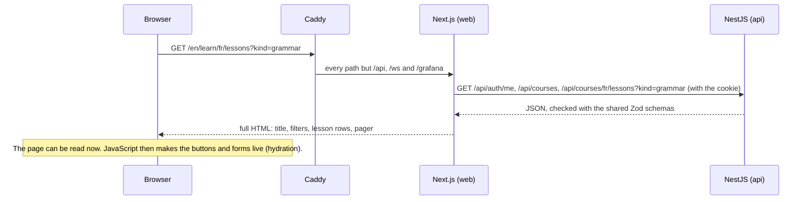

# Server-Side Rendering (SSR) (Minor, 1 point)

**Type:** Minor. **Points:** 1. **Status:** done.

The server builds each page before it sends it. The browser gets a full HTML page with the
text, the lessons and the user's data already in it, not an empty page that fills itself in
later. You can see it with JavaScript turned off: the pages still show their content.

## What the subject asks

The module is one line in the Web table of [../subject/summary.md](../subject/summary.md):

> | Minor | Server-Side Rendering (SSR) |

The PDF ([../subject/ft_transcendence.pdf](../subject/ft_transcendence.pdf), chapter IV, Web)
words it like this:

> Minor: Server-Side Rendering (SSR) for improved performance and SEO.

The subject has one rule about this module: "SSR is incompatible with the ICP blockchain
backend" ([../subject/summary.md](../subject/summary.md), dependency rules). We do not claim
either blockchain module ([README.md](README.md)), so the rule is met. The module sits on top
of the framework module ([framework.md](framework.md)): Next.js is the tool that renders on
the server.

## How we meet it

| The subject asks | What we built | Where |
| --- | --- | --- |
| Server-side rendering | All 22 pages are Next.js server components: no `page.tsx` starts with `'use client'`. The pages that show data load it on the server, from NestJS, while they render: the session, the courses, the day's lessons, the friends, the lesson list. The HTML that leaves the server already holds that data. 16 of the pages set `dynamic = 'force-dynamic'`, so they are rendered again on every request, for the user who asks. | [`apps/web/app/[locale]/`](../../apps/web/app), [`lib/session.ts`](../../apps/web/lib/session.ts), [`lib/api.ts`](../../apps/web/lib/api.ts), [`lib/lessons.ts`](../../apps/web/lib/lessons.ts), [`lib/friends.ts`](../../apps/web/lib/friends.ts), [`lib/courses.ts`](../../apps/web/lib/courses.ts) |
| For improved performance | The first HTML already has the content, so the browser can draw the page before any JavaScript runs. It does not have to call the API itself before it can show the data. The server talks to NestJS over the internal Docker network. Only the parts that react to clicks are client components, in their own files. We have no performance measurement to show; see [Limits and choices](#limits-and-choices). | [`lib/api.ts`](../../apps/web/lib/api.ts) (`API_INTERNAL_URL`), [`lessons/page.tsx`](<../../apps/web/app/[locale]/(dashboard)/learn/[lang]/lessons/page.tsx>) |
| For improved SEO | Every page has a `<title>` made on the server, in the page's language. 18 pages set their own with `generateMetadata`; the others get the site name from the root layout. The root layout also sets the site `description` and `<html lang>`. The public pages (home, login, signup, privacy, terms) are full HTML for a search engine. [`robots.txt`](../../apps/web/public/robots.txt) allows the site and keeps `/healthz` and `/grafana` out. | [`[locale]/layout.tsx`](<../../apps/web/app/[locale]/layout.tsx>), [`privacy/page.tsx`](<../../apps/web/app/[locale]/(main)/privacy/page.tsx>), [`apps/web/public/robots.txt`](../../apps/web/public/robots.txt) |

## How it works

1. **The request reaches Next.js.** Caddy sends every path except `/api`, `/ws` and `/grafana` to the
   `web` container ([`infra/caddy/Caddyfile`](../../infra/caddy/Caddyfile)).
   [`proxy.ts`](../../apps/web/proxy.ts) adds the language to the URL if it is missing.
2. **The layout and the page run on the server.** They are `async` server components. The
   root layout [`[locale]/layout.tsx`](<../../apps/web/app/[locale]/layout.tsx>) checks the
   language and loads the text catalogue. A page then asks for its data. For example, the
   all lessons page
   [`lessons/page.tsx`](<../../apps/web/app/[locale]/(dashboard)/learn/[lang]/lessons/page.tsx>)
   calls `requireCourses()` and then `loadLessonPage()`.
3. **The data comes from NestJS.** [`lib/api.ts`](../../apps/web/lib/api.ts) makes every call
   from the Next.js server to NestJS. It calls `http://api:3001` (or `API_INTERNAL_URL`),
   passes on the browser's cookie and the visitor's address, sets `cache: 'no-store'`, and
   checks the answer with a Zod schema. A 401 sends the visitor to `/login`. Any other failure
   throws, so the error page shows and nobody is logged out by a restart.
4. **One session read per render.** `loadSession()` in
   [`lib/session.ts`](../../apps/web/lib/session.ts) is wrapped in React's `cache`, so the
   layout and the page share one call to `/api/auth/me`. `currentUser()` is for pages anyone
   can see; `requireUser()` is for pages that need a signed-in user.
5. **The title is made on the server too.** `generateMetadata` reads the right catalogue and
   returns the title. The root layout adds `| ft_transcendence` with a template, so the tab of
   the all lessons page reads "All lessons | ft_transcendence". Some titles come from data:
   a profile page is titled with the person's display name
   ([`users/[id]/page.tsx`](<../../apps/web/app/[locale]/(main)/users/[id]/page.tsx>)), a lesson
   page with the lesson's title.
6. **Never cached between users.** A page that reads the session sets
   `export const dynamic = 'force-dynamic'`, with a comment saying why, for example "Renders one
   specific person's friends, so it must never be prerendered or cached"
   ([`friends/page.tsx`](<../../apps/web/app/[locale]/(main)/friends/page.tsx>)). The six pages
   without it are the login, signup, privacy and terms pages, the catch-all not-found page and
   the old `/dashboard` redirect.
7. **JavaScript comes last.** The browser shows the HTML, then React hydrates it (attaches the
   click handlers). The interactive parts are small client components beside the page: the
   live filter form, the level and goal pickers, the lesson player, the chat. When the server
   data changes because of another user, a client component calls `router.refresh()`, and the
   server renders the page again ([`refresh-on.tsx`](../../apps/web/components/refresh-on.tsx)).

### Pages built to work without JavaScript

Some pages were built so that the server's HTML is enough on its own:

- **The all lessons page** is a plain `<form method="get">`. Filters, sort and pages are URL
  parameters, the page links are real links, and an **Apply** button shows inside `<noscript>`.
  See [advanced-search.md](advanced-search.md).
- **The course page** (`/en/learn/fr`) shows the day's lessons, the progress bar, the rank and
  the day's challenge in the HTML.
- **The lesson page and its results** render without JavaScript. The results page has one part
  per anchor (`#part-1`, `#part-2`...), and the links between parts work without JavaScript.
- **The achievements page** lists the 16 achievements and the rules.

## Where the code is

| Path | What it does |
| --- | --- |
| [`apps/web/app/[locale]/`](../../apps/web/app) | All 22 pages, as server components |
| [`apps/web/app/[locale]/layout.tsx`](<../../apps/web/app/[locale]/layout.tsx>) | Root layout: `<html lang>`, the title template and description, the text catalogue |
| [`apps/web/lib/api.ts`](../../apps/web/lib/api.ts) | Server-side calls to NestJS: `apiGet`, `apiFind`, cookie and address forwarding, `no-store` |
| [`apps/web/lib/session.ts`](../../apps/web/lib/session.ts) | `loadSession` (cached per render), `currentUser`, `requireUser` |
| [`apps/web/lib/courses.ts`](../../apps/web/lib/courses.ts) | `requireCourses`, `findCourse`: the courses a page needs |
| [`apps/web/lib/lessons.ts`](../../apps/web/lib/lessons.ts) | `loadToday` and `loadLessonPage`, read on the server |
| [`apps/web/lib/friends.ts`](../../apps/web/lib/friends.ts) | `requireFriends`, `searchUsers`, `loadProfile`, `friendPending`, read on the server |
| [`apps/web/app/[locale]/(dashboard)/learn/[lang]/page.tsx`](<../../apps/web/app/[locale]/(dashboard)/learn/[lang]/page.tsx>) | The course page: courses and the day's lessons loaded on the server |
| [`apps/web/app/[locale]/(dashboard)/learn/[lang]/lessons/page.tsx`](<../../apps/web/app/[locale]/(dashboard)/learn/[lang]/lessons/page.tsx>) | The all lessons page: reads its search from the URL on the server |
| [`apps/web/components/refresh-on.tsx`](../../apps/web/components/refresh-on.tsx) | Asks the server to render the page again when a live event arrives |
| [`apps/web/public/robots.txt`](../../apps/web/public/robots.txt) | Tells search engines what to index |

## How to show it at the defence

1. Start the app with `make run` (or `make`) and open `https://localhost`. If port 443 was not
   free, use the address that `make run` prints (for example `https://localhost:8443` on a 42
   machine).
2. **The public page in the HTML.** Open `view-source:https://localhost/en` (or right-click,
   **View Page Source**). Search for "Learn a language with a tutor that adapts to you!": the
   headline is in the HTML the server sent. Also show `<html lang="en"`, the `<title>` and the
   `<meta name="description"`.
3. Create an account at `/en/signup`: fill **Email**, **Display name**, **Password** and
   **Confirm password**, then click **Create account**. You land on `/en/onboarding`.
4. Under "Language to learn" pick **Français**, pick a "Daily goal", and click **Next**. Click
   **I already know my level**, pick **A0**, and click **Start learning**. You land on the
   course page, `/en/learn/fr`. The tab reads "French course | ft_transcendence".
5. **A signed-in page in the HTML.** Open `view-source:https://localhost/en/learn/fr/lessons`.
   Search for the title of one lesson row: it is there, with the link to its lesson page. The
   server rendered this list for this user.
6. **Turn JavaScript off.** In Chrome: open the developer tools, press Ctrl+Shift+P (Cmd+Shift+P
   on a Mac), type "Disable JavaScript" and press Enter. Keep the developer tools open: the
   setting only lasts while they are open. Dock them at the bottom (menu ⋮ > **Dock side**):
   at the side they make the page narrower, and step 7 needs a page at least 1024 px wide.
   (Firefox: `about:config`, set
   `javascript.enabled` to `false`.)
7. Reload `/en/learn/fr` in a window at least 1024 px wide. The day's lessons, the progress,
   the rank line and "Today's challenge" are still there. (In a narrower window the rank and the
   challenge sit behind the **My course** button, which needs JavaScript.) Click **Achievements and rules**: the achievements page shows.
8. Go to `/en/learn/fr/lessons`. Tick **Grammar**, set **Direction** to **Descending**, and
   click **Apply**. The URL now has `kind=grammar` and `dir=desc`, and the list follows. Click
   **Clear filters**, then **2** in the pager under the list: page 2 opens. All of this ran on the
   server.
9. Open one lesson from the list: the lesson page shows its title. What needs JavaScript is
   said below.
10. Turn JavaScript on again (the same command, "Enable JavaScript").

## Tests that prove it

| Test | What it checks |
| --- | --- |
| [`e2e/tests/today.spec.ts`](../../e2e/tests/today.spec.ts) | "the page renders the proposal without JavaScript": the raw HTML of the course page holds the progress bar and a link to each lesson of the day |
| [`e2e/tests/lessons.spec.ts`](../../e2e/tests/lessons.spec.ts) | With `javaScriptEnabled: false`: "without JavaScript, the form still filters and the pager still pages", and "without JavaScript, the phone sheet applies its boxes". Also "a direct load renders exactly the view in its URL" |
| [`e2e/tests/roadmap.spec.ts`](../../e2e/tests/roadmap.spec.ts) | "the all lessons page: the Passed filter, page 2 by URL, and no JavaScript": the list renders without JavaScript, with the passed lesson shown as **Passed**. Another test reads the raw HTML of a reading lesson after a reload |
| [`e2e/tests/lesson.spec.ts`](../../e2e/tests/lesson.spec.ts) | "plays from the lesson page to the results, which stay": without JavaScript, the lesson page shows its title and **See your results**, and the results page shows "Your results" and every answer |
| [`e2e/tests/lesson-regressions.spec.ts`](../../e2e/tests/lesson-regressions.spec.ts) | "results fragments select one part across navigation and without JavaScript": the `#part-N` links of the results page, with JavaScript off |
| [`e2e/tests/gamification.spec.ts`](../../e2e/tests/gamification.spec.ts) | "both pages render without JavaScript": the course page shows the rank and the challenge, and the achievements page shows 16 achievements and "How it works" |
| [`e2e/tests/legal.spec.ts`](../../e2e/tests/legal.spec.ts) | The privacy and terms pages answer 200 with `text/html` and a real document in the raw HTML |
| [`e2e/tests/i18n.spec.ts`](../../e2e/tests/i18n.spec.ts) | "the tab title is translated", and each locale sets `lang` on `<html>` |
| [`apps/web/lib/session.test.ts`](../../apps/web/lib/session.test.ts) | The server-side session read: cookies and address forwarded, redirect to `/login` on 401, throw (not redirect) when the API is down |
| [`apps/web/lib/api.test.ts`](../../apps/web/lib/api.test.ts) | The server-side API client used by every page render |

The Playwright tests run in [`.github/workflows/e2e.yml`](../../.github/workflows/e2e.yml),
against the production build.

## Limits and choices

- **Not every feature works without JavaScript.** Signing up, logging in, starting and playing
  a lesson, the placement test and the chat are client components: they send their requests
  from the browser (`onSubmit` or `onClick` handlers), and the chat needs a WebSocket. The pages
  around them still come from the server, with their content and title.
- **No caching between requests.** Every page that reads the session is rendered on each
  request (`force-dynamic`), and every API call uses `cache: 'no-store'`. This keeps one user's
  data out of another user's page. The cost is one render, and a few API calls, per page view.
- **No performance numbers.** We did not measure load times against a client-only version. The
  claim is the one the subject makes for SSR: the first HTML already holds the content.
- **SEO is basic.** Titles, a description, `lang`, `robots.txt`, and the `hreflang` links
  between the three languages: the `next-intl` middleware in [`proxy.ts`](../../apps/web/proxy.ts)
  adds a `Link` header with them (`en`, `fr`, `de`, `x-default`) to every page. There is no
  sitemap and no Open Graph tags. Most pages need an
  account, so they are not meant for search engines anyway.
- **The HTML also carries the text catalogue.** The root layout passes the whole catalogue of
  the page's language to the client components. This is why the e2e tests check what is shown
  with role locators, not by searching the raw HTML for a sentence (the comment in
  [`gamification.spec.ts`](../../e2e/tests/gamification.spec.ts) says so).

## Who built it

| Member | GitHub | What they built | Issues and PRs |
| --- | --- | --- | --- |
| Victor | [VictorBro](https://github.com/VictorBro) | The Next.js scaffold with server components, the server-side session read (`lib/session.ts`), the course page, and the friends pages loaded on the server. | [#2](https://github.com/VictorBro/ft_transcendence/pull/2), [#5](https://github.com/VictorBro/ft_transcendence/pull/5), [#64](https://github.com/VictorBro/ft_transcendence/pull/64), [#189](https://github.com/VictorBro/ft_transcendence/pull/189) |
| Bastian | [bastian-schnitzler](https://github.com/bastian-schnitzler) | `apiGet`, the generic server-side API client. The daily goal page and its view-source test. The lesson page, the player and the results, with their no-JavaScript tests. | [#57](https://github.com/VictorBro/ft_transcendence/pull/57), [#186](https://github.com/VictorBro/ft_transcendence/pull/186), [#192](https://github.com/VictorBro/ft_transcendence/pull/192) |
| Luca | [luca-mattei](https://github.com/luca-mattei) | The root layout under `[locale]` with the translated titles. The all lessons page as a plain GET form that works without JavaScript, with its tests. | [#26](https://github.com/VictorBro/ft_transcendence/pull/26), [#87](https://github.com/VictorBro/ft_transcendence/issues/87), [#196](https://github.com/VictorBro/ft_transcendence/pull/196) |
| Anaïs | [avarrett](https://github.com/avarrett) (commits as ninisse) | The gamification pages (rank, challenge, achievements) as server components, and their no-JavaScript test. | [#199](https://github.com/VictorBro/ft_transcendence/pull/199) |
| Endrit | [VYAntares](https://github.com/VYAntares) | The roadmap e2e tests, including the all lessons list without JavaScript and the raw HTML check of a reading lesson. | [#202](https://github.com/VictorBro/ft_transcendence/pull/202) |
