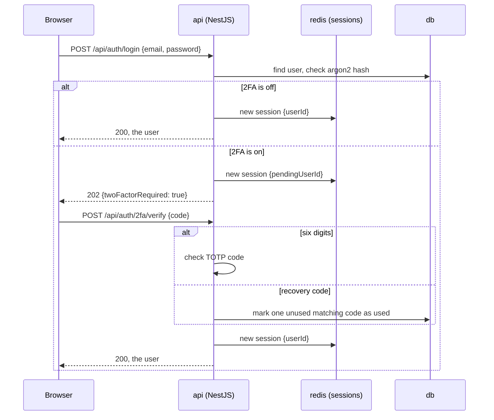

# Complete 2FA (Minor, 1 point)

**Type:** Minor. **Points:** 1. **Status:** done.

Two-factor authentication (2FA) means a person needs two things to sign in: their password, and
a six-digit code from an authenticator app on their phone. The code changes every 30 seconds.
So a stolen password alone is not enough to get into the account. If the phone is lost, the
person can sign in with one of ten single-use recovery codes instead.

## What the subject asks

The module is one line in the User Management modules table of
[../subject/summary.md](../subject/summary.md):

> | Minor | Complete 2FA |

The PDF ([../subject/ft_transcendence.pdf](../subject/ft_transcendence.pdf), chapter IV, User
Management) words it like this:

> Minor: Implement a complete 2FA (Two-Factor Authentication) system for the users.

The mandatory part (chapter III.3, Technical requirements) says that 2FA is not required there,
and can come from a module:

> - Your application must have a basic user management system. Users must be able to sign up
>   and log in securely:
>   - At minimum: email and password authentication with proper security (hashed passwords,
>     salted, etc.).
>   - Additional authentication methods (OAuth, 2FA, etc.) can be implemented via modules.

The subject gives no more detail. We read "complete" as the whole life of a second factor: a
user can turn it on, it is asked for at every login, there is a way in when the phone is lost,
and the user can turn it off again. The rows below follow that reading. One rule of the
mandatory part also applies to every form, so it has a row too:

> - All forms and user inputs must be properly validated in both the frontend and backend.

## How we meet it

| The subject asks | What we built | Where |
| --- | --- | --- |
| A second factor | TOTP (time-based one-time password, the standard that Google Authenticator and similar apps use): SHA-1, 6 digits, a new code every 30 seconds. The server accepts the code of the current 30-second step and of one step either side, for clocks that are a little off. Built with the `otpauth` library. | [two-factor.service.ts](../../apps/api/src/auth/two-factor.service.ts) |
| Turning it on | Two steps. `POST /api/auth/2fa/setup` stores a new secret and returns it with a QR code. The factor is not active yet. `POST /api/auth/2fa/enable` turns it on only when the user sends a valid code, which proves the app was set up correctly. So a setup that is abandoned, or a secret typed wrong, cannot lock anyone out. While 2FA is on, both routes answer `409` with `twoFactor.alreadyEnabled`: to change authenticator, the user turns 2FA off first, with the password ([#219](https://github.com/VictorBro/ft_transcendence/pull/219)). | [two-factor.service.ts](../../apps/api/src/auth/two-factor.service.ts) (`beginEnrolment`, `confirmEnrolment`), [auth.controller.ts](../../apps/api/src/auth/auth.controller.ts) |
| A QR code to scan | The server draws the QR code (with `qrcode-generator`) and sends it as an image inside the JSON (a `data:` URL). The page also shows the secret as text, for apps that cannot scan. | [two-factor.service.ts](../../apps/api/src/auth/two-factor.service.ts) (`qrDataUrl`), [two-factor-panel.tsx](../../apps/web/app/%5Blocale%5D/%28main%29/settings/2fa/two-factor-panel.tsx) |
| Asked for at login | When 2FA is on, a correct password does not sign the user in. `POST /api/auth/login` answers `202` with `{ twoFactorRequired: true }` and puts the user id under a separate session key, `pendingUserId`. The guard that protects every route reads only `userId`, so a half-finished login opens nothing. `POST /api/auth/2fa/verify` checks the code and only then starts the real session. | [auth.controller.ts](../../apps/api/src/auth/auth.controller.ts), [session.d.ts](../../apps/api/src/auth/session.d.ts), [auth.guard.ts](../../apps/api/src/auth/auth.guard.ts), [login-form.tsx](../../apps/web/app/%5Blocale%5D/%28main%29/login/login-form.tsx) |
| A way in when the phone is lost | Ten recovery codes, made when 2FA is turned on and shown once. Each has 20 characters in four groups of five (`xxxxx-xxxxx-xxxxx-xxxxx`), from an alphabet without look-alike characters (no `i`, `l`, `o`, `0`, `1`). The login step takes either a six-digit code or a recovery code. Each recovery code works once. | [two-factor.service.ts](../../apps/api/src/auth/two-factor.service.ts) (`issueRecoveryCodes`, `consumeRecoveryCode`), [two-factor.ts](../../packages/shared/src/schemas/two-factor.ts) |
| Recovery codes kept safely | The database keeps only a SHA-256 hash of each code, in the `RecoveryCode` table, never the code itself. A code is marked used in the same database statement that finds it, so two logins at the same moment cannot both use one code. | [schema.prisma](../../apps/api/prisma/schema.prisma) (`RecoveryCode`), [migration](../../apps/api/prisma/migrations/20260809004816_two_factor/migration.sql) |
| Turning it off | `DELETE /api/auth/2fa` asks for the password again, not only a valid session, so that a browser left open is not enough. It clears the secret and deletes the recovery codes in one transaction. It is the only way to turn 2FA off: setup and enable are refused while 2FA is on. | [auth.controller.ts](../../apps/api/src/auth/auth.controller.ts) (`disableTwoFactor`), [two-factor.service.ts](../../apps/api/src/auth/two-factor.service.ts) (`disable`) |
| Codes cannot be guessed quickly | Every route that checks a code or a password (`login`, `2fa/verify`, `2fa/enable`, `DELETE 2fa`) allows 5 tries a minute per IP address (`LOGIN_LIMIT_PER_MINUTE`). After that the API answers `429`. | [auth.controller.ts](../../apps/api/src/auth/auth.controller.ts), [rate-limits.ts](../../apps/api/src/throttler/rate-limits.ts), [../operations/deployment.md](../operations/deployment.md) |
| (Mandatory part) Forms validated in the browser and on the server | One set of Zod schemas in `@ft/shared` checks the code fields on both sides: `TotpCodeSchema` (six digits), `RecoveryCodeSchema` (hyphens and spaces removed, then 20 letters or digits) and `SecondFactorSchema` (either one). The "turn off" form uses `DisableTwoFactorSchema` (the password, 1 to 128 characters). The API applies them through `nestjs-zod`, and the login form, the setup form and the turn-off form apply them before they send anything ([#218](https://github.com/VictorBro/ft_transcendence/pull/218) for the turn-off form). | [two-factor.ts](../../packages/shared/src/schemas/two-factor.ts), [auth.dto.ts](../../apps/api/src/auth/auth.dto.ts), [two-factor-panel.tsx](../../apps/web/app/%5Blocale%5D/%28main%29/settings/2fa/two-factor-panel.tsx) |

## How it works

### The data

Two columns on `User` and one table ([schema.prisma](../../apps/api/prisma/schema.prisma)):

| Field | Meaning |
| --- | --- |
| `User.totpSecret` | The TOTP secret, in base32. Set when setup starts. |
| `User.totpEnabledAt` | When 2FA was turned on. `null` means 2FA is off, even if a secret is stored. |
| `RecoveryCode.codeHash` | The SHA-256 hash of one recovery code. Unique. |
| `RecoveryCode.usedAt` | When the code was used. `null` means it can still be used. |

`RecoveryCode` rows are deleted with their user (`onDelete: Cascade`). The `GET /api/auth/2fa`
route sums this up as `{ enabled, enrolmentPending, recoveryCodesRemaining }`.

### Turning it on

1. The user opens `/settings/2fa` and clicks **Set up**.
2. `POST /api/auth/2fa/setup` makes a new 20-byte secret and saves it in `totpSecret`, but only
   if 2FA is off: the check `totpEnabledAt: null` is in the same write. If 2FA is on, it answers
   `409` and sends no secret. Otherwise it returns the secret, the `otpauth://` link and the QR
   image. The QR label is the user's email, the issuer is `ft_transcendence`.
3. The user scans the QR code with their app and types the code it shows.
4. `POST /api/auth/2fa/enable` checks the code against the stored secret. It answers `409` if
   2FA is already on. If the code is right, it sets `totpEnabledAt`, but only if the secret is
   still the one it checked and 2FA is still off. If another request changed that in between, it
   turns nothing on (`409` or `400 twoFactor.setupFirst`). Then it deletes any old recovery
   codes, creates ten new ones, and returns them in clear text. This is the only time the server
   ever sends them.
5. The session gets a new id, and the WebSocket connections of the old id are closed. The user
   stays signed in.

### Signing in

- The login form shows a second form with an **Authentication code** field when it gets the
  `202`. The form has its own React `key`, so the browser does not reuse the password field for the
  code field ([login-form.tsx](../../apps/web/app/%5Blocale%5D/%28main%29/login/login-form.tsx)).
- `verifySecondFactor` first tries the input as a TOTP code if it is six digits. Otherwise it
  removes spaces and hyphens, puts it in lower case, and looks for an unused recovery code with the
  same hash.
- A wrong code answers `401` with the error code `twoFactor.invalidCode`. A call to
  `/2fa/verify` with no pending login answers `401` with `auth.passwordFirst`. The web app turns
  these codes into a sentence in the page's language (English, French or German).
- Each step gets a fresh session id (`session.regenerate`). This stops session fixation, where
  an attacker plants a session id before the login and uses it after. See
  [../architecture/overview.md](../architecture/overview.md), section 3, for the same login
  traced through Caddy and Redis.

The settings page shows **Set up** only when it knows 2FA is off. While `GET /api/auth/2fa`
loads, it shows "Checking two factor authentication…". If that call fails, it shows an error and
**Try again**, never **Set up**. If setup or enable answers `409` (2FA was turned on in another
tab), the page closes the setup form and loads the status again.

### Turning it off

The user types their password and clicks **Turn off**. `DELETE /api/auth/2fa` checks the
password with argon2, then sets `totpSecret` and `totpEnabledAt` to `null` and deletes all
recovery codes in one transaction. Turning it on again always starts with a new secret.

### Monitoring

The API counts `POST /api/auth/2fa/verify` answers with status `401`, and the Grafana API
dashboard has a "2FA failures" panel. The `SignInFailuresSpike` alert counts failed or throttled sign-ins and
2FA checks together (`401` or `429`). See [../operations/monitoring.md](../operations/monitoring.md) and
[metrics.ts](../../apps/api/src/metrics/metrics.ts).

## Where the code is

| Path | What it does |
| --- | --- |
| [apps/api/src/auth/two-factor.service.ts](../../apps/api/src/auth/two-factor.service.ts) | TOTP secret, QR code, code check, recovery codes, turn on and off |
| [apps/api/src/auth/auth.controller.ts](../../apps/api/src/auth/auth.controller.ts) | The routes: `login` (the `202` branch), `2fa/verify`, `GET 2fa`, `2fa/setup`, `2fa/enable`, `DELETE 2fa`; new session ids |
| [apps/api/src/auth/auth.service.ts](../../apps/api/src/auth/auth.service.ts) | `validateCredentials` says if 2FA is on; `verifyPassword` for turning it off |
| [apps/api/src/auth/session.d.ts](../../apps/api/src/auth/session.d.ts) | The two session keys, `userId` and `pendingUserId` |
| [apps/api/src/auth/auth.guard.ts](../../apps/api/src/auth/auth.guard.ts) | The global guard; it reads only `userId` |
| [apps/api/src/auth/auth.dto.ts](../../apps/api/src/auth/auth.dto.ts) | Wraps the shared schemas so NestJS validates the bodies and Swagger documents them |
| [apps/api/src/throttler/rate-limits.ts](../../apps/api/src/throttler/rate-limits.ts), [throttle-by-ip.decorator.ts](../../apps/api/src/throttler/throttle-by-ip.decorator.ts) | The 5-a-minute limit per IP address |
| [apps/api/prisma/schema.prisma](../../apps/api/prisma/schema.prisma) | `User.totpSecret`, `User.totpEnabledAt`, the `RecoveryCode` model |
| [apps/api/prisma/migrations/20260809004816_two_factor/](../../apps/api/prisma/migrations/20260809004816_two_factor/migration.sql) | The migration that added them |
| [packages/shared/src/schemas/two-factor.ts](../../packages/shared/src/schemas/two-factor.ts) | Zod schemas for codes and answers, shared by the browser and the API |
| [apps/web/app/[locale]/(main)/settings/2fa/page.tsx](../../apps/web/app/%5Blocale%5D/%28main%29/settings/2fa/page.tsx) | The settings page; sends a signed-out visitor to `/login` |
| [apps/web/app/[locale]/(main)/settings/2fa/two-factor-panel.tsx](../../apps/web/app/%5Blocale%5D/%28main%29/settings/2fa/two-factor-panel.tsx) | Set up, scan, confirm, recovery codes, turn off |
| [apps/web/app/[locale]/(main)/login/login-form.tsx](../../apps/web/app/%5Blocale%5D/%28main%29/login/login-form.tsx) | The password step and the code step |
| [apps/web/app/[locale]/(main)/profile/page.tsx](../../apps/web/app/%5Blocale%5D/%28main%29/profile/page.tsx) | The **Security** section, with the link to the settings page |
| [apps/web/lib/auth-client.ts](../../apps/web/lib/auth-client.ts) | The browser calls to the 2FA routes |
| [apps/web/messages/en.json](../../apps/web/messages/en.json) | The texts (`TwoFactorPage`, `TwoFactorPanel`, `LoginForm`, `Errors.twoFactor`), also in `fr.json` and `de.json` |

## How to show it at the defence

You need an authenticator app on a phone (any app that scans `otpauth://` QR codes). The login
routes allow 5 tries a minute per IP address, so do the steps at a calm pace: if the page says
"Too many attempts. Try again in a minute", wait one minute.

1. Start the app with `make run` (or `make all`) and open the address it prints,
   `https://localhost`.
2. Create a new account at `/en/signup`: fill **Email**, **Display name**, **Password** and
   **Confirm password**, then click **Create account**. You land on `/en/onboarding`.
3. Open `/en/profile`. Under **Security**, click **Two factor authentication**. The page
   `/en/settings/2fa` says "Two factor authentication is off."
4. Click **Set up**. The page shows "Scan this code", a QR code, and under it "Cannot scan it?
   Enter this key by hand:" with the secret.
5. Scan the QR code with the phone. The app shows `ft_transcendence` and the email.
6. To show that a wrong code is refused: type `000000` in **Code from your app** and click
   **Turn on**. The page says "That code is not valid", and 2FA stays off.
7. Type the code from the app and click **Turn on**. The page shows "Save your recovery codes"
   and ten codes. Copy two of them, then click **I have saved them**. The page now says "Two
   factor authentication is on. 10 recovery codes left."
8. To show that only hashes are stored, open a database shell with `make shell SERVICE=db` and
   run `psql -U ft -d ft_transcendence -c 'select "codeHash", "usedAt" from "RecoveryCode";'`.
   You see 64-character hashes, not the codes you copied.
9. Open the menu in the header and click **Sign out**. Go to `/en/login`, type the email and password, and click **Sign in**.
   You are not signed in yet: the page asks "Enter the six digit code from your authenticator
   app, or one of your recovery codes."
10. Optional: in a new tab, open `https://localhost/api/auth/me`. It answers `401`, because a
    half-finished login is not a login.
11. Type the code from the app in **Authentication code** and click **Verify**. You land on
    `/en/onboarding`, signed in.
12. Sign out and sign in again, but this time type one of the recovery codes (with or without
    the hyphens) and click **Verify**. It works. On `/en/settings/2fa` the page now says "9
    recovery codes left."
13. Sign out, sign in, and type the same recovery code again. The page says "That code is not
    valid": each code works once.
14. Sign in with the app code. On `/en/settings/2fa`, type a wrong password in **Confirm your
    password to turn it off** and click **Turn off**: "Incorrect password". Type the right
    password: the page says "Two factor authentication is off." Sign out and sign in: the
    password is enough again.

The API routes are also listed in Swagger at `https://localhost/api/docs`, under `auth`.

## Tests that prove it

Run the unit tests with `make test`, the API tests against a real database and Redis with
`make ci`, and the browser tests with `make test-e2e`.

| Test | What it checks |
| --- | --- |
| [apps/api/src/auth/two-factor.service.spec.ts](../../apps/api/src/auth/two-factor.service.spec.ts) | Setup stores a secret without turning anything on; setup and confirm are refused with `409` while 2FA is on (#216); confirm refuses before setup and refuses a wrong code; a real code turns 2FA on and makes recovery codes; a secret replaced after the check turns nothing on; two confirmations at the same time make only one set of codes; a code is refused when 2FA was never turned on; a recovery code works with or without hyphens; a used recovery code is refused |
| [apps/api/src/auth/auth.service.spec.ts](../../apps/api/src/auth/auth.service.spec.ts) | "reports an enrolled second factor": `validateCredentials` says when 2FA is on |
| [apps/api/src/auth/auth.controller.spec.ts](../../apps/api/src/auth/auth.controller.spec.ts) | A new session id, and the old id's sockets closed, on a login that still needs a code, on the code step, and when 2FA is turned on or off; the recovery codes are still returned if the session id cannot be changed |
| [apps/api/test/two-factor.e2e-spec.ts](../../apps/api/test/two-factor.e2e-spec.ts) | Full API flow on real Postgres and Redis: setup returns a QR, `000000` is refused, a real code turns it on and returns 10 codes; login stops at `202` and that session gets `401` on `/api/auth/me`; the code step gives a new session cookie; `/2fa/verify` with no pending login is refused; a recovery code works once and never again; setup and enable answer `409` while 2FA is on, and the old app code and recovery codes still work; turning off needs the right password, then a login with the password alone answers `200`; after that, setup and enable work again with a new secret |
| [apps/api/test/gateway.e2e-spec.ts](../../apps/api/test/gateway.e2e-spec.ts) | "a 2FA change replaces the session and its sockets": turning 2FA on closes the old WebSocket, and the old cookie can no longer open one |
| [packages/shared/src/schemas/schemas.test.ts](../../packages/shared/src/schemas/schemas.test.ts) | "validation messages": a bad `SecondFactorSchema`, `EnableTwoFactorSchema` or `DisableTwoFactorSchema` input gives an error code that can be translated, not Zod's English default |
| [e2e/tests/auth.spec.ts](../../e2e/tests/auth.spec.ts) | In a real browser: "offers two factor enrolment with a scannable QR"; "offers no setup when the 2FA status cannot be read" (the page shows an error and **Try again**, not **Set up**); "a signed-out visitor is sent to the login page"; "enrols in 2FA, then signs in with the code" (the test reads the secret from the page, acts as the app, turns 2FA on and sees the recovery codes screen, signs out, checks the code field is empty, and signs in with a code); "checks the turn-off password in the browser before sending it" (an empty password shows "Enter your password" and sends no request, [#218](https://github.com/VictorBro/ft_transcendence/pull/218)). CI runs them on Chromium, Firefox and WebKit. |
| [e2e/support/routes.ts](../../e2e/support/routes.ts) | `/en/settings/2fa` is in the list of pages the browser checks visit as a signed-in user, for example the console check ([console.spec.ts](../../e2e/tests/console.spec.ts)), which fails on anything the browser console reports |

## Limits and choices

- **Sessions, not JWT.** A login is a session in Redis with an opaque cookie. This gives the
  "password done, code still needed" state a safe place to live (`pendingUserId`), and a session
  can be ended at once. This was the reason given in PR #5.
- **SHA-256 for recovery codes, argon2 for passwords.** Passwords are chosen by people, so they
  need a slow hash. Recovery codes are random (20 characters from a 31-character alphabet, about
  99 bits), so a fast hash is enough, and a login finds the code with one indexed lookup instead
  of ten slow checks. Note: the comment above `RecoveryCode` in `schema.prisma` and the text of
  PR #5 say "160 bits"; the real figure from the code is about 99 bits, which is still far too
  many to guess.
- **The TOTP secret is stored as plain text** in `User.totpSecret`. The server needs the secret
  itself to check codes, so it cannot be hashed. It is not encrypted either: someone who can
  read the database can make valid codes.
- **A TOTP code can be used more than once** while it is valid (about 30 to 90 seconds, with the
  window of one step either side). The server does not store the last code used. The 5-a-minute
  limit per address still applies.
- **No route to make new recovery codes.** When a user has used them all, the only way to get
  new ones is to turn 2FA off and on again. `issueRecoveryCodes` already replaces the whole set,
  but no route calls it on its own.
- **Turning 2FA on does not sign out other devices.** Only the current session gets a new id.
  Sessions already open in other browsers stay valid until they end.
- **Changing authenticator needs the password.** There is no "replace my app" route. While 2FA is
  on, `POST /api/auth/2fa/setup` and `POST /api/auth/2fa/enable` answer `409`
  (`twoFactor.alreadyEnabled`). The user turns 2FA off with the password, then sets it up again.
  Before [#219](https://github.com/VictorBro/ft_transcendence/pull/219), setup turned 2FA off with a
  session alone ([#216](https://github.com/VictorBro/ft_transcendence/issues/216)).
- **Setting up 2FA asks for no password.** On an account without 2FA, a session is enough to
  start setup and turn it on.
- **The code limit is per IP address, not per account.** Someone who already has the password and
  can change address can keep guessing codes for one account.
- **A half-finished login lasts as long as a session.** The `pendingUserId` session uses the same
  cookie lifetime as a full session (7 days, renewed on each request, `SESSION_TTL_MS` in
  [app.setup.ts](../../apps/api/src/app.setup.ts)). The code is still required to finish it.
- **TOTP only.** No codes by email or SMS, and no passkeys.
- **No password reset**, with or without 2FA. A user who loses both the phone and the recovery
  codes cannot get back into the account.

## Who built it

From `git log --follow` on the 2FA files and `gh pr view` on each pull request.

| Member | GitHub | What they built | Issues and PRs |
| --- | --- | --- | --- |
| Victor | `VictorBro` | The whole module: `TwoFactorService`, the 2FA routes and the `202` login step, the two session keys, the `RecoveryCode` table and migration, the shared schemas, the login form and the settings page, and the 2FA tests in the API and in the browser. Later: the per-address limit (`ThrottleByIp`), and closing the old session's WebSockets when 2FA changes. | #4, #5, #21 (merged into #20), #27, #181 |
| Luca | `luca-mattei` | Moved the login and 2FA pages under `[locale]` and translated their texts into English, French and German; the service now sends error codes instead of English sentences, with the "validation messages" test. | #26 |
| Endrit | `VYAntares` (commits as `EA`) | Moved the login and 2FA pages into the shared `(main)` layout; gave every 2FA schema rule an error code, so a missing field is also translated. Later: the turn-off password checked in the browser, and setup and enable refused while 2FA is on. | #20, #126, #216, #217, #218, #219 |
| Bastian | `bastian-schnitzler` | The settings page now loads the 2FA status through the shared API client, which checks the answer with `TwoFactorStatusSchema`. | #57 |
