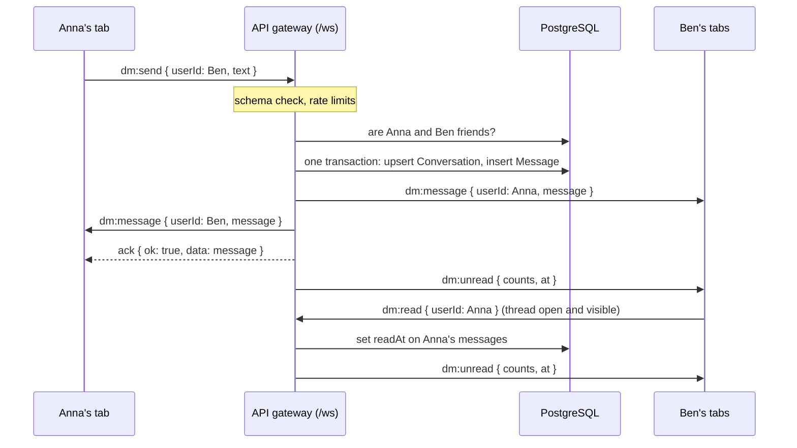

# User interaction: basic chat, profiles and friends (Major, 2 points)

**Type:** Major. **Points:** 2. **Status:** done.

Learners can add each other as friends, open each other's profile page, and send private
messages to a friend. Messages arrive live, are stored, and show an unread count in the header.

## What the subject asks

The module is one line in the Web modules table of [../subject/summary.md](../subject/summary.md):

> | Major | User interaction: basic **chat** + **profiles** + **friends** |

The same file adds one rule about it:

> - Advanced chat requires the basic chat from the "User interaction" module.

We do not claim Advanced chat, so this file covers only the basic chat.

One rule of the mandatory part applies to the chat box too:

> - All forms and inputs validated **both frontend and backend**.

### How it differs from standard user management

Two parts of this module also count for [Standard user management](./user-management.md): the
friends system and the public profile page. We say so openly. The code is the same, and the two
modules use it for different things:

| Part | Standard user management uses it for | This module uses it for |
| --- | --- | --- |
| Friends | The friends list and the online status of each friend | Who may write to whom: only friends can send a message |
| Profile page | Showing a user's data (name, avatar, courses) | Reaching another learner: from search, a list or a conversation, then **Add friend** or **Message** |
| Chat | Not part of it | All of it: only this module has it |

Profile editing, the avatar upload and the online status belong only to
[user-management.md](./user-management.md). The chat belongs only to this module.

## How we meet it

| The subject asks | What we built | Where |
| --- | --- | --- |
| Basic chat | The **Messages** page (`/chat`): one private conversation per pair of friends. Text messages of 1 to 1,000 characters, stored in the database, delivered live over the WebSocket connection to both people and to all their open tabs. The history survives a reload and can be paged back with **Load earlier messages**. Each conversation shows its unread count, and the header shows the total. Only friends can send. The chat is one to one: there are no group conversations. | [chat/page.tsx](<../../apps/web/app/[locale]/(messages)/chat/page.tsx>), [chat-thread.tsx](<../../apps/web/app/[locale]/(messages)/chat/chat-thread.tsx>), [messages.service.ts](../../apps/api/src/messages/messages.service.ts), [messages.gateway.ts](../../apps/api/src/messages/messages.gateway.ts) |
| Profiles | `/users/<id>`: the page any signed-in learner sees for another learner, with their display name, avatar, courses, level and streak, and the right friend button. Every name in a list links to it, and so does the name at the top of a conversation. | [users/[id]/page.tsx](<../../apps/web/app/[locale]/(main)/users/[id]/page.tsx>), [users.service.ts](../../apps/api/src/users/users.service.ts) |
| Friends | The **Friends** page (`/friends`): search by display name, a "Recently active" list, send, accept, decline and cancel requests, remove a friend. Each friend has a **Message** button that opens the conversation. The other person sees each change without a reload. | [friends/page.tsx](<../../apps/web/app/[locale]/(main)/friends/page.tsx>), [friends.service.ts](../../apps/api/src/friends/friends.service.ts), [friends.controller.ts](../../apps/api/src/friends/friends.controller.ts) |
| Inputs validated on both sides (mandatory part) | The message box and the server check the text with the same Zod schema (a rule set for data), `MessageTextSchema` from `@ft/shared`: trimmed, 1 to 1,000 characters, no NUL character. The server checks it again before any handler runs. | [packages/shared/src/schemas/message.ts](../../packages/shared/src/schemas/message.ts), [packages/shared/src/events/socket.ts](../../packages/shared/src/events/socket.ts), [socket.gateway.ts](../../apps/api/src/gateway/socket.gateway.ts) |

## How it works

### Friends

- One `Friendship` row per pair of users, with a status: `pending` (a request) or `accepted` (a
  friendship) ([schema.prisma](../../apps/api/prisma/schema.prisma)). Its key, `pairKey`, is the
  two user ids with the smaller first ([pair.ts](../../apps/api/src/friends/pair.ts)). So A to B
  and B to A share one key, and two requests that cross cannot make two rows.
- The routes are in [friends.controller.ts](../../apps/api/src/friends/friends.controller.ts). They
  always name the other user, never a row id, so a row that does not include you cannot be
  reached:

  | Route | What it does |
  | --- | --- |
  | `GET /api/friends` | Your friends (each with `online`), the requests you received, the requests you sent |
  | `POST /api/friends/requests/:userId` | Send a request. If they already asked you, this accepts theirs. Limited to 10 a minute. |
  | `POST /api/friends/requests/:userId/accept` | Accept their request |
  | `DELETE /api/friends/requests/:userId` | Decline their request, or cancel yours |
  | `DELETE /api/friends/:userId` | Remove a friend |

- Declining, cancelling and removing delete the row. A declined request can be sent again.
- After each change, `FriendsService` sends `friend:request`, `friend:accepted` or `friend:removed`
  over the WebSocket to both users ([friends.service.ts](../../apps/api/src/friends/friends.service.ts)).
  The friends page, the profile page and the messages page listen for these events and reload
  their data ([refresh-on.tsx](../../apps/web/components/refresh-on.tsx)).
- To find people: `GET /api/users?q=` searches display names, and `GET /api/users/recently-active`
  lists learners who opened the app in the last 7 days. Both are explained in
  [user-management.md](./user-management.md).

### Profiles

- `/users/<id>` ([users/[id]/page.tsx](<../../apps/web/app/[locale]/(main)/users/[id]/page.tsx>))
  calls `GET /api/users/:id`. The API sends only public fields: id, display name, avatar, and for
  each course the language, the level and the current streak. Email, time zone and 2FA settings
  never leave the server.
- The page shows one action that follows where you stand with that person: **Add friend**;
  "Request sent" with **Cancel request**; "Request received" with **Accept** and **Decline**;
  "Already friends" with **Message** and **Remove**. On your own id it shows **Edit profile**.
- **Remove** asks first, in a dialog: "Remove {name} from your friends?" with **Cancel** and
  **Remove** ([friend-buttons.tsx](../../apps/web/components/friend-buttons.tsx)).
- The page needs a session. An unknown id, or text that is not an id, gives a 404 page.

### Chat

**Sending.** Messages are sent over the WebSocket, not over HTTP.

1. The **Write a message** box ([chat-thread.tsx](<../../apps/web/app/[locale]/(messages)/chat/chat-thread.tsx>))
   checks the text with `MessageTextSchema`. Enter sends, Shift+Enter starts a new line. The box is
   read-only until the server answers, so one message is sent at a time.
2. The browser emits `dm:send { userId, text }` and waits up to 10 seconds for the answer, the
   "ack" ([send-message.ts](../../apps/web/lib/send-message.ts)). If the socket is not connected,
   the send fails at once with "Could not reach the server", and the text stays in the box.
3. On the server, the gateway's check (`screen` in
   [socket.gateway.ts](../../apps/api/src/gateway/socket.gateway.ts)) runs before any handler. It
   parses the payload with `DmSendSchema` and refuses an unknown event, a bad payload or more than
   20 events of one name in 10 seconds on one socket. A refusal answers the ack with an error code,
   for example `message.tooLong`.
4. `MessagesService.send` ([messages.service.ts](../../apps/api/src/messages/messages.service.ts))
   allows 30 messages a minute per account, across all its tabs. Then it checks that the two users
   are friends (`areFriends` in [friend-ids.ts](../../apps/api/src/friends/friend-ids.ts)). A
   stranger, a pending request or yourself gets `message.notFriends`: "Only friends can message
   each other".
5. In one database transaction, it creates or updates the `Conversation` row and inserts the
   `Message` row.
6. It sends `dm:message` to both users' rooms (a room is the group of all sockets of one user). So
   the other person sees it, and so do the sender's other tabs. The thread drops a message it
   already shows, by id ([thread.ts](../../apps/web/lib/thread.ts)).
7. It returns the stored message as the ack, and the box empties.

**Reading the history.** The history is read over HTTP
([messages.controller.ts](../../apps/api/src/messages/messages.controller.ts)):

| Route | What it does |
| --- | --- |
| `GET /api/conversations` | Your conversations, the latest message first, each with the other user and its unread count |
| `GET /api/conversations/:userId/messages?cursor=` | A page of 50 messages with that user, oldest first. With `cursor`, the page before that message. |

- Pages are cut by `(createdAt, id)`, so two messages sent in the same millisecond never fall
  between two pages. A cursor that is not a message of this pair gives 400.
- Reading needs no friendship. After a friend is removed, both people can still read the old
  conversation, but neither can write. The thread then shows "Only friends can message each other.
  You can still read this conversation." instead of the box.
- Each query is built from your own id and the other user's id, so you can never reach a
  conversation you are not in.

**Unread counts.**

- `Message.readAt` is empty until the other user reads the message. It is never sent to the
  browser, so the sender does not see when a message was read.
- `dm:unread { counts, at }` holds the unread count of every conversation
  ([unread.ts](../../apps/api/src/messages/unread.ts)). It is always the whole picture, never a
  change to add. The server sends it when a tab connects, to the recipient after each message, and
  to every tab of the reader after each read. `at` is the time of the count, so a tab keeps the
  newest one, whatever order they arrive in ([lib/unread.ts](../../apps/web/lib/unread.ts)).
- When a thread is open, the tab is visible and there is something unread, the page sends
  `dm:read { userId }`. The server sets `readAt` and sends a new count. Reads are limited per account
  to the API's general limit: 100 a minute unless `RATE_LIMIT_PER_MINUTE` in `.env` changes it
  (`READ_LIMIT_PER_MINUTE` in [messages.service.ts](../../apps/api/src/messages/messages.service.ts)).
- The header shows the total in a badge, and 99+ above 99: on the **Menu** button, and on the
  **Messages** row inside that menu
  ([unread-badge.tsx](../../apps/web/components/unread-badge.tsx),
  [header-menu.tsx](../../apps/web/components/header-menu.tsx),
  [session-nav.tsx](../../apps/web/components/session-nav.tsx)). A screen reader hears the exact
  number, for example "1 unread message".

**After a lost connection.** Each time the socket connects, the open thread asks for the newest
page again and merges it by id (`catchUp` in [thread.ts](../../apps/web/lib/thread.ts)). A message
sent while the tab was offline shows up when the connection is back.

**The page.** `/chat` lists the conversations on the left and the open one on the right.
`/chat?with=<userId>` opens a conversation. On a phone, the page shows the list or the
conversation, with an **All messages** link back. A friend opened before the first message is
listed on top. Friends in the list have an online dot. Times are shown in the account's time zone.

More about the gateway, the rooms and the socket events is in
[../architecture/realtime.md](../architecture/realtime.md), section 3, and in
[websockets.md](./websockets.md).

## Where the code is

| Path | What it does |
| --- | --- |
| [apps/api/src/messages/messages.service.ts](../../apps/api/src/messages/messages.service.ts) | Send (friends only, rate limit, one transaction, events to both rooms), mark as read, list conversations, page the history. |
| [apps/api/src/messages/messages.gateway.ts](../../apps/api/src/messages/messages.gateway.ts) | The socket handlers for `dm:send` (answered with an ack) and `dm:read`. |
| [apps/api/src/messages/messages.controller.ts](../../apps/api/src/messages/messages.controller.ts) | `GET /api/conversations` and `GET /api/conversations/:userId/messages`. |
| [apps/api/src/messages/unread.ts](../../apps/api/src/messages/unread.ts) | The unread count per conversation, also sent by the gateway on connect. |
| [apps/api/src/friends/](../../apps/api/src/friends) | Friend requests and the friends list; `pairKey`; `areFriends` and `friendIds`. |
| [apps/api/src/users/](../../apps/api/src/users) | User search, recently active learners, the public profile. |
| [apps/api/src/gateway/socket.gateway.ts](../../apps/api/src/gateway/socket.gateway.ts) | Checks the session on connect, puts the socket in its user's room, checks and limits every event from the browser. |
| [apps/api/prisma/schema.prisma](../../apps/api/prisma/schema.prisma) | The `Friendship`, `Conversation` and `Message` tables. The migrations are `add_messages` and `add_message_unread_index` in [apps/api/prisma/migrations/](../../apps/api/prisma/migrations). |
| [packages/shared/src/schemas/message.ts](../../packages/shared/src/schemas/message.ts) | `MessageTextSchema`, `MESSAGE_MAX_LENGTH` (1,000), `MESSAGE_PAGE_SIZE` (50), the answer shapes. |
| [packages/shared/src/events/socket.ts](../../packages/shared/src/events/socket.ts) | The socket event names and the schema of each payload, shared by the browser and the API. |
| [apps/web/app/[locale]/(messages)/chat/](<../../apps/web/app/[locale]/(messages)/chat>) | The **Messages** page: the conversation list and the thread with its message box. |
| [apps/web/app/[locale]/(main)/friends/page.tsx](<../../apps/web/app/[locale]/(main)/friends/page.tsx>) | The **Friends** page. |
| [apps/web/app/[locale]/(main)/users/[id]/page.tsx](<../../apps/web/app/[locale]/(main)/users/[id]/page.tsx>) | The public profile page. |
| [apps/web/components/friend-buttons.tsx](../../apps/web/components/friend-buttons.tsx), [apps/web/components/message-link.tsx](../../apps/web/components/message-link.tsx) | The friend buttons, and the **Message** button to a conversation. |
| [apps/web/components/tab-socket.ts](../../apps/web/components/tab-socket.ts) | The tab's one socket: sends `dm:send` and `dm:read`, keeps the unread counts. |
| [apps/web/lib/send-message.ts](../../apps/web/lib/send-message.ts), [apps/web/lib/thread.ts](../../apps/web/lib/thread.ts), [apps/web/lib/unread.ts](../../apps/web/lib/unread.ts) | The send and its ack; how new messages and pages join the thread; the unread store and badge text. |
| [apps/web/components/unread-badge.tsx](../../apps/web/components/unread-badge.tsx), [apps/web/components/header-menu.tsx](../../apps/web/components/header-menu.tsx), [apps/web/components/session-nav.tsx](../../apps/web/components/session-nav.tsx) | The unread badge, and the account links of the header menu, with **Friends** and **Messages**. |

## How to show it at the defence

The stack must be running: `make run` starts it, and `make` (the default target, `all`) runs every
check first. The app is at `https://localhost`. If port 443 was not free, use the address that
`make run` prints. You need two users, so use two browser windows that do not share cookies: a
normal window (window 1) and a private window (window 2).

**Friends and profiles**

1. In window 1, open `https://localhost/en/signup`. Fill in **Email**, **Display name**,
   **Password** and **Confirm password**, then click **Create account**. Do the same in window 2
   with another user.
2. In window 1, open the menu in the header (the button at the top right) and click **Friends**. The second user is under **Recently active**. You
   can also type part of their name (at least 3 characters) in **Search by display name** and
   click **Search**.
3. Click their name. Their profile page (`/users/<id>`) shows their name, avatar and **Courses**.
   Click **Add friend**: the page shows "Request sent" and **Cancel request**.
4. In window 2, open **Friends**. Under **Requests received**, click **Accept**. Window 1 changes
   to "Already friends" with **Message** and **Remove**, without a reload.

**Chat**

5. In window 1, click **Message**. The **Messages** page opens with the conversation and "No
   messages yet."
6. In window 2, open any page, for example **Friends**.
7. In window 1, type a message in **Write a message** and press Enter. It appears in the thread.
   In window 2, without a reload, the menu button in the header shows a badge with 1.
8. In window 2, open the menu and click **Messages**, then the first user's name. The message is there, and the
   badge goes away.
9. Reply from window 2. Use Shift+Enter for a second line, then click **Send**. The reply shows in
   window 1 at once.
10. Reload either window: the whole conversation is still there.
11. Validation: in window 1, paste a text longer than 1,000 characters and press Enter. The page
    shows "A message is limited to 1,000 characters" and sends nothing. Send only spaces: "Write a
    message first".
12. Click the user's name at the top of the conversation: it opens their profile page.
13. To show the API: open `https://localhost/api/conversations` in window 1. It lists the
    conversation with its `unread` count. The routes are also listed in Swagger at
    `https://localhost/api/docs`, under `messages` and `friends`.

**Only friends can write**

14. On the second user's profile in window 1, click **Remove**, then **Remove** in the dialog.
15. Open **Messages** in window 2 and the conversation. The old messages are still there, but the
    box is gone: "Only friends can message each other. You can still read this conversation."

## Tests that prove it

| Test | What it checks |
| --- | --- |
| [e2e/tests/messages.spec.ts](../../e2e/tests/messages.spec.ts) | Two browsers: "a message arrives live, is counted, is read by opening the thread, and stays"; "a friend written to for the first time is listed, as the open conversation"; "a long thread scrolls in its own pane on a desktop, and the screens fit a phone" (with the 1,000 character limit refused before sending); "in German, the header fits a phone with a count, which the conversation clears"; "a message sent while the socket was down arrives when it is back"; "a thread with an ex-friend stays readable, without a box"; "a message shows its time in Paris, as sent and as rendered". |
| [e2e/tests/friends.spec.ts](../../e2e/tests/friends.spec.ts) | "a request shows up live, is accepted, and both lists follow"; "a stranger found by search is added from their profile, then visited as a friend"; "a profile needs a session"; "an unknown or malformed profile is a 404". |
| [apps/api/test/messages.e2e-spec.ts](../../apps/api/test/messages.e2e-spec.ts) | Against a real database and Redis: "refuses both routes without a session"; 400 for a bad user id or cursor; "pages the history back from the newest, each page oldest first, with no overlap"; "a stranger, a pending request and yourself cannot send, and nothing is stored"; "a friend's message reaches the recipient and every tab of the sender, and is counted"; the unread count on connect, after a message and after a read; the conversation list order; "answers the ack of an event it refuses, never app:error as well, and stores nothing"; "refuses a send past the budget of a minute, from any tab of the account"; "after unfriending, both still read the history, and neither can send". |
| [apps/api/test/friends.e2e-spec.ts](../../apps/api/test/friends.e2e-spec.ts) | Search and recently active; "a request reaches both users, is accepted, then removed, and a stranger hears none of it"; declined and cancelled requests; two requests that cross; "limits sending to 10 a minute per account". |
| [apps/api/test/users.e2e-spec.ts](../../apps/api/test/users.e2e-spec.ts) | The public profile: "shows the public fields and nothing else", "answers 404 for an unknown id and 400 for a malformed one". |
| [apps/api/src/messages/messages.service.spec.ts](../../apps/api/src/messages/messages.service.spec.ts), [apps/api/src/messages/unread.spec.ts](../../apps/api/src/messages/unread.spec.ts) | Send in one transaction, events to both rooms, the rate limits, read, paging by cursor, the conversation list; the unread count per conversation. |
| [apps/api/src/friends/friends.service.spec.ts](../../apps/api/src/friends/friends.service.spec.ts) | `pairKey`, sending, accepting a crossed request, sorting the lists, each friend's online status. |
| [packages/shared/src/events/socket.test.ts](../../packages/shared/src/events/socket.test.ts) | "direct messages": the payload schemas, "sends trimmed text of 1 to 1,000 characters", and the refused cases (empty, spaces only, too long, not text, a NUL). |
| [apps/web/lib/thread.test.ts](../../apps/web/lib/thread.test.ts), [apps/web/lib/send-message.test.ts](../../apps/web/lib/send-message.test.ts), [apps/web/lib/unread.test.ts](../../apps/web/lib/unread.test.ts), [apps/web/lib/conversations-client.test.ts](../../apps/web/lib/conversations-client.test.ts) | Merging messages and pages in the thread; the send and its ack; the unread store and the 99+ badge; the history requests. |

How to run them: `make test` runs the unit tests. The API e2e tests
(`pnpm --filter @ft/api run test:e2e`) need a real database and Redis, and run in `make ci`.
`make test-e2e` runs Playwright against the production stack, and `make playwright-all` runs it on
Chromium, Firefox and WebKit, as CI does.

## Limits and choices

- **Shared with standard user management.** The friends system and the public profile page count
  for both modules. Only the chat is new in this module. See
  [How it differs from standard user management](#how-it-differs-from-standard-user-management).
- **One to one only.** A conversation is between two people. There are no group conversations and
  no channels. The `Conversation` table has two user columns and no list of members.
- **Text only.** No images or files. A message cannot be edited or
  deleted.
- **Only friends can send.** This stops strangers from writing to someone. After a friend is
  removed, the old conversation stays readable by both, as the privacy policy says
  ([lib/legal-content/en.ts](../../apps/web/lib/legal-content/en.ts)).
- **No blocking, no typing indicator, no read receipts.** These belong to the Advanced chat module,
  which we do not claim. Removing a friend is the way to stop messages. The read time is stored,
  only to count unread messages, and the sender never sees it.
- **No notifications outside the app.** The unread badge in the header is the only signal. There
  is no email and no push notification.
- **Messages are kept while both accounts exist.** Deleting either account deletes the
  conversation (the relations cascade). There is no account deletion button yet; see
  [user-management.md](./user-management.md).
- **A resend can show twice.** If the ack does not come within 10 seconds, the page says it failed,
  but the server may have stored the message. Sending it again then shows it twice
  ([send-message.ts](../../apps/web/lib/send-message.ts)).
- **One API instance.** Socket rooms live in the memory of the API process, so all users must be
  on the same instance ([../architecture/realtime.md](../architecture/realtime.md), "One API instance").

## Who built it

From `git log --follow` on the files above and `gh pr view` on each pull request.

| Member | GitHub | What they built | Issues and PRs |
| --- | --- | --- | --- |
| Victor | `VictorBro` | The WebSocket gateway the chat runs on; friends, the friend events and the friends page; user search; the public profile page and "Recently active"; the direct messages: the `Conversation` and `Message` tables, the REST routes, `dm:send`, `dm:read` and `dm:unread`, the **Messages** page, the unread badge, the **Message** buttons and the tests. | #181 (closes #154), #189 (closes #155), #193 (closes #156), #200 (closes #158) |
| Endrit | `VYAntares` (commits as `EA`) | Online status, which the friends list, the profile page and the conversation list show: `PresenceService`, the presence events, and `online` on each friend in `GET /api/friends`. | #195 (closes #157) |
