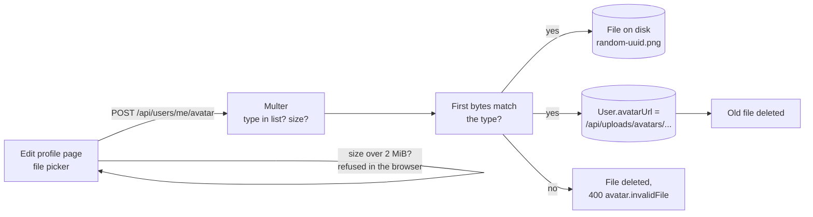
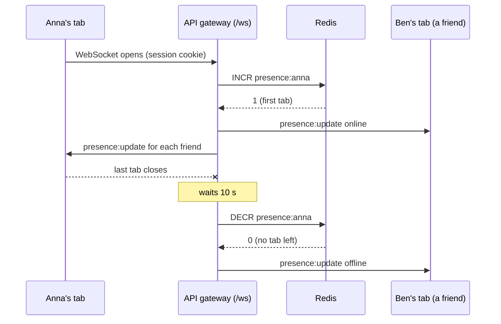

# Standard user management (Major, 2 points)

**Type:** Major. **Points:** 2. **Status:** done.

Each user has a profile they can edit, a picture (an avatar) they can upload or remove, and a
list of friends. Friends see each other's online status, live. Any signed-in user can open
another user's profile page.

## What the subject asks

The module is one line in the User Management modules table of
[../subject/summary.md](../subject/summary.md):

> | Major | Standard user management: profile editing, avatar upload (with default), friends + online status, profile page |

The PDF ([../subject/ft_transcendence.pdf](../subject/ft_transcendence.pdf), chapter IV, User
Management) words it like this:

> Major: Standard user management and authentication.
>
> - Users can update their profile information.
> - Users can upload an avatar (with a default avatar if none provided).
> - Users can add other users as friends and see their online status.
> - Users have a profile page displaying their information.

Two rules of the mandatory part (chapter III.3, Technical requirements) apply to the same code:

> - Your application must have a basic user management system. Users must be able to sign up
>   and log in securely:
>   - At minimum: email and password authentication with proper security (hashed passwords,
>     salted, etc.).
>   - Additional authentication methods (OAuth, 2FA, etc.) can be implemented via modules.
> - All forms and user inputs must be properly validated in both the frontend and backend.

Signup and login are the mandatory part, not this module, so this file does not cover them.

## How we meet it

| The subject asks | What we built | Where |
| --- | --- | --- |
| Profile editing | The **Edit profile** page changes the display name and the avatar (next row). The interface language and the time zone are saved on the same route, `PATCH /api/users/me`, but by the app itself, not by a form: the language when a learning page opens in a language other than the saved one (the lesson tutor answers in `User.locale`), the time zone from the browser. Email and password are not on this page (see [Limits and choices](#limits-and-choices)). | [profile-form.tsx](../../apps/web/app/[locale]/(main)/profile/edit/profile-form.tsx), [users.controller.ts](../../apps/api/src/users/users.controller.ts), [locale-sync.tsx](../../apps/web/components/locale-sync.tsx), [time-zone-sync.tsx](../../apps/web/components/time-zone-sync.tsx) |
| Avatar upload | On the same page: **Upload avatar** (or **Change avatar**) and **Remove avatar**. PNG, JPEG or WebP, 2 MiB at most. The browser checks the size first. The server checks the type, the size and the first bytes of the file. The old file is deleted when it is replaced or removed. | [profile-form.tsx](../../apps/web/app/[locale]/(main)/profile/edit/profile-form.tsx), [users.controller.ts](../../apps/api/src/users/users.controller.ts), [users.service.ts](../../apps/api/src/users/users.service.ts) |
| With a default | A user with no avatar gets a circle with the first letter of their display name. The colour comes from the name, so the same person always has the same colour. It is drawn in the page (SVG), so there is no image file to lose. | [avatar.tsx](../../apps/web/components/avatar.tsx), [lib/avatar.ts](../../apps/web/lib/avatar.ts) |
| Friends | The **Friends** page: search by display name, a "Recently active" list, send, accept, decline and cancel requests, remove a friend. The other user sees each change without a reload. | [friends/page.tsx](../../apps/web/app/[locale]/(main)/friends/page.tsx), [friends.service.ts](../../apps/api/src/friends/friends.service.ts) |
| Online status | A green or grey dot next to each friend: on the friends list, on their profile page and in the messages. It changes live over the WebSocket connection. Only friends see it. | [presence.service.ts](../../apps/api/src/presence/presence.service.ts), [socket.gateway.ts](../../apps/api/src/gateway/socket.gateway.ts), [presence-dot.tsx](../../apps/web/components/presence-dot.tsx) |
| Profile page | Two pages. `/profile` is your own page: display name, email, join date, avatar, and links to **Edit profile** and **Two factor authentication**. `/users/<id>` is the page any signed-in user sees: display name, avatar, the courses with their level and streak, the online dot for a friend, and the friend buttons. | [profile/page.tsx](../../apps/web/app/[locale]/(main)/profile/page.tsx), [users/[id]/page.tsx](../../apps/web/app/[locale]/(main)/users/[id]/page.tsx) |
| Forms validated on both sides (mandatory part) | The display name form and the API use the same Zod schema (a rule set for data) from `@ft/shared`: `UpdateProfileSchema`. The 2 MiB limit, `MAX_AVATAR_BYTES`, is shared too. | [packages/shared/src/schemas/user.ts](../../packages/shared/src/schemas/user.ts) |

## How it works

### Profile editing

1. The **Edit profile** page ([profile/edit/page.tsx](../../apps/web/app/[locale]/(main)/profile/edit/page.tsx))
   is rendered on the server with the signed-in user. A visitor with no session is sent to the
   login page.
2. On **Save changes**, the form checks the display name with `UpdateProfileSchema`: 3 to 32
   characters, only letters, digits, dot, underscore and hyphen. Then it sends
   `PATCH /api/users/me` ([lib/auth-client.ts](../../apps/web/lib/auth-client.ts)).
3. The API checks the body again with the same schema (`UpdateProfileDto` in
   [auth.dto.ts](../../apps/api/src/auth/auth.dto.ts)). The schema accepts only `displayName`,
   `locale` and `timeZone`, and at least one of them. Email, role and avatar are not in it on
   purpose: changing the email or the role is not a profile edit, and a caller who could set the
   avatar path could make the server delete another user's file.
4. `UsersService.updateProfile` writes the row with Prisma. If the display name is already taken,
   the unique key on `User.displayName` fails and the API answers 409 with the code
   `auth.displayNameTaken`. The browser shows "That display name is already taken".
5. There is no `PATCH /api/users/:id`. A user can only change their own profile, because the route
   takes the user from the session, not from the address.

### Avatar upload and the default



- The file picker accepts `image/png`, `image/jpeg` and `image/webp`. A file larger than 2 MiB is
  refused in the browser with "File is too large. Maximum size is 2 MiB."
- On the server ([users.controller.ts](../../apps/api/src/users/users.controller.ts)), Multer (the
  file upload library NestJS uses) keeps only those three types and stops at 2 MiB. Then the API
  reads the first 12 bytes of the file and checks that they match the type the browser claimed.
  A PDF renamed to `.png` is deleted and refused. Every refusal answers with the code
  `avatar.invalidFile`, which the browser shows as "That file could not be used as an avatar. Try
  a PNG, JPEG or WebP."
- The file name is a new random UUID, and the extension comes from the type, never from the name
  the user gave.
- The file goes to the folder named by `AVATAR_STORAGE_DIR`. The API does not start if it is not
  set ([app.setup.ts](../../apps/api/src/app.setup.ts)). In Docker it is `/data/avatars`, on the
  `avatars-data` volume, so files survive a restart ([compose.yml](../../compose.yml),
  [compose.deploy.yml](../../compose.deploy.yml)).
- The API serves the folder at `/api/uploads/avatars/` and stores that relative path in
  `User.avatarUrl`. It never stores a full address built from the request.
- When the avatar is replaced or removed (`DELETE /api/users/me/avatar`), `UsersService` deletes
  the old file. It takes the file name from the user's own row, and only inside the avatar folder.
- When `avatarUrl` is empty, the `Avatar` component ([avatar.tsx](../../apps/web/components/avatar.tsx))
  draws the default: a circle with the first letter of the display name, in a colour computed
  from the name ([lib/avatar.ts](../../apps/web/lib/avatar.ts)). The avatar shows in the header menu,
  on both profile pages, and in every list of users.

### Friends

Friends are shared with the [User interaction](./user-interaction.md) module, which explains them
in full. In short:

- One `Friendship` row per pair of users, with a status `pending` or `accepted`
  ([schema.prisma](../../apps/api/prisma/schema.prisma)). The key is built from both ids, smaller
  first, so two requests that cross cannot make two rows.
- The routes are in [friends.controller.ts](../../apps/api/src/friends/friends.controller.ts):
  `GET /api/friends`, `POST /api/friends/requests/:userId` (send, or accept if they already asked
  you), `POST /api/friends/requests/:userId/accept`, `DELETE /api/friends/requests/:userId`
  (decline or cancel), `DELETE /api/friends/:userId` (remove). Sending is limited to 10 a minute.
- To find people: `GET /api/users?q=` searches display names (part of the name, any case, 20
  results at most), and `GET /api/users/recently-active` lists up to 20 users who opened the app
  in the last 7 days and are not already linked to you
  ([users.service.ts](../../apps/api/src/users/users.service.ts)).
- After each change, the API sends `friend:request`, `friend:accepted` or `friend:removed` over
  the WebSocket to both users. The pages listen for them and refresh
  ([refresh-on.tsx](../../apps/web/components/refresh-on.tsx)).

### Online status



- Every signed-in page opens one WebSocket connection to `/ws`. The gateway
  ([socket.gateway.ts](../../apps/api/src/gateway/socket.gateway.ts)) accepts it only with a valid
  session.
- `PresenceService` ([presence.service.ts](../../apps/api/src/presence/presence.service.ts)) keeps
  one counter per user in Redis, `presence:<id>`: the number of open connections. The first one
  makes the user online.
- When a connection closes, the service waits 10 seconds (`PRESENCE_GRACE_MS`) before it lowers the
  counter. A page reload opens a new connection within that time, so friends do not see the user
  leave and come back.
- `presence:update` goes only to the user's friends. When a tab connects, it also receives the
  current status of each friend, because the page may be a moment old.
- `GET /api/friends` adds `online: true` or `false` to each friend, read from the same counters,
  so the page is right on first paint.
- In the browser, `PresenceDot` ([presence-dot.tsx](../../apps/web/components/presence-dot.tsx))
  shows green for online and grey for offline, and updates without a reload. A screen reader says
  "Online" or "Offline".
- On start, the API deletes every `presence:*` counter, because no connection survives a restart.

The WebSocket side is explained in [websockets.md](./websockets.md) and in
[../architecture/realtime.md](../architecture/realtime.md), section 3.

### The profile pages

- `/profile` ([profile/page.tsx](../../apps/web/app/[locale]/(main)/profile/page.tsx)) shows the
  signed-in user's own data, read from the session: display name, email, "Joined" date, avatar,
  **Edit profile**, and the **Security** part with the link to two factor authentication.
- `/users/<id>` ([users/[id]/page.tsx](../../apps/web/app/[locale]/(main)/users/[id]/page.tsx))
  calls `GET /api/users/:id`. The API sends only the public fields: id, display name, avatar, and
  for each course the language, the level and the current streak
  ([users.service.ts](../../apps/api/src/users/users.service.ts),
  [public-user.ts](../../apps/api/src/users/public-user.ts)). Email, time zone and 2FA settings
  never leave the server. The page adds the right button for where you stand with that person:
  **Add friend**, **Cancel request**, **Accept** / **Decline**, or **Message** and **Remove**. On
  your own id it shows **Edit profile** instead.
- The page needs a session. An unknown id, or text that is not an id, gives a 404 page.
- Every name in a list (search results, requests, friends, recently active) links to that user's
  `/users/<id>` page ([user-row.tsx](../../apps/web/components/user-row.tsx)).
- What other users see is written in the privacy policy
  ([lib/legal-content/en.ts](../../apps/web/lib/legal-content/en.ts)), shown at `/privacy`.

## Where the code is

| Path | What it does |
| --- | --- |
| [apps/api/src/users/users.controller.ts](../../apps/api/src/users/users.controller.ts) | Routes: search, recently active, public profile, `PATCH /api/users/me`, avatar upload and removal, and the file type check. |
| [apps/api/src/users/users.service.ts](../../apps/api/src/users/users.service.ts) | Reads and writes the `User` row; stores and deletes avatar files; builds the public profile with each course's streak. |
| [apps/api/src/users/public-user.ts](../../apps/api/src/users/public-user.ts) | The three columns another user may see: `id`, `displayName`, `avatarUrl`. |
| [apps/api/src/users/active-day.ts](../../apps/api/src/users/active-day.ts) | The UTC day stored as `lastActiveDay`, and the 7-day window for "Recently active". |
| [apps/api/src/presence/presence.service.ts](../../apps/api/src/presence/presence.service.ts) | The connection counter per user in Redis, the 10 s grace period, `isOnline`. |
| [apps/api/src/gateway/socket.gateway.ts](../../apps/api/src/gateway/socket.gateway.ts) | Checks the session on connect, stamps `lastActiveDay`, sends `presence:update` to friends. |
| [apps/api/src/friends/](../../apps/api/src/friends) | Friend requests and the friends list, with each friend's online status. |
| [apps/api/src/app.setup.ts](../../apps/api/src/app.setup.ts) | `AVATAR_STORAGE_DIR` (required) and the static route `/api/uploads/avatars`. |
| [packages/shared/src/schemas/user.ts](../../packages/shared/src/schemas/user.ts) | `DisplayNameSchema`, `UpdateProfileSchema`, `PublicProfileSchema`, `MAX_AVATAR_BYTES`, shared by the browser and the API. |
| [apps/web/app/[locale]/(main)/profile/](../../apps/web/app/[locale]/(main)/profile) | The own profile page and the **Edit profile** page with its form. |
| [apps/web/app/[locale]/(main)/users/[id]/page.tsx](../../apps/web/app/[locale]/(main)/users/[id]/page.tsx) | The public profile page. |
| [apps/web/app/[locale]/(main)/friends/](../../apps/web/app/[locale]/(main)/friends) | The friends page and its search form. |
| [apps/web/components/avatar.tsx](../../apps/web/components/avatar.tsx), [apps/web/lib/avatar.ts](../../apps/web/lib/avatar.ts) | The avatar, and the drawn default. |
| [apps/web/components/presence-dot.tsx](../../apps/web/components/presence-dot.tsx), [apps/web/components/tab-socket.ts](../../apps/web/components/tab-socket.ts), [apps/web/lib/presence.ts](../../apps/web/lib/presence.ts) | The online dot, and the tab's live map of who is online. |
| [apps/web/components/session-nav.tsx](../../apps/web/components/session-nav.tsx), [apps/web/components/header-menu.tsx](../../apps/web/components/header-menu.tsx) | The account links in the header menu: your avatar and name link to `/profile`, then **Friends**, **Messages** and **Sign out**. |
| [apps/web/lib/auth-client.ts](../../apps/web/lib/auth-client.ts) | `updateProfile`, `uploadAvatar`, `removeAvatar`: the browser calls to the API. |

## How to show it at the defence

The stack must be running: `make run` starts it, and `make` (the default target, `all`) runs every
check first. The app is at `https://localhost`. If port 443 was not free, use the address that
`make run` prints. You need two users, so use two browser windows that do not share cookies: a
normal window and a private window.

**Profile editing and the avatar (window 1)**

1. Open `https://localhost/en/signup`. Fill in **Email**, **Display name**, **Password** and
   **Confirm password**, then click **Create account**. The app opens the onboarding page.
2. Open the menu in the header (the button at the top right) and click your display name. The **Profile** page shows your name, email, "Joined"
   date and the default avatar: a coloured circle with your first letter.
3. Click **Edit profile**. Change **Display name** to `ab` and click **Save changes**: the form
   shows "Display name needs at least 3 characters". Now type a valid new name and click **Save
   changes**. You are back on **Profile** with the new name, and the header menu shows it too.
4. Validation on the server too: in a terminal, send a short name straight to the API, without
   the form. Copy the `ft.sid` cookie from the browser's developer tools first.
   ```sh
   curl -k -X PATCH https://localhost/api/users/me \
     -H 'Content-Type: application/json' -H 'Cookie: ft.sid=<value>' \
     -d '{"displayName":"ab"}'
   ```
   The answer is 400 with the code `displayName.tooShort`.
5. Back on **Edit profile**, click **Upload avatar** and pick a PNG, JPEG or WebP under 2 MiB. The
   picture replaces the circle, on the page and in the header menu. The link now says **Change avatar**.
6. Pick a file that is not an image, for example a PDF. The page shows "That file could not be
   used as an avatar. Try a PNG, JPEG or WebP." Pick an image over 2 MiB: "File is too large.
   Maximum size is 2 MiB."
7. Click **Remove avatar**. The default circle comes back.

**Friends, the profile page and online status (both windows)**

8. In the private window, sign up a second user the same way.
9. In window 1, open the menu in the header and click **Friends**. The second user is under **Recently active**.
   You can also type part of their name (at least 3 characters) in **Search by display name**
   and click **Search**.
10. Click their name. Their profile page (`/users/<id>`) shows their name, avatar and
    **Courses**. Click **Add friend**: the page shows "Request sent" and **Cancel request**.
11. In the private window, open **Friends**. Under **Requests received**, click **Accept**. Window 1
    changes to "Already friends" with **Message** and **Remove**, without a reload.
12. In window 1, open **Friends**. Under **Your friends**, the second user has a green dot.
    A screen reader reads it as "Online".
13. Close the private window. About 10 seconds later, the dot in window 1 turns grey ("Offline"),
    without a reload. Open a private window again, sign in as the second user and open any page:
    the dot turns green again.
14. To show the API keeps private fields private, open `https://localhost/api/users/<id>` in
    window 1, with the id from the address bar: only `id`, `displayName`, `avatarUrl` and
    `courses` come back. No email.
15. The routes are also listed in Swagger, the API's own documentation page:
    `https://localhost/api/docs`, under `users` and `friends`.

## Tests that prove it

| Test | What it checks |
| --- | --- |
| [e2e/tests/avatar.spec.ts](../../e2e/tests/avatar.spec.ts) | "uploads, renders, and removes again": the default is drawn, an uploaded PNG is served back and really decodes, **Remove avatar** brings the default back. "refuses a file that is not an image". "a signed out visitor cannot reach the edit page". |
| [e2e/tests/auth.spec.ts](../../e2e/tests/auth.spec.ts) | "saves a profile edit and shows it in the header": **Edit profile**, new **Display name**, **Save changes**, the new name on the page and in the header menu. |
| [e2e/tests/locale.spec.ts](../../e2e/tests/locale.spec.ts) | "stores the language the switcher picks, once" in `User.locale`; "retries on the next page when the PATCH fails"; "does not retry a locale the server rejects". |
| [e2e/tests/friends.spec.ts](../../e2e/tests/friends.spec.ts) | "a stranger found by search is added from their profile, then visited as a friend"; "a request shows up live, is accepted, and both lists follow"; "a friend's dot goes grey when they leave and green when they come back" (two browsers, the 10 s grace period); "a profile needs a session"; "an unknown or malformed profile is a 404". |
| [apps/api/test/users.e2e-spec.ts](../../apps/api/test/users.e2e-spec.ts) | Avatars: "stores a relative path and serves the file back", "deletes the previous file when the avatar is replaced", "rejects a file whose bytes are not the type it claims, and keeps nothing", "rejects an oversized file with a code, not a sentence", "will not let the profile patch set an avatar url". Profile: "shows the public fields and nothing else", "answers 404 for an unknown id and 400 for a malformed one". |
| [apps/api/test/friends.e2e-spec.ts](../../apps/api/test/friends.e2e-spec.ts) | Search and recently active; "a request reaches both users, is accepted, then removed, and a stranger hears none of it"; "a friend hears you come online, and someone who only sent you a request does not". |
| [apps/api/src/users/users.service.spec.ts](../../apps/api/src/users/users.service.spec.ts) | Avatar files: relative path, old file deleted, "never unlinks outside the storage directory". A taken display name becomes a conflict. The streak on the public profile uses the owner's day. |
| [apps/api/src/presence/presence.service.spec.ts](../../apps/api/src/presence/presence.service.spec.ts) | The counter: online on the first connection only, offline only after the grace period, no flicker when a tab comes back, reset at start. |
| [apps/api/src/gateway/socket.gateway.spec.ts](../../apps/api/src/gateway/socket.gateway.spec.ts) | "SocketGateway presence": who is told when a user comes online or leaves. |
| [apps/web/lib/avatar.test.ts](../../apps/web/lib/avatar.test.ts), [apps/web/lib/presence.test.ts](../../apps/web/lib/presence.test.ts) | The default avatar's letter and colour; the tab's map of who is online. |
| [packages/shared/src/schemas/schemas.test.ts](../../packages/shared/src/schemas/schemas.test.ts) | The user schemas, including "keeps the email out of the public projection". |

How to run them: `make test` runs the unit tests. The API e2e tests
(`pnpm --filter @ft/api run test:e2e`) need a real database and Redis, and run in `make ci`.
`make test-e2e` runs Playwright against the production stack, and `make playwright-all` runs it on
Chromium, Firefox and WebKit, as CI does.

## Limits and choices

- **Profile editing is small.** The form changes only the display name and the avatar. The email
  and the password cannot be changed, and there is no password reset. Account deletion and data
  export have no button: the privacy policy says to write to the contact address. Changing the
  email is left out on purpose ([user.ts](../../packages/shared/src/schemas/user.ts),
  `UpdateProfileSchema`): it is a change of identity, not a profile edit.
- **Shared with user interaction.** The friends system and the public profile page also count for
  [user-interaction.md](./user-interaction.md). That module adds the chat. Profile editing, the
  avatar and the online status are only claimed here.
- **No editing of other users.** There is no `PATCH /api/users/:id`. Editing someone else's
  profile belongs to the advanced permissions module, which we do not claim.
- **The public profile shows no XP or achievements.** It shows courses, levels and streaks. The
  gamification data exists, but it is not on this page yet.
- **Online status is for friends only.** Someone who only sent you a request, or a stranger on
  your profile, sees no dot. There is no "away" state and no "last seen" time. This is a privacy
  choice, written in the privacy policy.
- **10 seconds to go offline.** A friend who closes their last tab still shows online for 10
  seconds, so a reload does not look like leaving.
- **One API instance.** The counters live in Redis, but at start the API clears all of them, which
  is only right when there is one API instance
  ([presence.service.ts](../../apps/api/src/presence/presence.service.ts)).
- **Avatars are public to anyone with the address.** The file name is a random UUID, so it cannot
  be guessed, but the route needs no session. The privacy policy says so.
- **No image resizing.** The file is stored as uploaded, up to 2 MiB, and the browser scales it.

## Who built it

From `git log --follow` on the files above and `gh pr view` on each pull request.

| Member | GitHub | What they built | Issues and PRs |
| --- | --- | --- | --- |
| Victor | `VictorBro` | The first profile page and `PATCH /api/users/me` with the display name rule; friends and the friends page; user search; the public profile page and `GET /api/users/:id`; "Recently active" and `lastActiveDay`; the online dot in the messages. | #5, #189 (closes #155), #193 (closes #156), #200 (closes #158) |
| Anaïs | `avarrett` (commits as `ninisse`) | Avatar upload and removal: the upload route and its checks, file storage and deletion, the **Edit profile** page and form, the drawn default avatar, and the avatar e2e test. | #42 (closes #11) |
| Endrit | `VYAntares` (commits as `EA`) | Online status: `PresenceService` and the Redis counter with the grace period, the gateway's presence events, `isOnline` in the friends list, the `PresenceDot`, and the two-browser e2e test. Later: the header menu, and the profile pages laid out for phones. | #195 (closes #157), #220 |
| Luca | `luca-mattei` | The time zone and the interface language saved on the user through `PATCH /api/users/me`; the profile page laid out for phone screens. | #109 (closes #78), #212 (closes #211), #75 (closes #68) |
