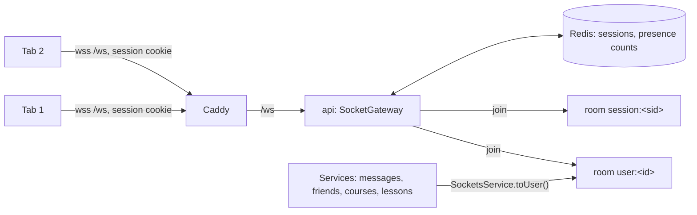
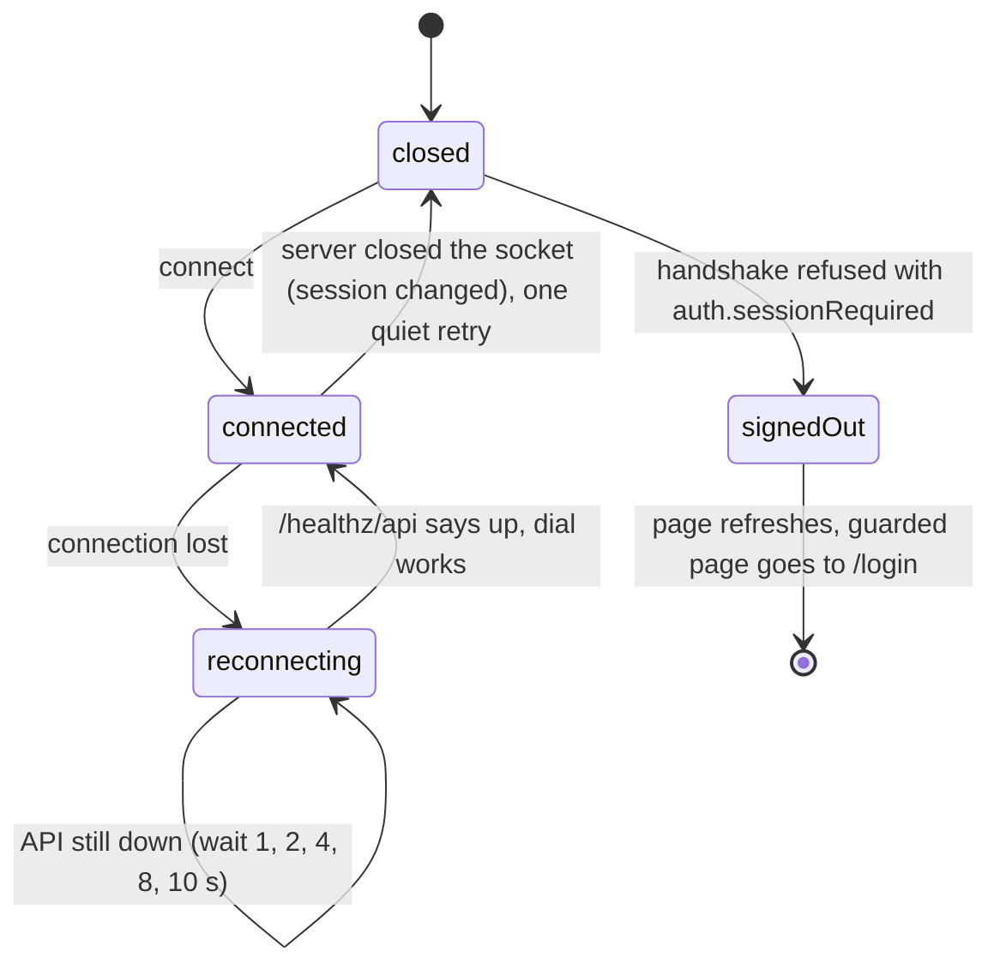

# Real-time features via WebSockets (Major, 2 points)

**Type:** Major. **Points:** 2. **Status:** done.

Each browser tab of a signed-in user keeps one live connection open to the server. Through it,
the server pushes changes the moment they happen: a new message, a friend request, a friend
coming online, or a course setting changed in another tab. Nobody has to reload the page.

## What the subject asks

The module is one line in the Web modules table of [../subject/summary.md](../subject/summary.md):

> | Major | Real-time features via WebSockets or similar (updates across clients, graceful dis/reconnect, efficient broadcasting) |

The mandatory part also asks for this, which the same connection helps with:

> - **Multi-user simultaneous support**: concurrent logins, concurrent actions handled correctly,
>   real-time updates propagated, no data corruption or race conditions.

## How we meet it

| The subject asks | What we built | Where |
| --- | --- | --- |
| Real-time features via WebSockets or similar | A socket.io server (a WebSocket library) inside the NestJS API, on the path `/ws`. It only uses the WebSocket transport, never long-polling. Caddy sends `/ws` to the API. | [socket.gateway.ts](../../apps/api/src/gateway/socket.gateway.ts), [Caddyfile](../../infra/caddy/Caddyfile) |
| Updates across clients | Eight server events. Four live features use them: direct messages and unread counts, friend requests, the online status of friends, and course changes that show in the user's other tabs. One person's action shows on the other person's screen, and in all their own open tabs, without a reload. | [packages/shared/src/events/socket.ts](../../packages/shared/src/events/socket.ts), [messages.service.ts](../../apps/api/src/messages/messages.service.ts), [friends.service.ts](../../apps/api/src/friends/friends.service.ts), [courses.service.ts](../../apps/api/src/courses/courses.service.ts) |
| Graceful connect | A socket is checked when it opens: same session cookie as the website, same origin, an account that still exists. A refused socket never connects, and the browser logs no error. On connect, the server sends a fresh snapshot: where each friend stands and what is unread. | [socket.gateway.ts](../../apps/api/src/gateway/socket.gateway.ts), [session-io.adapter.ts](../../apps/api/src/gateway/session-io.adapter.ts) |
| Graceful disconnect and reconnect | The tab retries with a growing wait (1, 2, 4, 8, then 10 seconds). Before each retry it asks the web server if the API is up, so a server that is down causes no console error. A **Reconnecting…** label shows while it waits. After it is back, the page fetches what it missed. A friend who reloads the page does not flicker offline: offline is sent only 10 seconds after their last tab closed. Logging out closes that session's sockets. | [tab-socket.ts](../../apps/web/components/tab-socket.ts), [reconnect.ts](../../apps/web/lib/reconnect.ts), [connection-status.tsx](../../apps/web/components/connection-status.tsx), [presence.service.ts](../../apps/api/src/presence/presence.service.ts) |
| Efficient broadcasting | Every event goes to a room (a named group of sockets) for one user, `user:<id>`, never to everyone. The only way the rest of the API can send is `SocketsService.toUser()`, which addresses one user. Online status goes only to friends. Events are small: most carry only an id or a language, and the page reads the rest itself. Inbound events are limited per socket and checked against a schema. | [sockets.service.ts](../../apps/api/src/gateway/sockets.service.ts), [socket.gateway.ts](../../apps/api/src/gateway/socket.gateway.ts) |

All three points are met. "Efficient broadcasting" is met by sending each event only to the people
it concerns. We do not broadcast to many users at once, because no feature needs it. See
[Limits and choices](#limits-and-choices).

## How it works

### One connection per tab

1. **The tab opens the socket.** `ConnectionStatus` sits in the header of every signed-in page
   and calls `connectSocket()`. The socket lives in module scope in
   [tab-socket.ts](../../apps/web/components/tab-socket.ts), not in a React component. So moving
   between pages, or changing the interface language, keeps the same socket.
2. **The server checks it.** Before the socket is accepted, a socket.io middleware in
   [socket.gateway.ts](../../apps/api/src/gateway/socket.gateway.ts) (`authenticate`):
   - reads the session with the same express-session middleware as the REST routes
     ([session-io.adapter.ts](../../apps/api/src/gateway/session-io.adapter.ts),
     [app.setup.ts](../../apps/api/src/app.setup.ts)). The cookie is the only credential;
   - refuses a page from another origin (`sameOrigin`);
   - refuses a session that already holds 20 sockets (`SESSION_SOCKET_LIMIT`);
   - refuses an account that no longer exists;
   - joins the socket to two rooms, `user:<id>` and `session:<sid>`, and checks once more that the
     session still exists, in case a logout happened during the handshake.

   Every refusal is the code `auth.sessionRequired` (or `server.rateLimited` for too many sockets,
   `server.unexpected` on a failure). The browser sees a refused connection, not an HTTP error.
3. **The server sends a snapshot.** Right after connecting, the new socket alone receives one
   `presence:update` per friend, then one `dm:unread` with every unread count (`arrived()`).
4. **Services send events after their database write.** For example, after a message is stored,
   `MessagesService.send()` calls `toUser()` twice: once for the recipient, once for the sender, so
   the sender's other tabs show it too.

### The events

The list is in [packages/shared/src/events/socket.ts](../../packages/shared/src/events/socket.ts).
The API and the web app both import it, so the names and payloads cannot drift apart.

| Event | Direction | Sent when | Sent to | What the page does |
| --- | --- | --- | --- | --- |
| `course:updated { lang }` | server to browser | The daily goal or the level changes, or a lesson attempt closes | The user's own room | The course page and the achievements page reload their data from the server |
| `friend:request`, `friend:accepted`, `friend:removed` `{ userId }` | server to browser | A request is sent, accepted, declined, cancelled, or a friend is removed | Both users | `/friends`, `/users/<id>` and `/chat` reload their data |
| `presence:update { userId, status, at }` | server to browser | A friend's first tab opens, or 10 s after their last tab closed. Also once per friend on connect | Each friend's room. On connect, only the new socket | The green or grey dot changes |
| `dm:message { userId, message }` | server to browser | A message is stored | Both users | The thread adds it. The conversation list moves it to the top |
| `dm:unread { counts, at }` | server to browser | After a message, after a read, and on connect | One user | The unread badges update |
| `app:error { code }` | server to browser | A client event is refused and came without an ack | That socket only | Nothing is shown |
| `dm:send { userId, text }` | browser to server | The user presses **Send** | | The server answers with an ack (a reply to that one event): the stored message, or an error code |
| `dm:read { userId }` | browser to server | An open thread has unread messages and the tab is visible | | The server marks them read and sends `dm:unread` |

Most server events carry only an id or a language, not the data itself. The page then asks the
server for the fresh page (`router.refresh()` in
[refresh-on.tsx](../../apps/web/components/refresh-on.tsx)). So there is one source of truth, the
REST API. Messages are the exception: `dm:message` carries the message, because messages are
frequent and a full reload costs several API calls
([conversation-list.tsx](<../../apps/web/app/[locale]/(messages)/chat/conversation-list.tsx>)).

### Every inbound event is checked

The checks NestJS runs on every HTTP request (its global guards and pipes) do not run for socket
events, so the gateway checks each event itself, before any handler (`screen()` in
[socket.gateway.ts](../../apps/api/src/gateway/socket.gateway.ts)):

- **A rate limit per socket:** 20 events of each name per 10 seconds (`EVENT_LIMIT`,
  `EVENT_WINDOW_MS`). Unknown event names share one budget.
- **A size limit:** 16 KB per message (`maxHttpBufferSize`).
- **A schema check:** the payload is parsed with the Zod schema (a set of rules for data) of that
  event, `CLIENT_EVENT_SCHEMAS`. An unknown event has no schema and is refused.
- **A refusal is never a crash.** It is answered with an error code: through the ack when there is
  one, else with `app:error` to that socket only.
- Errors thrown inside a handler go to
  [socket-exception.filter.ts](../../apps/api/src/gateway/socket-exception.filter.ts), which answers
  the same way.

On top of this, each account may send 30 messages a minute (`SEND_LIMIT_PER_MINUTE`) across all its
sockets, in [messages.service.ts](../../apps/api/src/messages/messages.service.ts).

### Disconnection and reconnection

The rules are in [reconnect.ts](../../apps/web/lib/reconnect.ts) and the loop is in
[tab-socket.ts](../../apps/web/components/tab-socket.ts):

- **socket.io's own reconnection is off.** Our loop replaces it, so nothing dials while the API is
  down.
- **Backoff:** 1, 2, 4, 8, then 10 seconds, each spread by a quarter either way, so many tabs do
  not all retry at the same moment (`backoffMs`).
- **No console error.** A failed WebSocket dial is a browser console error that code cannot hide.
  So before each retry the tab asks `/healthz/api` on the web server, which always answers 200
  with `{ "api": "up" }` or `{ "api": "down" }`
  ([apps/web/app/healthz/api/route.ts](../../apps/web/app/healthz/api/route.ts)). It dials only
  when the API is up.
- **Visible state:** `ConnectionStatus` shows **Reconnecting…** at the bottom of the page while the
  tab is reconnecting ([connection-status.tsx](../../apps/web/components/connection-status.tsx),
  `Connection.reconnecting` in [en.json](../../apps/web/messages/en.json)).
- **Catching up.** Events sent while the tab was away are lost, so after every reconnect:
  `RefreshOn` reloads the page once; the open chat thread fetches the newest messages and merges
  them by id ([chat-thread.tsx](<../../apps/web/app/[locale]/(messages)/chat/chat-thread.tsx>));
  the presence and unread snapshots on connect put the dots and badges right.
- **No send while offline.** A message sent while not connected fails at once with
  `network.unreachable` ("Could not reach the server"), instead of being queued and delivered much
  later ([send-message.ts](../../apps/web/lib/send-message.ts)).
- **Signed out elsewhere.** When the handshake is refused with `auth.sessionRequired`, the tab
  refreshes the page, and a page that needs a session sends the user to `/login`. So a sign-out in
  another tab shows up here too.
- **Firefox:** `closeOnBeforeunload: true` closes the socket cleanly when the page unloads, so
  Firefox logs no interrupted connection.

On the server side:

- **Sockets end with their session.** `SocketsService.closeSession()` closes every socket of a
  session id. [auth.controller.ts](../../apps/api/src/auth/auth.controller.ts) calls it on logout,
  and each time the session id changes: signup, login, 2FA verify, 2FA enable and 2FA disable.
  Every 60 seconds the gateway also closes the sockets whose session Redis has expired
  (`closeEndedSessions`).
- **Online status survives a reload.** [presence.service.ts](../../apps/api/src/presence/presence.service.ts)
  keeps a count of open sockets per user in Redis (`presence:<id>`). The first socket makes the
  user online. A closed socket comes off the count only after 10 seconds (`PRESENCE_GRACE_MS`). A
  reload opens its new socket within that time, so friends see nothing change.
- **A restart starts clean.** No socket survives an API restart, so at boot the presence counts are
  deleted (`onApplicationBootstrap`). The open tabs reconnect on their own.

### Metrics

The gateway counts its work for Prometheus
([apps/api/src/metrics/metrics.ts](../../apps/api/src/metrics/metrics.ts)):

- `ft_ws_connections`: open WebSocket connections.
- `ft_ws_events_total{direction, event, outcome}`: events in and out, with `ok`, `invalid` or
  `rate_limited`.

The Grafana **API** dashboard has a **WebSocket** row with the panels **Open connections** and
**Events** ([api.json](../../infra/monitoring/grafana/dashboards/api.json)). See
[../operations/monitoring.md](../operations/monitoring.md).

## Where the code is

| Path | What it does |
| --- | --- |
| [packages/shared/src/events/socket.ts](../../packages/shared/src/events/socket.ts) | The event names, their Zod schemas and types, and `userRoom()`. Shared by the API and the web app |
| [apps/api/src/gateway/socket.gateway.ts](../../apps/api/src/gateway/socket.gateway.ts) | The gateway: handshake checks, rooms, the connect snapshot, presence on connect and disconnect, the check of every inbound event, the session sweep |
| [apps/api/src/gateway/sockets.service.ts](../../apps/api/src/gateway/sockets.service.ts) | `toUser()`, the only way to send to a user, and `closeSession()` |
| [apps/api/src/gateway/session-io.adapter.ts](../../apps/api/src/gateway/session-io.adapter.ts) | Gives socket.io the same session middleware as Express |
| [apps/api/src/gateway/socket-exception.filter.ts](../../apps/api/src/gateway/socket-exception.filter.ts) | Turns an error in a handler into an error code for the client |
| [apps/api/src/messages/messages.gateway.ts](../../apps/api/src/messages/messages.gateway.ts) | The handlers of `dm:send` and `dm:read` |
| [apps/api/src/presence/presence.service.ts](../../apps/api/src/presence/presence.service.ts) | The socket count per user in Redis and the 10 second grace period |
| [apps/api/src/messages/messages.service.ts](../../apps/api/src/messages/messages.service.ts), [friends.service.ts](../../apps/api/src/friends/friends.service.ts), [courses.service.ts](../../apps/api/src/courses/courses.service.ts), [attempts.service.ts](../../apps/api/src/lessons/attempts.service.ts) | Where the events are sent, after each write |
| [apps/api/src/auth/auth.controller.ts](../../apps/api/src/auth/auth.controller.ts) | Closes the sockets of a session on logout and when the session id changes |
| [apps/web/components/tab-socket.ts](../../apps/web/components/tab-socket.ts) | The tab's one socket, its status, the retry loop, the presence and unread stores, and the hooks pages use |
| [apps/web/lib/reconnect.ts](../../apps/web/lib/reconnect.ts) | The reconnect rules: backoff, what to do after a disconnect or a refusal, the API probe |
| [apps/web/components/connection-status.tsx](../../apps/web/components/connection-status.tsx) | Opens the socket on signed-in pages and shows **Reconnecting…** |
| [apps/web/components/refresh-on.tsx](../../apps/web/components/refresh-on.tsx) | Reloads a page's data on an event, and once after each reconnect |
| [apps/web/components/presence-dot.tsx](../../apps/web/components/presence-dot.tsx), [unread-badge.tsx](../../apps/web/components/unread-badge.tsx) | The online dot and the unread badge, updated live |
| [apps/web/lib/send-message.ts](../../apps/web/lib/send-message.ts) | `dm:send` with its ack and a 10 second timeout |
| [apps/web/app/healthz/api/route.ts](../../apps/web/app/healthz/api/route.ts) | The probe the tab asks before each retry |
| [infra/caddy/Caddyfile](../../infra/caddy/Caddyfile) | Routes `/ws` and `/ws/*` to the API |

The design is also described in [../architecture/realtime.md](../architecture/realtime.md),
sections 1 and 3.

## How to show it at the defence

Start the stack with `make run`. It prints the address, `https://localhost`. Use two browser windows
with separate cookies (for example a normal window and a private window), so you can be two people.

**1. A change in one tab shows in another tab (same user).**

1. In window A, click **Create account** and sign up as user A.
2. On the onboarding page, pick a language and a daily goal and click **Next**. Click **I already
   know my level**, pick a level, then **Start learning**. You land on the course page,
   `/en/learn/<lang>`.
3. Open the same course page in a second tab of window A.
4. In the first tab, change **Daily goal** in the **This course** box (in a narrow window, click
   **My course** first).
5. The second tab shows the new value without a reload. Do the same with **Level** and **Save**.

**2. Live updates between two people.**

1. In window B, sign up as user B.
2. Both users open the menu in the header and click **Friends** (`/friends`).
3. User A types B's display name in **Search by display name**, clicks **Search**, then **Add
   friend**.
4. On B's screen, A appears under **Requests received** without a reload. B clicks **Accept**.
   Both lists show the other person under **Your friends**, with a green dot (**Online**).
5. User A clicks **Message** next to B. User B opens **Messages** (`/chat`) from the header menu.
6. A types in **Write a message** and clicks **Send**. The message appears on B's side at once, and
   B's menu button in the header shows a red unread badge until B opens the conversation.

**3. Disconnect and reconnect.**

1. Close window B. After about 10 seconds, B's dot on A's **Friends** page turns grey
   (**Offline**). A private window forgets its cookies when it closes, so open a new private
   window, click **Sign in** and sign in as user B: the dot on A's side turns green.
2. Reload B's page: the dot on A's side stays green (the 10 second grace period).
3. With A on the course page, restart the API from the repository root:
   `docker compose restart --no-deps api` (the command
   [restart.spec.ts](../../e2e/tests/restart.spec.ts) runs).
4. A **Reconnecting…** label appears at the bottom of A's page, then goes away when the API is
   back. The browser console (DevTools) shows no error. A is still signed in, and a goal change
   from another tab shows again.
5. In one tab of A, open the header menu and click **Sign out**. A's other tabs lose their socket, and a page that needs a
   session sends them to the login page.

**4. Optional: the metrics.** Open Grafana at `https://localhost/grafana` (user `admin`, password:
`grep GRAFANA_ADMIN_PASSWORD .env`, as `make run` prints). Open the dashboard **API**, row
**WebSocket**: **Open connections** goes up and down with the tabs.

## Tests that prove it

| Test | What it checks |
| --- | --- |
| [e2e/tests/live.spec.ts](../../e2e/tests/live.spec.ts): "a goal changed in one tab shows in the other", "a level changed in one tab shows in the other" | Two tabs of one account: a change in one shows in the other, with no console error |
| [e2e/tests/restart.spec.ts](../../e2e/tests/restart.spec.ts): "an open page reconnects after an API restart, silently" | A real API restart: **Reconnecting…** shows, a new socket joins, the user stays signed in, live updates work again, no console error. Runs alone after the suite, on Chromium (`E2E_RESTART=1`, `make playwright`) |
| [e2e/tests/friends.spec.ts](../../e2e/tests/friends.spec.ts): "a request shows up live, is accepted, and both lists follow", "a friend's dot goes grey when they leave and green when they come back" | Two people: friend events and online status, with no reload |
| [e2e/tests/messages.spec.ts](../../e2e/tests/messages.spec.ts): "a message arrives live, is counted, is read by opening the thread, and stays", "a message sent while the socket was down arrives when it is back" | Live messages and unread counts, and the catch-up after a lost connection |
| [apps/api/test/gateway.e2e-spec.ts](../../apps/api/test/gateway.e2e-spec.ts) | With a real database and Redis: the handshake refuses no session, a forged cookie, another origin and a 21st socket; sockets close on logout, on a new login, on expiry and on a 2FA change; `course:updated` reaches only the user's sockets; an unknown event gets `app:error` and the socket stays connected; the per-socket limit |
| [apps/api/test/messages.e2e-spec.ts](../../apps/api/test/messages.e2e-spec.ts), [friends.e2e-spec.ts](../../apps/api/test/friends.e2e-spec.ts) | A message reaches the recipient and every tab of the sender; a friend hears you come online, and someone who only sent a request does not; a stranger hears no friend event |
| [apps/api/src/gateway/socket.gateway.spec.ts](../../apps/api/src/gateway/socket.gateway.spec.ts) | Unit tests of the handshake, the event check (unknown, invalid, flood, ack), presence on connect and disconnect, the unread snapshot and the session sweep |
| [apps/api/src/gateway/sockets.service.spec.ts](../../apps/api/src/gateway/sockets.service.spec.ts) | Emits go to the user's room only; `closeSession` closes that session's sockets and no one else's |
| [apps/api/src/presence/presence.service.spec.ts](../../apps/api/src/presence/presence.service.spec.ts) | The grace period: offline only after it, no second "online" on a reload, a count never stays below zero, the boot reset |
| [apps/api/src/gateway/socket-exception.filter.spec.ts](../../apps/api/src/gateway/socket-exception.filter.spec.ts) | A handler error becomes an ack or an `app:error` with a code |
| [apps/web/lib/reconnect.test.ts](../../apps/web/lib/reconnect.test.ts) | The backoff values, what happens after each kind of disconnect, the API probe |
| [apps/web/lib/send-message.test.ts](../../apps/web/lib/send-message.test.ts), [presence.test.ts](../../apps/web/lib/presence.test.ts), [unread.test.ts](../../apps/web/lib/unread.test.ts) | Sending with an ack and a timeout, the tab's presence map, the unread snapshots arriving out of order |
| [packages/shared/src/events/socket.test.ts](../../packages/shared/src/events/socket.test.ts) | No event uses a name socket.io reserves; every inbound event has a schema; the payload schemas |

How to run them: `make test` runs the unit tests. The API e2e tests need a real database and Redis,
and run in `make ci`. `make test-e2e` runs Playwright against the production stack, then the
restart test. `make playwright-all` runs Playwright on Chromium, Firefox and WebKit, as CI does.

## Limits and choices

- **One API instance.** Rooms live in the memory of the API process. With two API copies, an event
  sent by one would miss a user connected to the other. That would need the socket.io Redis
  adapter, which we did not add (`InterServerEvents` is empty in
  [socket.ts](../../packages/shared/src/events/socket.ts)). The presence reset at boot also assumes
  one instance. The project runs one API container, so this is enough.
- **No broadcast to everyone.** By design, `SocketsService` can only address one user. No feature
  sends the same thing to all users. "Efficient broadcasting" here means each event reaches only
  the people it concerns.
- **Events missed while offline are not replayed.** There is no event queue. Instead the page
  reloads its data after each reconnect, and the chat fetches its newest messages.
- **Messages are not queued while offline.** A send without a connection fails at once. If the ack
  does not come within 10 seconds, the page says the send failed, but the server may have stored
  the message, so sending again can show it twice
  ([send-message.ts](../../apps/web/lib/send-message.ts)).
- **A reload, not a patch.** Most events make the page reload its data from the server. This costs
  a few API calls, but there is only one source of truth.
- **Two states only:** online and offline. There is no "away" status.
- **The lesson discussion does not use the socket.** It streams the tutor's answer over
  Server-Sent Events on a normal `POST`, because it is one learner and one answer
  ([../architecture/realtime.md](../architecture/realtime.md), section 1). It is part of the LLM
  module, not this one.
- **Shared with other modules.** The chat belongs to
  [user-interaction.md](./user-interaction.md) and the online status to
  [user-management.md](./user-management.md). This module claims the real-time layer under them:
  the connection, the rooms, the reconnect and the live updates.

## Who built it

From `git log --follow` on the files above and `gh pr view` on each pull request.

| Member | GitHub | What they built | Issues and PRs |
| --- | --- | --- | --- |
| Victor | `VictorBro` | The gateway and its handshake checks, rooms, `SocketsService`, the inbound event check, closing sockets with their session, the session sweep, the metrics, `course:updated`, the tab socket with its reconnect loop, **Reconnecting…**, `RefreshOn`, the `/healthz/api` probe, and the live and restart e2e tests. Then the friend events, the activity day stamp on connect, and the direct message events (`dm:send`, `dm:read`, `dm:message`, `dm:unread`) with `MessagesGateway` and `SocketExceptionFilter`. | #181 (closes #154), #189 (closes #155), #193 (closes #156), #200 (closes #158) |
| Endrit | `VYAntares` (commits as `EA`) | Online status: `PresenceService` with its Redis counts and grace period, `presence:update` to friends, the snapshot on connect, and the tab's presence map. | #195 (closes #157) |
| Anaïs | `avarrett` (commits as `ninisse`) | A finished lesson sends `course:updated`, with its API e2e test. | #190 (closes #145) |
| Bastian | `bastian-schnitzler` | Adapted the two-tab e2e test to the new level picker of the course page. | #186 (closes #86) |
