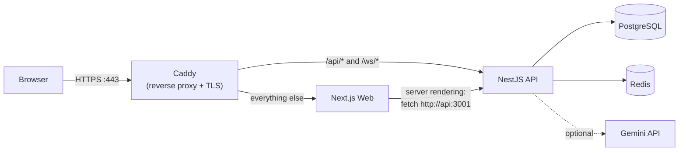

# 01 · Introduction to our Transcendence (Module 00)

## 1. What you need to understand

ft_transcendence is the last project of the 42 common core. The subject (v21.2, summarized in
`docs/SUBJECT_SUMMARY.md`) lets you **choose the theme** of the application: it imposes a
foundation (frontend + backend + database, Docker, HTTPS, sign-up/login,
validation on both sides, legal pages, zero console errors) and requires **14 module
points** (major module = 2 points, minor = 1).

Our team chose an **AI-driven language-learning platform**.
No game, no Pong. It is a bold choice: you must be ready to explain it.

## 2. How it works in Transcendence

### The problem we solve

A learner does not always know what level they are at, and gives up if they do not have a
daily habit. Our application:

1. **places them** at a CEFR level (A1, A2, B1, B2, C1, C2) with an **adaptive test**
   (a binary search over the levels);
2. offers them **every day** a number of lessons that matches their **daily
   goal** (10, 30 or 60 minutes; one lesson = 10 minutes);
3. has them do lessons of **four types**: grammar, vocabulary, "functions"
   (speech acts: greeting, apologizing…), reading. Each lesson has practice
   pages corrected page by page, then a **timed exam** and a score;
4. keeps motivation up: **day streak**, XP and ranks, daily challenge,
   achievements;
5. adds a social layer: **public profiles, friends, real-time online status**.

### The actors

| Actor | What they do |
|---|---|
| **Anonymous visitor** | Sees the home page, the legal pages, signs up or logs in. |
| **Logged-in learner** | Chooses a language ("a course"), takes the placement, does their lessons, manages their profile, their friends, their 2FA. |
| **The Gemini API (Google)** | Optional: generates new placement questions when the bank runs out. By default it is a **"fixture" provider** that makes no network call. |
| **The team (authors)** | Writes the lessons offline with Claude Code (`pnpm --filter @ft/api lessons:author`), checked by validators, then versioned in `content/`. |
| **Grafana / Alertmanager** | Monitor the platform and send alerts to Discord. |

The `ADMIN` `role` exists in the schema (`enum Role { USER ADMIN }`) but **no route
checks it**: there is no administration area. [CONFIRMED: no occurrence
of a role check in `apps/api/src`]

### The languages

Two notions not to be confused:

- **the interface language** (`Locale`: `en`, `fr`, `de`), in the URL: `/fr/learn`.
  Handled by `next-intl` on the web side. [CONFIRMED `apps/web/i18n/routing.ts`]
- **the language being learned** (`Language`: `en`, `fr`, `de`), the "course": `/fr/learn/de`
  = interface in French, German course. [CONFIRMED `schema.prisma`, enum `Language`]

## 3. Concrete example

Lina signs up, interface in French:

1. `/fr/signup` → account created, session opened, redirect to `/fr/onboarding`.
2. She chooses "German", goal 30 min → `POST /api/courses` creates a `UserLevel`
   (`lang = de`, `level = null`).
3. She takes the placement: starts at B1, goes up or down depending on her answers → the API
   writes `level = A2`.
4. `/fr/learn/de` displays "today": 3 lessons offered (30 min / 10 min).
5. She plays a grammar lesson, page by page; the exam is timed; the
   server computes 85/100 → result saved, XP earned, goal progressed.
6. In another tab open on the same page, the dashboard updates by itself
   (`course:updated` event over WebSocket).

## 4. Files to know

| File | Why |
|---|---|
| `README.md` | Official presentation, team, commands |
| `docs/PRODUCT_ARCHITECTURE.md` | The learner journey, the targeted modules, the AI |
| `docs/ARCHITECTURE.md` | The containers, the flows, real time |
| `docs/SUBJECT_SUMMARY.md` | The 42 subject summarized |
| `apps/api/prisma/schema.prisma` | The data model: the best "map" of the business domain |

## 5. Diagram

## Actual state of the project: what is done and what is not

This is the most useful section for the defense: **never claim what is not
in the code**. Comparison between what `docs/PRODUCT_ARCHITECTURE.md` §2 targets and the
code at commit `477b3d4`:

| Subject module | Type | Verified state |
|---|---|---|
| Frontend + backend framework (Next.js + NestJS) | Major | **Done** [CONFIRMED] |
| ORM (Prisma 7) | Minor | **Done** [CONFIRMED] |
| Standard user management (profile, avatar, friends, online, profile page) | Major | **Done** [CONFIRMED] |
| Full 2FA (TOTP + backup codes) | Minor | **Done** [CONFIRMED] |
| i18n, 3 languages | Minor | **Done**: `next-intl` is wired, 3 catalogs of 475 lines. The "not wired" line in the docs is **outdated**. [CONFIRMED] |
| Additional browsers | Minor | Playwright on Chromium, Firefox, WebKit [CONFIRMED config] |
| WebSocket real time | Major | **Done server → client** (course updates, friends, presence). No client → server events (`CLIENT_EVENTS = {}`). [CONFIRMED] |
| User interaction (chat + profiles + friends) | Major | Profiles and friends done; **chat absent**: `/chat` is a static mockup. [NOT PRESENT] |
| Complete LLM interface | Major | Gemini + fixture provider, used **only** to restock the placement question bank, with no streaming and no user interface. **At risk.** [CONFIRMED] |
| RAG | Major | **Absent**: the Postgres image contains pgvector, but there is no vector table or query. [NOT PRESENT] |
| Gamification | Minor | Complete server-side computation (XP, ranks, daily challenge, 16 achievements); the UI only displays the streak. XP/achievements **not displayed**. [CONFIRMED] |
| Advanced search | Minor | API `GET /courses/:lang/lessons` with filters, sorting, pagination; **no web page** (the "see all" link leads to a 404). [CONFIRMED] |
| SSR | Minor | The pages are Server Components that call the API on the server side. [CONFIRMED] |

And for the lessons: 3,990 lessons in the syllabus, **216 written and ready** (72 per language,
spread over the six levels). In the browser, **only grammar lessons are
playable** (`playable()` in `apps/web/components/lesson/kinds/index.ts`): the other three
types are ready on the server side, their screens arrive with tickets #147 to #149.
[CONFIRMED]

## 6. Key takeaways

1. Our Transcendence is a **language-learning platform**, not a game.
2. Journey: **sign-up → choice of a course → adaptive placement → lessons of the day → score, streak, XP**.
3. Two distinct languages: the **interface** one (`/fr/…`) and the **course** one (`/learn/de`).
4. A single HTTPS entry point: **Caddy**, which routes to Next.js or NestJS.
5. **NestJS** does all the business logic; **Next.js** only displays what the API returns.
6. The lessons are **content written in advance** (validated JSON), not generated live.
7. AI in production is only used to **restock the placement question bank**.
8. Know the **actual state**: chat and RAG absent, 1 lesson type out of 4 playable in the UI.

## 7. Possible oral questions

1. Why a language platform rather than a Pong?
2. Who are the users and what can they do?
3. Where does AI come in in your project?
4. How many module points do you claim, and which ones are fragile?
5. What is the difference between `/fr/learn/de` and `/de/learn/fr`?

## 8. Expected answers

1. "The subject leaves the theme open. We wanted a product useful in everyday life, with a real
   data model (levels, lessons, results) and AI. We gave up the game
   modules, except gamification, which does not require a game."
2. "Learners: they create an account, choose a language, take a level
   test, then do their lessons of the day. They have a profile, friends, see who is
   online. There is no administrator in the interface."
3. "Two places. Offline: the team writes the lessons with Claude Code, and validators
   in the code check them. Online: when the placement question bank
   for a language and a level drops to 3 unseen questions, the API asks Gemini for a batch,
   in the background. By default, the provider is a fixture, so there is no cost."
4. Answer honestly with the table above: solid = framework, ORM, user
   management, 2FA, i18n, SSR, browsers; partial = real time (without chat), LLM, gamification; absent = RAG, chat.
5. "The first segment is the interface language, handled by next-intl. `learn/de` is
   the language being learned. `/fr/learn/de`: French interface, German course."

## 9. Mini-exercise

Open `apps/api/prisma/schema.prisma`. Without reading the rest of the course, find:
(a) the table that represents "a course in one language for one user";
(b) the column that says whether a lesson can be played;
(c) the enum that lists the 4 lesson types.

## 10. Self-assessment

1. Name the five steps of a learner's journey.
2. How many lessons are in the catalog, and how many are ready?
3. Which lesson type is playable in the browser today?
4. Which targeted major module has no line of code?
5. What does the "fixture" LLM provider do?

### Answers

1. Sign-up → creation of a course (language + goal) → placement → lessons of the day → result (score, streak, XP).
2. 3,990 in the catalog (`content/outlines`), 216 ready (72 per language).
3. Grammar only (`KINDS` contains only `grammar`).
4. RAG (pgvector installed but unused). Chat is also absent, but it is part of a larger module.
5. It returns answers written in advance, without any network call, which lets the tests and the evaluator run without an API key (`apps/api/src/llm/fixture.provider.ts`).

Mini-exercise: (a) `UserLevel`; (b) `Lesson.ready`; (c) `LessonKind`.
