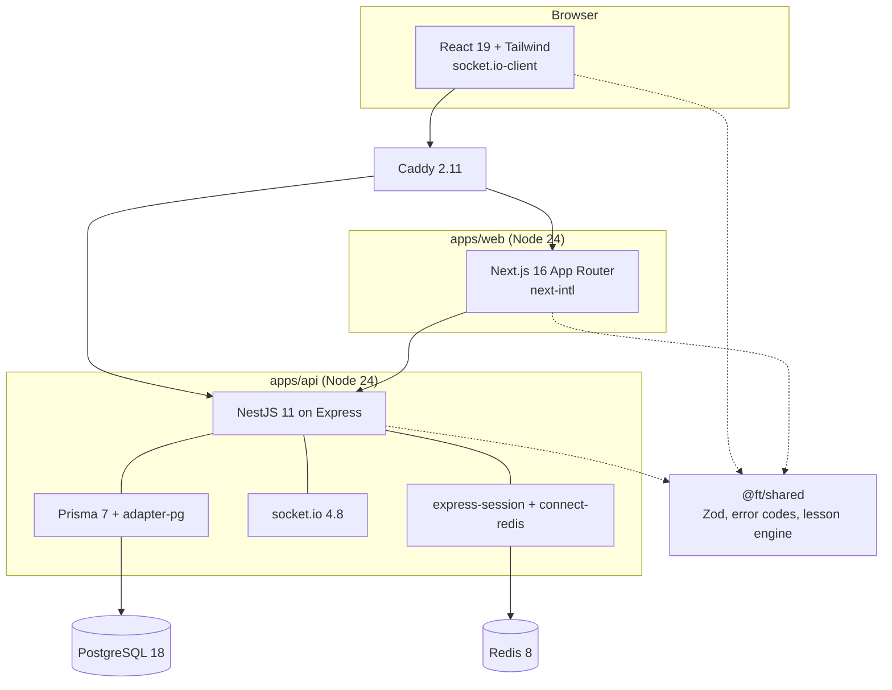

# 02 · The tech stack (Module 01)

## 1. What you need to understand

A "stack" is the set of technologies that, stacked together, run the
application. In our case, everything is in **TypeScript**, from the browser to the server, in a
**monorepo** (a single Git repository containing several applications and libraries).

The guiding idea: **one language, one shared contract**. The same validation schema
(Zod) is imported by the React form and by the NestJS endpoint.

## 2. How it works in Transcendence

All versions come from the `package.json` files, the `compose*.yml` files and the Dockerfiles. [CONFIRMED]

### The foundation

| Tech | Version | Role in our project | Where to find it |
|---|---|---|---|
| **TypeScript** | 6.0.3 (pinned exactly) | Single language, front and back | `package.json`, `scripts/assert-ts-version.sh` |
| **Node.js** | 24.18 | Runs the API, the Next server and the tooling | `.nvmrc`, `FROM node:24.18-bookworm-slim` |
| **pnpm** | 11.18 | Package manager, *workspaces* | `pnpm-workspace.yaml` |
| **Turborepo** | 2.10 | Runs `build`, `test`, `lint` in each package, with caching | `turbo.json` |

Worth knowing for the jury: the TypeScript version is checked in CI (`assert-ts-version.sh`)
because `pnpm up --latest` would install TypeScript 7 (a trap documented in `docs/VERSIONS.md`).

### The frontend: `apps/web`

| Tech | Version | Role in our project |
|---|---|---|
| **Next.js** (App Router) | 16.2 | Pages, folder-based routing, **server rendering** (Server Components) |
| **React** | 19.2 | Components, local state (`useState`), effects |
| **next-intl** | 4.13 | `en`/`fr`/`de` translations, language prefix in the URL |
| **Tailwind CSS** | 4.3 | Styling with utility classes (`className="flex gap-6"`) |
| **socket.io-client** | 4.8 | One WebSocket connection per tab |
| **Zod** | 4.4 | Validates forms and **API responses** |

How we use it: each page is an asynchronous **Server Component** that calls
the API **from the Next server**, forwarding the user's cookie
(`apps/web/lib/api.ts`). Interactive components (forms, lesson player)
are marked `'use client'` and call the API **from the browser** with a relative
`fetch` (`/api/...`, `apps/web/lib/api-client.ts`).

### The backend: `apps/api`

| Tech | Version | Role in our project |
|---|---|---|
| **NestJS** (on Express) | 11.1 | Server framework: modules, controllers, services, dependency injection, guards |
| **Prisma** | 7.9 (+ `@prisma/adapter-pg`) | ORM: schema, migrations, typed client |
| **express-session** + **connect-redis** | 1.19 / 10.0 | Server-side sessions stored in Redis |
| **argon2** | 0.45 | Password hashing (argon2id) |
| **otpauth** + **qrcode-generator** | 9.5 / 2.0 | TOTP 2FA and QR code |
| **socket.io** (`@nestjs/websockets`) | 4.8 | Real-time gateway on `/ws` |
| **nestjs-zod** | 5.5 | Turns the shared Zod schemas into validated + documented DTOs |
| **@nestjs/throttler** | 6.7 | Rate limiting (100 req/min by default, 5/min on login) |
| **@nestjs/swagger** | 11.4 | OpenAPI documentation at `/api/docs` |
| **multer** | 2.2 | Avatar upload (multipart) |
| **@prometheus-io/client** | 0.16 | Metrics exposed on internal port 9464 |

`class-validator` is in the dependencies but **validation goes through Zod**
(`apps/api/src/validation.pipe.ts`, comment "Zod, not class-validator" in
`app.setup.ts`). [CONFIRMED]

### The data

| Tech | Version | Role in our project |
|---|---|---|
| **PostgreSQL** | 18, image `pgvector/pgvector:0.8.6-pg18-trixie` | Relational database: users, courses, lessons, results, friendships |
| **pgvector** | 0.8.6 | Vector extension planned for RAG; **not used** [NOT PRESENT] |
| **Redis** | 8.10 (AOF enabled) | Sessions (`sess:*`), placement sessions + locks, presence counters |

### The shared packages: `packages/`

| Package | Role |
|---|---|
| `@ft/shared` | Zod schemas, error codes, socket event contract, **the entire lesson engine** (plan, score, masking) |
| `@ft/ui` | 3 components: `Button`, `Card`, `ProgressBar` (+ `cn`) |
| `@ft/tsconfig`, `@ft/eslint-config` | Shared configurations |

### The infrastructure

| Tech | Version | Role in our project |
|---|---|---|
| **Docker / Compose** | — | 12 services, started via `make` |
| **Caddy** | 2.11 | Only published port (80/443), TLS with an internal CA, routing `/api` `/ws` `/grafana` `/` |
| **Prometheus / Alertmanager / Grafana** | — | Monitoring, 25 alert rules, Discord notifications |
| **GitHub Actions** | — | 4 workflows: `ci`, `e2e`, `hygiene`, `images` |
| **GHCR** | — | Registry for multi-architecture images (amd64 + arm64) |

### The tests

| Tool | What for |
|---|---|
| **Vitest** 4.1 | Unit tests for all packages, 60% coverage threshold |
| **Supertest** | HTTP tests of the API against a real Postgres + Redis (`apps/api/test/*.e2e-spec.ts`) |
| **Playwright** | Browser tests on 3 engines + "console gate" |

### The AI

| Tech | Role |
|---|---|
| **Gemini** (REST API `generativelanguage.googleapis.com`, default model `gemini-3.6-flash`) | Generates batches of placement questions as structured JSON |
| **Fixture provider** | Network-free substitute, default value of `LLM_PROVIDER` |
| **Claude Code** | Lesson **authoring** tool, outside production (`apps/api/scripts/lessons/author.ts`) |

## 3. Concrete example: how the technologies talk to each other

A submission of the signup form goes through almost the entire stack:

```
React (signup-form.tsx, 'use client')
  └─ Zod SignUpFormSchema.safeParse()           ← @ft/shared
  └─ fetch POST /api/auth/signup                ← api-client.ts
        └─ Caddy :443 → api:3001
              └─ NestJS AuthController.signUp
                    └─ CodeValidationPipe (Zod CreateUserSchema, nestjs-zod)
                    └─ AuthService.signUp → argon2.hash → Prisma user.create → PostgreSQL
                    └─ session.regenerate → connect-redis → Redis (sess:<id>)
              └─ Set-Cookie: ft.sid=…; HttpOnly; SameSite=Lax
```

## 4. Files to know

- `package.json` (root), `pnpm-workspace.yaml`, `turbo.json`
- `apps/web/package.json`, `apps/api/package.json`
- `docs/VERSIONS.md`: the pinned versions and their traps
- `docs/TECHNICAL_PLAN.md` §1: the "Choice / Why" table
- `compose.yml`: the Postgres, Redis, Caddy, monitoring images

## 5. Diagram



## 6. Key takeaways

1. **Everything is TypeScript**, in a pnpm + Turborepo monorepo.
2. **Next.js 16** for display and server rendering, **NestJS 11** for business logic.
3. **Prisma 7** talks to **PostgreSQL 18**; **Redis** holds sessions, placement and presence.
4. **Zod** in `@ft/shared` = a single schema for front and back.
5. **Socket.IO** for real time, on `/ws`, behind the same Caddy.
6. **Caddy** is the only entry point, over HTTPS.
7. **Vitest, Supertest, Playwright** cover the three levels of testing.
8. **pgvector is installed but unused**; do not say we do RAG.

## 7. Possible oral questions

1. Why NestJS and not plain Express?
2. Why Next.js if NestJS already does everything?
3. What do you use Redis for? Why not put everything in Postgres?
4. Why Zod rather than class-validator, the NestJS standard?
5. What does Turborepo bring?

## 8. Expected answers

1. "The subject accepts Express as a framework, but NestJS gives us structure:
   modules that match how the team split the work, dependency injection (we
   replace the LLM with a fixture in tests), global guards for auth, the
   throttler, Swagger and the WebSocket gateways. NestJS actually runs on Express."
2. "For server rendering, folder-based routing and internationalization. Next
   contains no business logic: its pages call the API just as the browser would."
3. "Three uses: login sessions (`sess:<id>`), the placement test session
   with a lock (one-hour expiry, `SET NX`), and the per-user socket counter
   for presence. These are ephemeral data, with expiry, read
   very often: that is what Redis is made for."
4. "Because the schema must be shared with the browser. Zod runs everywhere;
   `nestjs-zod` turns them into Nest DTOs and Swagger docs."
5. "It runs the `build`, `test`, `lint` tasks in the right dependency order between
   packages (for example `@ft/shared` before the API) and caches the results."

## 9. Mini-exercise

In `apps/api/src/app.setup.ts`, find the four things that `configureApp` installs
**globally** on the application (hint: a metrics middleware, a pipe, a filter,
a session middleware).

## 10. Self-assessment

1. Which database, which version, and which unused extension?
2. Where are the validation schemas defined?
3. Which library hashes passwords, and with which algorithm?
4. Which service is the only one publishing a port to the outside?
5. What is the default value of `LLM_PROVIDER`, and why?

### Answers

1. PostgreSQL 18, pgvector 0.8.6 (installed by the image, unused).
2. In `packages/shared/src/schemas/` (`@ft/shared`).
3. `argon2`, in argon2id (19 MiB, 2 iterations, parallelism 1: `auth.service.ts`).
4. Caddy (80, 443 tcp + udp).
5. `fixture`: the tests and the evaluator have no API key; no cost, no network.

Mini-exercise: `app.use(httpMetrics)`, `useGlobalPipes(new CodeValidationPipe())`,
`useGlobalFilters(new ErrorCodeFilter(...))`, `app.use(sessionMiddleware)` (plus
the WebSocket adapter and Swagger).
