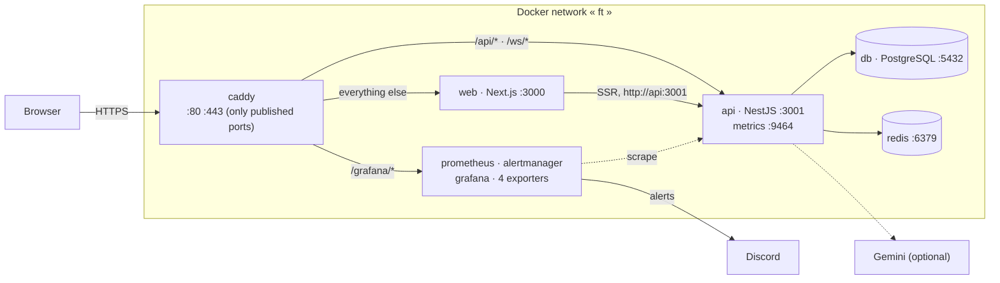

# 03 · The global architecture (Module 02)

## 1. What you need to understand

The architecture answers three questions: **which boxes** exist, **who talks to
whom**, and **who is allowed to do what**. In our project, the answer fits in one rule and
one diagram.

> **The rule**: NestJS owns all the business logic and data access.
> Next.js does presentation and server rendering, nothing else.
> No Prisma client in `apps/web`, no business logic in *server actions*.
> (`docs/ARCHITECTURE.md` §1, `docs/TECHNICAL_PLAN.md` §1)

Verification [CONFIRMED]: `apps/web/package.json` depends neither on `@prisma/client` nor
on Prisma; `scripts/check-app-boundaries.sh` checks in CI that the two apps compile
separately.

## 2. How it works in Transcendence

### The layers

| Layer | Component | Responsibility |
|---|---|---|
| **Entry** | Caddy | TLS (HTTPS mandatory), 80 → 443 redirect, security headers, path-based routing |
| **Presentation** | `web` (Next.js) | Pages, forms, translation, server rendering; calls the API |
| **Business** | `api` (NestJS) | Auth, courses, placement, lessons, scores, friends, presence, real time |
| **Contract** | `@ft/shared` | Zod schemas, error codes, socket events, pure lesson engine |
| **Data** | PostgreSQL | Durable data (users, courses, results…) |
| **Ephemeral data** | Redis | Sessions, placement in progress, presence |
| **External** | Gemini (optional), Discord (alerts) | Question generation; notifications |
| **Observability** | Prometheus, Grafana, Alertmanager, exporters | Metrics, dashboards, alerts |

### Caddy's routing (`infra/caddy/Caddyfile`) [CONFIRMED]

| Path | Destination | Note |
|---|---|---|
| `/api`, `/api/*` | `api:3001` | The prefix is **kept**: NestJS has `setGlobalPrefix('api')` |
| `/ws`, `/ws/*` | `api:3001` | Socket.IO; Caddy handles the WebSocket upgrade |
| `/grafana/metrics*` | 404 response | Deliberately blocked (unauthenticated) |
| `/grafana`, `/grafana/*` | `grafana:3000` | |
| everything else | `web:3000` | Next.js |

### Why "a single origin" is the key

The browser sees **a single site**: `https://localhost`. The pages (`/fr/learn`) and the API
(`/api/...`) have the same origin. Consequences:

- **no CORS** to configure;
- the `ft.sid` session cookie is **first-party**, so `SameSite=Lax` is enough and it can
  be `httpOnly` (inaccessible to JavaScript);
- the `/ws` WebSocket receives the same cookie automatically.

### Two paths for calling the API

This is the subtlest point of the architecture, and a classic jury question.

1. **Server rendering (SSR)**: a Next Server Component runs *inside the `web` container*.
   It calls `http://api:3001/api/...` **directly on the Docker network**, without going
   through Caddy, copying the cookie from the browser's request
   (`fetchWithRequestHeaderAndIP` in `apps/web/lib/api.ts`). [CONFIRMED]
2. **From the browser**: a `'use client'` component calls `fetch('/api/...')`,
   relative, `credentials: 'same-origin'`. The request goes through Caddy → API
   (`apps/web/lib/api-client.ts`). [CONFIRMED]

In both cases it is **the same API** with **the same session**: Next has no
special privilege.

### Organization of the NestJS modules

`apps/api/src/app.module.ts` imports: `ConfigModule`, `ThrottlerModule`, `PrismaModule`,
`RedisModule`, `AuthModule`, `UsersModule`, `FriendsModule`, `HealthModule`,
`CoursesModule`, `PlacementModule`, `LessonsModule`, `GatewayModule`, `MetricsModule`.
`LlmModule` is not directly in it: it is imported by `QuestionGenerationModule`,
itself imported by `PlacementModule`. [CONFIRMED]

## 3. Concrete example

Opening `https://localhost/fr/learn/de`:

1. Caddy receives the HTTPS request, recognizes neither `/api` nor `/ws` → `web:3000`.
2. The `apps/web/proxy.ts` middleware (next-intl) validates the `fr` locale and remembers the
   `de` course in an `httpOnly` cookie.
3. The page `app/[locale]/(dashboard)/learn/[lang]/page.tsx` runs **on the server**:
   `requireCourses()` then `loadToday('de')` → `GET http://api:3001/api/courses/de/today`
   with the cookie.
4. NestJS: `AuthGuard` reloads the user, `LessonsController.today` → `LessonsService.today`
   → 4 Prisma queries → response validated by `TodaySchema`.
5. Next produces the HTML, the browser displays it, then the `RefreshOn` client component
   listens for `course:updated` on the WebSocket.

## 4. Files to know

- `infra/caddy/Caddyfile`: the entry gate and the routing
- `compose.yml`: the services and the `ft` network
- `apps/api/src/app.module.ts`: the map of the backend modules
- `apps/api/src/app.setup.ts`: the global pipeline (prefix, sessions, pipe, filter, Swagger, WebSocket)
- `apps/web/lib/api.ts` and `apps/web/lib/api-client.ts`: the two paths to the API
- `docs/ARCHITECTURE.md`: the team's reference documentation

## 5. Diagram

The full diagram is in [diagrams/GLOBAL-ARCHITECTURE.md](diagrams/GLOBAL-ARCHITECTURE.md).

### Explaining it at the whiteboard, step by step

1. **I draw the browser and a single HTTPS arrow to Caddy.** It is the only
   entry; nothing else is published (`ports:` exists only on `caddy` in `compose.yml`).
2. **Caddy splits into three arrows** depending on the path: `/api` and `/ws` to the API,
   `/grafana` to Grafana, everything else to Next.
3. **I connect web to api**: that is server rendering. Next calls the API by the Docker
   service name `api`, in plain HTTP (the subject allows cleartext inside the network).
4. **The API is the only one touching the data**: arrows to Postgres and Redis.
5. **I show the optional dependencies** as dotted lines: Gemini (by default we use
   the fixture) and the monitoring that *reads* the API's metrics on an internal port.

## 6. Key takeaways

1. Rule: **Next = presentation, NestJS = business + data**.
2. **Caddy** is the only exposed service, over HTTPS; it routes by path prefix.
3. **Same origin** for pages, API and WebSocket → no CORS, first-party cookie.
4. Two paths to the API: **SSR over the Docker network** and **browser through Caddy**.
5. `@ft/shared` is the **contract** shared by the two apps.
6. Postgres = durable; Redis = ephemeral (sessions, placement, presence).
7. Monitoring is separate: metrics on `:9464`, never proxied by Caddy.

## 7. Possible oral questions

1. Explain your architecture in one sentence.
2. Why doesn't Next talk directly to the database?
3. Why don't you have any CORS configuration?
4. Is the traffic between Next and the API encrypted?
5. What prevents someone from accessing Postgres directly?

## 8. Expected answers

1. "A Caddy reverse proxy over HTTPS in front of two TypeScript applications: Next.js for
   display, NestJS for all the logic, with PostgreSQL and Redis behind the API."
2. "To have a single place that enforces the rules: authentication, validation,
   permissions. If Next read the database, we would have to duplicate those rules and we would have two
   entry doors to the data."
3. "Because everything is served from the same origin by Caddy. The browser never makes
   a cross-origin request."
4. "No, it is HTTP on the internal Docker network, which the subject allows. Everything
   coming from outside is HTTPS, terminated by Caddy."
5. "It has no published port in production. In development, it is published on
   `127.0.0.1:5432` only, so it is unreachable from the network."

## 9. Mini-exercise

Draw the diagram above from memory, then check in `compose.yml`: which
services have a `ports:` section? In `compose.override.yml` (dev), which additional ones?

## 10. Self-assessment

1. Where does Caddy send `/ws/`?
2. Why does Caddy use `handle` and not `handle_path` for `/api`?
3. How does Next pass the user's identity to the API during SSR?
4. Which NestJS module imports the LLM module?
5. On which port does the API expose its metrics, and who can access it?

### Answers

1. To `api:3001` (Socket.IO is hosted in the API).
2. `handle_path` would strip the `/api` prefix and all NestJS routes (prefixed `api`) would answer 404.
3. It copies the incoming request's cookies (including `ft.sid`) and the `x-forwarded-for` header into its `fetch` to `http://api:3001`.
4. `QuestionGenerationModule`, imported by `PlacementModule`.
5. 9464, on the Docker network only, read by Prometheus; Caddy never proxies it.

Mini-exercise: in prod, only `caddy`; in dev, `db` (`127.0.0.1:5432`) and `redis` (`127.0.0.1:6379`) in addition.
