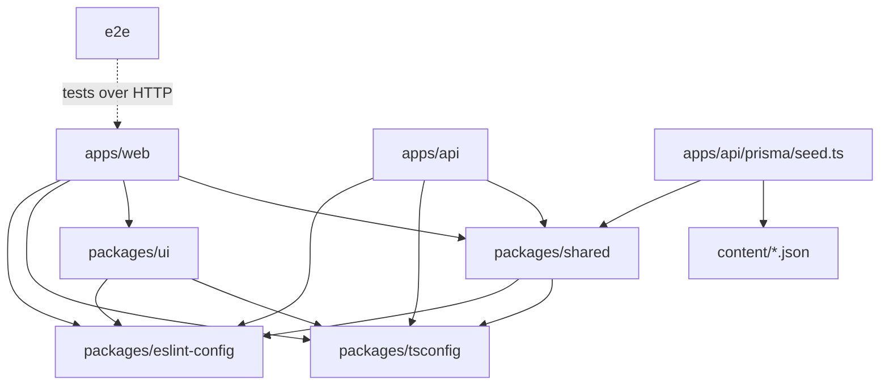

# 04 · The code structure (Module 03)

## 1. What you need to understand

The repository is a **pnpm monorepo**: a single `pnpm-lock.yaml`, several packages declared
in `pnpm-workspace.yaml`. The packages reference each other through `workspace:*`
(for example `"@ft/shared": "workspace:*"` in `apps/api/package.json`), which creates a
local link, not a download.

Size [CONFIRMED, Understand Anything scan]: 563 files analyzed excluding teaching
content, of which 422 in TypeScript; 66 `*.spec.ts` files, 43 `*.test.ts(x)`,
16 `*.e2e-spec.ts` and 22 Playwright specs.

## 2. How it works in Transcendence

### The annotated tree

```
ft_transcendence/
├── apps/
│   ├── api/            NestJS: ALL the business logic and data access
│   │   ├── src/        one folder = one Nest module (auth, courses, lessons…)
│   │   ├── prisma/     schema.prisma, 13 SQL migrations, seed.ts
│   │   ├── scripts/    non-prod tools: write/check lessons, test Gemini
│   │   └── test/       HTTP "e2e" tests (Supertest + real database)
│   └── web/            Next.js: pages and components
│       ├── app/        folder-based routing: app/[locale]/(group)/page.tsx
│       ├── components/ reusable React components (+ lesson/: the player)
│       ├── lib/        API calls, session, pure display logic (tested)
│       ├── i18n/       next-intl configuration
│       ├── messages/   en.json, fr.json, de.json (475 lines each)
│       └── proxy.ts    Next 16 middleware (locale + course cookie)
├── packages/
│   ├── shared/         @ft/shared: Zod schemas, errors, events, lesson engine
│   ├── ui/             @ft/ui: Button, Card, ProgressBar
│   ├── tsconfig/       shared TS configurations
│   └── eslint-config/  shared ESLint rules
├── content/            THE TEACHING CONTENT (JSON, versioned)
│   ├── outlines/       18 syllabi (3 languages × 6 levels) = 3,990 entries
│   ├── briefs/         216 written lesson sheets
│   ├── lessons/        108 exercise files (all types except vocabulary)
│   └── items/          9 files = 270 placement questions
├── e2e/                Playwright: 22 browser test files
├── infra/              caddy/, monitoring/ (prometheus, grafana, alertmanager), deploy/
├── scripts/            shell checks run by CI and `make ci`
├── docs/               the team's documentation (+ this course)
├── .github/            4 workflows, CODEOWNERS, PR template, commitlint
├── .claude/            skills and workflow for writing the content with Claude Code
├── .devcontainer/      VS Code environment in a container
├── compose*.yml        4 Compose files (base, dev, prod, deployment)
└── Makefile            the entry point: `make`
```

### `apps/api/src`: one folder per module

| Folder | Essential content | Interacts with |
|---|---|---|
| `auth/` | controller (signup, login, 2FA, logout, me), global `AuthGuard`, `TwoFactorService` | prisma, gateway (closing sockets) |
| `users/` | search, public profile, "recently active", profile editing, avatar | prisma |
| `friends/` | requests, acceptance, removal; `pair.ts` (pair key) | prisma, gateway, presence |
| `courses/` | create a course, change goal or level | prisma, gateway, lessons/goal |
| `placement/` | adaptive test; session in Redis | redis, prisma, courses, question-generation |
| `question-generation/` | restock the question bank via the LLM | llm, prisma |
| `llm/` | `LlmProvider` interface, `GeminiProvider`, `FixtureProvider`, factory | metrics |
| `lessons/` | today, list, lesson, attempt, rules (goal, streak, XP, achievements) | prisma, gateway, @ft/shared/lessons |
| `gateway/` | Socket.IO gateway, `SocketsService`, session adapter | redis, prisma, presence |
| `presence/` | per-user socket counter in Redis | redis |
| `throttler/` | rate limiting per account or per IP | — |
| `prisma/`, `redis/` | the two clients, instantiated only once | — |
| `metrics/`, `health/` | Prometheus `:9464`, `GET /api/health` | — |
| `demo/` | generates 6 demo learners (dev only) | seed |
| root | `main.ts`, `app.module.ts`, `app.setup.ts`, `validation.pipe.ts`, `error-code.filter.ts` | everything |

A convention worth noticing: the **pure business rules** are in
`*.rules.ts` files (`roadmap.rules.ts`, `gamification.rules.ts`) with no database, so
they are easy to test; the files that write to the database (`goal.ts`, `gamification.ts`)
receive the `tx` transaction as a parameter. [CONFIRMED]

### `apps/web/app`: folder-based routing

```
app/
├── [locale]/                     dynamic segment: en | fr | de
│   ├── layout.tsx                <html lang>, NextIntlClientProvider
│   ├── (main)/                   "site" group: header + legal footer
│   │   ├── page.tsx              home
│   │   ├── signup/ login/        forms
│   │   ├── onboarding/           choose a language then a level
│   │   ├── profile/ profile/edit/ users/[id]/ friends/ settings/2fa/
│   │   └── privacy/ terms/       mandatory legal pages
│   ├── (dashboard)/              "application" group: dashboard navigation
│   │   ├── learn/                redirects to the last course
│   │   ├── learn/[lang]/         today, goal, level
│   │   │   ├── placement/        placement test
│   │   │   └── lessons/[id]/     lesson page, /play (player), /results
│   │   └── dashboard/            redirects to /learn
│   ├── (mode)/chat/              chat mockup (no logic)
│   ├── [...rest]/                any unknown URL → translated 404
│   ├── error.tsx, not-found.tsx
└── healthz/                      probes: /healthz, /healthz/api, /healthz/upstream
```

The parentheses in `(main)` are **route groups**: they do not appear in the URL,
they are used to give a different **layout** to a set of pages.

### `packages/shared/src`

| Folder | Content |
|---|---|
| `schemas/` | `user.ts`, `course.ts`, `lesson.ts`, `placement.ts`, `friend.ts`, `gamification.ts`, `errors.ts` (the `ERROR_CODES` list)… |
| `events/socket.ts` | names and payloads of the Socket.IO events |
| `lessons/schemas/` | format of the lesson files, per type |
| `lessons/validation/` | content validators (used by the seed and the authoring tool) |
| `lessons/player/` | **the lesson engine**: `plan`, `attempt`, `score`, `redact`, `view`, `feedback` |

## 3. Concrete example: following a feature through the folders

"Sending a friend request" touches:

```
apps/web/components/friend-buttons.tsx       button (client)
  → apps/web/lib/friends-client.ts           sendFriendRequest(userId)
    → POST /api/friends/requests/:userId
      → apps/api/src/friends/friends.controller.ts   @Post('requests/:userId'), throttle 10/min
        → apps/api/src/friends/friends.service.ts    send → trySend → create
          → apps/api/src/friends/pair.ts             pairKey(a, b)
          → Prisma friendship.create                 Friendship table
          → apps/api/src/gateway/sockets.service.ts  toUser(..., 'friend:request')
packages/shared/src/schemas/friend.ts        FriendRequestResultSchema (on both sides)
packages/shared/src/events/socket.ts         FRIEND_REQUEST
```

## 4. Files to know

See the full list of 35 annotated files: [18-IMPORTANT-FILES.md](18-IMPORTANT-FILES.md).

## 5. Diagram: dependencies between packages



## 6. Key takeaways

1. **Two apps** (`api`, `web`), **four packages** (`shared`, `ui`, `tsconfig`, `eslint-config`).
2. Backend: **one folder = one Nest module** (controller + service + module + DTO).
3. Frontend: **the folder path = the URL**; `[locale]` and `(groups)`.
4. `@ft/shared` also contains **the lesson engine**, run only by the API.
5. `content/` = **the teaching content in JSON**, loaded into the database by the seed.
6. The pure business rules are in the `*.rules.ts` files.
7. Unit tests sit **next to** the code (`x.spec.ts`, `x.test.ts`); HTTP tests are in `apps/api/test/`.

## 7. Possible oral questions

1. Why a monorepo?
2. Where is the code that computes a lesson's grade?
3. What does `content/` contain, and how does it get into the database?
4. What are the folders in parentheses in `app/` for?
5. Where would you add a new API route?

## 8. Expected answers

1. "To share code (`@ft/shared`) between front and back without publishing a package, have
   a single CI, and change a contract and both its users in the same commit."
2. "In `packages/shared/src/lessons/player/score.ts` and `attempt.ts`, but it is
   only called by the API, in `AttemptsService.submit`. The browser never grades."
3. "JSON files: the syllabi, the lesson sheets and exercises, the question bank.
   `make seed` runs `prisma/seed.ts`, which validates each lesson with `validateLesson` and
   does one `upsert` per lesson, marking as `ready` those that are complete and valid."
4. "They are route groups: they do not change the URL, they group pages under the
   same layout, for example the dashboard."
5. "In the relevant module of `apps/api/src`: a method decorated with `@Get`/`@Post` in
   the controller, the logic in the service, the schema in `@ft/shared`. It is private
   by default thanks to the global `AuthGuard`."

## 9. Mini-exercise

Find in `apps/web/app` the file that runs when you open
`https://localhost/de/learn/fr/lessons/fr-subject-pronouns/play`. Which segments are dynamic?

## 10. Self-assessment

1. How many syllabi are in `content/outlines`, and why that number?
2. Which file lists all the error codes?
3. Where are the SQL migrations, and how many are there?
4. What distinguishes `goal.ts` from `roadmap.rules.ts`?
5. Where do the API's HTTP tests live?

### Answers

1. 18 = 3 languages × 6 levels (`fr-a1.json` … `de-c2.json`).
2. `packages/shared/src/schemas/errors.ts`.
3. `apps/api/prisma/migrations/`, 13 migrations (from `init_user` to `add_gamification`).
4. `roadmap.rules.ts` = pure functions with no database; `goal.ts` = writes to the database with the `tx` transaction (lock, goal reached).
5. `apps/api/test/*.e2e-spec.ts`.

Mini-exercise: `app/[locale]/(dashboard)/learn/[lang]/lessons/[id]/play/page.tsx`;
dynamic: `[locale]` = `de`, `[lang]` = `fr`, `[id]` = `fr-subject-pronouns`.
