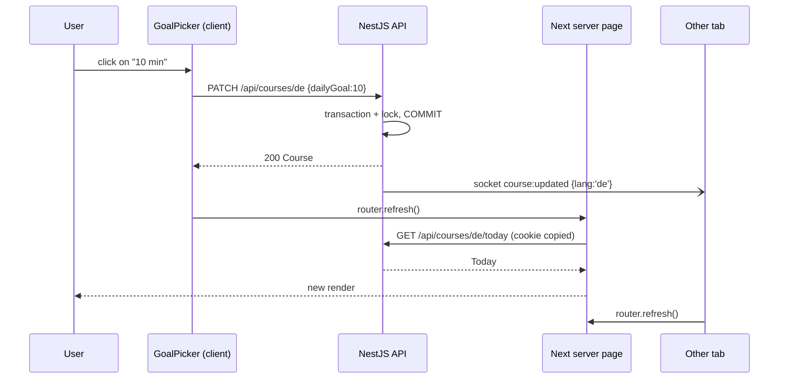

# 05 · The frontend (Module 04)

## 1. What you need to understand

The frontend is a **Next.js 16 application with the App Router**. Three ideas are enough:

1. **The folder = the URL.** `app/[locale]/(main)/signup/page.tsx` answers `/fr/signup`.
2. **By default, a component runs on the server** (*Server Component*). It can
   be `async`, do a `fetch`, and only sends HTML to the browser. It cannot
   have state or a click handler.
3. **A file starting with `'use client'`** is a *Client Component*: it also runs
   in the browser, with `useState`, `useEffect`, `onClick`, `onSubmit`.

In our project, the rule is simple: **pages read on the server, forms and the
lesson player write from the browser**, then ask Next to re-read the page
(`router.refresh()`).

## 2. How it works in Transcendence

### Initialization and routing

| Element | File | Role |
|---|---|---|
| Middleware | `apps/web/proxy.ts` | next-intl: adds/validates the `/en` `/fr` `/de` prefix; remembers the last visited course in the `httpOnly` cookie `ft.lang` (1 year). Excludes `/api`, `/healthz`, files. [CONFIRMED] |
| i18n routing | `apps/web/i18n/routing.ts` | `locales = SUPPORTED_LOCALES` (from `@ft/shared`), `localePrefix: 'always'` |
| Loading translations | `apps/web/i18n/request.ts` | imports `messages/<locale>.json` |
| Root layout | `app/[locale]/layout.tsx` | checks the locale (`notFound()` otherwise), sets `<html lang>`, provides the messages via `NextIntlClientProvider` |
| Group layouts | `(main)/layout.tsx`, `(dashboard)/layout.tsx`, `(mode)/layout.tsx` | `Shell` wrapper with header and **legal footer** (`LegalFooter`) everywhere |
| Config | `next.config.ts` | `output: 'standalone'` (minimal Docker image), next-intl plugin, `poweredByHeader: false` |

Note: in Next.js 16, the middleware file is called `proxy.ts` (formerly
`middleware.ts`). [INFERRED: `default function proxy` export + `config.matcher`]

### Pages and their layouts

| Group | Pages | Specifics |
|---|---|---|
| `(main)` | home, signup, login, onboarding, profile, profile/edit, users/[id], friends, settings/2fa, privacy, terms | `HeaderNav` |
| `(dashboard)` | learn, learn/[lang], placement, lessons/[id], /play, /results, dashboard | `DashboardNav`, `TimeZoneSync` |
| `(mode)` | chat | ✕ button to go back; **static** page [NOT PRESENT functionally] |

### Reading data: the server path

`apps/web/lib/api.ts` provides `apiGet(schema, path)` and `apiFind(...)`:

```ts
// apps/web/lib/api.ts (simplified excerpt)
export async function fetchWithRequestHeaderAndIP(fetcher) {
  const cookie = (await cookies()).getAll().map(({ name, value }) => `${name}=${value}`).join('; ');
  const forwardedFor = (await headers()).get('x-forwarded-for');
  return fetcher({ baseUrl: process.env.API_INTERNAL_URL, cookie, forwardedFor });
}
// fetchJson: fetch(url, { cache: 'no-store', headers: { cookie, 'x-forwarded-for' } })
//   401        → { status: 'signed-out' }
//   404        → { status: 'not-found' } (apiFind only)
//   other !ok  → { status: 'unavailable', reason }
//   200        → schema.safeParseAsync(json) → { status: 'ok', data }
```

What you need to explain:

- **Parameters**: a Zod schema (from `@ft/shared`) and a path. **Return**: a union
  discriminated by `status`, so the page *must* handle each case.
- **The API response is validated** by Zod on the web side too: if the API changes shape,
  the page fails cleanly instead of displaying garbage.
- `cache: 'no-store'`: every render re-reads the API (the data is personal).
- `lib/session.ts`: `loadSession` is wrapped in React's `cache()`, so there is **only one**
  `/api/auth/me` call per render, even if several components ask for the user.
  `requireUser()` redirects to `/login` if there is no session.

### Writing data: the browser path

`apps/web/lib/api-client.ts` provides `clientGet/Post/Put/Patch/Delete(schema, path, body)`:

- **relative** `fetch` (`/api/...`) with `credentials: 'same-origin'` → goes through Caddy;
- returns `{ ok: true, data }` or `{ ok: false, code, status }`;
- `code` is read by `readCode(body)` from the `message` field of the NestJS error;
- network error → `network.unreachable`.

On top of it, one module per domain: `auth-client.ts`, `courses-client.ts`,
`placement-client.ts`, `friends-client.ts`, `lesson-client.ts`.

### Error handling: codes, not sentences

The API **never** returns a sentence, only a code from `ERROR_CODES`
(`packages/shared/src/schemas/errors.ts`), for example `auth.invalidCredentials`.
The browser translates it:

```ts
// apps/web/lib/error-message.ts
export function useErrorMessage() {
  const t = useTranslations('Errors');
  return useCallback((code, status = 0) => t(isErrorCode(code) ? code : 'unknown', { status }), [t]);
}
```

Why: the interface language is known in the browser, not in the API.
Rendering errors are caught by `app/[locale]/error.tsx` and `app/global-error.tsx`.

### State: local, no global store

There is **no Redux, no Zustand, no application Context**. [CONFIRMED: no dependency
of that kind in `apps/web/package.json`] State lives:

- **on the server** (the source of truth is the API; we re-read with `router.refresh()`);
- **in components** (`useState` for a form, `useRef` for flags);
- **in a module** for the socket: `components/tab-socket.ts` keeps *one* connection per
  tab in a module variable and exposes it through hooks based on `useSyncExternalStore`
  (`useSocketStatus`, `useFriendOnline`, `useServerEvent`);
- **in `localStorage`** for a lesson's answer drafts (`lib/lesson-client.ts`,
  `loadDrafts`/`saveDrafts`), which survive a reload.

### Custom hooks to know

| Hook | File | Role |
|---|---|---|
| `useErrorMessage` | `lib/error-message.ts` | code → translated sentence |
| `useCourseSave` | `lib/use-course-save.ts` | chains writes in series (`serialQueue`), displays the error, then `router.refresh()` |
| `useSocketStatus` | `components/tab-socket.ts` | `connected` / `reconnecting` / `closed` / `signedOut` |
| `useServerEvent` | `components/tab-socket.ts` | subscribe to a server event |
| `useFriendOnline` | `components/tab-socket.ts` | a friend's online status, updated live |

### Main components and their relationships

```
Shell (components/shell.tsx)
├── HeaderNav / DashboardNav
│   └── SessionNav (server) ── ConnectionStatus (client) ── connectSocket()
│                            └─ LogOutButton (client) ── closeSocket()
├── {children} = the page
│   └── learn/[lang]/page.tsx (server)
│       ├── RefreshOn events=[course:updated] (client)
│       ├── StreakLine, TodayCard, MoreLessons, LevelComplete (today.tsx)
│       ├── DirectLevelPicker, GoalPicker (client → useCourseSave → PATCH)
└── LegalFooter (links /privacy and /terms: mandatory)
```

The lesson player: `lessons/[id]/play/page.tsx` (server) loads the attempt then renders
`LessonPlayer` (`player.tsx`, client), which picks a renderer per item type using
`ITEM_RENDERERS` (`components/lesson/kinds/index.ts`). **Only the `grammar` type is
registered**; `playable(kind)` returns `false` for the other three, and the lesson
page then does not offer to play. [CONFIRMED]

## 3. Concrete example: from the click to the displayed result

**Changing your daily goal from 30 to 10 minutes** on `/fr/learn/de`:

1. Click in `GoalPicker` (client, `app/[locale]/(dashboard)/learn/[lang]/goal-picker.tsx`).
2. `save(() => clientPatch(CourseSchema, '/api/courses/de', { dailyGoal: 10 }))`
   via `useCourseSave`: button pending, errors cleared.
3. The browser sends `PATCH /api/courses/de` (cookie `ft.sid` attached automatically).
4. The API validates (`SetGoalDto` → `DailyGoalSchema`: 10, 30 or 60), locks the course,
   writes, checks whether today's goal is now reached, awards XP, then
   **after the commit** emits `course:updated { lang: 'de' }` to the user's room.
5. Response `200 Course` → `CourseSchema` validates → `router.refresh()`.
6. Next re-runs the page **on the server** (`GET /api/courses/de/today`) and sends the
   new render: "Goal 10 min: 1 lesson out of 1".
7. In the **other tabs**, `RefreshOn` receives `course:updated` and also does
   `router.refresh()`.

## 4. Files to know

- `apps/web/proxy.ts`, `apps/web/i18n/routing.ts`
- `apps/web/app/[locale]/layout.tsx`
- `apps/web/lib/api.ts` (server), `apps/web/lib/api-client.ts` (browser)
- `apps/web/lib/session.ts`, `apps/web/lib/error-message.ts`
- `apps/web/components/tab-socket.ts`, `apps/web/components/refresh-on.tsx`
- `apps/web/app/[locale]/(main)/signup/signup-form.tsx` (model form)
- `apps/web/app/[locale]/(dashboard)/learn/[lang]/page.tsx` (model page)
- `apps/web/app/[locale]/(dashboard)/learn/[lang]/lessons/[id]/play/player.tsx` (the largest component)
- `apps/web/components/lesson/kinds/index.ts` (`playable`)

## 5. Diagram

See also [diagrams/FRONTEND-BACKEND-FLOW.md](diagrams/FRONTEND-BACKEND-FLOW.md).



## 6. Key takeaways

1. **Server Components to read**, **Client Components to write**, then `router.refresh()`.
2. Two HTTP clients: `lib/api.ts` (server, cookie copied) and `lib/api-client.ts` (browser, relative).
3. **All API responses are validated by Zod** on the web side.
4. Errors are **codes** translated by `useErrorMessage`.
5. No global store: the truth lives **on the server**.
6. **One socket per tab**, in a module variable, exposed through hooks.
7. i18n: `next-intl`, mandatory prefix, 3 catalogs.
8. Today the player can only play **grammar**.

## 7. Possible oral questions

1. How do you validate a form on the frontend?
2. How does the page know who is logged in?
3. Why no Redux?
4. How does the page update after a change?
5. What happens if the API returns unexpected JSON?

## 8. Expected answers

1. "With the same Zod schema as the backend. In the signup form,
   `SignUpFormSchema.safeParse` checks e-mail, username, password and confirmation; the
   first error code is translated and displayed. Then the API revalidates with `CreateUserSchema`."
2. "The server layout or page calls `currentUser()` or `requireUser()`, which does
   `GET /api/auth/me` while copying the cookie. The result is cached for the duration of the render."
3. "The source of truth is the API. After a write we re-read the server page with
   `router.refresh()`; there is no client-side copy to synchronize. The only shared
   state, the socket, lives in a module with `useSyncExternalStore`."
4. "Locally through `router.refresh()`; in the other tabs through the socket event
   `course:updated`, which the `RefreshOn` component turns into `router.refresh()`."
5. "`safeParse` fails, we return `unavailable` on the server side (the page throws an error,
   caught by `error.tsx`) or `server.unexpected` on the client side, displayed as "unexpected
   error". Never unvalidated data on screen."

## 9. Mini-exercise

In `signup-form.tsx`, list in order what happens between `onSubmit` and
arriving on `/onboarding`. How many times is the password validated, and where?

## 10. Self-assessment

1. What does `proxy.ts` do, in two points?
2. Which function should you use in a server page to require a session?
3. Where are a lesson's answer drafts stored?
4. Which component opens the WebSocket, and when?
5. Why does the "see all lessons" button lead to a 404?

### Answers

1. It applies the next-intl middleware (locale prefix) and writes the `httpOnly` cookie of the last opened course.
2. `requireUser()` (`lib/session.ts`), which redirects to `/login`.
3. In `localStorage`, per (language, lesson, attempt): `lib/lesson-client.ts`.
4. `ConnectionStatus`, rendered by `SessionNav` for a logged-in user: `useEffect(() => connectSocket(), [pathname])`.
5. The page `learn/[lang]/lessons/page.tsx` does not exist yet; the URL falls on `[...rest]` which calls `notFound()`. The API, however, can answer (`GET /api/courses/:lang/lessons`).

Mini-exercise: `preventDefault` → `SignUpFormSchema.safeParse` (1st validation, browser)
→ `signUp()` → `POST /api/auth/signup` → `CodeValidationPipe` with `CreateUserSchema`
(2nd validation, server) → `201` → `router.replace('/onboarding')` + `router.refresh()`.
