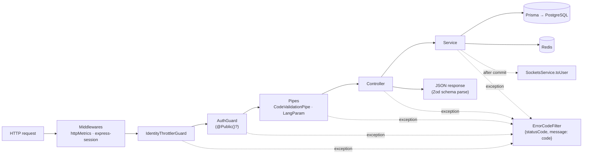

# 06 · The backend (Module 05)

## 1. What you need to understand

NestJS organizes a server into **modules**. Each module groups:

- **controllers**: classes whose methods, decorated with `@Get()`, `@Post()`…,
  answer a URL. They read the request and delegate;
- **services** (`@Injectable()`): the business logic;
- **providers** injected through the constructor (**dependency injection**): Nest
  builds the objects and passes them in automatically.

A request goes through, in order: **middlewares** (Express) → **guards** (am I allowed?)
→ **pipes** (validation/transformation) → **controller** → **service** → database → response;
an exception is turned into an HTTP response by a **filter**.

In our project there is **no separate "repository" layer**: services use
`PrismaService` directly. [CONFIRMED]

## 2. How it works in Transcendence

### Server startup

```ts
// apps/api/src/main.ts (simplified)
const app = await NestFactory.create(AppModule);
configureApp(app);                                   // the whole global pipeline
await app.listen(Number(process.env.PORT ?? 3001), '0.0.0.0');
collectDefaultMetrics({ register: registry });       // after listen
startMetricsServer(METRICS_PORT)                     // :9464, separate server
  .catch(err => new Logger('Metrics').error(...));   // monitoring never brings the app down
```

`configureApp` (`apps/api/src/app.setup.ts`) is **also called by the e2e tests**, so
that the tests use exactly the same pipeline. It installs, in this order:

1. `httpMetrics`: middleware that times every request;
2. `setGlobalPrefix('api')`: all routes start with `/api`;
3. the static avatar files under `/api/uploads/avatars`;
4. `trust proxy = 1`: only one hop (Caddy) is trusted for `X-Forwarded-*`;
5. global `CodeValidationPipe` (Zod);
6. global `ErrorCodeFilter`;
7. `express-session` with `RedisStore` (cookie `ft.sid`);
8. `SessionIoAdapter`: the same session middleware for Socket.IO;
9. Swagger at `/api/docs`.

The app **refuses to start** if `SESSION_SECRET` is shorter than 32 characters, or if
`DATABASE_URL` or `AVATAR_STORAGE_DIR` is missing. [CONFIRMED]

### The global guards

Two `APP_GUARD`s are registered:

- `IdentityThrottlerGuard` (`app.module.ts`): 100 requests / 60 s, counted **per account**
  (`user:<id>`) if logged in, otherwise **per IP**. Routes marked `@ThrottleByIp(n)`
  always count per IP (login, 2FA: 5/min; signup: 10/min). The throttler storage
  is the default one, **in the process's memory**. [INFERRED: no `storage`
  passed to `ThrottlerModule.forRoot`]
- `AuthGuard` (`auth.module.ts`): **every route is private** unless it carries `@Public()`.
  It re-reads the user from the database on every request and puts it in `request.user`.

### Validation: `CodeValidationPipe`

DTOs are built from the shared Zod schemas:

```ts
// apps/api/src/auth/auth.dto.ts
export class SignUpDto extends createZodDto(CreateUserSchema) {}
```

The pipe (`apps/api/src/validation.pipe.ts`) is the `nestjs-zod` one, modified so that the
error response puts **the codes** in `message`:

```json
{ "statusCode": 400, "message": ["email.invalid", "password.tooShort"] }
```

There are also two parameter pipes: `LangParam` (`:lang` must be `en|fr|de`,
otherwise `400 course.unknownLanguage`) and `UserIdParam` (UUID, lowercased).

### Error handling: `ErrorCodeFilter`

Services throw Nest exceptions with a code: `throw new ConflictException('course.alreadyStarted')`.
The global filter (`apps/api/src/error-code.filter.ts`) guarantees that **no response
contains a sentence**: invalid JSON → `request.invalid`, body too large → `request.tooLarge`,
unknown route or crash → `server.unexpected` (and the crash is logged with its stack).

### The routes (all prefixed with `/api`)

| Module | Method and path | Public | Effect |
|---|---|---|---|
| auth | `POST /auth/signup` | yes, 10/min/IP | create an account + session |
| auth | `POST /auth/login` | yes, 5/min/IP | `200 SessionUser` or `202 {twoFactorRequired}` |
| auth | `POST /auth/2fa/verify` | yes, 5/min/IP | finish a 2FA login |
| auth | `GET /auth/2fa`, `POST /auth/2fa/setup`, `POST /auth/2fa/enable`, `DELETE /auth/2fa` | no | manage 2FA |
| auth | `POST /auth/logout` | yes | destroy the session |
| auth | `GET /auth/me` | no | the current user |
| users | `GET /users?q=`, `GET /users/recently-active`, `GET /users/:id` | no | search, active < 7 days, public profile |
| users | `PATCH /users/me`, `POST /users/me/avatar`, `DELETE /users/me/avatar` | no | profile, avatar |
| friends | `GET /friends`, `POST /friends/requests/:userId` (10/min), `POST …/accept`, `DELETE /friends/requests/:userId`, `DELETE /friends/:userId` | no | friendships |
| courses | `GET /courses`, `POST /courses`, `PATCH /courses/:lang`, `PATCH /courses/:lang/level` | no | courses, goal, level |
| placement | `POST /placement`, `GET /placement`, `POST /placement/answers`, `DELETE /placement` | no | placement test |
| lessons | `GET /courses/:lang/today`, `GET /courses/:lang/lessons`, `GET /courses/:lang/lessons/:id`, `GET /courses/:lang/achievements` | no | reads |
| attempts | `GET` and `POST /courses/:lang/lessons/:id/attempt`, `POST …/attempt/pages/:index` | no | play a lesson |
| health | `GET /health` | yes | database and Redis status |

[CONFIRMED: controller decorators in `apps/api/src/*/*.controller.ts`]

### Data access

`PrismaService` (`apps/api/src/prisma/prisma.service.ts`) **extends** `PrismaClient` with
the `PrismaPg` adapter (mandatory in Prisma 7 with the `prisma-client` generator), and
connects at startup (`onModuleInit`) so that a bad `DATABASE_URL` makes the
container fail rather than the first request. Three techniques show up everywhere:

1. **Explicit `select`** (`LESSON_SELECT`, `PUBLIC_USER_SELECT`): a column you do not
   ask for cannot leak (e.g. `passwordHash`, a lesson's `brief`).
2. **Unique constraints rather than prior checks**: we attempt the insert and
   catch `P2002` (duplicate) → `409`. A `SELECT` before an `INSERT` would leave a race.
3. **Transactions + row lock** for everything that touches a course's day:
   `lockCourse` does `SELECT … FOR UPDATE` on `UserLevel` (`apps/api/src/lessons/goal.ts`).

### Communication with the other services

- **Redis** via `RedisService` (client `redis` v6): sessions, placement, presence, probes.
- **Socket.IO** via `SocketsService.toUser(userId, event, payload)`, called by the services
  **after** the commit (courses, friends, attempts).
- **LLM** via the injection token `LLM_PROVIDER`: `QuestionStockService` receives either
  `GeminiProvider` or `FixtureProvider` (`llm.factory.ts`, depending on `LLM_PROVIDER`).

## 3. Concrete example: the path of a request

**`GET /api/courses/de/today`**

```
Browser or Next server
  → Caddy (/api/* → api:3001)
  → httpMetrics (timer starts)
  → express-session: reads the ft.sid cookie, loads sess:<id> from Redis
  → IdentityThrottlerGuard: counter user:<id> < 100/min?
  → AuthGuard: session.userId? → AuthService.findById → request.user
  → LangParam: 'de' ∈ {en, fr, de}
  → LessonsController.today(user, 'de')
  → LessonsService.today(user.id, 'de', user.timeZone, new Date())
       ├─ userLevel.findUnique (the course) → checkCourse: 404 course.notFound / 409 course.notPlaced
       ├─ in parallel: lesson.findMany (lessons of the level) + lessonResult.findMany (results)
       ├─ courseDay(now, timeZone, …): "today" in the learner's time zone
       ├─ plan(...): done / proposed / extra (roadmap.rules.ts)
       └─ userAchievement.findMany (today's achievements)
  → TodaySchema.parse(...)        ← the output is validated too!
  → 200 JSON
```

## 4. Files to know

- `apps/api/src/main.ts`, `apps/api/src/app.setup.ts`, `apps/api/src/app.module.ts`
- `apps/api/src/validation.pipe.ts`, `apps/api/src/error-code.filter.ts`
- `apps/api/src/auth/auth.guard.ts`, `apps/api/src/auth/auth.decorators.ts`
- `apps/api/src/throttler/identity-throttler.guard.ts`
- `apps/api/src/prisma/prisma.service.ts`
- `apps/api/src/lessons/lessons.service.ts`, `apps/api/src/lessons/goal.ts`
- `apps/api/src/gateway/sockets.service.ts`

## 5. Diagram



## 6. Key takeaways

1. Global pipeline in **`configureApp`**, shared with the e2e tests.
2. **Private by default**: global `AuthGuard`, `@Public()` to open a route.
3. Global **throttling** per account, per IP on sensitive routes.
4. **Zod** validation (`createZodDto` DTOs), errors in the form of **codes**.
5. Services use **Prisma directly**, with explicit `select`s.
6. **Database uniqueness + catching `P2002`** rather than racy checks.
7. **`SELECT … FOR UPDATE`** on the course to serialize lesson completions and goal changes.
8. Real-time events are sent **after the commit**.

## 7. Possible oral questions

1. How is a route protected?
2. What happens if a body field is invalid?
3. How do you avoid concurrency problems (two tabs)?
4. How does the API protect itself against brute force?
5. Why is `trust proxy` set to 1?

## 8. Expected answers

1. "By default: the `AuthGuard` is global. It reads `userId` from the session, re-reads
   the user from the database; if it no longer exists, it destroys the session and returns
   `401 auth.sessionRequired`. Only `@Public()` routes escape it."
2. "The `CodeValidationPipe` applies the DTO's Zod schema and returns `400` with the list
   of codes, for example `["password.tooShort"]`. The browser translates the first one."
3. "Every write on a course's day happens in a transaction that starts with
   `SELECT … FOR UPDATE` on the `UserLevel` row. The second tab waits, then re-reads
   what the first one wrote. For duplicates, we rely on unique constraints."
4. "The throttler: 5 attempts per minute per IP on login and 2FA, 10 on
   signup. And argon2id, which is expensive to compute. Plus a dummy hash for an unknown
   e-mail, so that the response time does not reveal whether the account exists."
5. "Caddy terminates TLS and forwards over HTTP. Express learns that the request was
   secure through `X-Forwarded-Proto`, which is needed to set a `secure` cookie. Trusting
   only one hop prevents a client from forging `X-Forwarded-For`, and therefore its IP
   as seen by the throttler."

## 9. Mini-exercise

Take `POST /api/friends/requests/:userId`. Write the list of processing steps
(middlewares, guards, pipes, controller, service, Prisma, socket) as in the example
above. What does the API answer if the user sends a request to themselves?

## 10. Self-assessment

1. What are the two global guards?
2. Which code does an unknown route return?
3. Why does `PrismaService` connect in `onModuleInit`?
4. What does `request.user` contain, and who fills it?
5. Which method sends an event to a user?

### Answers

1. `IdentityThrottlerGuard` and `AuthGuard`.
2. `404` with `message: "server.unexpected"` (rewritten by `ErrorCodeFilter`).
3. So that a bad database URL makes startup (and the healthcheck) fail rather than a user's first request.
4. A `SessionUser` (id, email, displayName, avatarUrl, locale, timeZone, role, createdAt), filled by `AuthGuard`.
5. `SocketsService.toUser(userId, event, payload)`.

Mini-exercise: session → throttler (10/min, the controller's `@Throttle` decorator) →
`AuthGuard` → `UserIdParam` → `FriendsController.send` → `FriendsService.send` → if
`them === me`: `400 friend.self`.
