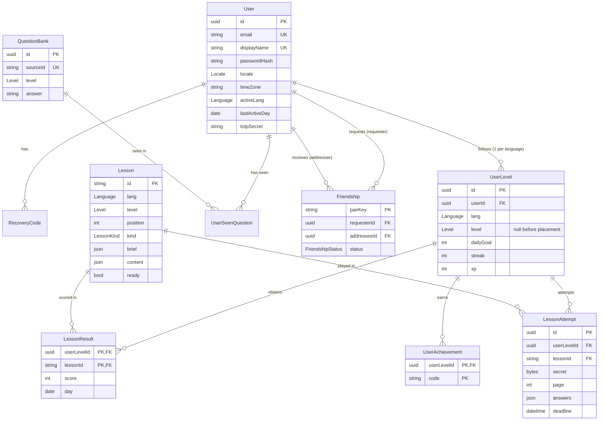

# 07 · The database (Module 06)

## 1. What you need to understand

- **PostgreSQL** is a **relational** database: tables, rows, **primary keys** (the unique
  identifier of a row) and **foreign keys** (a column that points to the primary key of
  another table).
- **Prisma** is an **ORM**: you describe the tables in `schema.prisma`, and Prisma generates
  (1) the **SQL migrations** that create/modify the tables and (2) a **typed TypeScript
  client** (`prisma.user.findUnique(...)`).
- A **migration** is a dated SQL file, applied only once, in order. Together they form
  the history of the schema.

## 2. How it works in Transcendence

### Why PostgreSQL

The subject asks for "a clear schema with well-defined relations". Our data is highly
relational (a user has courses, a course has results, which point to lessons). The
original plan chose the **pgvector** image for a future RAG
(`docs/TECHNICAL_PLAN.md` §1); this extension is not used anywhere. [NOT PRESENT]

### How it is initialized

1. The `db` container starts (`pgvector/pgvector:0.8.6-pg18-trixie`, volume `pg-data`)
   with `POSTGRES_USER/PASSWORD/DB` coming from `.env`.
2. `make migrate` runs `prisma migrate deploy` in a throwaway "tooling" container:
   it applies the **13 migrations** in `apps/api/prisma/migrations/`.
3. `make seed` runs `pnpm --filter @ft/api run db:seed` (`apps/api/prisma/seed.ts`):
   - `seedQuestionBank`: loads `content/items/*.json` (270 questions) via `upsert` on `sourceId`;
   - `seedLessons`: reads the 18 syllabi and creates **one `Lesson` row per entry (3,990)**;
     a lesson whose files exist and pass `validateLesson` receives its content and
     `ready = true` (**216**); a modified lesson deletes the **in-progress** attempts on it;
   - in dev only (`NODE_ENV=development` and `DEMO_PASSWORD` set): 6 demo learners.

[CONFIRMED: seed dry-run against a fake database for the numbers]

### How the backend accesses it

A single client: `PrismaService` (adapter `@prisma/adapter-pg`, hence `node-postgres`).
The client is **generated in `apps/api/src/generated/prisma`** (excluded from Git), because
Prisma 7's `prisma-client` generator emits TypeScript to be compiled with the app.
The connection URL is in `apps/api/prisma.config.ts`, no longer in `schema.prisma`
(new in Prisma 7).

### The tables

| Table | Role | Primary key | Important points |
|---|---|---|---|
| `User` | an account | `id` UUID | `email` and `displayName` **unique**; `passwordHash`; `locale`, `timeZone`, `role`; `totpSecret`, `totpEnabledAt`; `activeLang`; `lastActiveDay` (date) |
| `RecoveryCode` | 2FA recovery codes | `id` | unique `codeHash` (SHA-256), `usedAt` |
| `UserLevel` | **a course** = (user, language) | `id` | `@@unique([userId, lang])`; `level` (null before placement); `dailyGoal`; streak (`streak`, `bestStreak`, `lastGoalDay`); XP and challenge (`xp`, `lastChallengeDay`, `lastChallengeCode`, `challengesDone`) |
| `Lesson` | a lesson in the catalog | text `id` (e.g. `fr-subject-pronouns`) | `lang`, `level`, `position`, `kind`, `topic`/`theme`, `brief` (JSON), `content` (JSON, null for vocabulary), `ready`; index `(lang, level, position)` |
| `LessonResult` | best result of a course on a lesson | **composite** `(userLevelId, lessonId)` | `score` (best), `day`, `finishedAt`; `onDelete: Restrict` on the lesson side |
| `LessonAttempt` | the attempt in progress or the latest one | `id` | `@@unique([userLevelId, lessonId])`; `secret` (32 bytes, never sent); `page` (cursor), `deadline`, `answers` (JSON), `completedAt`, `results` (JSON); `motherTongue` |
| `UserAchievement` | an earned achievement | composite `(userLevelId, code)` | `day`, `earnedAt` |
| `QuestionBank` | placement questions | `id` | unique `sourceId` (seed questions); `lang`, `level`, `category`, `options[]`, `answer`, `timeLimitS`; index `(lang, level, category)` |
| `UserSeenQuestion` | questions already seen by a user | `id` | `@@unique([userId, questionId])`: never the same question twice |
| `Friendship` | a request or a friendship | **`pairKey`** (text) | `requesterId`, `addresseeId`, `status` (`pending`/`accepted`) |

Enums: `Level` (A1…C2), `Language` and `Locale` (en, fr, de), `Role` (USER, ADMIN),
`LessonKind` (grammar, vocabulary, functions, reading), `Topic` (13), `Theme` (14),
`QuestionCategory` (vocabulary, grammar, reading), `FriendshipStatus`.

### The keys and constraints that carry the logic

- **`UserLevel @@unique([userId, lang])`**: only one course per language. A second
  `POST /api/courses` for the same language raises `P2002` → `409 course.alreadyStarted`.
- **`LessonResult` with a composite key**: only one row per (course, lesson). Redoing a
  lesson updates the row with `max(old, new)` (`merge` in `roadmap.rules.ts`).
- **`Friendship.pairKey`** = the two UUIDs sorted, joined by `:` (`friends/pair.ts`).
  A→B and B→A give the **same key**: two crossed requests cannot create two
  rows. The one that arrives second accepts the first.
- **`UserAchievement (userLevelId, code)`**: an achievement can only be stored once,
  even if two simultaneous lesson completions trigger it.
- **Cascades**: deleting a user deletes their courses, codes, friendships, seen
  questions (`onDelete: Cascade`). Deleting a lesson that has results is **refused**
  (`Restrict`): a learner's results never disappear by accident.

### The migrations, in order

`init_user` → `two_factor` → `add_user_levels_and_question_bank` →
`question_bank_source_id_unique` → `add_active_lang` → `add_user_time_zone` →
`add_lessons` → `add_lesson_content` → `add_lesson_ready` → `add_lesson_attempt` →
`add_friendships` → `add_user_last_active_day` → `add_gamification`.
This is also **the history of the project**: users, 2FA, placement, lessons, attempts,
friends, presence, gamification. CI checks that the schema and the migrations do not diverge
(`scripts/check-prisma-drift.sh`, `prisma migrate diff`).

### What is NOT in Postgres

Sessions, the placement session in progress and presence are in **Redis**
(see [10](10-REALTIME-AND-COMMUNICATION.md) and [08](08-AUTHENTICATION-AND-SECURITY.md)).

## 3. Concrete example: the life of a result

A learner finishes the lesson `de-verb-sein-present` with 85:

1. **Creation**: `AttemptsService.submit`, inside a transaction, calls `applyFinish`.
2. **Reading the old one**: `lessonResult.findUnique({ userLevelId_lessonId })` → 60, 2 days ago.
3. **Merge**: `merge` → `score = max(60, 85) = 85`, `day = today`, `finishedAt = now`.
4. **Saving**: `lessonResult.upsert` (updates the existing row).
5. **Effects**: `meetGoal` counts today's `LessonResult` rows; if the goal is reached,
   it updates `streak`, `bestStreak`, `lastGoalDay` in `UserLevel`; `award` adds
   the XP and any `UserAchievement`.
6. **Retrieval**: `GET /api/courses/de/today` reads the course's `LessonResult` rows and builds
   "cards": `status = done` because `85 ≥ LESSON_PASS_MARK (70)`.
7. **Display**: `TodayCard` shows the lesson under "done today".

## 4. Files to know

- `apps/api/prisma/schema.prisma`: **the** file
- `apps/api/prisma/migrations/*/migration.sql`
- `apps/api/prisma/seed.ts`
- `apps/api/prisma.config.ts`
- `apps/api/src/prisma/prisma.service.ts`
- `apps/api/src/friends/pair.ts`, `apps/api/src/lessons/goal.ts`

## 5. Diagram

See [diagrams/DATABASE-RELATIONSHIPS.md](diagrams/DATABASE-RELATIONSHIPS.md) for the annotated version.

## 6. Key takeaways

1. **10 tables**, Postgres 18, accessed **only** through Prisma in the API.
2. **`UserLevel` = a course** (user × language), the center of the model.
3. `Lesson` holds the **content as JSON** (`brief`, `content`) and a `ready` flag.
4. `LessonResult` keeps **the best score** per (course, lesson); `LessonAttempt` the **attempt**.
5. `Friendship.pairKey` makes the relation **symmetric** and duplicate-free.
6. Unique constraints **replace** prior checks.
7. **13 migrations**, checked against the schema in CI.
8. The seed **validates** the content before marking it ready.

## 7. Possible oral questions

1. Show me the main relations.
2. Why a text `pairKey` and not an auto-incremented id?
3. Why is the lesson content stored as JSON in a column?
4. How do you prevent a placement question from being asked twice?
5. What happens if a user is deleted?

## 8. Expected answers

1. "A `User` has several `UserLevel` rows, one per language. Each `UserLevel` has its
   `LessonResult`, `LessonAttempt` and `UserAchievement` rows. `LessonResult` and `LessonAttempt`
   point to `Lesson`. `Friendship` links two `User` rows."
2. "Because friendship has no direction: A-B and B-A are the same relation. By sorting the
   two ids, the primary key itself forbids the duplicate, even if both requests
   arrive at the same time."
3. "The content has a deep structure that differs depending on the lesson type. It is
   validated by Zod (`validateLesson`) before being written, and read as a whole to build the
   plan. We never query it with SQL, so JSON is enough."
4. "`UserSeenQuestion` has a unique constraint `(userId, questionId)`, and the draw only
   takes questions with no `UserSeenQuestion` row for this user
   (`userSeenQuestions: { none: { userId } }`). If none are left, we take back the
   question seen **the longest time ago**, but never a question already asked in the
   current test; and in the background we ask the LLM to replenish the bank."
   (`apps/api/src/placement/placement-question.service.ts`)
5. "Cascade: their courses, results, attempts, achievements, recovery codes, friendships and
   seen questions disappear. The catalog lessons remain."

## 9. Mini-exercise

Write (on paper) the Prisma query that returns the number of lessons a course has
finished today. Compare with `meetGoal` in `apps/api/src/lessons/goal.ts`.

## 10. Self-assessment

1. Which constraint prevents two German courses for the same user?
2. Which tables have a composite primary key?
3. What is the value of `content` for a vocabulary lesson?
4. Why is `LessonResult → Lesson` set to `Restrict`?
5. Where is the connection URL for the Prisma CLI?

### Answers

1. `@@unique([userId, lang])` on `UserLevel`.
2. `LessonResult (userLevelId, lessonId)` and `UserAchievement (userLevelId, code)`.
3. `null`: the lesson is built from the `brief`.
4. So that a learner's results cannot be erased by deleting a lesson; the seed moves or modifies a lesson, it never deletes it.
5. In `apps/api/prisma.config.ts` (`process.env.DATABASE_URL`).

Mini-exercise: `prisma.lessonResult.count({ where: { userLevelId: course.id, day: new Date(day) } })`.
