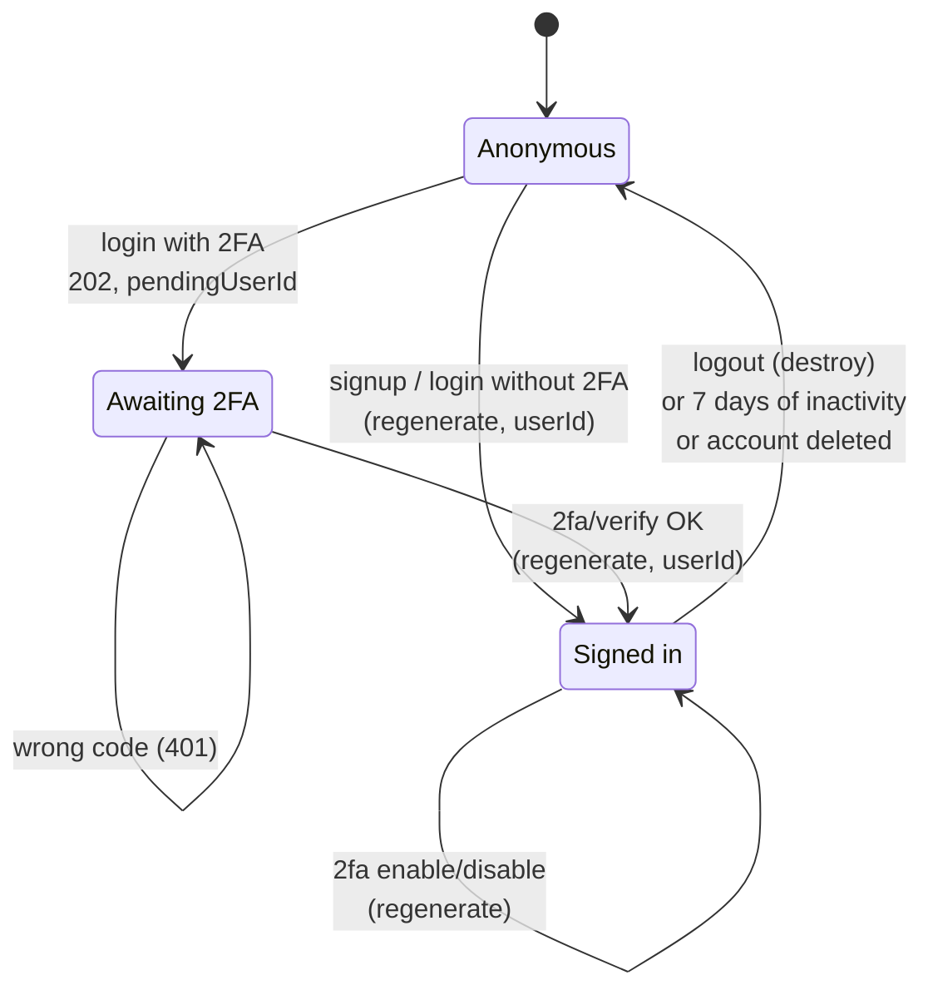

# 08 · Authentication and security (Module 07)

## 1. What you need to understand

- **Authentication**: "who are you?" (proving your identity: password, 2FA code).
- **Authorization**: "are you allowed?" (to access this route, this data).
- Two main ways to keep a user signed in:
  - **server-side session**: the browser keeps a cookie containing an **opaque
    identifier**; the session data lives on the server;
  - **token (JWT)**: the browser keeps a signed token that itself contains the identity.

**We use server-side sessions, not JWTs.** [CONFIRMED: `express-session`
+ `connect-redis` in `app.setup.ts`; no JWT dependency in `apps/api/package.json`]
There is no OAuth either ("Explicitly out", `docs/PRODUCT_ARCHITECTURE.md` §2). [NOT PRESENT]

## 2. How it works in Transcendence

### The cookie and the session

```ts
// apps/api/src/app.setup.ts (excerpt)
session({
  name: 'ft.sid',
  secret: requireSessionSecret(),           // ≥ 32 characters, otherwise the API refuses to start
  store: new RedisStore({ client, prefix: 'sess:' }),
  resave: false,
  saveUninitialized: false,                  // an anonymous visitor does NOT get a session
  rolling: true,                             // every request resets the expiry
  cookie: {
    httpOnly: true,                          // unreadable from JavaScript (protects against theft via XSS)
    secure: process.env.NODE_ENV === 'production',
    sameSite: 'lax',                         // not sent on POSTs coming from another site
    maxAge: 7 * 24 * 60 * 60 * 1000,         // 7 days of inactivity
    path: '/',
  },
});
```

What a session contains (`apps/api/src/auth/session.d.ts`): `userId` (complete
sign-in) **or** `pendingUserId` (correct password, 2FA pending). Two different keys
so that a half-finished sign-in can **never** satisfy the guard.

### Sign-up: `POST /api/auth/signup` (public, 10/min/IP)

1. `SignUpDto` = `CreateUserSchema`: valid e-mail; username of 3–32 characters (letters,
   digits, `._-`); password of **12 to 128** characters with a lowercase letter, an uppercase letter and a digit.
2. `AuthService.signUp`: `argon2.hash` (argon2id, 19 MiB, 2 passes, parallelism 1:
   OWASP recommendation), e-mail lowercased, `prisma.user.create`.
3. Duplicate e-mail or username → `P2002` → `409 auth.identityTaken`.
4. `startSession`: **regenerates** the session id (anti-fixation), sets `userId`.
5. Response `201 SessionUser` (never the hash).

### Sign-in: `POST /api/auth/login` (public, 5/min/IP)

1. `validateCredentials`: looks up the e-mail.
   - Unknown → **still verifies a dummy hash** (`DUMMY_HASH`) so that the response
     time is the same → `401 auth.invalidCredentials`.
   - Wrong password → the **same** code. We do not reveal whether the account exists.
2. If `totpEnabledAt` is set: session regenerated with `pendingUserId`, response
   **`202 { twoFactorRequired: true }`** with no user.
3. Otherwise: session regenerated with `userId`, `200 SessionUser`.
4. In both cases, the sockets of the **old** session are closed (`closeSession`).

### 2FA (TOTP): `apps/api/src/auth/two-factor.service.ts`

| Step | Route | What happens |
|---|---|---|
| Prepare | `POST /auth/2fa/setup` | random 20-byte secret (base32) written, **`totpEnabledAt = null`**; returns the `otpauth://` URI and a QR code as a data URL |
| Enable | `POST /auth/2fa/enable` (5/min/IP) | checks a code (SHA1, 6 digits, 30 s, window ±1); sets `totpEnabledAt`; generates **10 recovery codes** (4 groups of 5 characters with no ambiguous characters), stored as **SHA-256**; returned **only once**; session regenerated |
| Sign in | `POST /auth/2fa/verify` (5/min/IP) | reads `pendingUserId`; accepts a TOTP code **or** a recovery code |
| Disable | `DELETE /auth/2fa` (5/min/IP) | **asks for the password again**; erases secret and codes; session regenerated |

A recovery code is consumed atomically:

```ts
// updateMany with usedAt: null in the where → two simultaneous sign-ins
// cannot spend the same code.
const { count } = await prisma.recoveryCode.updateMany({
  where: { userId, codeHash: digest(code), usedAt: null },
  data: { usedAt: new Date() },
});
return count > 0;
```

Why SHA-256 and not argon2 for these codes: they are **random** (about 98 bits
of entropy), so there is nothing to "guess"; a simple hash allows an indexed lookup instead
of 10 argon2 verifications. (The schema comment mentions "160 bits"; the calculation
over 20 characters from a 31-character alphabet gives ≈ 99 bits. Both are far above a
password.) [CONFIRMED for the alphabet and the length; INFERRED for the calculation]

### Sign-out: `POST /api/auth/logout` (public)

`session.destroy` (deletes `sess:<id>` in Redis; **fails loudly** if Redis does not
respond, rather than lying), then the sockets of this session are closed, then
`clearCookie('ft.sid')`. Public so that signing out with an expired session is not
a `401`.

### Route protection and authorization

- **Global `AuthGuard`** (`apps/api/src/auth/auth.guard.ts`): everything is private except `@Public()`.
  It **reloads the user from the database on every request**: a deleted account loses access
  immediately, not at expiry.
- **Authorization by construction**: "my" routes use `@CurrentUser()` and
  never an id coming from the client (`PATCH /users/me`, `/courses/:lang` = *my* courses). It
  is therefore impossible to modify someone else's course.
- **No roles enforced**: `Role.ADMIN` exists but no route checks it. [CONFIRMED]
- **Web side**: `requireUser()` redirects to `/login`; this is a convenience, the real
  barrier is the API.

### WebSocket protection

Same cookie, same session middleware (`SessionIoAdapter`), plus: **check of the
`Origin` header** (same host), session with `userId`, existing account, at most 20
sockets per session, 20 events / 10 s per socket, frames of 16 KiB max. Details in
[module 10](10-REALTIME-AND-COMMUNICATION.md).

### Input validation and other defenses

| Threat | Defense in our code |
|---|---|
| Invalid input | Zod on **all** bodies and parameters (`CodeValidationPipe`, `LangParam`, `UserIdParam`), **and** in the browser |
| Password stolen from the database | salted argon2id (the salt is included in the argon2 hash) |
| Brute force | Per-IP throttler (5/min login, 2FA); costly argon2 |
| Account enumeration | Same message + dummy hash for an unknown e-mail |
| Session fixation | `session.regenerate` on every privilege change |
| Cookie theft via XSS | `httpOnly` |
| CSRF | `SameSite=Lax` (cookie not sent on a POST from another site) [INFERRED: no dedicated CSRF protection] |
| Fake avatar files | MIME type limited to png/jpeg/webp **and** check of the **magic bytes**; 2 MiB max; random name (`randomUUID`) |
| Field leaks | explicit `select`s; `SessionUserSchema` and `.strict()` on placement questions (an extra `answer` field makes the response **fail**) |
| Leak of a lesson's answers | the server only sends the current page, without the keys, and masks the ids with HMAC (module 09) |
| Spoofed IP | `trust proxy = 1` |
| Clickjacking, sniffing | Caddy headers: `X-Frame-Options DENY`, `X-Content-Type-Options nosniff`, `Referrer-Policy`, `Permissions-Policy`, `-Server` |
| Network eavesdropping | HTTPS everywhere from the outside (Caddy, internal CA locally, Let's Encrypt in prod) [INFERRED for prod: `Caddyfile.prod`] |
| Secrets in Git | `.env` ignored, `.env.example` committed; gitleaks and `.env.example` drift check in CI |

**No Content-Security-Policy** today (`docs/ARCHITECTURE.md` §4). [CONFIRMED]

### Handling authentication errors

| Situation | Status | Code |
|---|---|---|
| No session / deleted account | 401 | `auth.sessionRequired` |
| Wrong credentials | 401 | `auth.invalidCredentials` |
| `/2fa/verify` without a prior password | 401 | `auth.passwordFirst` |
| Wrong TOTP code | 401 | `twoFactor.invalidCode` |
| Enable without preparing | 400 | `twoFactor.setupFirst` |
| E-mail or username taken | 409 | `auth.identityTaken` |
| Too many requests | 429 | `server.rateLimited` |

On the web side, `lib/api.ts` turns a 401 into `{ status: 'signed-out' }` and the pages
redirect to `/login`.

## 3. Concrete example: a sign-in with 2FA

See the sequence diagram in [diagrams/AUTHENTICATION-FLOW.md](diagrams/AUTHENTICATION-FLOW.md).
Lina signs in: `POST /login` → `202` (session `pendingUserId`) → the form shows
the code field → `POST /2fa/verify { code: "492817" }` → `200 SessionUser`, new session
id with `userId` → redirect to `/learn`.

## 4. Files to know

- `apps/api/src/app.setup.ts` (session, cookie, trust proxy)
- `apps/api/src/auth/auth.controller.ts`, `auth.service.ts`, `two-factor.service.ts`
- `apps/api/src/auth/auth.guard.ts`, `auth.decorators.ts`, `session.d.ts`
- `apps/api/src/throttler/identity-throttler.guard.ts`, `throttle-by-ip.decorator.ts`
- `packages/shared/src/schemas/user.ts`, `two-factor.ts`
- `apps/web/app/[locale]/(main)/login/login-form.tsx`, `settings/2fa/two-factor-panel.tsx`
- `infra/caddy/Caddyfile` (headers)

## 5. Diagram



## 6. Key takeaways

1. **Server sessions in Redis**, cookie `ft.sid` `httpOnly` `SameSite=Lax`, 7 sliding days. **No JWT, no OAuth.**
2. **argon2id** for passwords, **SHA-256** for the random recovery codes.
3. **Session regeneration** on every privilege change.
4. **Private by default** (global `AuthGuard`), user **reloaded on every request**.
5. **Same error message** and constant time so as not to reveal accounts.
6. **Per-IP throttler** on login, 2FA, signup.
7. **Complete 2FA**: TOTP + QR + 10 single-use recovery codes; disabling requires the password.
8. **Double** validation (browser + API) with the **same** Zod schema.

## 7. Possible oral questions

1. Why sessions and not JWTs?
2. How are passwords stored?
3. What happens if someone steals the cookie?
4. How do you prevent session fixation?
5. If a user loses their phone, how do they sign in?
6. How do you protect the form against CSRF?

## 8. Expected answers

1. "With a server session, we can **revoke** immediately: sign-out, deleted
   account, 2FA change. A JWT stays valid until it expires. Since everything is
   on the same origin, an `httpOnly` cookie is the simplest and safest solution."
2. "Hashed with argon2id, which includes a random salt, with the parameters recommended by
   OWASP. The hash appears in no shared schema, so never in a response."
3. "It cannot be read by JavaScript (`httpOnly`), it only travels over HTTPS in
   production (`secure`). If it is stolen anyway, it is valid for at most 7 days without
   activity, and a sign-out or a 2FA change makes it useless. Disabling 2FA
   asks for the password again."
4. "We call `session.regenerate` at sign-up, at sign-in, at the 2FA step, and when
   enabling and disabling 2FA. An id planted before sign-in is useless afterwards."
5. "With one of the 10 recovery codes shown only once at activation. Each code
   can only be used once, which is guaranteed by an atomic update in the database."
6. "The cookie is `SameSite=Lax`: the browser does not send it with a POST coming from
   another site. And our routes expect JSON, which an HTML form from another site
   cannot send with the right type. We have no dedicated CSRF token."

## 9. Mini-exercise

Open `apps/api/src/auth/auth.controller.ts`. For each of the 9 routes, note whether it is
`@Public()`, its rate limit, and whether it regenerates the session.

## 10. Self-assessment

1. What HTTP status does a correct login return for an account with 2FA?
2. Where is the session stored, under which key?
3. Why are `pendingUserId` and `userId` two separate keys?
4. What does the avatar upload check in addition to the MIME type?
5. Why does an unknown e-mail still trigger an argon2 computation?

### Answers

1. `202 Accepted` with `{ twoFactorRequired: true }`.
2. In Redis, `sess:<sessionID>`.
3. So that a half-finished sign-in can never pass the `AuthGuard`, which only reads `userId`.
4. The first bytes of the file (PNG, JPEG or RIFF/WEBP signature); otherwise the file is deleted and `400 avatar.invalidFile`.
5. So that the response time is identical and does not reveal whether the e-mail is registered.

Mini-exercise (answer): signup (public, 10/IP, regenerates), login (public, 5/IP, regenerates),
2fa/verify (public, 5/IP, regenerates), GET 2fa (private, 100/account, no), 2fa/setup (private, no),
2fa/enable (private, 5/IP, regenerates), DELETE 2fa (private, 5/IP, regenerates), logout (public, destroys),
me (private, no).
