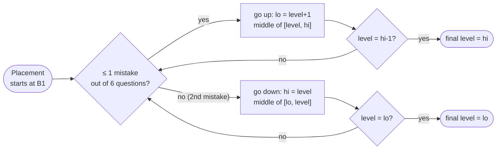

# 09 · The business features (Module 08)

## 1. What you need to understand

A business feature is what the application **does for the user**. For
each one, we follow the same grid: goal, how it works, frontend, backend, data,
interactions, files. Our project's business rules are almost all
**on the server side** and often **pure** (testable without a database): `roadmap.rules.ts`,
`gamification.rules.ts`, and the lesson engine in `@ft/shared/lessons/player`.

## 2. How it works in Transcendence

Overview of the features and their state:

| # | Feature | State |
|---|---|---|
| F1 | Account, profile, avatar, preferences | Done [CONFIRMED] |
| F2 | Onboarding: create a course (language + goal) | Done [CONFIRMED] |
| F3 | Adaptive placement test | Done [CONFIRMED] |
| F4 | Restocking the question bank with the LLM | Done, fixture by default [CONFIRMED] |
| F5 | The daily plan, daily goal, streak | Done [CONFIRMED] |
| F6 | Playing a lesson (server-side attempt, timed exam, score) | Server: 4 types; browser: **grammar only** [CONFIRMED] |
| F7 | Gamification: XP, ranks, daily challenge, 16 achievements | Server done; **not displayed** in the web app (except the streak) [CONFIRMED] |
| F8 | Searching/filtering a level's lessons | API done; **no web page** [CONFIRMED] |
| F9 | Changing level, level completed | Done [CONFIRMED] |
| F10 | Friends, user search, public profiles, "recently active" | Done [CONFIRMED] |
| F11 | Online presence | Done (module 10) [CONFIRMED] |
| F12 | Internationalization en/fr/de | Done [CONFIRMED] |
| F13 | Legal pages | Done [CONFIRMED] |
| F14 | Chat | Mockup with no logic [NOT PRESENT] |
| F15 | Content authoring (offline, Claude Code) | Tool done, 216/3,990 lessons written [CONFIRMED] |
| F16 | Demo learners | Done, dev only [CONFIRMED] |

---

### F1 · Account and profile

1. **Goal**: have an identity, a display name, an avatar, an interface language, a time zone.
2. **How it works**: `PATCH /api/users/me` accepts `displayName`, `locale`, `timeZone`
   (at least one field, otherwise `profile.noChanges`). The e-mail and the role **cannot be
   modified** (that would be a privilege change). The avatar: `POST /api/users/me/avatar`
   (multipart, png/jpeg/webp, 2 MiB, magic bytes checked), served under
   `/api/uploads/avatars/<uuid>.<ext>` from the `avatars-data` volume; `DELETE` goes back to
   the default avatar. The time zone is synchronized automatically: `TimeZoneSync` compares
   `Intl.DateTimeFormat().resolvedOptions().timeZone` with the saved one and sends the PATCH.
3. **Frontend**: `profile/page.tsx`, `profile/edit/profile-form.tsx`, `components/avatar.tsx`, `components/time-zone-sync.tsx`.
4. **Backend**: `users.controller.ts`, `users.service.ts`.
5. **Data**: `User.displayName`, `avatarUrl`, `locale`, `timeZone`.
6. **Interactions**: the time zone determines "today" for the goal and the streak (F5).
7. **Files**: those above + `packages/shared/src/schemas/user.ts` (`UpdateProfileSchema`, `MAX_AVATAR_BYTES`).

### F2 · Onboarding: creating a course

1. **Goal**: choose the language being learned and the daily goal.
2. **How it works**: `resolveOnboardingStep` (`apps/web/lib/onboarding.ts`) decides which
   screen to show: choose a course, or choose a level for a course without a level. The level
   is chosen **either** through the placement, **or** directly (`PATCH /courses/:lang/level`).
   `POST /api/courses { lang, dailyGoal }` creates a `UserLevel` with `level = null`.
3. **Frontend**: `onboarding/page.tsx`, `choose-course.tsx`, `choose-level.tsx`, `lib/courses-client.ts`.
4. **Backend**: `courses.controller.ts`, `courses.service.ts` (`createCourse`, `setLevel`).
5. **Data**: `UserLevel`; `User.activeLang` (last course used).
6. **Interactions**: without a level, `today` responds `409 course.notPlaced` and the page redirects to onboarding.
7. **Files**: those above.

### F3 · The adaptive placement test

1. **Goal**: find the CEFR level in a few questions.
2. **How it works** (`apps/api/src/placement/`): it is a **binary search**
   over the 6 levels (indices 0 to 5).
   - Start: `level = B1` (index 2), `lo = 0`, `hi = 5`.
   - At each level, at most **6 questions** (2 per category: vocabulary, grammar,
     reading; `PLACEMENT_ROUNDS = { perCategory: 2, maxMistakes: 1 }`).
   - More than **one** mistake at that level → we **go down**: `hi = level`, new level in the middle of `[lo, level]`.
   - 6 questions with at most one mistake → we **go up**: `lo = level + 1`, middle of `[level, hi]`.
   - It ends when we go up from `hi - 1` (→ `hi`) or go down from `lo` (→ `lo`).
   - Each question has a **time limit** (`timeLimitS`) + 2 s of network tolerance;
     beyond that, an empty answer counted as wrong.
   - The test state is in **Redis** (hash `user:<id>:eval` + list `user:<id>:eval_questions`, expiring after 1 h) with a
     **lock** `user:<id>:eval_lock` (`SET NX`, 5 s) (released by a Lua script that checks the token): two
     tabs cannot answer at the same time.
   - The result (`targetLevel` + question-by-question report) is **applied** to the course
     (`CoursesService.setLevel`) if at least one answer was given.
   - The question sent to the browser **does not have** the `answer` field; its options are
     **shuffled** (the bank often puts the right answer first).
3. **Frontend**: `learn/[lang]/placement/` (`placement-exam.tsx`, `start-screen.tsx`, `question-screen.tsx`, `result-screen.tsx`), `lib/placement-client.ts`.
4. **Backend**: `placement.service.ts` (orchestration), `placement-progress.service.ts`
   (rules for going up/down), `placement-question.service.ts` (drawing),
   `placement-session.service.ts` (Redis).
5. **Data**: `QuestionBank`, `UserSeenQuestion` (Postgres); session and lock (Redis).
6. **Interactions**: sets `UserLevel.level` (F5 becomes possible); triggers F4; emits `course:updated`.
7. **Files**: those above + `packages/shared/src/schemas/placement.ts`.

### F4 · Restocking the question bank (the LLM)

1. **Goal**: never run out of placement questions.
2. **How it works**: at each draw, for each category, if **3 unseen questions or
   fewer** remain (`RESTOCK_AT = 3`), `QuestionStockService.restock` launches a generation **without
   waiting** (`void`): prompt (`prompts/question-batch.prompt.ts`) →
   `llm.generateStructured({ schema: generatedBatchSchema(category) })` → duplicates are
   discarded → `createMany`. Only one generation at a time per cell
   (`language:level:category`); after a failure or a batch with nothing new, the cell
   "cools down" for 10 min. A "retryable" failure is retried once.
   `GeminiProvider` calls the Gemini REST API, asking for a JSON response that conforms to the
   Zod schema (`responseMimeType: 'application/json'`, `responseJsonSchema`), with a timeout.
3. **Frontend**: none (invisible to the learner).
4. **Backend**: `question-generation/`, `llm/` (`llm.provider.ts`, `llm.factory.ts`, `gemini.provider.ts`, `fixture.provider.ts`).
5. **Data**: `QuestionBank` (generated rows: `sourceId = null`). **Written** questions
   are served in priority over generated ones.
6. **Interactions**: called by F3; metrics `ft_question_restocks_total`, alert `QuestionRestocksFailing`.
7. **Files**: `apps/api/src/question-generation/QUESTION_GENERATION.md`, `apps/api/src/llm/GEMINI_PROVIDER.md`.

### F5 · The daily plan, the goal and the streak

1. **Goal**: offer exactly the right number of lessons each day and reward consistency.
2. **How it works** (`apps/api/src/lessons/roadmap.rules.ts`):
   - **target** = `dailyGoal / 10` (10 min → 1 lesson, 30 → 3, 60 → 6);
   - **"today"** = the date in the **user's time zone**, but never before
     the last day already recorded (`courseDay`): traveling west does not let you
     relive a day;
   - **queue** (`queue`): first the **unpassed** lessons in syllabus
     order, then the passed ones, from the one done longest ago to the most recent;
     only `ready` lessons;
   - **plan**: `done` (finished today), `proposed` (target − done), `extra` (3 more);
   - **goal met** when `done ≥ target`; then `metOn` advances the streak
     (continues if yesterday was met, otherwise restarts at 1), `bestStreak` = max;
   - a lesson is **passed** (`done`) from **70/100** (`LESSON_PASS_MARK`);
   - a level is **completed** when all its ready lessons have been attempted and **80 %**
     passed (`LEVEL_PASS_SHARE`); `levelAfter` proposes the next one.
   - Every write (end of lesson, lowered goal) goes through `lockCourse` (`FOR UPDATE`).
3. **Frontend**: `learn/[lang]/page.tsx`, `today.tsx` (`TodayCard`, `StreakLine`, `MoreLessons`, `LevelComplete`), `goal-picker.tsx`.
4. **Backend**: `lessons.controller.ts` (`today`), `lessons.service.ts`, `goal.ts`, `roadmap.rules.ts`.
5. **Data**: `UserLevel` (`dailyGoal`, `streak`, `bestStreak`, `lastGoalDay`), `LessonResult`.
6. **Interactions**: fed by F6, rewarded by F7.
7. **Files**: those above; tests `roadmap.rules.spec.ts` (661 lines).

### F6 · Playing a lesson (the attempt engine)

This is the most original feature of the project. **The browser never sees the
answers, never grades, and does not control the timer.**

1. **Goal**: learn (presentation and practice pages corrected right
   away), then be assessed (timed exam), with a reliable score.
2. **How it works**:
   - A lesson (`brief` + `content` JSON) is turned into a **plan** (`buildPlan`): a
     sequence of **pages** (`presentation`, `practice`, `discussion`, `examIntro`, `exam`),
     each page containing **units** (a unit = one answer graded 0, 0.5 or 1).
     The plan contains **all the keys** and is **never stored or sent**: it is
     rebuilt on each request.
   - `POST …/attempt { locale }`: creates the attempt (`201`) or resumes the one in progress
     (`200`); after the results, it is a **retake** (the old one is deleted).
     The "native language" (instructions) is fixed at the start.
   - The server only sends **the page at the cursor**, without the keys (`redact.ts`); each
     unit/option/token is named by a **ref** = `HMAC-SHA256(attempt secret, path)`
     truncated to 16 characters (`attempt-ref.ts`). Shuffled lists are **sorted by
     ref**: a new attempt = a new order, and the order gives nothing away.
   - `POST …/attempt/pages/:index { attemptId, answers }`: only **the page at the cursor**
     is accepted, **only once** (otherwise `409 attempt.stale`). The units are graded and
     **locked**; the cursor moves forward (**forward only**).
   - When entering an exam page, the server sets a **deadline**; a page received
     after deadline + 2 s counts all its units as empty ("out of time").
   - The last page **closes** the attempt: `results` (results sheet), score =
     **35 % practice + 65 % exam** (`POLICY` in `score.ts`), an answer that is one
     mistake off (spelling) is worth 0.5. Then `applyFinish` (F5 + F7) in **the same
     transaction**, and `course:updated` after the commit.
   - The browser keeps drafts in `localStorage` to survive a reload.
3. **Frontend**: `lessons/[id]/page.tsx` (lesson sheet + start/resume button), `lesson-actions.tsx`,
   `play/page.tsx` + `play/player.tsx` + `exam-timer.tsx`, `results/page.tsx`,
   `components/lesson/*`, `lib/lesson-client.ts`. Renderers: **grammar only** (`kinds/index.ts`).
4. **Backend**: `attempts.controller.ts`, `attempts.service.ts`, `attempt-ref.ts`, `lessons.service.ts` (`applyFinish`).
5. **Data**: `Lesson.brief/content`, `LessonAttempt` (`secret`, `page`, `deadline`, `answers`, `results`), `LessonResult`.
6. **Interactions**: F5 (goal, streak), F7 (XP, achievements), F11 (refresh of the other tabs).
7. **Files**: `packages/shared/src/lessons/player/` (`plan.ts`, `attempt.ts`, `score.ts`, `redact.ts`, `view.ts`, `feedback.ts`), `docs/LESSONS.md` §10.

### F7 · Gamification

1. **Goal**: motivate (the subject's "Gamification" sub-module: at least 3 elements among achievements, badges, leaderboards, XP, daily challenges, rewards).
2. **How it works** (`gamification.rules.ts`, `gamification.ts`, constants in `@ft/shared/schemas/gamification.ts`):
   - **XP**: `LESSON_XP = 10` per lesson counted today + the **improvement** of the best
     score (`max(0, score − old)`); `GOAL_XP = 20` when the goal is met;
     `CHALLENGE_XP = 30` for the daily challenge.
   - **Ranks**: going from rank n to n+1 costs `100 × n` XP → thresholds 0, 100, 300, 600… (`rankOf`).
   - **Daily challenge**: one among `grammar`, `vocabulary`, `functions`, `reading`, `score90`,
     `beyondGoal`, chosen **deterministically** by a hash (FNV-1a + mixing) of
     `(course, day)`, only among the types that have ready lessons.
   - **16 achievements**: first lesson, 10/25/50 passed, streaks 3/7/30/100, 10/50 challenges, one per level A1…C2.
3. **Frontend**: only the **streak** is displayed (`StreakLine`). The API returns `xp`,
   `challenge`, `earnedToday` in `today` and `GET /achievements`, but **no interface
   string** displays them. [CONFIRMED]
4. **Backend**: `award()` in the transaction for finishing a lesson or changing the goal.
5. **Data**: `UserLevel.xp`, `lastChallengeDay`, `lastChallengeCode`, `challengesDone`; `UserAchievement`.
6. **Interactions**: F5, F6.
7. **Files**: `apps/api/src/lessons/gamification*.ts`, `apps/api/test/gamification.e2e-spec.ts`.

### F8 · Searching a level's lessons

`GET /api/courses/:lang/lessons` with `status`, `kind`, `topic`, `theme`, text (`q`,
accent-insensitive thanks to `foldText`), sorting (`position`, `score`, `finishedAt`),
grouping (`none`, `status`, `day`, `kind`) and pages of 20, **in memory** (a level has at
most ~320 lessons): `apps/api/src/lessons/lesson-search.ts`. **No web page**: the
"see all" link leads to the 404. [CONFIRMED]

### F9 · Changing level

`PATCH /api/courses/:lang/level` (direct choice, `DirectLevelPicker`) or placement
result; `LevelComplete` is displayed when the level is completed and proposes
`levelAfter(level)`. The results are **not filtered by level**: a lesson from a previous
level done this morning stays in "done today".

### F10 · Friends and public profiles

1. **Goal**: the social part of the "user management" module.
2. **How it works**: a single `Friendship` row per pair (`pairKey`). Sending to
   someone who has already sent me a request = **accepting**. Declining, cancelling and removing **delete**
   the row. Each action notifies **both** users (`friend:request`,
   `friend:accepted`, `friend:removed`). `GET /friends` returns `friends` (with `online`),
   `received`, `sent`. Search by display name (`ILIKE`, `_` and `%` escaped). Public profile
   `GET /users/:id` (display name, avatar, courses). "Recently active": users whose
   `lastActiveDay` is less than 7 days old.
3. **Frontend**: `friends/page.tsx`, `friend-search.tsx`, `components/friend-buttons.tsx`, `users/[id]/page.tsx`, `components/presence-dot.tsx`.
4. **Backend**: `friends/*`, `users/users.service.ts`.
5. **Data**: `Friendship`, `User.lastActiveDay`.
6. **Interactions**: F11 (presence restricted to accepted friends).
7. **Files**: those above + `packages/shared/src/schemas/friend.ts`.

### F12 · Internationalization

3 catalogs of **475 lines** each (`apps/web/messages/{en,fr,de}.json`), switcher
(`components/language-switcher.tsx`), mandatory URL prefix, errors translated by
code. A test checks that the catalogs have the same keys (`lib/messages.test.ts`). The API
is **language-neutral**: no route takes a locale, a lesson is written in the
course language.

### F13 · Legal pages

`/privacy` and `/terms` (real content in 3 languages in `apps/web/lib/legal-content/`),
linked in the footer of all layouts; tested by `e2e/tests/legal.spec.ts`
(a **rejection** criterion of the subject if absent).

### F15 · The content authoring pipeline

Outside production. `pnpm --filter @ft/api lessons:author fr a1`: Claude Code writes a
lesson from the syllabus, `complete` + `validateLesson` check it, the problems are
sent back in the same conversation (several attempts), then the file is written to
`content/`. The seed only marks valid lessons as `ready`. See `docs/LESSONS.md` and
`.claude/skills/author-lessons/SKILL.md`.

## 3. Concrete example

See the complete journeys in [module 12](12-END-TO-END-FLOWS.md): sign-up → placement → lesson → streak.

## 4. Files to know

- `apps/api/src/lessons/roadmap.rules.ts`, `gamification.rules.ts`, `goal.ts`, `lessons.service.ts`, `attempts.service.ts`
- `apps/api/src/placement/placement-progress.service.ts`
- `packages/shared/src/lessons/player/attempt.ts`, `score.ts`, `redact.ts`
- `docs/PRODUCT_ARCHITECTURE.md` §1, `docs/LESSONS.md` §10

## 5. Diagram

See [diagrams/MAIN-FEATURE-FLOWS.md](diagrams/MAIN-FEATURE-FLOWS.md).

## 6. Key takeaways

1. Placement = **binary search** starting from **B1**, 6 questions max per level, 1 mistake tolerated.
2. The LLM is only used to **restock** the bank, in the background, with a cooldown.
3. **Daily target** = goal / 10 min; **pass** = 70; **level completed** = everything attempted + 80 % passed.
4. The **day** is the one in the learner's time zone, never going backwards.
5. The **server** owns the lesson: page at the cursor, HMAC refs, timer, 35/65 score.
6. XP, ranks, challenge, achievements **computed** but **not displayed** (except the streak).
7. Friends: **one row per pair**, notifications to both.
8. Honest state: only grammar playable, no search page, no chat.

## 7. Possible oral questions

1. How does the placement test work?
2. How do you prevent cheating in the lessons?
3. How do you compute the score?
4. How is "today" determined for the streak?
5. How is the daily challenge chosen?
6. What happens if two people send each other a friend request at the same time?

## 8. Expected answers

1. "It is a binary search over the six levels. We start at B1. At each
   level we ask up to two questions per category; at the second mistake we go down,
   after six questions with at most one mistake we go up, halfway through the remaining
   interval. The state is in Redis with a lock, and the correct answer never leaves the server."
2. "The browser only receives the current page, without the answers; the identifiers are
   HMACs specific to the attempt, and the order of the options depends on them. A page can only be
   submitted once, in order. The exam timer is on the server. There is
   no route that accepts a score."
3. "Each unit is worth 0, 0.5 (spelling mistake) or 1. Score = 35 % of the success in
   practice + 65 % in the exam. We keep the best score per lesson; 70 and above = passed."
4. "It is the date in the user's time zone, synchronized from the
   browser, but never earlier than the last day already recorded, so that traveling
   west does not let you redo a day."
5. "By a deterministic hash of the course id and the day, among the possible challenges (we
   exclude a type with no ready lesson). Same day, same course: same challenge, without storing anything in advance."
6. "Both requests have the same `pairKey`. The first one creates the row; the second
   fails on the primary key (`P2002`), rereads the row, sees a request from the other person and accepts it."

## 9. Mini-exercise

With `RANK_STEP = 100`, what rank is a learner with 650 XP at? Compute
`rankOf(650)` with the formula from `gamification.rules.ts`.

## 10. Self-assessment

1. How many lessons do we offer with a 60-minute goal?
2. What are the conditions for a level to be completed?
3. What does a "ref" contain, and why?
4. When is the LLM called?
5. What share of the score comes from the exam?

### Answers

1. 6 (60 / 10), plus 3 "extra" lessons.
2. All the ready lessons of the level attempted and at least 80 % (rounded up) passed (≥ 70).
3. 16 base64url characters of an HMAC-SHA256 of the internal path, with the attempt's secret; so that the browser knows neither the ids nor an order that would give away the answer.
4. When a cell (language, level, category) has only 3 unseen questions or fewer left for the learner, in the background, unless a generation is in progress or cooling down.
5. 65 %.

Mini-exercise: `rank = floor((1 + √(1 + 8·650/100)) / 2) = floor((1 + √53) / 2) = floor(4.14) = 4`;
thresholds: rank 4 starts at 600, rank 5 at 1,000.
