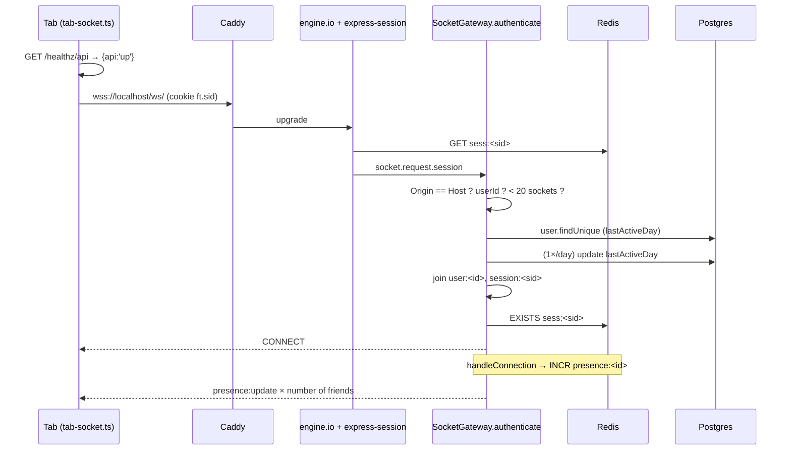
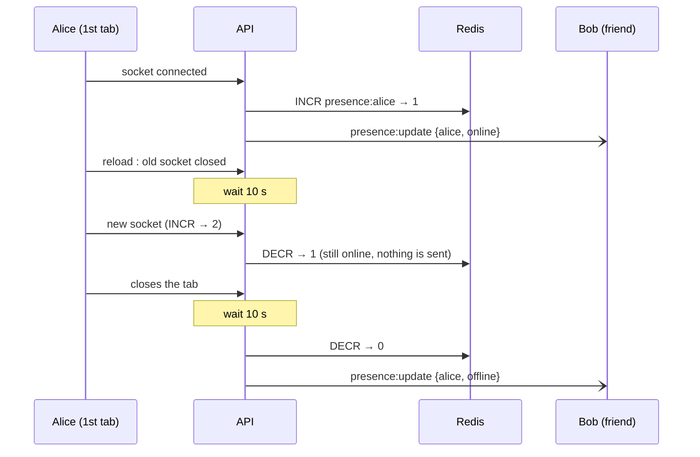

# 10 · Communication and real time (Module 09)

## 1. What you need to understand

In classic HTTP, **the client asks, the server answers**. The server cannot
tell a browser that some data has changed. A **WebSocket** is a connection that
stays open and over which **the server can send** whenever it wants.

**Socket.IO** adds to WebSocket: **named events** (`socket.emit('name', data)`),
**rooms** (groups of sockets to send to all at once), middlewares and reconnection
handling.

In our project: **REST for everything CRUD, Socket.IO to push changes**
(`docs/PRODUCT_ARCHITECTURE.md` §3). And a key point: today the socket is
**one-way**, server → client. `CLIENT_EVENTS = {}`: the client sends no
events. [CONFIRMED `packages/shared/src/events/socket.ts`]

## 2. How it works in Transcendence

### Why it is needed

The subject (major module "Real-time features") asks for **updates between
clients**, **clean handling of disconnections/reconnections** and **efficient
broadcasting**. Our real cases:

| Event | Payload | Sent to | Trigger |
|---|---|---|---|
| `course:updated` | `{ lang }` | the user (all their tabs) | goal or level changed, lesson finished, placement applied |
| `friend:request` | `{ userId }` (the other one) | **both** users | request sent |
| `friend:accepted` | `{ userId }` | both | request accepted |
| `friend:removed` | `{ userId }` | both | refusal, cancellation, removal |
| `presence:update` | `{ userId, status: 'online'|'offline', at }` | the **accepted friends** | 1st socket opened / 10 s after the last one closed |
| `app:error` | `{ code }` | the offending socket | invalid event or too many events |

### How the connection is created

**Server side** (`apps/api/src/gateway/socket.gateway.ts`):

```ts
@WebSocketGateway({
  path: '/ws',                  // the engine.io URL, routed by Caddy (/ws/* → api)
  serveClient: false,
  transports: ['websocket'],    // no long-polling
  maxHttpBufferSize: 16_384,    // frames of 16 KiB max
})
export class SocketGateway { … }
```

The gateway lives **inside the API**, on the same HTTP server (port 3001). `path` and not
`namespace`: `path` is the HTTP path of the handshake.

**Client side** (`apps/web/components/tab-socket.ts`): **one socket per tab**, as a
module variable, created on demand:

```ts
io({ path: '/ws', transports: ['websocket'], autoConnect: false, reconnection: false,
     closeOnBeforeunload: true });
```

It is opened by `ConnectionStatus` (rendered in `SessionNav` **only for a
signed-in user**) and closed by `LogOutButton`. Because it lives in the module and not
in a component, changing page or language **does not cut it**.

### How users are identified

No token: **the session cookie is the only proof**. engine.io answers `/ws`
before Express, so `SessionIoAdapter` plugs **the same
`express-session` middleware** into it (`server.engine.use(this.session)`). Then the gateway's
`authenticate` middleware refuses, with `auth.sessionRequired`:

1. an `Origin` from another host (`sameOrigin`): the `SameSite=Lax` cookie would be sent by
   a neighboring site on the same domain, same site is not same origin;
2. a session without `userId`;
3. a session that already has **20 sockets** (`server.rateLimited`);
4. a deleted account.

Then: it writes `User.lastActiveDay` if it is not today, sets
`socket.data = { userId, sessionId }`, **joins the rooms** `user:<id>` and `session:<sid>`,
then **re-checks that `sess:<sid>` still exists in Redis** (a sign-out during the
handshake must not be missed).

### How events are sent

A single door: `SocketsService.toUser(userId, event, payload)` → `server.to('user:<id>').emit(...)`.
**Never a global broadcast.** Typed by `ServerToClientEvents`: you cannot emit
an unknown event or a wrong payload.

Always **after the commit** of the transaction:

```ts
// apps/api/src/courses/courses.service.ts
const course = await this.prisma.$transaction(async (tx) => { … });
// After the commit: sent from inside the transaction, the other tab could
// read the old row, or a row that then rolls back.
this.sockets.toUser(user.id, SERVER_EVENTS.COURSE_UPDATED, { lang });
```

### How events are received (client side)

- `useServerEvent(event, handler)`: subscribes to an event.
- `RefreshOn events={[…]}`: on each listed event, `router.refresh()` (Next re-reads the
  page on the server). The message only says "re-read", it does not carry the data:
  **no second copy of the state** to synchronize.
- Presence: a `Map` (`lib/presence.ts`) fed by `presence:update`;
  `useFriendOnline(id, rendered)` reads it, and otherwise uses the value rendered by the server.

### How data is synchronized: presence

`apps/api/src/presence/presence.service.ts`:

- **Per-user counter** in Redis: `presence:<id>`, `INCR` when a socket opens,
  `DECR` when it closes. Online from the **first** socket.
- **10 s grace period** before decrementing: a page reload opens the
  new socket before the old one is counted down, so friends do not see a flicker.
- **Friends only**: the update goes to `user:<friend>` for each **accepted** friendship.
- **Snapshot on connection**: the new socket receives one `presence:update` per friend
  (`isOnline` = one `MGET`). `GET /api/friends` also returns `online`.
- **Reset at startup**: `onApplicationBootstrap` clears `presence:*` with
  `SCAN` (never `KEYS`), because no socket survives a restart. A negative counter is reset to 0.
- **Assumption: a single API instance** (the reset would erase the other instances'
  counters, and rooms do not span instances; ticket #158).

### How errors are handled

**Server** (`screen`, applied to every incoming packet): fixed window of **20 events
/ 10 s per socket** (at the 21st: `app:error server.rateLimited`, then silence); unknown
event or invalid payload (Zod via `CLIENT_EVENT_SCHEMAS`) → `app:error request.invalid`,
the packet is dropped; never a crash. Since `CLIENT_EVENTS` is empty, **every** client
event is rejected today.

**Closing with the session**: on sign-out, and on **every** session id change
(signup, login, 2FA), `closeSession(sid)` cuts the sockets of the `session:<sid>` room.
A **sweep every 60 s** closes the sockets whose `sess:<sid>` key has disappeared (expiry).

**Client** (`lib/reconnect.ts`): **manual** reconnection (`reconnection: false`):
- delays of **1, 2, 4, 8 then 10 s**, with ±25% jitter (`backoffMs`);
- **before each attempt**, probes `/healthz/api` (a Next route that always returns 200) and
  only dials if the API responds: a WebSocket failure is a console error that
  cannot be hidden, and the subject requires **zero console errors**;
- refusal `auth.sessionRequired` → `signedOut` state, we stop;
- on reconnection, `RefreshOn` re-reads the page (missed events are lost).

### How the frontend reacts

`ConnectionStatus` shows "Reconnecting…" during `reconnecting`. `RefreshOn` triggers
`router.refresh()`. `PresenceDot` turns green/gray. The `/friends` and `/users/[id]` pages
refresh on friendship events.

### And without real time?

Everything else is **REST**: `fetch` to `/api/...`. The placement test and the lesson
player, even though timed, are over HTTP: the timer is **on the server** (stored
deadline), the client only shows a countdown (`exam-timer.tsx`).

## 3. Concrete example

Lina has `/fr/learn/de` open in two tabs (A and B). In A, she sets the goal to
10 min. The API commits, emits `course:updated { lang: 'de' }` to `user:<lina>`; the sockets
of A and B receive it; in both, `RefreshOn` calls `router.refresh()`; B shows
the new goal without any action from Lina.

## 4. Files to know

- `packages/shared/src/events/socket.ts` (the contract)
- `apps/api/src/gateway/socket.gateway.ts`, `sockets.service.ts`, `session-io.adapter.ts`
- `apps/api/src/presence/presence.service.ts`
- `apps/web/components/tab-socket.ts`, `refresh-on.tsx`, `connection-status.tsx`, `presence-dot.tsx`
- `apps/web/lib/reconnect.ts`, `apps/web/lib/presence.ts`
- `apps/api/test/gateway.e2e-spec.ts`, `e2e/tests/live.spec.ts`

## 5. Diagrams

### Authenticated connection



### Presence



## 6. Key takeaways

1. **Socket.IO on `/ws`**, inside the API, WebSocket transport only.
2. **The session cookie is the only credential**; `Origin` check.
3. **Rooms `user:<id>` and `session:<sid>`**, never a broadcast.
4. Events **after commit**, and they say "re-read" (`router.refresh()`).
5. **Presence** = Redis counter + 10 s grace + accepted friends only.
6. **Sockets closed** on every session change + 60 s sweep.
7. Safeguards: 20 sockets/session, 20 events/10 s, 16 KiB, Zod.
8. **Home-made reconnection** with a prior probe to keep the console clean.
9. **Today, no client → server events**; the chat does not exist.

## 7. Possible oral questions

1. How do you authenticate a WebSocket?
2. How do you send a message to a single user?
3. What happens when the API restarts?
4. Why emit after the commit?
5. How do you avoid a page reload showing the friend as offline?
6. Is your real time bidirectional?

## 8. Expected answers

1. "With the same session cookie as REST: the adapter plugs `express-session`
   into engine.io, then we check the origin, the presence of `userId` and that the account exists.
   Otherwise the connection is refused with `auth.sessionRequired`."
2. "Each socket joins the `user:<id>` room. `SocketsService.toUser` emits to that
   room: all the user's tabs, and nobody else."
3. "The sockets drop. The client probes `/healthz/api` with an increasing delay and only
   redials once the API is back, then refreshes the page because events
   may have been lost. At startup, the API resets the presence counters to zero.
   A Playwright test (`restart.spec.ts`) restarts the API to check this."
4. "Otherwise the other tab could re-read before the commit and see the old value, or a
   value that will be undone by a rollback."
5. "The counter decrement waits 10 seconds; the new socket from the reload
   increments before that, so the counter never drops to zero."
6. "No, today it is server → client. The receiving infrastructure is ready:
   per-event Zod validation, rate limiting, error codes. The chat will use these
   client events."

## 9. Mini-exercise

In `apps/api/src/friends/friends.service.ts`, find the `notify` method. Why
does it send the event **to both** users, and not only to the recipient?

## 10. Self-assessment

1. Which path and which transport does the Socket.IO client use?
2. Which component opens the socket?
3. What does `socket.data` contain?
4. How long before announcing a friend as offline?
5. What does a client that sends an undeclared event receive?

### Answers

1. `path: '/ws'`, `transports: ['websocket']`.
2. `ConnectionStatus` (via `SessionNav`, signed-in user), which calls `connectSocket()`.
3. `{ userId, sessionId }`.
4. 10 s after their **last** socket closes (`PRESENCE_GRACE_MS`).
5. `app:error { code: 'request.invalid' }`, and the event is ignored.

Mini-exercise: so that the **actor's other tabs** follow too (their own
`/friends` open elsewhere updates).
