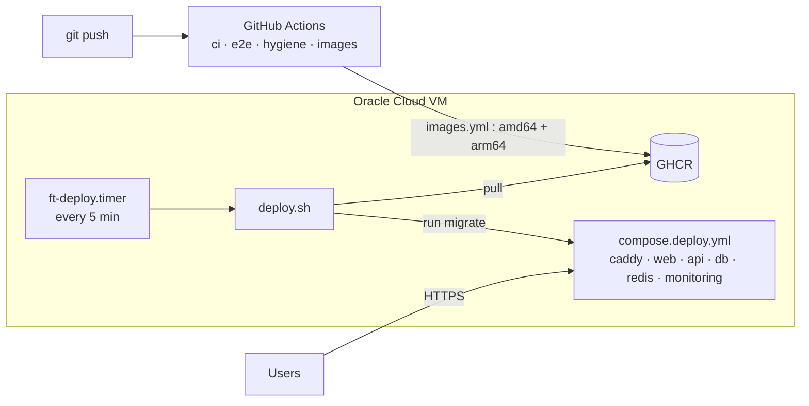

# 11 · Infrastructure and deployment (Module 10)

## 1. What you need to understand

- A **Docker image** is a frozen package (system + dependencies + code). A **container**
  is a running image.
- **Docker Compose** describes several containers (**services**), their **network**, their
  **volumes** (data that outlives the container) and their environment variables.
- A **multi-stage Dockerfile** builds in intermediate stages and keeps only what is
  needed in the final image.

The subject requires: a **containerized** application, launched by **a single command**,
**HTTPS**, secrets in a **non-committed `.env`** with a committed `.env.example`.

## 2. How it works in Transcendence

### The Compose files

| File | When | Role |
|---|---|---|
| `compose.yml` | always | the topology: 12 services, `ft` network, 8 volumes |
| `compose.override.yml` | loaded **automatically** by `docker compose` (dev) | `dev` stage of the images, code mounted, hot reload, db/redis ports on loopback, monitoring behind the `monitoring` profile, `workspace` service (devcontainer) behind the `devcontainer` profile |
| `compose.prod.yml` | `make` (with `-f compose.yml -f compose.prod.yml`) | `prod` stage, `NODE_ENV=production`, `restart: unless-stopped`, `SESSION_SECRET` **mandatory** (`${SESSION_SECRET:?…}`), Grafana passwords mandatory |
| `compose.deploy.yml` (+ `.proxy.yml`) | production server | images pulled from GHCR, `migrate` service, no build |

### The 12 services (`compose.yml`) [CONFIRMED]

| Service | Image | Internal port | Role |
|---|---|---|---|
| `caddy` | `caddy:2.11.4-alpine` | **80, 443 (tcp+udp) published**; 2019 admin, 2020 metrics | HTTPS entry point |
| `web` | build `apps/web/Dockerfile` | 3000 | Next.js |
| `api` | build `apps/api/Dockerfile` | 3001, 9464 (metrics) | NestJS |
| `db` | `pgvector/pgvector:0.8.6-pg18-trixie` | 5432 | PostgreSQL |
| `redis` | `redis:8.10.1-alpine`, `--appendonly yes` | 6379 | persistent Redis (AOF) |
| `prometheus` | build `infra/monitoring/prometheus` | 9090 | metrics collection, 256 MB max |
| `alertmanager` | build | 9093 | sending alerts (Discord webhook) |
| `grafana` | build | 3000 (served under `/grafana`) | dashboards |
| `node-exporter`, `postgres-exporter`, `redis-exporter`, `blackbox-exporter` | official images | 9100, 9187, 9121, 9115 | host, Postgres and Redis metrics, HTTP probes |

Startup order: `api` waits for `db` and `redis` to be **healthy** (`pg_isready`, `redis-cli
ping`); `caddy` waits for `web` and `api` (healthy in prod).

**Network**: a single bridge network `ft`; services reach each other by their **name**
(`http://api:3001`, `db:5432`).

**Volumes**: `pg-data`, `redis-data`, `caddy-data` (including the **internal CA**), `caddy-config`,
`avatars-data`, `prometheus-data`, `alertmanager-data`, `grafana-data`.
In dev, named volumes mask each `node_modules`, `dist`, `.next` and the generated Prisma
client, so that the host and the container do not step on each other.

### The Dockerfiles (`apps/api/Dockerfile`, `apps/web/Dockerfile`)

Same stages for both apps: `base` (`node:24.18-bookworm-slim`, pnpm via corepack)
→ `deps` (`pnpm install --frozen-lockfile`, BuildKit cache) → `dev` / `ci` / `build` →
(`prune` for the API) → **`prod`**: Node only, npm and corepack removed, user
**`node` (non-root)**, **`tini`** as PID 1, **`HEALTHCHECK`**. The API runs
`node dist/main.js`, the web app `node apps/web/server.js` (Next's *standalone* output).

Why **Debian slim and not Alpine**: Prisma and argon2 (native modules) cause
problems on musl/arm64 (`docs/TECHNICAL_PLAN.md` §3).

### Environment variables (`.env.example`, names only)

`NODE_ENV`, `APP_VERSION`, `POSTGRES_USER`, `POSTGRES_PASSWORD`, `POSTGRES_DB`,
`DATABASE_URL`, `REDIS_URL`, `SESSION_SECRET`, `API_INTERNAL_URL`, `HTTP_PORT`,
`HTTPS_PORT`, `POSTGRES_HOST_PORT`, `REDIS_HOST_PORT`, `CADDY_EXTRA_HOSTNAME`,
`LOCAL_WORKSPACE_FOLDER`, `LLM_PROVIDER`, `LLM_API_KEY`, `LLM_MODEL`,
`GRAFANA_ADMIN_PASSWORD`, `GRAFANA_SECRET_KEY`, `DISCORD_WEBHOOK_URL`, `DEMO_PASSWORD`.

`make` creates `.env` from `.env.example` if it is missing and **generates** the two Grafana
secrets (`make env-file`). `scripts/check-env-example.sh` checks in CI that `.env.example`
contains every variable in use.

### The Makefile: the single command

`.DEFAULT_GOAL := all`. So **plain `make`** runs:

```
make = ci → run → monitoring-check → playwright
  ci   : checks (TS version, .env.example, monitoring, app boundaries, prisma format
         and drift), pnpm run ci (format, lint, typecheck, tests + coverage, build),
         prisma migrate deploy, API e2e tests (Supertest)
  run  : up (prod build + startup, wait for "healthy") → db-ready (migrate + seed) → certs
  monitoring-check : every Prometheus target "up", every rule healthy
  playwright : installs Chromium/Firefox/WebKit, runs all browser tests
```

This is deliberately **the evaluator's path**: what `make` runs is exactly what
is tested.

### Commands (read from the `Makefile` and the `README.md`)

Launch the project from scratch:

```bash
cp .env.example .env
```

```bash
make
```

Just start the production stack, without the tests:

```bash
make run
```

Develop with hot reload:

```bash
make dev
```

Add monitoring in dev:

```bash
make monitoring-up
```

Other useful commands: `make down` (stop, volumes kept), `make logs`
(`SERVICES="api web"`), `make ps`, `make shell SERVICE=api`, `make test` (unit
tests), `make test-e2e`, `make migrate`, `make migrate-new NAME=…`, `make seed`,
`make studio` (Prisma Studio on `127.0.0.1:5555`), `make redis-ui` (`127.0.0.1:5540`),
`make reset-db` (**destructive**), `make certs`, `make clean`, `make help`, `make doctor`.

Then:

| URL | What |
|---|---|
| `https://localhost` | the application |
| `https://localhost/api/docs` | Swagger |
| `https://localhost/grafana` | Grafana (`admin`, password in `.env`) |

`make certs` exports Caddy's local CA into `./certs` so that the browser trusts
the certificate. Demo accounts: set `DEMO_PASSWORD` before `make`, then
`demo-anna@example.com` … `demo-felix@example.com` (dev only).

**Verification status**: the commands `pnpm install --frozen-lockfile` and
`pnpm run test` were run successfully while preparing this course
[CONFIRMED]; `make`, `make run`, `make dev` could **not** be run here for lack of a
Docker daemon [UNVERIFIED]. **Run `make` once yourself before the defense.**

### CI (`.github/workflows/`)

| Workflow | Content |
|---|---|
| `ci.yml` | pinned TS, format, lint, typecheck, app boundaries, monitoring config (`promtool`, `amtool`, `caddy validate`), per-app unit tests in the Docker `ci` stage, package tests, Supertest tests against a real Postgres + Redis, build |
| `e2e.yml` | prod images + `compose up`, monitoring check, **Playwright, one job per browser**, "console gate", legal pages, API restart test (Chromium) |
| `hygiene.yml` | gitleaks (secrets), commitlint (commit messages), `.env.example` drift, `prisma migrate diff` |
| `images.yml` | on every push (any branch, `v*` tags): **multi-arch** amd64 + arm64 build on native runners, Trivy scan, push to **GHCR** |

### Deployment (`docs/DEPLOYMENT.md`, `infra/deploy/`)

- An **Oracle Cloud** VM (Ubuntu 24.04) with Docker; three files on the host:
  `compose.deploy.yml`, the `Caddyfile` (`infra/caddy/Caddyfile.prod`, automatic ACME
  certificate for the public domain) and a `.env`.
- A **systemd timer** (`ft-deploy.timer`, every **5 min**) runs `deploy.sh`:
  `docker compose pull` → if all our images carry **the same Git revision** (otherwise
  publishing is in progress, we wait) and they have changed → `run --rm migrate` → `up -d`
  → cleanup. So there is **no push deployment** from CI: the server
  **pulls** the images published by `images.yml`.

### Development vs production

| | Dev (`make dev`) | Prod (`make` / server) |
|---|---|---|
| Image | `dev` stage, code mounted | `prod` stage, nothing mounted |
| Reload | `next dev`, `nest start --watch` | no |
| Ports | 443 + db/redis on `127.0.0.1` | 80/443 only |
| Monitoring | optional (`make monitoring-up`) | always |
| `secure` cookie | no (`NODE_ENV=development`) | yes |
| Demo | possible | never (the seed forbids it outside dev) |

## 3. Concrete example

In front of the jury: `make` (≈ several minutes, the tests run), open
`https://localhost`, show Swagger `/api/docs`, show Grafana `/grafana`, then
`make ps` to list the 12 "healthy" containers. If time is short: `make run`.

## 4. Files to know

- `Makefile`, `compose.yml`, `compose.override.yml`, `compose.prod.yml`, `compose.deploy.yml`
- `apps/api/Dockerfile`, `apps/web/Dockerfile`
- `infra/caddy/Caddyfile`, `infra/caddy/Caddyfile.prod`
- `.env.example`, `infra/deploy/deploy.sh`, `infra/deploy/ft-deploy.timer`
- `.github/workflows/*.yml`, `docs/DEPLOYMENT.md`, `docs/MONITORING.md`

## 5. Diagram

See [diagrams/INFRASTRUCTURE.md](diagrams/INFRASTRUCTURE.md).



## 6. Key takeaways

1. **`make`** = the single command (tests + prod stack + seed + Playwright).
2. **12 services**, one `ft` network, **only Caddy** publishes ports.
3. **4 Compose files**: base, dev (auto), prod, deployment.
4. **Multi-stage** images, prod **non-root** + `tini` + `HEALTHCHECK`, Debian slim.
5. Secrets in **`.env`** (not committed); Compose **refuses** to start prod without `SESSION_SECRET`.
6. **4 CI workflows**; **multi-arch** images on GHCR.
7. **Pull**-based deployment by a systemd timer, migrations before `up`.
8. Monitoring: **Prometheus + Grafana + Alertmanager (Discord)**, 25 alert rules.

## 7. Possible oral questions

1. How do you launch your project?
2. What exactly happens when I type `make`?
3. How are migrations applied in production?
4. Why is the prod image not run as root?
5. How do you manage secrets?

## 8. Expected answers

1. "`cp .env.example .env` then `make`. The application is at `https://localhost`."
2. "The CI checks locally, then building the prod images, starting up
   while waiting for everything to be "healthy", the migrations and the seed, exporting the
   certificate, checking the monitoring and finally the Playwright tests."
3. "The deployment script runs a `migrate` container that does `prisma migrate deploy`
   before restarting the services. Locally, `make db-ready` does the same thing."
4. "If the process is compromised, it does not have root rights in the container. We
   also remove npm and corepack from the final image to reduce the attack surface."
5. "In `.env`, ignored by Git; `.env.example` shows the keys without the real
   values; gitleaks checks on every PR that no secret is committed; prod refuses
   to start without `SESSION_SECRET`."

## 9. Mini-exercise

In `compose.yml`, find the condition that makes the API wait. What would happen without
it on the first startup?

## 10. Self-assessment

1. Which Compose file is loaded automatically?
2. Which Dockerfile stage runs in production?
3. How often does the server check for new images?
4. Which ports are published in dev, and on which interface?
5. Which workflow publishes the images?

### Answers

1. `compose.override.yml` (with `compose.yml`).
2. `prod`.
3. Every 5 minutes (`OnUnitActiveSec=5min`).
4. 80/443 (Caddy) + 5432 and 6379 on `127.0.0.1` only.
5. `images.yml`.

Mini-exercise: `depends_on: db: condition: service_healthy` (and redis). Without it, the API
would start before Postgres accepts connections, `$connect()` would fail in
`onModuleInit` and the container would crash.
