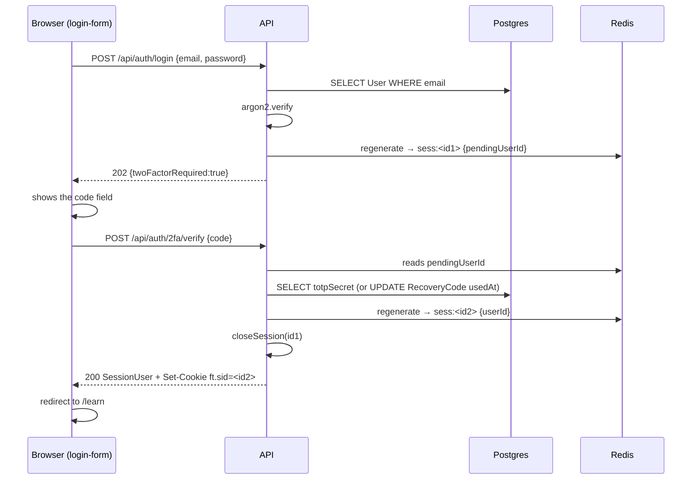
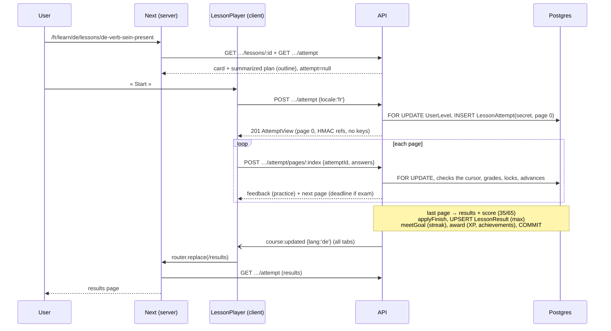

# 12 · The application's end-to-end flows (Module 11)

## 1. What you need to understand

An "end-to-end" flow follows **one user action through all the
layers**: browser → Caddy → Next or API → database → response → display. This is what
proves to the jury that you understand **the system**, not just files.

We follow six of them, the most important ones:

1. Sign-up and first course
2. Login with 2FA
3. Placement test
4. Playing a lesson through to the score
5. Friend request and presence
6. Logout

## 2. How it works in Transcendence

### Flow 1 · Sign-up and first course

| Step | Who | What | File |
|---|---|---|---|
| 1 | User | fills in `/fr/signup` and submits | — |
| 2 | Front (client) | `SignUpFormSchema.safeParse`; on error, translated message | `signup-form.tsx` |
| 3 | Front | `POST /api/auth/signup { email, displayName, password }` | `lib/auth-client.ts` |
| 4 | Caddy | `/api/*` → `api:3001` | `Caddyfile` |
| 5 | API | IP throttler (10/min), `@Public()`, `CreateUserSchema` | `auth.controller.ts` |
| 6 | API | argon2id → `INSERT User` (duplicate → 409) | `auth.service.ts` |
| 7 | API | `session.regenerate` + `userId` → `SET sess:<id>` in Redis | `auth.controller.ts` |
| 8 | Response | `201 SessionUser` + `Set-Cookie: ft.sid` | — |
| 9 | Front | `router.replace('/onboarding')` | — |
| 10 | Front (server) | onboarding page: `GET /api/courses` (cookie copied) → no course | `onboarding/page.tsx` |
| 11 | User | chooses "German, 30 min" | `choose-course.tsx` |
| 12 | API | `POST /api/courses` → `INSERT UserLevel(level=null)` | `courses.service.ts` |
| 13 | Front | "choose a level" step: placement or direct choice | `choose-level.tsx` |

**Stored**: 1 `User`, 1 `UserLevel`, 1 Redis session. **Displayed**: the level screen.

### Flow 2 · Login with 2FA

### Flow 3 · The placement test

| Step | Front | API | Data |
|---|---|---|---|
| Start | `startPlacement('de')` → `POST /api/placement { lang }` | Redis lock; no test in progress; existing course; initial session (B1, lo=0, hi=5); draw | `HSET user:<id>:eval`, `UserSeenQuestion` |
| Question | `question-screen.tsx` shows question + shuffled options + timer | `PlacementQuestionSchema.strict()` without `answer` | — |
| Answer | `POST /api/placement/answers { questionId, choice }` | lock; time limit exceeded? (empty answer); `questionId` = current question?; valid choice?; lo/hi/level adjustment; result or next question | Redis; background LLM restock if ≤ 3 unseen |
| End | `result-screen.tsx`: level + report | `getResult`; if at least one answer: `CoursesService.setLevel` + `course:updated` | `UserLevel.level`, `User.activeLang` |
| Abandon | `DELETE /api/placement` | deletes the Redis keys | — |

### Flow 4 · Playing a lesson through to the score

Points to make: the **browser grades nothing**; the timer is the stored `deadline`;
the score is **never** sent by the client; everything is in **one transaction** with
a row lock.

### Flow 5 · Friend request and presence

1. Alice searches for "bob": `GET /api/users?q=bob` (`ILIKE`, 20 results max).
2. Click "Add" (`friend-buttons.tsx`) → `POST /api/friends/requests/<bob>`.
3. API: `pairKey(alice, bob)`; no row → `INSERT Friendship(pending)`;
   `friend:request` to `user:<bob>` **and** `user:<alice>`.
4. Bob's `/friends` tab receives the event → `router.refresh()` → the request appears.
5. Bob accepts → `UPDATE status = accepted` → `friend:accepted` to both.
6. From then on, when Alice opens a tab, her socket does `INCR presence:alice` → 1 → Bob
   receives `presence:update online`; 10 s after her last tab closes, `offline`.

### Flow 6 · Logout

`LogOutButton` → `POST /api/auth/logout` → the API does `session.destroy` (`DEL sess:<id>`),
then `closeSession(<id>)` (closes **all** the sockets of that session, in all
tabs), then `clearCookie('ft.sid')` → `204` → on the tab side, `closeSocket()` (voluntary
close, no reconnection), `router.replace('/')` and `router.refresh()`. The other
tabs see a server disconnection, retry quietly, are rejected with
`auth.sessionRequired` and switch to the `signedOut` state.
(`apps/web/components/log-out-button.tsx`, `apps/api/src/auth/auth.controller.ts`)

## 3. Concrete example

Flow 4 is the one to tell the jury first: it shows security (the server
owns the truth), concurrency (lock + transaction), the database (upsert of the best
score), the business logic (streak, XP) and real time (event after commit).

## 4. Files to know

For each flow, the files are in the tables above. The tests that
cover them: `e2e/tests/auth.spec.ts`, `onboarding.spec.ts`, `placement.spec.ts`,
`lesson.spec.ts`, `friends.spec.ts`, `live.spec.ts`; and on the API side
`apps/api/test/auth.e2e-spec.ts`, `two-factor.e2e-spec.ts`, `placement.e2e-spec.ts`,
`attempts.e2e-spec.ts`, `friends.e2e-spec.ts`, `gateway.e2e-spec.ts`.

## 5. Diagram

All the flow diagrams are gathered in [diagrams/MAIN-FEATURE-FLOWS.md](diagrams/MAIN-FEATURE-FLOWS.md).

## 6. Key takeaways

1. Every write flow: **client → `/api` via Caddy → guard → Zod pipe → service → transaction → response**.
2. Every page read flow: **Next server → `http://api:3001` with the cookie**.
3. After a write: **`router.refresh()`** here, **socket event** elsewhere.
4. Login **always** changes the session id.
5. The end of a lesson is **a single transaction**: result, streak, XP, achievements.
6. Friendship events go **to both** users.

## 7. Possible oral questions

1. Tell me what happens when I finish a lesson.
2. What happens if I submit the same page twice (double click)?
3. Where is the state of an in-progress placement test stored?
4. How is the "today" page in another tab updated?

## 8. Expected answers

1. Tell flow 4: last page submitted, graded, attempt closed, score computed
   35/65, `applyFinish` in the same transaction (best score, goal, streak, XP,
   achievements), commit, `course:updated`, redirect to the results.
2. "The first one goes through; the second finds a cursor that has already advanced and gets `409
   attempt.stale`. Since the transaction locks the course row, the two cannot
   run at the same time."
3. "In Redis, `user:<id>:eval` (hash) and `user:<id>:eval_questions`, with a one-hour
   expiry, and a lock `user:<id>:eval_lock`. The seen questions are also in
   Postgres (`UserSeenQuestion`) so they are not asked again later."
4. "The API emits `course:updated` to the user's room after the commit;
   `RefreshOn` receives it and calls `router.refresh()`."

## 9. Mini-exercise

Draw flow 1 as a sequence diagram (5 participants: browser, Caddy, API,
Postgres, Redis), without looking.

## 10. Self-assessment

1. How many HTTP requests does a login with 2FA take?
2. Which step of flow 3 can call Gemini?
3. During flow 4, where does the exam deadline live?
4. Why does tab B of a logged-out session switch to "signedOut"?

### Answers

1. Two (`/login` then `/2fa/verify`).
2. Drawing a question (starting or answering), when a category has ≤ 3 unseen questions, in the background.
3. In `LessonAttempt.deadline` in the database; the client only displays a countdown.
4. Its socket is closed by the server (`closeSession`), it retries, the handshake is rejected with `auth.sessionRequired` (no more `sess:<id>`), which `afterConnectError` translates into `signedOut`.
