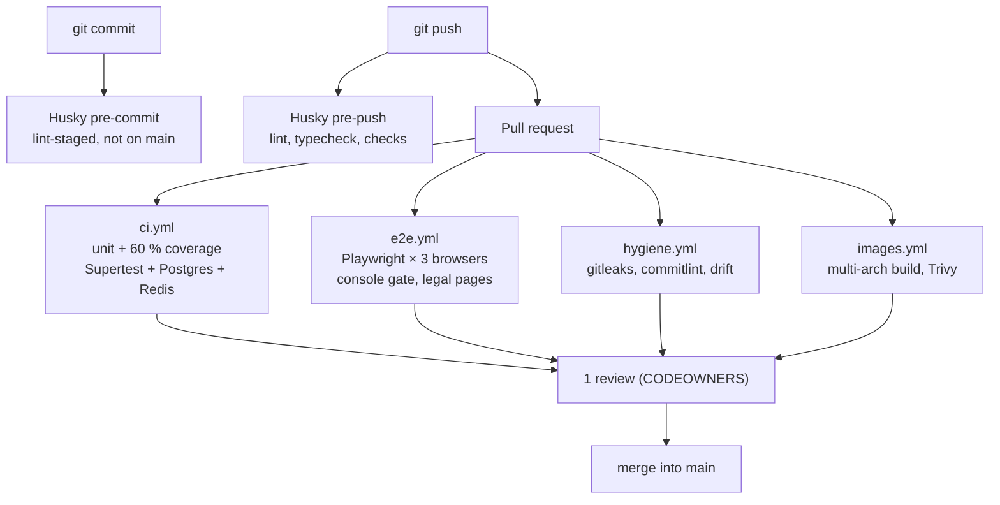

# 13 · Testing and quality (Module 12)

## 1. What you need to understand

Three levels of tests, from the fastest to the most realistic:

| Level | Tests | Tool in our project |
|---|---|---|
| **Unit** | a single isolated function or class (mocked dependencies) | Vitest |
| **HTTP integration** (API "e2e") | the whole API, real requests, **real Postgres and Redis** | Vitest + Supertest |
| **Browser end-to-end** | the complete application in production, in a real browser | Playwright |

**Coverage** measures the share of the code executed by the tests.

## 2. How it works in Transcendence

### What exists (counted in the repository) [CONFIRMED]

| Package | Test files | Tests (run of 15/11/2026) |
|---|---|---|
| `apps/api` (unit `src/**/*.spec.ts`) | 44 | **1,184** ✅ |
| `packages/shared` | 17 | **435** ✅ |
| `apps/web` (`lib/*.test.ts`) | 25 | **290** ✅ |
| `packages/ui` | 1 | **10** ✅ |
| `apps/api/test/*.e2e-spec.ts` (Supertest) | 16 | not run here (no Docker) [UNVERIFIED] |
| `e2e/tests/*.spec.ts` (Playwright) | 22 | not run here [UNVERIFIED] |

Command run: `pnpm run test` → `Tasks: 6 successful, 6 total`.

### Organization

- **Unit tests next to the code**: `auth.service.ts` ↔ `auth.service.spec.ts`. The pure
  rules (`roadmap.rules.spec.ts`: 661 lines, `gamification.rules.spec.ts`,
  `lesson-search.spec.ts`) are tested without a database; the lesson engine in
  `packages/shared/src/lessons/player/*.test.ts` (plan, attempt, score, redact, view).
  Time is injected (`now`): time limits are tested without waiting.
- **The LLM is mocked**: `FixtureProvider`, and `gemini.provider.spec.ts` mocks `fetch`.
- **API e2e** (`apps/api/test/`): each file starts the app with **the same
  `configureApp`** as prod (`app.e2e-spec.ts`, `auth`, `two-factor`, `courses`,
  `placement`, `lessons`, `attempts`, `finish`, `gamification`, `friends`, `users`,
  `gateway` (real socket.io client), `metrics`, `error-codes`, `seed`, `demo`). Config:
  `apps/api/vitest.config.e2e.mts`.
- **Playwright** (`e2e/`): 3 projects (`chromium`, `firefox`, `webkit`) against
  `https://localhost` (prod stack). Files: `auth`, `onboarding`, `placement`,
  `course`, `today`, `dashboard`, `lesson`, `lesson-regressions`, `friends`, `live`
  (real time between two pages), `avatar`, `i18n`, `legal`, `landing`, `layout`,
  `layout-gate`, `time-zone`, `monitoring`, `signup-budget`, `smoke`, **`console`**,
  **`restart`** (restarts the API and checks the reconnection).

### Two tests that are rejection criteria of the subject

- **Console gate** (`e2e/support/console-guard.ts`, `console.spec.ts`): **any** console error or
  warning, uncaught exception or failed request makes the route fail.
  It is because of it that the socket reconnection probes the API before dialing.
- **Legal pages** (`legal.spec.ts`): `/privacy` and `/terms` respond with real content.

### The "signup budget"

Sign-up is limited to 10 per minute per IP. The Playwright suite creates many accounts:
it **queues up** to respect the limit (`e2e/support/signup-budget.ts`). Team
rule: *the tests bend, not the limit* (comment in `auth.controller.ts`).

### The quality tools

| Tool | Where | What it blocks |
|---|---|---|
| **Coverage ≥ 60 %** lines and functions | `vitest.config.mts` of api, web, shared | test job in CI |
| **ESLint**, **Prettier**, **tsc** | `turbo run lint typecheck`, `format:check` | CI + `pre-push` hook |
| **Husky** | `.husky/pre-commit` (no commit on `main`, `lint-staged`), `pre-push` (TS, `.env.example`, boundaries, lint, typecheck), `commit-msg` (commitlint) | locally |
| **commitlint** | `.github/commitlint.config.mjs` | messages like `feat: …`, `fix(api): …` |
| **gitleaks** | `hygiene.yml` | committed secrets |
| **Prisma drift** | `scripts/check-prisma-drift.sh` | schema ≠ migrations |
| **Monitoring config** | `promtool`, `amtool`, `caddy validate`, alert tests (`infra/monitoring/prometheus/tests/alerts.test.yml`) | broken config |
| **CODEOWNERS** + at least 1 review | `.github/CODEOWNERS`, `main` rules (`docs/TECHNICAL_PLAN.md` §5) | merging without review |

### What is tested, and what is not

| Feature | Tests | Note |
|---|---|---|
| Auth, 2FA, sessions | unit + API e2e + Playwright | well covered |
| Placement | unit (4 services) + API e2e + 20 Playwright tests | well covered |
| Day plan, streak, goal | `roadmap.rules.spec.ts`, `goal.spec.ts`, e2e | well covered |
| Lesson engine (score, masking, cursor) | `shared` + `attempts.e2e-spec.ts` + Playwright | well covered |
| Gamification | `gamification.rules.spec.ts` + `gamification.e2e-spec.ts` | server only; no UI to test |
| Friends, presence, gateway | unit + `gateway.e2e-spec.ts` + `live.spec.ts` | covered |
| Lesson search | `lesson-search.spec.ts` | API only; no page |
| React components | **no component unit tests** in `apps/web` (only `lib/`); covered by Playwright | [CONFIRMED] |
| Player for vocabulary / functions / reading (UI) | — | does not exist yet |
| Chat, RAG | — | do not exist |
| Real Gemini | no (mocked); `pnpm --filter @ft/api generation:try` for a manual trial | |

### Known limitations and issues

- Assumption of **a single API instance** (presence, throttler and restocking in memory). [CONFIRMED by the code comments]
- The throttler is **in memory**: a restart resets the counters. [INFERRED]
- No **Content-Security-Policy**. [CONFIRMED doc]
- The README still contains **TODOs** (team logins, organization, communication) to fill in before the defense. [CONFIRMED `README.md`]
- Some lines of `docs/PRODUCT_ARCHITECTURE.md` §2 are outdated (i18n "not wired"). [CONFIRMED]

### How to run

Unit tests (without Docker):

```bash
pnpm install --frozen-lockfile
```

```bash
pnpm run test
```

With coverage:

```bash
pnpm run test:cov
```

Everything the CI does, locally (starts Postgres and Redis in Docker):

```bash
make ci
```

The browser tests against the prod stack:

```bash
make test-e2e
```

Playwright report: `make report`.

## 3. Concrete example

`apps/api/src/lessons/roadmap.rules.spec.ts` tests `plan()` with hand-built lists of lessons and
results: no database, no server, hundreds of cases in
a few milliseconds. The same scenario is then verified end to end by
`apps/api/test/finish.e2e-spec.ts` with Postgres.

## 4. Files to know

- `apps/api/vitest.config.mts`, `apps/api/vitest.config.e2e.mts`
- `apps/api/test/app.e2e-spec.ts`, `apps/api/test/attempts.e2e-spec.ts`
- `e2e/playwright.config.ts`, `e2e/support/console-guard.ts`, `e2e/tests/console.spec.ts`
- `.github/workflows/ci.yml`, `e2e.yml`, `hygiene.yml`
- `.husky/*`

## 5. Diagram



## 6. Key takeaways

1. **≈ 1,900 green unit tests**; 16 Supertest files; 22 Playwright files.
2. Supertest on a **real database** with the **same pipeline** as prod (`configureApp`).
3. Playwright on **3 engines**, against the **prod images**.
4. **Console gate** and **legal pages**: rejection criteria, tested in CI.
5. Minimum coverage **60 %**, blocking.
6. Husky hooks, commitlint, gitleaks, Prisma drift.
7. The **pure rules** are easy to test because time and the database are injected.
8. No unit tests for React components: Playwright covers them.

## 7. Possible oral questions

1. How do you test the API?
2. How do you test without a Gemini key?
3. How do you guarantee zero console errors?
4. What coverage do you aim for?
5. What is not tested?

## 8. Expected answers

1. "At two levels: unit tests on the services and the pure rules, with
   Prisma and Redis mocked; then HTTP tests with Supertest against the complete
   application, started with the same `configureApp` as production, on a real Postgres
   and a real Redis."
2. "The LLM provider is injected by Nest. In tests and by default, it is a fixture that
   returns answers written in advance. The Gemini provider has its own tests where `fetch` is mocked."
3. "A Playwright test walks through all the routes, including client-side navigation, on
   the prod build, and fails on the slightest error, warning, exception or failed
   request. It runs in CI on the three browsers."
4. "At least 60 % of lines and functions, blocking in CI, to be raised, never lowered."
5. "The React components have no unit tests (they are covered by Playwright),
   and the real call to Gemini is not tested automatically."

## 9. Mini-exercise

Open `e2e/tests/live.spec.ts`. Explain how you can test a real-time event
with two Playwright pages.

## 10. Self-assessment

1. How many browsers does Playwright test?
2. Why do the API e2e tests call `configureApp`?
3. What does `restart.spec.ts` check?
4. Which hook prevents committing on `main`?

### Answers

1. Three: Chromium, Firefox, WebKit.
2. To test exactly the same pipeline (prefix, sessions, pipe, filter, WebSocket) as production.
3. That after an API restart, the application reconnects without any console error.
4. `.husky/pre-commit`.
