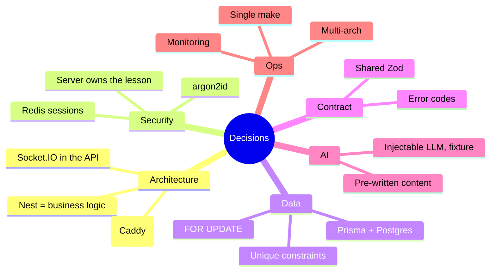

# 14 · The technical decisions (Module 13)

## 1. What you need to understand

Defending a decision means stating: **the problem**, **the chosen solution**, **what it
brings**, **what it costs**, **the alternatives**. A jury especially appreciates it when you
know the **drawbacks**.

Each decision below carries a source:
- **[DOCUMENTED]**: the reason is written down by the team (doc or code comment);
- **[INFERRED-INTENT]**: the reason is inferred from the implementation, the intent is not written down.

## 2. How it works in Transcendence

### D1 · NestJS owns the business logic, Next.js only displays [DOCUMENTED `ARCHITECTURE.md` §1]

| | |
|---|---|
| Problem | Two server runtimes (Next and Nest) could both touch the database. |
| Solution | No Prisma in `apps/web`; Next calls the API like a browser. |
| Advantages | A single gateway to the data, rules written once, a clear answer at the defense, the API can also serve a possible "Public API". |
| Drawbacks | One more network hop for SSR; two applications to deploy. |
| Alternatives | Next.js alone as full-stack (server actions + Prisma); Nest + SPA without SSR. |

### D2 · Server sessions in Redis rather than JWT [INFERRED-INTENT, backed by the comments in `app.setup.ts` and `auth.guard.ts`]

| | |
|---|---|
| Problem | Staying logged in securely. |
| Solution | `express-session` + `connect-redis`, opaque `httpOnly` `SameSite=Lax` cookie. |
| Advantages | Immediate revocation (logout, deleted account, closing the sockets), nothing readable on the client side, simple with a single origin. |
| Drawbacks | One Redis round trip per request; server-side state (to be shared if there are several instances). |
| Alternatives | JWT in a cookie, JWT + refresh token, OAuth (excluded). |

### D3 · A single origin behind Caddy [DOCUMENTED `ARCHITECTURE.md` §2, `TECHNICAL_PLAN.md` §1]

| | |
|---|---|
| Problem | HTTPS is mandatory; front and API on two ports = CORS, third-party cookies. |
| Solution | Caddy terminates TLS (internal CA locally) and routes `/api`, `/ws`, `/grafana`, `/`. |
| Advantages | No CORS, first-party cookie, a single certificate, a single published port. |
| Drawbacks | One more component; `trust proxy` must be set correctly. |
| Alternatives | Nginx (more TLS configuration), Traefik. |

### D4 · Shared Zod, not class-validator [DOCUMENTED `app.setup.ts`, `ARCHITECTURE.md` §8]

| | |
|---|---|
| Problem | The subject requires validation **front and back**; two implementations drift apart. |
| Solution | Schemas in `@ft/shared`, DTOs via `nestjs-zod`, same schemas in the forms. |
| Advantages | One rule = one place; derived TypeScript types; generated Swagger. |
| Drawbacks | Departs from the NestJS standard (class-validator); an extra adapter. |
| Alternatives | class-validator + duplication on the front; tRPC. |

### D5 · Error codes, not sentences [DOCUMENTED `validation.pipe.ts`, `error-code.filter.ts`]

| | |
|---|---|
| Problem | The API does not know the interface language. |
| Solution | `message` = a code from `ERROR_CODES`; translation in the browser; global fallback filter. |
| Advantages | Full i18n of errors, testable contract (`error-codes.e2e-spec.ts`). |
| Drawbacks | The list and three translations per code have to be maintained. |
| Alternatives | `Accept-Language` on the API side. |

### D6 · The server owns the lesson [DOCUMENTED `PRODUCT_ARCHITECTURE.md` §3 "No route takes a score", `docs/LESSONS.md` §10]

| | |
|---|---|
| Problem | A score computed in the browser can be forged; answers in the JS can be read. |
| Solution | Plan rebuilt on the server side, only the page at the cursor, HMAC refs, server deadline, server score. |
| Advantages | Reliable score, no answer leaks, resume after reload, several tabs stay consistent. |
| Drawbacks | One round trip per page; more complex logic (≈ 30 files in `lessons/player`). |
| Alternatives | Send the full lesson and grade on the client side (simple, but cheatable). |

### D7 · Content written in advance rather than generated live [DOCUMENTED `PRODUCT_ARCHITECTURE.md` §2 "Open, for the team"]

| | |
|---|---|
| Problem | A live LLM costs money, varies, can be wrong, and the evaluator has no key. |
| Solution | Lessons written with Claude Code, **validated** (`validateLesson`), versioned as JSON. |
| Advantages | Controlled quality, no cost at usage time, deterministic tests. |
| Drawbacks | 3,990 lessons have to be written (216 done); weakens the LLM/RAG module. |
| Alternatives | On-the-fly generation with a cache; RAG over a corpus. |

### D8 · Injectable LLM provider, "fixture" by default [DOCUMENTED `TECHNICAL_PLAN.md` §5, `llm.module.ts`]

| | |
|---|---|
| Problem | No key in CI or on the evaluator's side; costs; flaky tests. |
| Solution | `LlmProvider` interface, `LLM_PROVIDER` token, `FixtureProvider` or `GeminiProvider` depending on `.env`. |
| Advantages | Zero cost by default, stable tests, switching provider with one variable. |
| Drawbacks | In a default demo, the "online" AI is not visible. |

### D9 · `FOR UPDATE` row lock on the course [DOCUMENTED `goal.ts`]

| | |
|---|---|
| Problem | Two tabs finishing a lesson at the same time could count the streak twice. |
| Solution | Every write on a course's day starts with `SELECT … FOR UPDATE` (raw SQL, Prisma has no equivalent). |
| Advantages | Meets the subject's "no race condition" requirement, simple to reason about. |
| Drawbacks | Serializes writes on the same course (negligible: one human). |
| Alternatives | Redis lock, unique constraints alone, `SERIALIZABLE` transactions. |

### D10 · Unique constraints rather than prior checks [DOCUMENTED `auth.service.ts`, `pair.ts`]

Insert and catch `P2002`, sorted `pairKey` for friendships, composite PK for
achievements. **Advantage**: no race is possible. **Drawback**: the logic depends on
Prisma error codes.

### D11 · Socket.IO in the API, "re-read" push [DOCUMENTED `PRODUCT_ARCHITECTURE.md` §3, `ARCHITECTURE.md` §4]

| | |
|---|---|
| Solution | One `/ws` gateway, same cookie, `user:<id>` rooms, events after commit that trigger `router.refresh()`. |
| Advantages | A single auth, a single transport; no second state on the client side. |
| Drawbacks | One refresh = one full server render; only one instance supported. |
| Alternatives | Server-Sent Events, native WebSocket, polling. |

### D12 · Prisma 7 + PostgreSQL (+ planned pgvector) [DOCUMENTED `TECHNICAL_PLAN.md` §1]

ORM = minor module; `schema.prisma` serves as documentation; pgvector avoided a
second database for RAG. **Current drawback**: pgvector is unused.

### D13 · pnpm + Turborepo monorepo, TypeScript everywhere [DOCUMENTED `TECHNICAL_PLAN.md` §1]

Strict `node_modules`, cached tasks, shared contract. Drawback: more complex
tooling (Docker volumes to mask `node_modules`, pinned versions).

### D14 · Debian slim, non-root, multi-arch [DOCUMENTED `TECHNICAL_PLAN.md` §3]

Avoid Prisma/argon2 bugs on musl; amd64 + arm64 images (Apple M-series Macs, ARM servers).

### D15 · `make` = the evaluator's path, tests included [DOCUMENTED `TECHNICAL_PLAN.md` §4]

What is launched is what is tested. Drawback: `make` is slow.

### D16 · Full monitoring [DOCUMENTED `docs/MONITORING.md`]

Prometheus + Grafana + Alertmanager (25 rules), business metrics
(`ft_placement_exams_total`, `ft_lesson_attempts_total`…), separate metrics port.

### D17 · No global store on the front [INFERRED-INTENT]

The truth is on the server; `router.refresh()` is enough. Alternative: React Query,
Redux. Drawback: less optimism (we wait for the response).

### D18 · In-memory throttler, a single instance [INFERRED-INTENT + comments in `question-stock.service.ts`]

Simple; to be revisited (Redis storage) if we move to several instances (#158).

## 3. Concrete example

"Why not a JWT?" → D2: revocation. Demonstrate it: `POST /logout` deletes
`sess:<id>` and closes the session's sockets; with a JWT, the token would remain valid.

## 4. Files to know

`docs/TECHNICAL_PLAN.md`, `docs/PRODUCT_ARCHITECTURE.md`, `docs/ARCHITECTURE.md`,
`docs/VERSIONS.md`, `docs/LESSONS.md`, and the comments in `app.setup.ts`,
`auth.guard.ts`, `goal.ts`, `validation.pipe.ts`.

## 5. Diagram

## 6. Key takeaways

1. Every decision has a **cost**: be able to state it.
2. The three most defensible: **Nest = business logic**, **server sessions**, **the server owns the lesson**.
3. The three most debatable: **unused pgvector**, **barely visible LLM**, **a single instance**.
4. Always distinguish **documented** from **inferred**.

## 7. Possible oral questions

1. If you had to do it again, what would you change?
2. Can your architecture handle 10,000 users?
3. Why not generate the lessons live with the LLM?

## 8. Expected answers

1. "I would plug in RAG earlier or remove pgvector; I would finish the screens for the
   three other lesson types before broadening; I would put the throttler storage and
   the Socket.IO rooms in Redis so we could run several instances."
2. "The bottleneck would be the single API instance: presence, throttler and restocking are in
   memory, and rooms do not span instances. We would need Socket.IO's Redis adapter
   and Redis storage for the throttler. Postgres and Redis can handle the load."
3. "Cost, latency, quality and reproducibility: the evaluator has no key, and a wrong
   lesson generated live would be seen by nobody before the learner. So we write
   with AI, but we validate before publishing."

## 9. Mini-exercise

Pick D6 and present it in 45 seconds, drawbacks included, out loud.

## 10. Self-assessment

1. Which decision addresses the "no race condition" requirement?
2. Why is the LLM provider "fixture" by default?
3. What is the main drawback of D11?

### Answers

1. D9 (`FOR UPDATE` lock) and D10 (unique constraints).
2. No key on the evaluator's side or in CI, no cost, deterministic tests.
3. Only one API instance is supported; each event triggers a full server render.
