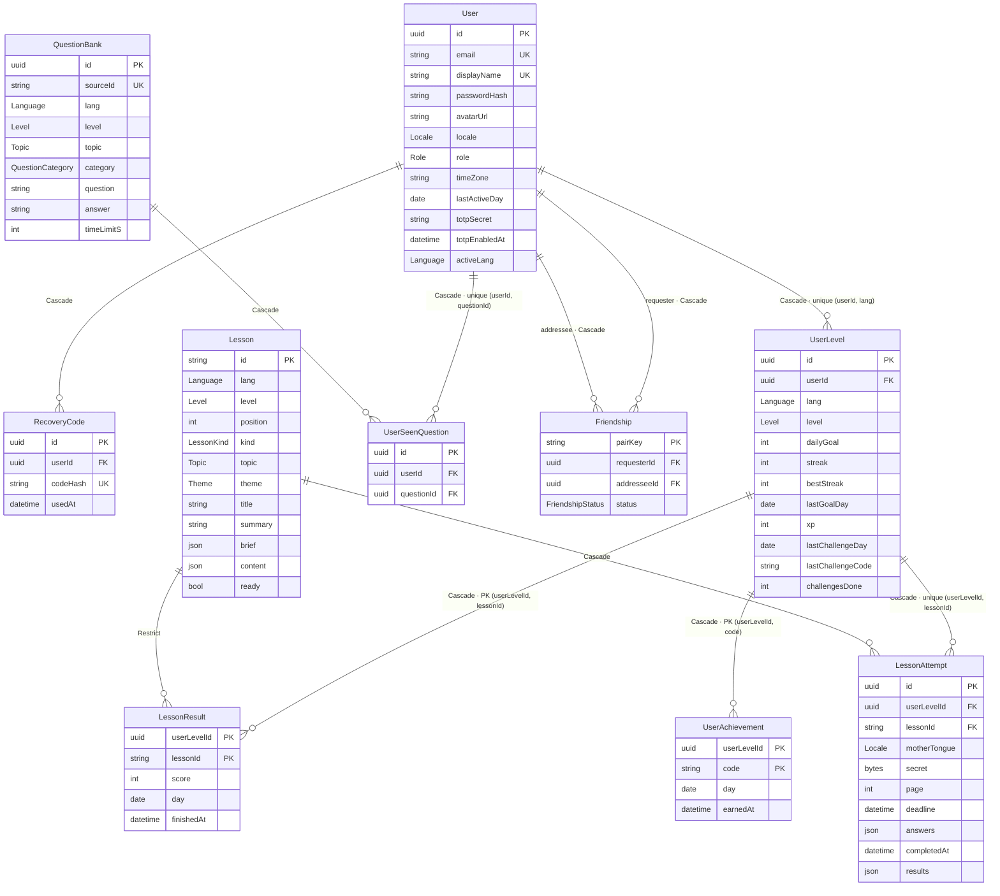

# Diagram · Database relationships

Checked against `apps/api/prisma/schema.prisma` (13 migrations, the latest being `add_gamification`).

## Examples

- Lina (`User`) is learning German and French: **2 `UserLevel` rows** (`de`, `fr`).
- She finished `de-verb-sein-present` twice (60 then 85): **1 `LessonResult` row**, score 85.
- She replays the lesson: her finished `LessonAttempt` is **deleted** and a new one is created.
- Lina and Bob are friends: **1 `Friendship` row**, `pairKey = "<smaller uuid>:<larger>"`, `status = accepted`.
