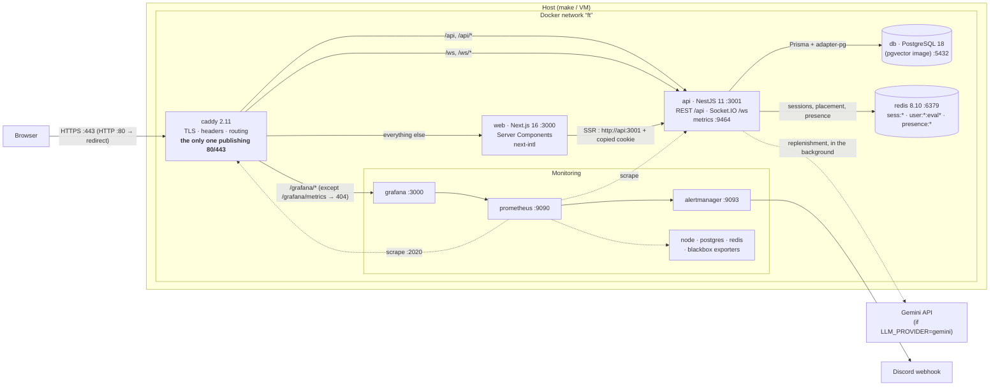

# Diagram · Global architecture

Checked against `compose.yml`, `compose.prod.yml` and `infra/caddy/Caddyfile` (commit `477b3d4`).

## Reading

1. A single entry point: Caddy. Everything else is only reachable through the `ft` network.
2. Same origin for the pages, the API and the WebSocket.
3. Next has no access to the data: it goes through the API, like the browser.
4. Postgres = durable; Redis = ephemeral.
5. Monitoring reads, it is never on the path of a user request.
