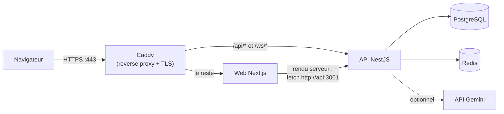

# 01 · Introduction à notre Transcendence (Module 00)

## 1. Ce qu'il faut comprendre

ft_transcendence est le dernier projet du tronc commun 42. Le sujet (v21.2, résumé dans
`docs/SUBJECT_SUMMARY.md`) laisse **choisir le thème** de l'application : il impose un
socle (frontend + backend + base de données, Docker, HTTPS, inscription/connexion,
validation des deux côtés, pages légales, zéro erreur console) et demande **14 points
de modules** (module majeur = 2 points, mineur = 1).

Notre équipe a choisi une **plateforme d'apprentissage des langues pilotée par l'IA**.
Pas de jeu, pas de Pong. C'est un choix fort : il faut être prêt à l'expliquer.

## 2. Explication dans Transcendence

### Le problème que l'on résout

Un apprenant ne sait pas toujours à quel niveau il est, et abandonne s'il n'a pas une
habitude quotidienne. Notre application :

1. **le place** à un niveau du CECRL (A1, A2, B1, B2, C1, C2) avec un **test adaptatif**
   (une recherche dichotomique sur les niveaux) ;
2. lui propose **chaque jour** un nombre de leçons qui correspond à son **objectif
   quotidien** (10, 30 ou 60 minutes ; une leçon = 10 minutes) ;
3. lui fait faire des leçons de **quatre types** : grammaire, vocabulaire, « fonctions »
   (actes de langage : saluer, s'excuser…), lecture. Chaque leçon a des pages
   d'entraînement corrigées page par page, puis un **examen chronométré** et un score ;
4. entretient la motivation : **série de jours** (streak), XP et rangs, défi du jour,
   succès (achievements) ;
5. ajoute une couche sociale : **profils publics, amis, statut en ligne en temps réel**.

### Les acteurs

| Acteur | Ce qu'il fait |
|---|---|
| **Visiteur anonyme** | Voit l'accueil, les pages légales, s'inscrit ou se connecte. |
| **Apprenant connecté** | Choisit une langue (« un cours »), passe le placement, fait ses leçons, gère son profil, ses amis, sa 2FA. |
| **L'API Gemini (Google)** | Facultative : génère de nouvelles questions de placement quand la banque s'épuise. Par défaut c'est un **fournisseur « fixture »** qui ne fait aucun appel réseau. |
| **L'équipe (auteurs)** | Écrit les leçons hors ligne avec Claude Code (`pnpm --filter @ft/api lessons:author`), validées par des validateurs, puis versionnées dans `content/`. |
| **Grafana / Alertmanager** | Surveillent la plateforme et alertent sur Discord. |

Le `role` `ADMIN` existe dans le schéma (`enum Role { USER ADMIN }`) mais **aucune route
ne le vérifie** : il n'y a pas d'espace d'administration. [CONFIRMED : aucune occurrence
de vérification de rôle dans `apps/api/src`]

### Les langues

Deux notions à ne pas confondre :

- **la langue de l'interface** (`Locale` : `en`, `fr`, `de`), dans l'URL : `/fr/learn`.
  Gérée par `next-intl` côté web. [CONFIRMED `apps/web/i18n/routing.ts`]
- **la langue apprise** (`Language` : `en`, `fr`, `de`), le « cours » : `/fr/learn/de`
  = interface en français, cours d'allemand. [CONFIRMED `schema.prisma`, enum `Language`]

## 3. Exemple concret

Lina s'inscrit, interface en français :

1. `/fr/signup` → compte créé, session ouverte, redirection vers `/fr/onboarding`.
2. Elle choisit « allemand », objectif 30 min → `POST /api/courses` crée un `UserLevel`
   (`lang = de`, `level = null`).
3. Elle passe le placement : commence en B1, monte ou descend selon ses réponses → l'API
   écrit `level = A2`.
4. `/fr/learn/de` affiche « aujourd'hui » : 3 leçons proposées (30 min / 10 min).
5. Elle joue une leçon de grammaire, page par page ; l'examen est chronométré ; le
   serveur calcule 85/100 → résultat enregistré, XP gagnée, objectif avancé.
6. Dans un autre onglet ouvert sur la même page, le tableau se met à jour tout seul
   (événement `course:updated` par WebSocket).

## 4. Fichiers à connaître

| Fichier | Pourquoi |
|---|---|
| `README.md` | Présentation officielle, équipe, commandes |
| `docs/PRODUCT_ARCHITECTURE.md` | Le parcours apprenant, les modules visés, l'IA |
| `docs/ARCHITECTURE.md` | Les conteneurs, les flux, le temps réel |
| `docs/SUBJECT_SUMMARY.md` | Le sujet 42 résumé |
| `apps/api/prisma/schema.prisma` | Le modèle de données : la meilleure « carte » du métier |

## 5. Schéma

## État réel du projet : ce qui est fini et ce qui ne l'est pas

C'est la section la plus utile pour la soutenance : **ne revendique jamais ce qui n'est
pas dans le code**. Comparaison entre ce que vise `docs/PRODUCT_ARCHITECTURE.md` §2 et le
code au commit `477b3d4` :

| Module du sujet | Type | État vérifié |
|---|---|---|
| Framework frontend + backend (Next.js + NestJS) | Majeur | **Fait** [CONFIRMED] |
| ORM (Prisma 7) | Mineur | **Fait** [CONFIRMED] |
| Gestion utilisateur standard (profil, avatar, amis, en ligne, page profil) | Majeur | **Fait** [CONFIRMED] |
| 2FA complète (TOTP + codes de secours) | Mineur | **Fait** [CONFIRMED] |
| i18n, 3 langues | Mineur | **Fait** : `next-intl` est branché, 3 catalogues de 475 lignes. La ligne « not wired » de la doc est **périmée**. [CONFIRMED] |
| Navigateurs supplémentaires | Mineur | Playwright sur Chromium, Firefox, WebKit [CONFIRMED config] |
| Temps réel WebSocket | Majeur | **Fait côté serveur → client** (mises à jour de cours, amis, présence). Aucun événement client → serveur (`CLIENT_EVENTS = {}`). [CONFIRMED] |
| Interaction utilisateur (chat + profils + amis) | Majeur | Profils et amis faits ; **chat absent** : `/chat` est une maquette statique. [NOT PRESENT] |
| Interface LLM complète | Majeur | Fournisseur Gemini + fixture, utilisé **seulement** pour regarnir la banque de questions de placement, sans streaming ni interface utilisateur. **À risque.** [CONFIRMED] |
| RAG | Majeur | **Absent** : l'image Postgres contient pgvector, mais aucune table ni requête vectorielle. [NOT PRESENT] |
| Gamification | Mineur | Calcul serveur complet (XP, rangs, défi du jour, 16 succès) ; l'UI n'affiche que la série. XP/succès **non affichés**. [CONFIRMED] |
| Recherche avancée | Mineur | API `GET /courses/:lang/lessons` avec filtres, tri, pagination ; **pas de page web** (le lien « voir tout » mène à une 404). [CONFIRMED] |
| SSR | Mineur | Les pages sont des Server Components qui appellent l'API côté serveur. [CONFIRMED] |

Et pour les leçons : 3 990 leçons au syllabus, **216 écrites et prêtes** (72 par langue,
réparties sur les six niveaux). Dans le navigateur, **seules les leçons de grammaire sont
jouables** (`playable()` dans `apps/web/components/lesson/kinds/index.ts`) : les trois
autres types sont prêts côté serveur, leurs écrans arrivent avec les tickets #147 à #149.
[CONFIRMED]

## 6. Ce qu'il faut retenir

1. Notre Transcendence est une **plateforme d'apprentissage des langues**, pas un jeu.
2. Parcours : **inscription → choix d'un cours → placement adaptatif → leçons du jour → score, série, XP**.
3. Deux langues distinctes : celle de l'**interface** (`/fr/…`) et celle du **cours** (`/learn/de`).
4. Une seule porte d'entrée HTTPS : **Caddy**, qui route vers Next.js ou NestJS.
5. **NestJS** fait tout le métier ; **Next.js** n'affiche que ce que l'API renvoie.
6. Les leçons sont du **contenu écrit à l'avance** (JSON validé), pas générées en direct.
7. L'IA en production ne sert qu'à **regarnir la banque de questions** de placement.
8. Connaître l'**état réel** : chat et RAG absents, 1 type de leçon jouable sur 4 dans l'UI.

## 7. Questions possibles à l'oral

1. Pourquoi une plateforme de langues plutôt qu'un Pong ?
2. Qui sont les utilisateurs et que peuvent-ils faire ?
3. Où intervient l'IA dans votre projet ?
4. Combien de points de modules revendiquez-vous, et lesquels sont fragiles ?
5. Quelle différence entre `/fr/learn/de` et `/de/learn/fr` ?

## 8. Réponses attendues

1. « Le sujet laisse libre le thème. On a voulu un produit utile au quotidien, avec un vrai
   modèle de données (niveaux, leçons, résultats) et de l'IA. On a renoncé aux modules de
   jeu, sauf la gamification, qui ne demande pas de jeu. »
2. « Des apprenants : ils créent un compte, choisissent une langue, passent un test de
   niveau, puis font leurs leçons du jour. Ils ont un profil, des amis, voient qui est en
   ligne. Il n'y a pas d'administrateur dans l'interface. »
3. « Deux endroits. Hors ligne : l'équipe écrit les leçons avec Claude Code, et des
   validateurs du code les vérifient. En ligne : quand la banque de questions de placement
   d'une langue et d'un niveau tombe à 3 questions non vues, l'API demande un lot à
   Gemini, en arrière-plan. Par défaut, le fournisseur est une fixture, donc aucun coût. »
4. Répondre honnêtement avec le tableau ci-dessus : solides = framework, ORM, gestion
   utilisateur, 2FA, i18n, SSR, navigateurs ; partiels = temps réel (sans chat), LLM, gamification ; absents = RAG, chat.
5. « Le premier segment est la langue de l'interface, géré par next-intl. `learn/de` est
   la langue apprise. `/fr/learn/de` : interface française, cours d'allemand. »

## 9. Mini-exercice

Ouvre `apps/api/prisma/schema.prisma`. Sans lire la suite du cours, trouve :
(a) la table qui représente « un cours d'une langue pour un utilisateur » ;
(b) la colonne qui dit si une leçon peut être jouée ;
(c) l'enum qui liste les 4 types de leçon.

## 10. Auto-évaluation

1. Cite les cinq étapes du parcours d'un apprenant.
2. Combien de leçons sont au catalogue, et combien sont prêtes ?
3. Quel type de leçon est jouable dans le navigateur aujourd'hui ?
4. Quel module majeur visé n'a aucune ligne de code ?
5. Que fait le fournisseur LLM « fixture » ?

### Corrections

1. Inscription → création d'un cours (langue + objectif) → placement → leçons du jour → résultat (score, série, XP).
2. 3 990 au catalogue (`content/outlines`), 216 prêtes (72 par langue).
3. La grammaire uniquement (`KINDS` ne contient que `grammar`).
4. Le RAG (pgvector installé mais inutilisé). Le chat est aussi absent, mais il fait partie d'un module plus large.
5. Il renvoie des réponses écrites à l'avance, sans appel réseau, ce qui permet aux tests et à l'évaluateur de tourner sans clé API (`apps/api/src/llm/fixture.provider.ts`).

Mini-exercice : (a) `UserLevel` ; (b) `Lesson.ready` ; (c) `LessonKind`.
