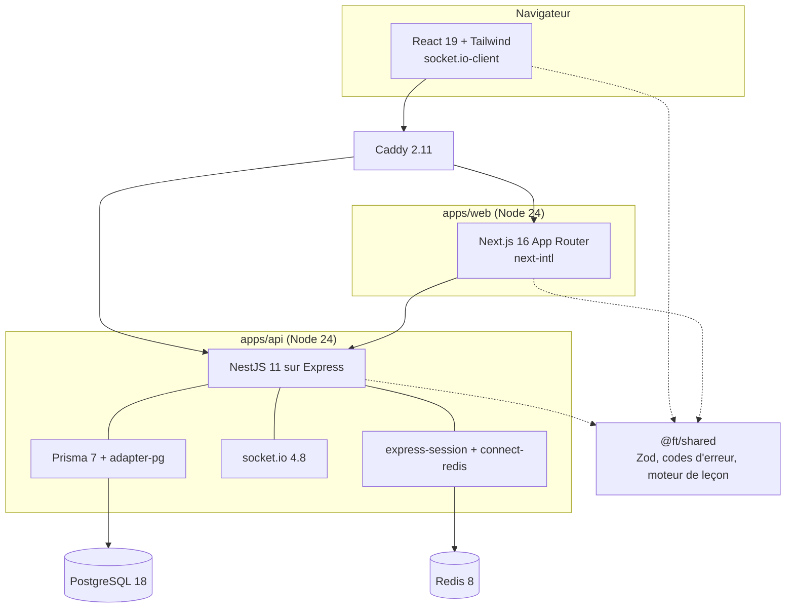

# 02 · La stack technique (Module 01)

## 1. Ce qu'il faut comprendre

Une « stack », c'est l'ensemble des technologies qui, empilées, font tourner
l'application. Chez nous, tout est en **TypeScript**, du navigateur au serveur, dans un
**monorepo** (un seul dépôt Git qui contient plusieurs applications et bibliothèques).

L'idée directrice : **un langage, un contrat partagé**. Le même schéma de validation
(Zod) est importé par le formulaire React et par l'endpoint NestJS.

## 2. Explication dans Transcendence

Toutes les versions viennent des `package.json`, des `compose*.yml` et des Dockerfiles. [CONFIRMED]

### Le socle

| Techno | Version | Rôle chez nous | Où la trouver |
|---|---|---|---|
| **TypeScript** | 6.0.3 (épinglé exactement) | Langage unique, front et back | `package.json`, `scripts/assert-ts-version.sh` |
| **Node.js** | 24.18 | Exécute l'API, le serveur Next et les outils | `.nvmrc`, `FROM node:24.18-bookworm-slim` |
| **pnpm** | 11.18 | Gestionnaire de paquets, *workspaces* | `pnpm-workspace.yaml` |
| **Turborepo** | 2.10 | Lance `build`, `test`, `lint` dans chaque paquet, avec cache | `turbo.json` |

À savoir pour le jury : la version de TypeScript est vérifiée en CI (`assert-ts-version.sh`)
parce que `pnpm up --latest` installerait TypeScript 7 (piège documenté dans `docs/VERSIONS.md`).

### Le frontend : `apps/web`

| Techno | Version | Rôle chez nous |
|---|---|---|
| **Next.js** (App Router) | 16.2 | Pages, routing par dossiers, **rendu serveur** (Server Components) |
| **React** | 19.2 | Composants, état local (`useState`), effets |
| **next-intl** | 4.13 | Traductions `en`/`fr`/`de`, préfixe de langue dans l'URL |
| **Tailwind CSS** | 4.3 | Styles par classes utilitaires (`className="flex gap-6"`) |
| **socket.io-client** | 4.8 | Une connexion WebSocket par onglet |
| **Zod** | 4.4 | Valide les formulaires et **les réponses de l'API** |

Comment on l'utilise : chaque page est un **Server Component** asynchrone qui appelle
l'API **depuis le serveur Next** en transmettant le cookie de l'utilisateur
(`apps/web/lib/api.ts`). Les composants interactifs (formulaires, lecteur de leçon)
sont marqués `'use client'` et appellent l'API **depuis le navigateur** par `fetch`
relatif (`/api/...`, `apps/web/lib/api-client.ts`).

### Le backend : `apps/api`

| Techno | Version | Rôle chez nous |
|---|---|---|
| **NestJS** (sur Express) | 11.1 | Framework serveur : modules, contrôleurs, services, injection de dépendances, guards |
| **Prisma** | 7.9 (+ `@prisma/adapter-pg`) | ORM : schéma, migrations, client typé |
| **express-session** + **connect-redis** | 1.19 / 10.0 | Sessions côté serveur stockées dans Redis |
| **argon2** | 0.45 | Hachage des mots de passe (argon2id) |
| **otpauth** + **qrcode-generator** | 9.5 / 2.0 | 2FA TOTP et QR code |
| **socket.io** (`@nestjs/websockets`) | 4.8 | Passerelle temps réel sur `/ws` |
| **nestjs-zod** | 5.5 | Transforme les schémas Zod partagés en DTO validés + documentés |
| **@nestjs/throttler** | 6.7 | Limitation de débit (100 req/min par défaut, 5/min sur le login) |
| **@nestjs/swagger** | 11.4 | Documentation OpenAPI sur `/api/docs` |
| **multer** | 2.2 | Upload d'avatar (multipart) |
| **@prometheus-io/client** | 0.16 | Métriques exposées sur le port interne 9464 |

`class-validator` est dans les dépendances mais **la validation passe par Zod**
(`apps/api/src/validation.pipe.ts`, commentaire « Zod, not class-validator » dans
`app.setup.ts`). [CONFIRMED]

### Les données

| Techno | Version | Rôle chez nous |
|---|---|---|
| **PostgreSQL** | 18, image `pgvector/pgvector:0.8.6-pg18-trixie` | Base relationnelle : utilisateurs, cours, leçons, résultats, amitiés |
| **pgvector** | 0.8.6 | Extension vectorielle prévue pour le RAG ; **non utilisée** [NOT PRESENT] |
| **Redis** | 8.10 (AOF activé) | Sessions (`sess:*`), sessions de placement + verrous, compteurs de présence |

### Les paquets partagés : `packages/`

| Paquet | Rôle |
|---|---|
| `@ft/shared` | Schémas Zod, codes d'erreur, contrat des événements socket, **tout le moteur de leçon** (plan, score, masquage) |
| `@ft/ui` | 3 composants : `Button`, `Card`, `ProgressBar` (+ `cn`) |
| `@ft/tsconfig`, `@ft/eslint-config` | Configurations communes |

### L'infrastructure

| Techno | Version | Rôle chez nous |
|---|---|---|
| **Docker / Compose** | — | 12 services, lancés par `make` |
| **Caddy** | 2.11 | Seul port publié (80/443), TLS avec CA interne, routage `/api` `/ws` `/grafana` `/` |
| **Prometheus / Alertmanager / Grafana** | — | Supervision, 25 règles d'alerte, notifications Discord |
| **GitHub Actions** | — | 4 workflows : `ci`, `e2e`, `hygiene`, `images` |
| **GHCR** | — | Registre des images multi-architecture (amd64 + arm64) |

### Les tests

| Outil | Pour quoi |
|---|---|
| **Vitest** 4.1 | Tests unitaires de tous les paquets, seuil de couverture 60 % |
| **Supertest** | Tests HTTP de l'API contre un vrai Postgres + Redis (`apps/api/test/*.e2e-spec.ts`) |
| **Playwright** | Tests navigateur sur 3 moteurs + « console gate » |

### L'IA

| Techno | Rôle |
|---|---|
| **Gemini** (API REST `generativelanguage.googleapis.com`, modèle par défaut `gemini-3.6-flash`) | Génère des lots de questions de placement en JSON structuré |
| **Fixture provider** | Remplaçant sans réseau, valeur par défaut de `LLM_PROVIDER` |
| **Claude Code** | Outil **d'écriture** des leçons, hors production (`apps/api/scripts/lessons/author.ts`) |

## 3. Exemple concret : comment les technologies se parlent

Une soumission du formulaire d'inscription traverse presque toute la stack :

```
React (signup-form.tsx, 'use client')
  └─ Zod SignUpFormSchema.safeParse()           ← @ft/shared
  └─ fetch POST /api/auth/signup                ← api-client.ts
        └─ Caddy :443 → api:3001
              └─ NestJS AuthController.signUp
                    └─ CodeValidationPipe (Zod CreateUserSchema, nestjs-zod)
                    └─ AuthService.signUp → argon2.hash → Prisma user.create → PostgreSQL
                    └─ session.regenerate → connect-redis → Redis (sess:<id>)
              └─ Set-Cookie: ft.sid=…; HttpOnly; SameSite=Lax
```

## 4. Fichiers à connaître

- `package.json` (racine), `pnpm-workspace.yaml`, `turbo.json`
- `apps/web/package.json`, `apps/api/package.json`
- `docs/VERSIONS.md` : les versions épinglées et leurs pièges
- `docs/TECHNICAL_PLAN.md` §1 : le tableau « Choix / Pourquoi »
- `compose.yml` : les images de Postgres, Redis, Caddy, monitoring

## 5. Schéma



## 6. Ce qu'il faut retenir

1. **Tout est TypeScript**, dans un monorepo pnpm + Turborepo.
2. **Next.js 16** pour l'affichage et le rendu serveur, **NestJS 11** pour le métier.
3. **Prisma 7** parle à **PostgreSQL 18** ; **Redis** garde sessions, placement et présence.
4. **Zod** dans `@ft/shared` = un seul schéma pour le front et le back.
5. **Socket.IO** pour le temps réel, sur `/ws`, derrière le même Caddy.
6. **Caddy** est la seule porte d'entrée, en HTTPS.
7. **Vitest, Supertest, Playwright** couvrent les trois niveaux de tests.
8. **pgvector est installé mais inutilisé** ; ne dis pas qu'on fait du RAG.

## 7. Questions possibles à l'oral

1. Pourquoi NestJS et pas Express seul ?
2. Pourquoi Next.js si NestJS fait déjà tout ?
3. À quoi sert Redis chez vous ? Pourquoi ne pas tout mettre dans Postgres ?
4. Pourquoi Zod plutôt que class-validator, le standard de NestJS ?
5. Qu'apporte Turborepo ?

## 8. Réponses attendues

1. « Le sujet accepte Express comme framework, mais NestJS nous apporte une structure : des
   modules qui correspondent au découpage de l'équipe, l'injection de dépendances (on
   remplace le LLM par une fixture dans les tests), des guards globaux pour l'auth, le
   throttler, Swagger et les passerelles WebSocket. NestJS tourne d'ailleurs sur Express. »
2. « Pour le rendu serveur, le routing par dossiers et l'internationalisation. Next ne
   contient aucune logique métier : ses pages appellent l'API comme le ferait le navigateur. »
3. « Trois usages : les sessions de connexion (`sess:<id>`), la session du test de
   placement avec un verrou (expiration d'une heure, `SET NX`), et le compteur de sockets
   par utilisateur pour la présence. Ce sont des données éphémères, avec expiration, lues
   très souvent : Redis est fait pour ça. »
4. « Parce que le schéma doit être partagé avec le navigateur. Zod tourne partout ;
   `nestjs-zod` en fait des DTO Nest et la doc Swagger. »
5. « Il lance les tâches `build`, `test`, `lint` dans le bon ordre de dépendances entre
   paquets (par exemple `@ft/shared` avant l'API) et met les résultats en cache. »

## 9. Mini-exercice

Dans `apps/api/src/app.setup.ts`, trouve les quatre choses que `configureApp` installe
**globalement** sur l'application (indice : un middleware de métriques, un pipe, un filtre,
un middleware de session).

## 10. Auto-évaluation

1. Quelle base de données, quelle version, et quelle extension inutilisée ?
2. Où sont définis les schémas de validation ?
3. Quelle librairie hache les mots de passe, et avec quel algorithme ?
4. Quel service est le seul à publier un port vers l'extérieur ?
5. Quelle valeur par défaut a `LLM_PROVIDER`, et pourquoi ?

### Corrections

1. PostgreSQL 18, pgvector 0.8.6 (installée par l'image, inutilisée).
2. Dans `packages/shared/src/schemas/` (`@ft/shared`).
3. `argon2`, en argon2id (19 MiB, 2 itérations, parallélisme 1 : `auth.service.ts`).
4. Caddy (80, 443 tcp + udp).
5. `fixture` : les tests et l'évaluateur n'ont pas de clé API ; pas de coût, pas de réseau.

Mini-exercice : `app.use(httpMetrics)`, `useGlobalPipes(new CodeValidationPipe())`,
`useGlobalFilters(new ErrorCodeFilter(...))`, `app.use(sessionMiddleware)` (plus
l'adaptateur WebSocket et Swagger).
