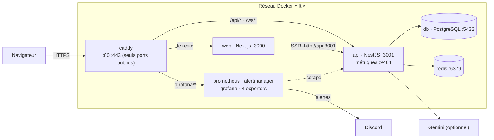

# 03 · L'architecture globale (Module 02)

## 1. Ce qu'il faut comprendre

L'architecture répond à trois questions : **quelles boîtes** existent, **qui parle à
qui**, et **qui a le droit de faire quoi**. Chez nous, la réponse tient en une règle et
un schéma.

> **La règle** : NestJS possède toute la logique métier et l'accès aux données.
> Next.js fait la présentation et le rendu serveur, rien d'autre.
> Pas de client Prisma dans `apps/web`, pas de logique métier dans des *server actions*.
> (`docs/ARCHITECTURE.md` §1, `docs/TECHNICAL_PLAN.md` §1)

Vérification [CONFIRMED] : `apps/web/package.json` ne dépend ni de `@prisma/client` ni
de Prisma ; `scripts/check-app-boundaries.sh` vérifie en CI que les deux apps compilent
séparément.

## 2. Explication dans Transcendence

### Les couches

| Couche | Composant | Responsabilité |
|---|---|---|
| **Entrée** | Caddy | TLS (HTTPS obligatoire), redirection 80 → 443, en-têtes de sécurité, routage par chemin |
| **Présentation** | `web` (Next.js) | Pages, formulaires, traduction, rendu serveur ; appelle l'API |
| **Métier** | `api` (NestJS) | Auth, cours, placement, leçons, scores, amis, présence, temps réel |
| **Contrat** | `@ft/shared` | Schémas Zod, codes d'erreur, événements socket, moteur de leçon pur |
| **Données** | PostgreSQL | Données durables (utilisateurs, cours, résultats…) |
| **Données éphémères** | Redis | Sessions, placement en cours, présence |
| **Externe** | Gemini (optionnel), Discord (alertes) | Génération de questions ; notifications |
| **Observabilité** | Prometheus, Grafana, Alertmanager, exporters | Métriques, tableaux de bord, alertes |

### Le routage de Caddy (`infra/caddy/Caddyfile`) [CONFIRMED]

| Chemin | Destination | Remarque |
|---|---|---|
| `/api`, `/api/*` | `api:3001` | Le préfixe est **conservé** : NestJS a `setGlobalPrefix('api')` |
| `/ws`, `/ws/*` | `api:3001` | Socket.IO ; Caddy gère l'upgrade WebSocket |
| `/grafana/metrics*` | réponse 404 | Bloqué volontairement (non authentifié) |
| `/grafana`, `/grafana/*` | `grafana:3000` | |
| tout le reste | `web:3000` | Next.js |

### Pourquoi « une seule origine » est la clé

Le navigateur voit **un seul site** : `https://localhost`. Les pages (`/fr/learn`) et l'API
(`/api/...`) ont la même origine. Conséquences :

- **pas de CORS** à configurer ;
- le cookie de session `ft.sid` est **first-party**, donc `SameSite=Lax` suffit et il peut
  être `httpOnly` (inaccessible au JavaScript) ;
- le WebSocket `/ws` reçoit le même cookie automatiquement.

### Deux chemins pour appeler l'API

C'est le point le plus subtil de l'architecture, et une question classique du jury.

1. **Rendu serveur (SSR)** : un Server Component de Next tourne *dans le conteneur `web`*.
   Il appelle `http://api:3001/api/...` **directement sur le réseau Docker**, sans passer
   par Caddy, en recopiant le cookie de la requête du navigateur
   (`fetchWithRequestHeaderAndIP` dans `apps/web/lib/api.ts`). [CONFIRMED]
2. **Depuis le navigateur** : un composant `'use client'` appelle `fetch('/api/...')`,
   relatif, `credentials: 'same-origin'`. La requête passe par Caddy → API
   (`apps/web/lib/api-client.ts`). [CONFIRMED]

Dans les deux cas c'est **la même API** avec **la même session** : Next n'a aucun
privilège particulier.

### Organisation des modules NestJS

`apps/api/src/app.module.ts` importe : `ConfigModule`, `ThrottlerModule`, `PrismaModule`,
`RedisModule`, `AuthModule`, `UsersModule`, `FriendsModule`, `HealthModule`,
`CoursesModule`, `PlacementModule`, `LessonsModule`, `GatewayModule`, `MetricsModule`.
`LlmModule` n'y est pas directement : il est importé par `QuestionGenerationModule`,
lui-même importé par `PlacementModule`. [CONFIRMED]

## 3. Exemple concret

Ouvrir `https://localhost/fr/learn/de` :

1. Caddy reçoit la requête HTTPS, ne reconnaît ni `/api` ni `/ws` → `web:3000`.
2. Le middleware `apps/web/proxy.ts` (next-intl) valide la locale `fr` et mémorise le
   cours `de` dans un cookie `httpOnly`.
3. La page `app/[locale]/(dashboard)/learn/[lang]/page.tsx` s'exécute **sur le serveur** :
   `requireCourses()` puis `loadToday('de')` → `GET http://api:3001/api/courses/de/today`
   avec le cookie.
4. NestJS : `AuthGuard` relit l'utilisateur, `LessonsController.today` → `LessonsService.today`
   → 4 requêtes Prisma → réponse validée par `TodaySchema`.
5. Next produit le HTML, le navigateur l'affiche, puis le composant client `RefreshOn`
   écoute `course:updated` sur le WebSocket.

## 4. Fichiers à connaître

- `infra/caddy/Caddyfile` : la porte d'entrée et le routage
- `compose.yml` : les services et le réseau `ft`
- `apps/api/src/app.module.ts` : la carte des modules du backend
- `apps/api/src/app.setup.ts` : le pipeline global (préfixe, sessions, pipe, filtre, Swagger, WebSocket)
- `apps/web/lib/api.ts` et `apps/web/lib/api-client.ts` : les deux chemins vers l'API
- `docs/ARCHITECTURE.md` : la doc de référence de l'équipe

## 5. Schéma

Le schéma complet est dans [diagrams/GLOBAL-ARCHITECTURE.md](diagrams/GLOBAL-ARCHITECTURE.md).

### Explication au tableau, étape par étape

1. **Je dessine le navigateur et une seule flèche HTTPS vers Caddy.** C'est la seule
   entrée ; rien d'autre n'est publié (`ports:` n'existe que sur `caddy` dans `compose.yml`).
2. **Caddy se divise en trois flèches** selon le chemin : `/api` et `/ws` vers l'API,
   `/grafana` vers Grafana, tout le reste vers Next.
3. **Je relie web à api** : c'est le rendu serveur. Next appelle l'API par le nom de
   service Docker `api`, en HTTP simple (le sujet autorise le clair à l'intérieur du réseau).
4. **L'API est la seule à toucher les données** : flèches vers Postgres et Redis.
5. **Je montre les dépendances optionnelles** en pointillés : Gemini (par défaut on utilise
   la fixture) et le monitoring qui *lit* les métriques de l'API sur un port interne.

## 6. Ce qu'il faut retenir

1. Règle : **Next = présentation, NestJS = métier + données**.
2. **Caddy** est le seul service exposé, en HTTPS ; il route par préfixe de chemin.
3. **Même origine** pour pages, API et WebSocket → pas de CORS, cookie first-party.
4. Deux chemins vers l'API : **SSR par le réseau Docker** et **navigateur via Caddy**.
5. `@ft/shared` est le **contrat** commun aux deux apps.
6. Postgres = durable ; Redis = éphémère (sessions, placement, présence).
7. Le monitoring est séparé : métriques sur `:9464`, jamais proxyfié par Caddy.

## 7. Questions possibles à l'oral

1. Expliquez votre architecture en une phrase.
2. Pourquoi Next ne parle-t-il pas directement à la base ?
3. Pourquoi n'avez-vous pas de configuration CORS ?
4. Le trafic entre Next et l'API est-il chiffré ?
5. Qu'est-ce qui empêche quelqu'un d'accéder directement à Postgres ?

## 8. Réponses attendues

1. « Un reverse proxy Caddy en HTTPS devant deux applications TypeScript : Next.js pour
   l'affichage, NestJS pour toute la logique, avec PostgreSQL et Redis derrière l'API. »
2. « Pour avoir un seul endroit qui applique les règles : authentification, validation,
   droits. Si Next lisait la base, il faudrait dupliquer ces règles et on aurait deux
   portes d'entrée sur les données. »
3. « Parce que tout est servi depuis la même origine par Caddy. Le navigateur ne fait
   jamais de requête cross-origin. »
4. « Non, c'est du HTTP sur le réseau Docker interne, ce que le sujet autorise. Tout ce
   qui vient de l'extérieur est en HTTPS, terminé par Caddy. »
5. « Il n'a pas de port publié en production. En développement, il est publié sur
   `127.0.0.1:5432` seulement, donc inaccessible depuis le réseau. »

## 9. Mini-exercice

Dessine de mémoire le schéma ci-dessus, puis vérifie dans `compose.yml` : quels
services ont une section `ports:` ? Dans `compose.override.yml` (dev), lesquels de plus ?

## 10. Auto-évaluation

1. Vers où Caddy envoie-t-il `/ws/` ?
2. Pourquoi Caddy utilise `handle` et non `handle_path` pour `/api` ?
3. Comment Next transmet-il l'identité de l'utilisateur à l'API pendant le SSR ?
4. Quel module NestJS importe le module LLM ?
5. Sur quel port l'API expose-t-elle ses métriques, et qui peut y accéder ?

### Corrections

1. Vers `api:3001` (Socket.IO est hébergé dans l'API).
2. `handle_path` retirerait le préfixe `/api` et toutes les routes NestJS (préfixées `api`) répondraient 404.
3. Il recopie les cookies de la requête entrante (dont `ft.sid`) et l'en-tête `x-forwarded-for` dans son `fetch` vers `http://api:3001`.
4. `QuestionGenerationModule`, importé par `PlacementModule`.
5. 9464, sur le réseau Docker uniquement, lu par Prometheus ; Caddy ne le proxyfie jamais.

Mini-exercice : en prod, seul `caddy` ; en dev, `db` (`127.0.0.1:5432`) et `redis` (`127.0.0.1:6379`) en plus.
