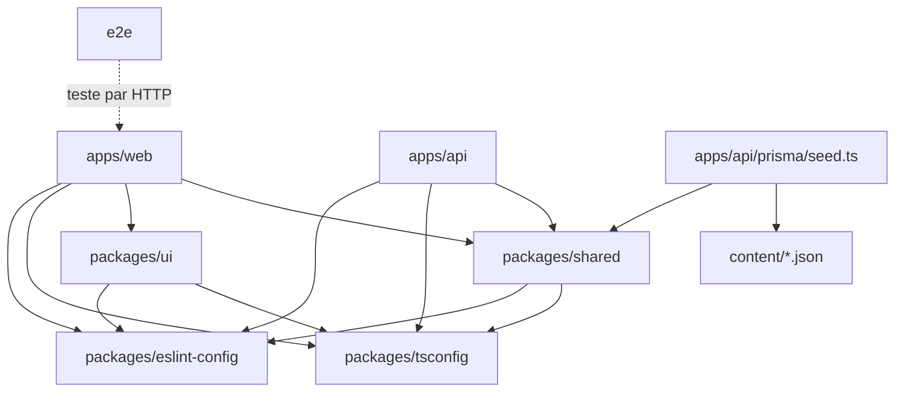

# 04 · La structure du code (Module 03)

## 1. Ce qu'il faut comprendre

Le dépôt est un **monorepo pnpm** : un seul `pnpm-lock.yaml`, plusieurs paquets déclarés
dans `pnpm-workspace.yaml`. Les paquets se référencent entre eux par `workspace:*`
(par exemple `"@ft/shared": "workspace:*"` dans `apps/api/package.json`), ce qui fait un
lien local, pas un téléchargement.

Taille [CONFIRMED, scan Understand Anything] : 563 fichiers analysés hors contenu
pédagogique, dont 422 en TypeScript ; 66 fichiers `*.spec.ts`, 43 `*.test.ts(x)`,
16 `*.e2e-spec.ts` et 22 specs Playwright.

## 2. Explication dans Transcendence

### L'arborescence commentée

```
ft_transcendence/
├── apps/
│   ├── api/            NestJS : TOUT le métier et l'accès aux données
│   │   ├── src/        un dossier = un module Nest (auth, courses, lessons…)
│   │   ├── prisma/     schema.prisma, 13 migrations SQL, seed.ts
│   │   ├── scripts/    outils hors prod : écrire/vérifier les leçons, tester Gemini
│   │   └── test/       tests HTTP « e2e » (Supertest + vraie base)
│   └── web/            Next.js : pages et composants
│       ├── app/        routing par dossiers : app/[locale]/(groupe)/page.tsx
│       ├── components/ composants React réutilisables (+ lesson/ : le lecteur)
│       ├── lib/        appels API, session, logique d'affichage pure (testée)
│       ├── i18n/       configuration next-intl
│       ├── messages/   en.json, fr.json, de.json (475 lignes chacun)
│       └── proxy.ts    middleware Next 16 (locale + cookie du cours)
├── packages/
│   ├── shared/         @ft/shared : schémas Zod, erreurs, événements, moteur de leçon
│   ├── ui/             @ft/ui : Button, Card, ProgressBar
│   ├── tsconfig/       configurations TS communes
│   └── eslint-config/  règles ESLint communes
├── content/            LE CONTENU PÉDAGOGIQUE (JSON, versionné)
│   ├── outlines/       18 syllabus (3 langues × 6 niveaux) = 3 990 entrées
│   ├── briefs/         216 fiches de leçon écrites
│   ├── lessons/        108 fichiers d'exercices (tous types sauf vocabulaire)
│   └── items/          9 fichiers = 270 questions de placement
├── e2e/                Playwright : 22 fichiers de tests navigateur
├── infra/              caddy/, monitoring/ (prometheus, grafana, alertmanager), deploy/
├── scripts/            contrôles shell lancés par la CI et `make ci`
├── docs/               la documentation de l'équipe (+ ce cours)
├── .github/            4 workflows, CODEOWNERS, template de PR, commitlint
├── .claude/            skills et workflow pour écrire le contenu avec Claude Code
├── .devcontainer/      environnement VS Code dans un conteneur
├── compose*.yml        4 fichiers Compose (base, dev, prod, déploiement)
└── Makefile            le point d'entrée : `make`
```

### `apps/api/src` : un dossier par module

| Dossier | Contenu essentiel | Interagit avec |
|---|---|---|
| `auth/` | contrôleur (signup, login, 2FA, logout, me), `AuthGuard` global, `TwoFactorService` | prisma, gateway (fermer les sockets) |
| `users/` | recherche, profil public, « récemment actifs », édition de profil, avatar | prisma |
| `friends/` | demandes, acceptation, suppression ; `pair.ts` (clé de paire) | prisma, gateway, presence |
| `courses/` | créer un cours, changer objectif ou niveau | prisma, gateway, lessons/goal |
| `placement/` | test adaptatif ; session dans Redis | redis, prisma, courses, question-generation |
| `question-generation/` | regarnir la banque de questions via le LLM | llm, prisma |
| `llm/` | interface `LlmProvider`, `GeminiProvider`, `FixtureProvider`, fabrique | metrics |
| `lessons/` | aujourd'hui, liste, leçon, tentative, règles (objectif, série, XP, succès) | prisma, gateway, @ft/shared/lessons |
| `gateway/` | passerelle Socket.IO, `SocketsService`, adaptateur de session | redis, prisma, presence |
| `presence/` | compteur de sockets par utilisateur dans Redis | redis |
| `throttler/` | limitation par compte ou par IP | — |
| `prisma/`, `redis/` | les deux clients, instanciés une seule fois | — |
| `metrics/`, `health/` | Prometheus `:9464`, `GET /api/health` | — |
| `demo/` | génère 6 apprenants de démonstration (dev uniquement) | seed |
| racine | `main.ts`, `app.module.ts`, `app.setup.ts`, `validation.pipe.ts`, `error-code.filter.ts` | tout |

Une convention à remarquer : les **règles métier pures** sont dans des fichiers
`*.rules.ts` (`roadmap.rules.ts`, `gamification.rules.ts`) sans base de données, donc
faciles à tester ; les fichiers qui écrivent en base (`goal.ts`, `gamification.ts`)
reçoivent la transaction `tx` en paramètre. [CONFIRMED]

### `apps/web/app` : le routing par dossiers

```
app/
├── [locale]/                     segment dynamique : en | fr | de
│   ├── layout.tsx                <html lang>, NextIntlClientProvider
│   ├── (main)/                   groupe « site » : en-tête + pied de page légal
│   │   ├── page.tsx              accueil
│   │   ├── signup/ login/        formulaires
│   │   ├── onboarding/           choisir une langue puis un niveau
│   │   ├── profile/ profile/edit/ users/[id]/ friends/ settings/2fa/
│   │   └── privacy/ terms/       pages légales obligatoires
│   ├── (dashboard)/              groupe « application » : navigation du tableau de bord
│   │   ├── learn/                redirige vers le dernier cours
│   │   ├── learn/[lang]/         aujourd'hui, objectif, niveau
│   │   │   ├── placement/        test de placement
│   │   │   └── lessons/[id]/     page de leçon, /play (lecteur), /results
│   │   └── dashboard/            redirige vers /learn
│   ├── (mode)/chat/              maquette du chat (pas de logique)
│   ├── [...rest]/                toute URL inconnue → 404 traduite
│   ├── error.tsx, not-found.tsx
└── healthz/                      sondes : /healthz, /healthz/api, /healthz/upstream
```

Les parenthèses `(main)` sont des **route groups** : elles n'apparaissent pas dans l'URL,
elles servent à donner un **layout** différent à un ensemble de pages.

### `packages/shared/src`

| Dossier | Contenu |
|---|---|
| `schemas/` | `user.ts`, `course.ts`, `lesson.ts`, `placement.ts`, `friend.ts`, `gamification.ts`, `errors.ts` (la liste `ERROR_CODES`)… |
| `events/socket.ts` | noms et charges utiles des événements Socket.IO |
| `lessons/schemas/` | format des fichiers de leçon, par type |
| `lessons/validation/` | validateurs du contenu (utilisés par le seed et l'outil d'écriture) |
| `lessons/player/` | **le moteur de leçon** : `plan`, `attempt`, `score`, `redact`, `view`, `feedback` |

## 3. Exemple concret : suivre une fonctionnalité à travers les dossiers

« Envoyer une demande d'ami » touche :

```
apps/web/components/friend-buttons.tsx       bouton (client)
  → apps/web/lib/friends-client.ts           sendFriendRequest(userId)
    → POST /api/friends/requests/:userId
      → apps/api/src/friends/friends.controller.ts   @Post('requests/:userId'), throttle 10/min
        → apps/api/src/friends/friends.service.ts    send → trySend → create
          → apps/api/src/friends/pair.ts             pairKey(a, b)
          → Prisma friendship.create                 table Friendship
          → apps/api/src/gateway/sockets.service.ts  toUser(..., 'friend:request')
packages/shared/src/schemas/friend.ts        FriendRequestResultSchema (des deux côtés)
packages/shared/src/events/socket.ts         FRIEND_REQUEST
```

## 4. Fichiers à connaître

Voir la liste complète de 35 fichiers commentés : [18-IMPORTANT-FILES.md](18-IMPORTANT-FILES.md).

## 5. Schéma : dépendances entre paquets



## 6. Ce qu'il faut retenir

1. **Deux apps** (`api`, `web`), **quatre paquets** (`shared`, `ui`, `tsconfig`, `eslint-config`).
2. Backend : **un dossier = un module Nest** (contrôleur + service + module + DTO).
3. Frontend : **le chemin des dossiers = l'URL** ; `[locale]` et `(groupes)`.
4. `@ft/shared` contient aussi **le moteur de leçon**, exécuté uniquement par l'API.
5. `content/` = **le contenu pédagogique en JSON**, chargé en base par le seed.
6. Les règles métier pures sont dans les `*.rules.ts`.
7. Les tests unitaires sont **à côté** du code (`x.spec.ts`, `x.test.ts`) ; les tests HTTP dans `apps/api/test/`.

## 7. Questions possibles à l'oral

1. Pourquoi un monorepo ?
2. Où est le code qui calcule la note d'une leçon ?
3. Que contient `content/`, et comment arrive-t-il en base ?
4. À quoi servent les dossiers entre parenthèses dans `app/` ?
5. Où ajouteriez-vous une nouvelle route API ?

## 8. Réponses attendues

1. « Pour partager le code (`@ft/shared`) entre front et back sans publier de paquet, avoir
   une seule CI et changer un contrat et ses deux utilisateurs dans le même commit. »
2. « Dans `packages/shared/src/lessons/player/score.ts` et `attempt.ts`, mais il n'est
   appelé que par l'API, dans `AttemptsService.submit`. Le navigateur ne note jamais. »
3. « Des JSON : les syllabus, les fiches et exercices de leçon, la banque de questions.
   `make seed` lance `prisma/seed.ts`, qui valide chaque leçon avec `validateLesson` et
   fait un `upsert` par leçon, en marquant `ready` celles qui sont complètes et valides. »
4. « Ce sont des route groups : ils ne changent pas l'URL, ils regroupent des pages sous un
   même layout, par exemple le tableau de bord. »
5. « Dans le module concerné de `apps/api/src` : une méthode décorée `@Get`/`@Post` dans
   le contrôleur, la logique dans le service, le schéma dans `@ft/shared`. Elle est privée
   par défaut grâce à l'`AuthGuard` global. »

## 9. Mini-exercice

Trouve dans `apps/web/app` le fichier qui s'exécute quand on ouvre
`https://localhost/de/learn/fr/lessons/fr-subject-pronouns/play`. Quels segments sont dynamiques ?

## 10. Auto-évaluation

1. Combien de syllabus dans `content/outlines`, et pourquoi ce nombre ?
2. Quel fichier liste tous les codes d'erreur ?
3. Où sont les migrations SQL, et combien y en a-t-il ?
4. Qu'est-ce qui distingue `goal.ts` de `roadmap.rules.ts` ?
5. Où vivent les tests HTTP de l'API ?

### Corrections

1. 18 = 3 langues × 6 niveaux (`fr-a1.json` … `de-c2.json`).
2. `packages/shared/src/schemas/errors.ts`.
3. `apps/api/prisma/migrations/`, 13 migrations (de `init_user` à `add_gamification`).
4. `roadmap.rules.ts` = fonctions pures sans base ; `goal.ts` = écrit en base avec la transaction `tx` (verrou, objectif atteint).
5. `apps/api/test/*.e2e-spec.ts`.

Mini-exercice : `app/[locale]/(dashboard)/learn/[lang]/lessons/[id]/play/page.tsx` ;
dynamiques : `[locale]` = `de`, `[lang]` = `fr`, `[id]` = `fr-subject-pronouns`.
