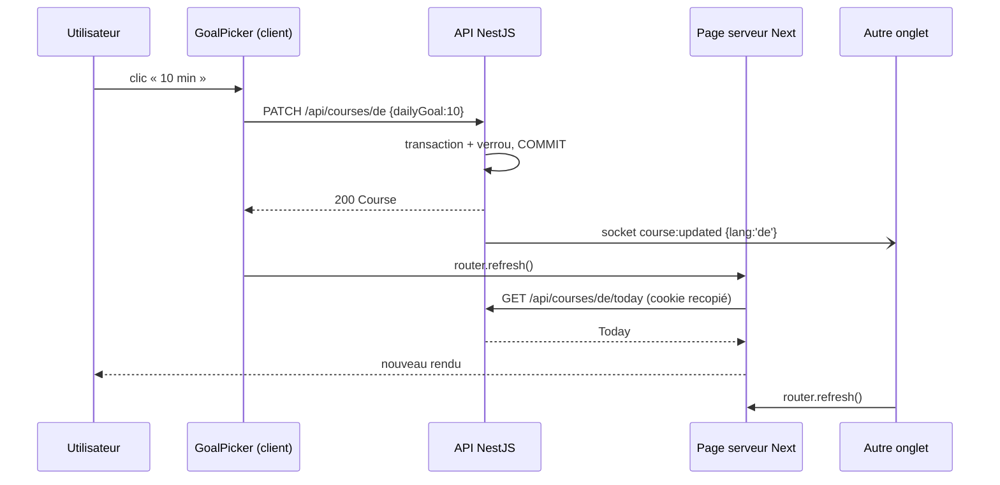

# 05 · Le frontend (Module 04)

## 1. Ce qu'il faut comprendre

Le frontend est une application **Next.js 16 avec l'App Router**. Trois idées suffisent :

1. **Le dossier = l'URL.** `app/[locale]/(main)/signup/page.tsx` répond à `/fr/signup`.
2. **Par défaut, un composant s'exécute sur le serveur** (*Server Component*). Il peut
   être `async`, faire un `fetch`, et n'envoie au navigateur que du HTML. Il ne peut pas
   avoir d'état ni de gestionnaire de clic.
3. **Un fichier qui commence par `'use client'`** est un *Client Component* : il tourne
   aussi dans le navigateur, avec `useState`, `useEffect`, `onClick`, `onSubmit`.

Chez nous, la règle est simple : **les pages lisent sur le serveur, les formulaires et le
lecteur de leçon écrivent depuis le navigateur**, puis demandent à Next de relire la page
(`router.refresh()`).

## 2. Explication dans Transcendence

### Initialisation et routing

| Élément | Fichier | Rôle |
|---|---|---|
| Middleware | `apps/web/proxy.ts` | next-intl : ajoute/valide le préfixe `/en` `/fr` `/de` ; mémorise le dernier cours visité dans le cookie `httpOnly` `ft.lang` (1 an). Exclut `/api`, `/healthz`, les fichiers. [CONFIRMED] |
| Routing i18n | `apps/web/i18n/routing.ts` | `locales = SUPPORTED_LOCALES` (de `@ft/shared`), `localePrefix: 'always'` |
| Chargement des traductions | `apps/web/i18n/request.ts` | importe `messages/<locale>.json` |
| Layout racine | `app/[locale]/layout.tsx` | vérifie la locale (`notFound()` sinon), pose `<html lang>`, fournit les messages via `NextIntlClientProvider` |
| Layouts de groupe | `(main)/layout.tsx`, `(dashboard)/layout.tsx`, `(mode)/layout.tsx` | coquille `Shell` avec en-tête et **pied de page légal** (`LegalFooter`) partout |
| Config | `next.config.ts` | `output: 'standalone'` (image Docker minimale), plugin next-intl, `poweredByHeader: false` |

Note : dans Next.js 16, le fichier de middleware s'appelle `proxy.ts` (anciennement
`middleware.ts`). [INFERRED : export `default function proxy` + `config.matcher`]

### Les pages et leurs layouts

| Groupe | Pages | Particularité |
|---|---|---|
| `(main)` | accueil, signup, login, onboarding, profile, profile/edit, users/[id], friends, settings/2fa, privacy, terms | `HeaderNav` |
| `(dashboard)` | learn, learn/[lang], placement, lessons/[id], /play, /results, dashboard | `DashboardNav`, `TimeZoneSync` |
| `(mode)` | chat | bouton ✕ pour revenir ; page **statique** [NOT PRESENT fonctionnellement] |

### Lire des données : le chemin serveur

`apps/web/lib/api.ts` fournit `apiGet(schema, path)` et `apiFind(...)` :

```ts
// apps/web/lib/api.ts (extrait simplifié)
export async function fetchWithRequestHeaderAndIP(fetcher) {
  const cookie = (await cookies()).getAll().map(({ name, value }) => `${name}=${value}`).join('; ');
  const forwardedFor = (await headers()).get('x-forwarded-for');
  return fetcher({ baseUrl: process.env.API_INTERNAL_URL, cookie, forwardedFor });
}
// fetchJson : fetch(url, { cache: 'no-store', headers: { cookie, 'x-forwarded-for' } })
//   401        → { status: 'signed-out' }
//   404        → { status: 'not-found' } (apiFind seulement)
//   autre !ok  → { status: 'unavailable', reason }
//   200        → schema.safeParseAsync(json) → { status: 'ok', data }
```

Ce qu'il faut expliquer :

- **Paramètres** : un schéma Zod (de `@ft/shared`) et un chemin. **Retour** : une union
  discriminée par `status`, donc la page *doit* traiter chaque cas.
- **La réponse de l'API est validée** par Zod côté web aussi : si l'API change de forme,
  la page échoue proprement au lieu d'afficher n'importe quoi.
- `cache: 'no-store'` : chaque rendu relit l'API (les données sont personnelles).
- `lib/session.ts` : `loadSession` est enveloppé dans `cache()` de React, donc **un seul**
  appel `/api/auth/me` par rendu, même si plusieurs composants demandent l'utilisateur.
  `requireUser()` redirige vers `/login` si la session est absente.

### Écrire des données : le chemin navigateur

`apps/web/lib/api-client.ts` fournit `clientGet/Post/Put/Patch/Delete(schema, path, body)` :

- `fetch` **relatif** (`/api/...`) avec `credentials: 'same-origin'` → passe par Caddy ;
- retour `{ ok: true, data }` ou `{ ok: false, code, status }` ;
- `code` est lu par `readCode(body)` dans le champ `message` de l'erreur NestJS ;
- erreur réseau → `network.unreachable`.

Au-dessus, des modules par domaine : `auth-client.ts`, `courses-client.ts`,
`placement-client.ts`, `friends-client.ts`, `lesson-client.ts`.

### Gestion des erreurs : des codes, pas des phrases

L'API ne renvoie **jamais** de phrase, seulement un code de `ERROR_CODES`
(`packages/shared/src/schemas/errors.ts`), par exemple `auth.invalidCredentials`.
Le navigateur le traduit :

```ts
// apps/web/lib/error-message.ts
export function useErrorMessage() {
  const t = useTranslations('Errors');
  return useCallback((code, status = 0) => t(isErrorCode(code) ? code : 'unknown', { status }), [t]);
}
```

Pourquoi : la langue de l'interface est connue dans le navigateur, pas dans l'API.
Les erreurs de rendu sont attrapées par `app/[locale]/error.tsx` et `app/global-error.tsx`.

### État : local, pas de store global

Il n'y a **ni Redux, ni Zustand, ni Context applicatif**. [CONFIRMED : aucune dépendance
de ce type dans `apps/web/package.json`] L'état vit :

- **sur le serveur** (la source de vérité est l'API ; on relit avec `router.refresh()`) ;
- **dans les composants** (`useState` pour un formulaire, `useRef` pour des drapeaux) ;
- **dans un module** pour le socket : `components/tab-socket.ts` garde *une* connexion par
  onglet en variable de module et l'expose par des hooks basés sur `useSyncExternalStore`
  (`useSocketStatus`, `useFriendOnline`, `useServerEvent`) ;
- **dans `localStorage`** pour les brouillons de réponses d'une leçon (`lib/lesson-client.ts`,
  `loadDrafts`/`saveDrafts`), qui survivent à un rechargement.

### Hooks maison à connaître

| Hook | Fichier | Rôle |
|---|---|---|
| `useErrorMessage` | `lib/error-message.ts` | code → phrase traduite |
| `useCourseSave` | `lib/use-course-save.ts` | enchaîne les écritures en série (`serialQueue`), affiche l'erreur, puis `router.refresh()` |
| `useSocketStatus` | `components/tab-socket.ts` | `connected` / `reconnecting` / `closed` / `signedOut` |
| `useServerEvent` | `components/tab-socket.ts` | s'abonner à un événement serveur |
| `useFriendOnline` | `components/tab-socket.ts` | statut en ligne d'un ami, mis à jour en direct |

### Composants principaux et leurs relations

```
Shell (components/shell.tsx)
├── HeaderNav / DashboardNav
│   └── SessionNav (serveur) ── ConnectionStatus (client) ── connectSocket()
│                            └─ LogOutButton (client) ── closeSocket()
├── {children} = la page
│   └── learn/[lang]/page.tsx (serveur)
│       ├── RefreshOn events=[course:updated] (client)
│       ├── StreakLine, TodayCard, MoreLessons, LevelComplete (today.tsx)
│       ├── DirectLevelPicker, GoalPicker (client → useCourseSave → PATCH)
└── LegalFooter (liens /privacy et /terms : obligatoires)
```

Le lecteur de leçon : `lessons/[id]/play/page.tsx` (serveur) charge la tentative puis rend
`LessonPlayer` (`player.tsx`, client), qui choisit un rendu par type d'item grâce à
`ITEM_RENDERERS` (`components/lesson/kinds/index.ts`). **Seul le type `grammar` est
enregistré** ; `playable(kind)` renvoie `false` pour les trois autres, et la page de
leçon ne propose alors pas de jouer. [CONFIRMED]

## 3. Exemple concret : du clic au résultat affiché

**Changer son objectif quotidien de 30 à 10 minutes** sur `/fr/learn/de` :

1. Clic dans `GoalPicker` (client, `app/[locale]/(dashboard)/learn/[lang]/goal-picker.tsx`).
2. `save(() => clientPatch(CourseSchema, '/api/courses/de', { dailyGoal: 10 }))`
   via `useCourseSave` : bouton en attente, erreurs effacées.
3. Le navigateur envoie `PATCH /api/courses/de` (cookie `ft.sid` joint automatiquement).
4. L'API valide (`SetGoalDto` → `DailyGoalSchema` : 10, 30 ou 60), verrouille le cours,
   écrit, vérifie si l'objectif du jour est maintenant atteint, attribue l'XP, puis
   **après le commit** émet `course:updated { lang: 'de' }` vers la room de l'utilisateur.
5. Réponse `200 Course` → `CourseSchema` valide → `router.refresh()`.
6. Next réexécute la page **sur le serveur** (`GET /api/courses/de/today`) et envoie le
   nouveau rendu : « Objectif 10 min : 1 leçon sur 1 ».
7. Dans les **autres onglets**, `RefreshOn` reçoit `course:updated` et fait aussi
   `router.refresh()`.

## 4. Fichiers à connaître

- `apps/web/proxy.ts`, `apps/web/i18n/routing.ts`
- `apps/web/app/[locale]/layout.tsx`
- `apps/web/lib/api.ts` (serveur), `apps/web/lib/api-client.ts` (navigateur)
- `apps/web/lib/session.ts`, `apps/web/lib/error-message.ts`
- `apps/web/components/tab-socket.ts`, `apps/web/components/refresh-on.tsx`
- `apps/web/app/[locale]/(main)/signup/signup-form.tsx` (formulaire modèle)
- `apps/web/app/[locale]/(dashboard)/learn/[lang]/page.tsx` (page modèle)
- `apps/web/app/[locale]/(dashboard)/learn/[lang]/lessons/[id]/play/player.tsx` (le plus gros composant)
- `apps/web/components/lesson/kinds/index.ts` (`playable`)

## 5. Schéma

Voir aussi [diagrams/FRONTEND-BACKEND-FLOW.md](diagrams/FRONTEND-BACKEND-FLOW.md).



## 6. Ce qu'il faut retenir

1. **Server Components pour lire**, **Client Components pour écrire**, puis `router.refresh()`.
2. Deux clients HTTP : `lib/api.ts` (serveur, cookie recopié) et `lib/api-client.ts` (navigateur, relatif).
3. **Toutes les réponses de l'API sont validées par Zod** côté web.
4. Les erreurs sont des **codes** traduits par `useErrorMessage`.
5. Pas de store global : la vérité est **sur le serveur**.
6. **Un socket par onglet**, en variable de module, exposé par des hooks.
7. i18n : `next-intl`, préfixe obligatoire, 3 catalogues.
8. Le lecteur ne sait jouer que la **grammaire** aujourd'hui.

## 7. Questions possibles à l'oral

1. Comment validez-vous un formulaire côté frontend ?
2. Comment la page sait-elle qui est connecté ?
3. Pourquoi pas de Redux ?
4. Comment la page se met-elle à jour après une modification ?
5. Que se passe-t-il si l'API renvoie un JSON inattendu ?

## 8. Réponses attendues

1. « Avec le même schéma Zod que le backend. Dans le formulaire d'inscription,
   `SignUpFormSchema.safeParse` vérifie e-mail, pseudo, mot de passe et confirmation ; le
   premier code d'erreur est traduit et affiché. Puis l'API revalide avec `CreateUserSchema`. »
2. « Le layout ou la page serveur appelle `currentUser()` ou `requireUser()`, qui fait
   `GET /api/auth/me` en recopiant le cookie. Résultat mis en cache pour la durée du rendu. »
3. « La source de vérité est l'API. Après une écriture on relit la page serveur avec
   `router.refresh()` ; il n'y a pas de copie côté client à synchroniser. Le seul état
   partagé, le socket, vit dans un module avec `useSyncExternalStore`. »
4. « Localement par `router.refresh()` ; dans les autres onglets par l'événement socket
   `course:updated`, que le composant `RefreshOn` transforme en `router.refresh()`. »
5. « `safeParse` échoue, on renvoie `unavailable` côté serveur (la page lève une erreur,
   attrapée par `error.tsx`) ou `server.unexpected` côté client, affiché comme « erreur
   inattendue ». Jamais de donnée non validée à l'écran. »

## 9. Mini-exercice

Dans `signup-form.tsx`, liste dans l'ordre ce qui se passe entre `onSubmit` et
l'arrivée sur `/onboarding`. Combien de fois le mot de passe est-il validé, et où ?

## 10. Auto-évaluation

1. Que fait `proxy.ts`, en deux points ?
2. Quelle fonction utiliser dans une page serveur pour exiger une session ?
3. Où sont stockés les brouillons de réponse d'une leçon ?
4. Quel composant ouvre le WebSocket, et quand ?
5. Pourquoi le bouton « voir toutes les leçons » mène-t-il à une 404 ?

### Corrections

1. Applique le middleware next-intl (préfixe de locale) et écrit le cookie `httpOnly` du dernier cours ouvert.
2. `requireUser()` (`lib/session.ts`), qui redirige vers `/login`.
3. Dans `localStorage`, par (langue, leçon, tentative) : `lib/lesson-client.ts`.
4. `ConnectionStatus`, rendu par `SessionNav` pour un utilisateur connecté : `useEffect(() => connectSocket(), [pathname])`.
5. La page `learn/[lang]/lessons/page.tsx` n'existe pas encore ; l'URL tombe sur `[...rest]` qui appelle `notFound()`. L'API, elle, sait répondre (`GET /api/courses/:lang/lessons`).

Mini-exercice : `preventDefault` → `SignUpFormSchema.safeParse` (1re validation, navigateur)
→ `signUp()` → `POST /api/auth/signup` → `CodeValidationPipe` avec `CreateUserSchema`
(2e validation, serveur) → `201` → `router.replace('/onboarding')` + `router.refresh()`.
