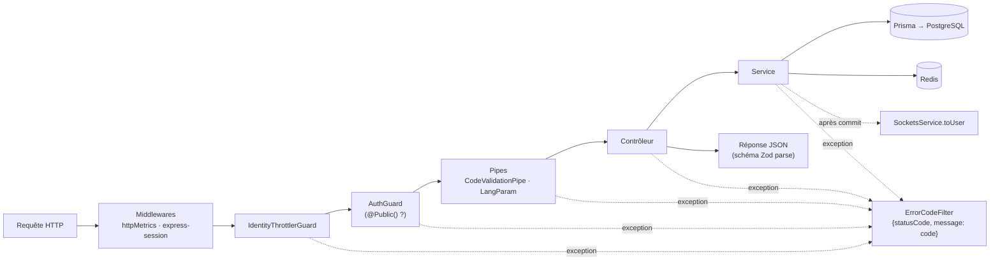

# 06 · Le backend (Module 05)

## 1. Ce qu'il faut comprendre

NestJS organise un serveur en **modules**. Chaque module regroupe :

- des **contrôleurs** : des classes dont les méthodes, décorées par `@Get()`, `@Post()`…,
  répondent à une URL. Ils lisent la requête et délèguent ;
- des **services** (`@Injectable()`) : la logique métier ;
- des **providers** injectés par le constructeur (**injection de dépendances**) : Nest
  construit les objets et les passe automatiquement.

Une requête traverse, dans l'ordre : **middlewares** (Express) → **guards** (ai-je le droit ?)
→ **pipes** (validation/transformation) → **contrôleur** → **service** → base → réponse ;
une exception est transformée en réponse HTTP par un **filtre**.

Chez nous il n'y a **pas de couche « repository »** séparée : les services utilisent
directement `PrismaService`. [CONFIRMED]

## 2. Explication dans Transcendence

### Démarrage du serveur

```ts
// apps/api/src/main.ts (simplifié)
const app = await NestFactory.create(AppModule);
configureApp(app);                                   // tout le pipeline global
await app.listen(Number(process.env.PORT ?? 3001), '0.0.0.0');
collectDefaultMetrics({ register: registry });       // après listen
startMetricsServer(METRICS_PORT)                     // :9464, serveur séparé
  .catch(err => new Logger('Metrics').error(...));   // le monitoring ne fait jamais tomber l'app
```

`configureApp` (`apps/api/src/app.setup.ts`) est appelé **aussi par les tests e2e**, pour
que les tests utilisent exactement le même pipeline. Il installe, dans cet ordre :

1. `httpMetrics` : middleware qui chronomètre toutes les requêtes ;
2. `setGlobalPrefix('api')` : toutes les routes commencent par `/api` ;
3. les fichiers statiques des avatars sous `/api/uploads/avatars` ;
4. `trust proxy = 1` : un seul saut (Caddy) est de confiance pour `X-Forwarded-*` ;
5. `CodeValidationPipe` global (Zod) ;
6. `ErrorCodeFilter` global ;
7. `express-session` avec `RedisStore` (cookie `ft.sid`) ;
8. `SessionIoAdapter` : le même middleware de session pour Socket.IO ;
9. Swagger sur `/api/docs`.

L'app **refuse de démarrer** si `SESSION_SECRET` fait moins de 32 caractères, si
`DATABASE_URL` ou `AVATAR_STORAGE_DIR` manquent. [CONFIRMED]

### Les guards globaux

Deux `APP_GUARD` sont enregistrés :

- `IdentityThrottlerGuard` (`app.module.ts`) : 100 requêtes / 60 s, comptées **par compte**
  (`user:<id>`) si connecté, sinon **par IP**. Les routes marquées `@ThrottleByIp(n)`
  comptent toujours par IP (login, 2FA : 5/min ; signup : 10/min). Le stockage du
  throttler est celui par défaut, **en mémoire du processus**. [INFERRED : aucun `storage`
  passé à `ThrottlerModule.forRoot`]
- `AuthGuard` (`auth.module.ts`) : **toute route est privée** sauf si elle porte `@Public()`.
  Il relit l'utilisateur en base à chaque requête et le met dans `request.user`.

### Validation : `CodeValidationPipe`

Les DTO sont fabriqués à partir des schémas Zod partagés :

```ts
// apps/api/src/auth/auth.dto.ts
export class SignUpDto extends createZodDto(CreateUserSchema) {}
```

Le pipe (`apps/api/src/validation.pipe.ts`) est celui de `nestjs-zod`, modifié pour que la
réponse d'erreur mette **les codes** dans `message` :

```json
{ "statusCode": 400, "message": ["email.invalid", "password.tooShort"] }
```

Il existe aussi deux pipes de paramètres : `LangParam` (le `:lang` doit être `en|fr|de`,
sinon `400 course.unknownLanguage`) et `UserIdParam` (UUID, mis en minuscules).

### Gestion des erreurs : `ErrorCodeFilter`

Les services lèvent des exceptions Nest avec un code : `throw new ConflictException('course.alreadyStarted')`.
Le filtre global (`apps/api/src/error-code.filter.ts`) garantit qu'**aucune réponse ne
contient une phrase** : JSON invalide → `request.invalid`, corps trop gros → `request.tooLarge`,
route inconnue ou crash → `server.unexpected` (et le crash est journalisé avec sa pile).

### Les routes (toutes préfixées `/api`)

| Module | Méthode et chemin | Public | Effet |
|---|---|---|---|
| auth | `POST /auth/signup` | oui, 10/min/IP | créer un compte + session |
| auth | `POST /auth/login` | oui, 5/min/IP | `200 SessionUser` ou `202 {twoFactorRequired}` |
| auth | `POST /auth/2fa/verify` | oui, 5/min/IP | finir une connexion 2FA |
| auth | `GET /auth/2fa`, `POST /auth/2fa/setup`, `POST /auth/2fa/enable`, `DELETE /auth/2fa` | non | gérer la 2FA |
| auth | `POST /auth/logout` | oui | détruire la session |
| auth | `GET /auth/me` | non | l'utilisateur courant |
| users | `GET /users?q=`, `GET /users/recently-active`, `GET /users/:id` | non | recherche, actifs < 7 j, profil public |
| users | `PATCH /users/me`, `POST /users/me/avatar`, `DELETE /users/me/avatar` | non | profil, avatar |
| friends | `GET /friends`, `POST /friends/requests/:userId` (10/min), `POST …/accept`, `DELETE /friends/requests/:userId`, `DELETE /friends/:userId` | non | amitiés |
| courses | `GET /courses`, `POST /courses`, `PATCH /courses/:lang`, `PATCH /courses/:lang/level` | non | cours, objectif, niveau |
| placement | `POST /placement`, `GET /placement`, `POST /placement/answers`, `DELETE /placement` | non | test de niveau |
| lessons | `GET /courses/:lang/today`, `GET /courses/:lang/lessons`, `GET /courses/:lang/lessons/:id`, `GET /courses/:lang/achievements` | non | lectures |
| attempts | `GET` et `POST /courses/:lang/lessons/:id/attempt`, `POST …/attempt/pages/:index` | non | jouer une leçon |
| health | `GET /health` | oui | état de la base et de Redis |

[CONFIRMED : décorateurs des contrôleurs dans `apps/api/src/*/*.controller.ts`]

### Accès aux données

`PrismaService` (`apps/api/src/prisma/prisma.service.ts`) **étend** `PrismaClient` avec
l'adaptateur `PrismaPg` (obligatoire en Prisma 7 avec le générateur `prisma-client`), se
connecte au démarrage (`onModuleInit`) pour qu'une mauvaise `DATABASE_URL` fasse échouer
le conteneur et non la première requête. Trois techniques reviennent partout :

1. **`select` explicite** (`LESSON_SELECT`, `PUBLIC_USER_SELECT`) : une colonne qu'on ne
   demande pas ne peut pas fuiter (ex. `passwordHash`, `brief` d'une leçon).
2. **Contraintes uniques plutôt que vérifications préalables** : on tente l'insertion et on
   attrape `P2002` (doublon) → `409`. Un `SELECT` avant `INSERT` laisserait une course.
3. **Transactions + verrou de ligne** pour tout ce qui touche la journée d'un cours :
   `lockCourse` fait `SELECT … FOR UPDATE` sur `UserLevel` (`apps/api/src/lessons/goal.ts`).

### Communication avec les autres services

- **Redis** via `RedisService` (client `redis` v6) : sessions, placement, présence, sondes.
- **Socket.IO** via `SocketsService.toUser(userId, event, payload)`, appelé par les services
  **après** le commit (courses, friends, attempts).
- **LLM** via le jeton d'injection `LLM_PROVIDER` : `QuestionStockService` reçoit soit
  `GeminiProvider`, soit `FixtureProvider` (`llm.factory.ts`, selon `LLM_PROVIDER`).

## 3. Exemple concret : le chemin d'une requête

**`GET /api/courses/de/today`**

```
Navigateur ou serveur Next
  → Caddy (/api/* → api:3001)
  → httpMetrics (début du chrono)
  → express-session : lit le cookie ft.sid, charge sess:<id> depuis Redis
  → IdentityThrottlerGuard : compteur user:<id> < 100/min ?
  → AuthGuard : session.userId ? → AuthService.findById → request.user
  → LangParam : 'de' ∈ {en, fr, de}
  → LessonsController.today(user, 'de')
  → LessonsService.today(user.id, 'de', user.timeZone, new Date())
       ├─ userLevel.findUnique (le cours) → checkCourse : 404 course.notFound / 409 course.notPlaced
       ├─ en parallèle : lesson.findMany (leçons du niveau) + lessonResult.findMany (résultats)
       ├─ courseDay(now, timeZone, …) : « aujourd'hui » dans le fuseau de l'apprenant
       ├─ plan(...) : faites / proposées / en plus (roadmap.rules.ts)
       └─ userAchievement.findMany (succès du jour)
  → TodaySchema.parse(...)        ← la sortie est validée aussi !
  → 200 JSON
```

## 4. Fichiers à connaître

- `apps/api/src/main.ts`, `apps/api/src/app.setup.ts`, `apps/api/src/app.module.ts`
- `apps/api/src/validation.pipe.ts`, `apps/api/src/error-code.filter.ts`
- `apps/api/src/auth/auth.guard.ts`, `apps/api/src/auth/auth.decorators.ts`
- `apps/api/src/throttler/identity-throttler.guard.ts`
- `apps/api/src/prisma/prisma.service.ts`
- `apps/api/src/lessons/lessons.service.ts`, `apps/api/src/lessons/goal.ts`
- `apps/api/src/gateway/sockets.service.ts`

## 5. Schéma



## 6. Ce qu'il faut retenir

1. Pipeline global dans **`configureApp`**, partagé avec les tests e2e.
2. **Privé par défaut** : `AuthGuard` global, `@Public()` pour ouvrir.
3. **Throttling** global par compte, par IP sur les routes sensibles.
4. Validation **Zod** (DTO `createZodDto`), erreurs sous forme de **codes**.
5. Les services utilisent **Prisma directement**, avec `select` explicites.
6. **Unicité en base + capture de `P2002`** plutôt que des vérifications racées.
7. **`SELECT … FOR UPDATE`** sur le cours pour sérialiser fins de leçon et changements d'objectif.
8. Les événements temps réel partent **après le commit**.

## 7. Questions possibles à l'oral

1. Comment une route est-elle protégée ?
2. Que se passe-t-il si un champ du corps est invalide ?
3. Comment évitez-vous les problèmes de concurrence (deux onglets) ?
4. Comment l'API se protège-t-elle du brute force ?
5. Pourquoi `trust proxy` vaut 1 ?

## 8. Réponses attendues

1. « Par défaut : l'`AuthGuard` est global. Il lit `userId` dans la session, relit
   l'utilisateur en base ; s'il n'existe plus, il détruit la session et renvoie
   `401 auth.sessionRequired`. Seules les routes `@Public()` y échappent. »
2. « Le `CodeValidationPipe` applique le schéma Zod du DTO et renvoie `400` avec la liste
   des codes, par exemple `["password.tooShort"]`. Le navigateur traduit le premier. »
3. « Toute écriture sur la journée d'un cours se fait dans une transaction qui commence par
   `SELECT … FOR UPDATE` sur la ligne `UserLevel`. Le deuxième onglet attend, puis relit
   ce que le premier a écrit. Pour les doublons, on s'appuie sur des contraintes uniques. »
4. « Le throttler : 5 tentatives par minute et par IP sur le login et la 2FA, 10 sur
   l'inscription. Et argon2id, coûteux à calculer. Plus un hash factice pour un e-mail
   inconnu, pour que le temps de réponse ne révèle pas si le compte existe. »
5. « Caddy termine le TLS et transmet en HTTP. Express apprend que la requête était
   sécurisée par `X-Forwarded-Proto`, nécessaire pour poser un cookie `secure`. Ne faire
   confiance qu'à un saut empêche un client de falsifier `X-Forwarded-For`, donc son IP
   aux yeux du throttler. »

## 9. Mini-exercice

Prends `POST /api/friends/requests/:userId`. Écris la liste des étapes de traitement
(middlewares, guards, pipes, contrôleur, service, Prisma, socket) comme dans l'exemple
ci-dessus. Que répond l'API si l'utilisateur s'envoie une demande à lui-même ?

## 10. Auto-évaluation

1. Quels sont les deux guards globaux ?
2. Quel code renvoie une route inconnue ?
3. Pourquoi `PrismaService` se connecte-t-il dans `onModuleInit` ?
4. Que contient `request.user`, et qui le remplit ?
5. Quelle méthode envoie un événement à un utilisateur ?

### Corrections

1. `IdentityThrottlerGuard` et `AuthGuard`.
2. `404` avec `message: "server.unexpected"` (réécrit par `ErrorCodeFilter`).
3. Pour qu'une mauvaise URL de base fasse échouer le démarrage (et le healthcheck) plutôt que la première requête d'un utilisateur.
4. Un `SessionUser` (id, email, displayName, avatarUrl, locale, timeZone, role, createdAt), rempli par `AuthGuard`.
5. `SocketsService.toUser(userId, event, payload)`.

Mini-exercice : session → throttler (10/min, décorateur `@Throttle` du contrôleur) →
`AuthGuard` → `UserIdParam` → `FriendsController.send` → `FriendsService.send` → si
`them === me` : `400 friend.self`.
