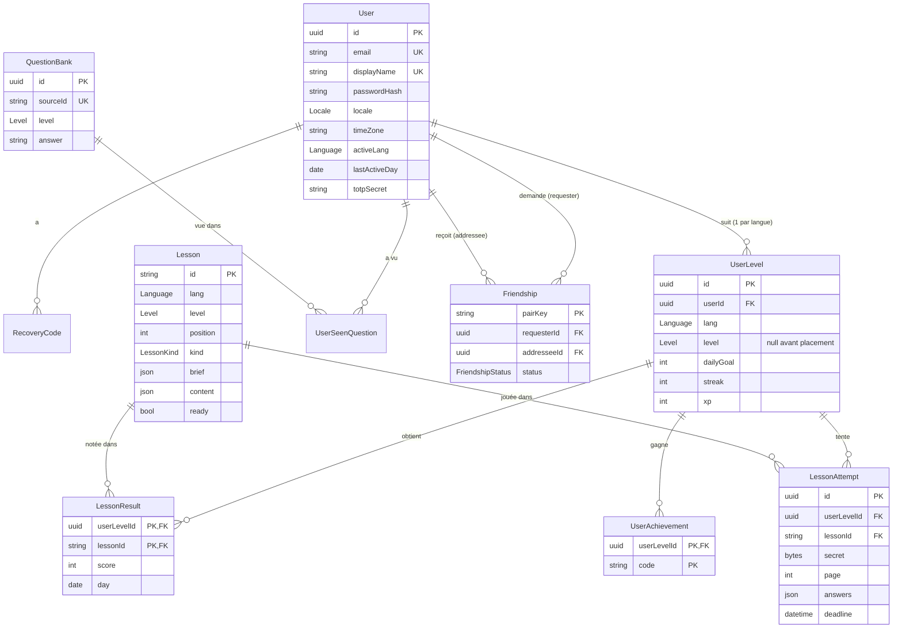

# 07 · La base de données (Module 06)

## 1. Ce qu'il faut comprendre

- **PostgreSQL** est une base **relationnelle** : des tables, des lignes, des **clés
  primaires** (identifiant unique d'une ligne) et des **clés étrangères** (une colonne qui
  pointe vers la clé primaire d'une autre table).
- **Prisma** est un **ORM** : on décrit les tables dans `schema.prisma`, Prisma génère
  (1) les **migrations SQL** qui créent/modifient les tables et (2) un **client
  TypeScript typé** (`prisma.user.findUnique(...)`).
- Une **migration** est un fichier SQL daté, appliqué une seule fois, dans l'ordre. Elles
  forment l'historique du schéma.

## 2. Explication dans Transcendence

### Pourquoi PostgreSQL

Le sujet demande « un schéma clair avec des relations bien définies ». Nos données sont
très relationnelles (un utilisateur a des cours, un cours a des résultats, qui pointent
vers des leçons). Le plan d'origine choisissait l'image **pgvector** pour un futur RAG
(`docs/TECHNICAL_PLAN.md` §1) ; cette extension n'est utilisée nulle part. [NOT PRESENT]

### Comment elle est initialisée

1. Le conteneur `db` démarre (`pgvector/pgvector:0.8.6-pg18-trixie`, volume `pg-data`)
   avec `POSTGRES_USER/PASSWORD/DB` venant de `.env`.
2. `make migrate` lance, dans un conteneur jetable « tooling », `prisma migrate deploy` :
   applique les **13 migrations** de `apps/api/prisma/migrations/`.
3. `make seed` lance `pnpm --filter @ft/api run db:seed` (`apps/api/prisma/seed.ts`) :
   - `seedQuestionBank` : charge `content/items/*.json` (270 questions) par `upsert` sur `sourceId` ;
   - `seedLessons` : lit les 18 syllabus et crée **une ligne `Lesson` par entrée (3 990)** ;
     une leçon dont les fichiers existent et passent `validateLesson` reçoit son contenu et
     `ready = true` (**216**) ; une leçon modifiée supprime les tentatives **en cours** dessus ;
   - en dev seulement (`NODE_ENV=development` et `DEMO_PASSWORD` défini) : 6 apprenants de démo.

[CONFIRMED : seed exécuté à blanc avec une fausse base pour les chiffres]

### Comment le backend y accède

Un seul client : `PrismaService` (adaptateur `@prisma/adapter-pg`, donc `node-postgres`).
Le client est **généré dans `apps/api/src/generated/prisma`** (exclu de Git), car le
générateur `prisma-client` de Prisma 7 émet du TypeScript à compiler avec l'app.
L'URL de connexion est dans `apps/api/prisma.config.ts`, plus dans `schema.prisma`
(nouveauté Prisma 7).

### Les tables

| Table | Rôle | Clé primaire | Points importants |
|---|---|---|---|
| `User` | un compte | `id` UUID | `email` et `displayName` **uniques** ; `passwordHash` ; `locale`, `timeZone`, `role` ; `totpSecret`, `totpEnabledAt` ; `activeLang` ; `lastActiveDay` (date) |
| `RecoveryCode` | codes de secours 2FA | `id` | `codeHash` unique (SHA-256), `usedAt` |
| `UserLevel` | **un cours** = (utilisateur, langue) | `id` | `@@unique([userId, lang])` ; `level` (null avant placement) ; `dailyGoal` ; série (`streak`, `bestStreak`, `lastGoalDay`) ; XP et défi (`xp`, `lastChallengeDay`, `lastChallengeCode`, `challengesDone`) |
| `Lesson` | une leçon du catalogue | `id` texte (ex. `fr-subject-pronouns`) | `lang`, `level`, `position`, `kind`, `topic`/`theme`, `brief` (JSON), `content` (JSON, null pour le vocabulaire), `ready` ; index `(lang, level, position)` |
| `LessonResult` | meilleur résultat d'un cours sur une leçon | **composite** `(userLevelId, lessonId)` | `score` (meilleur), `day`, `finishedAt` ; `onDelete: Restrict` côté leçon |
| `LessonAttempt` | la tentative en cours ou la dernière | `id` | `@@unique([userLevelId, lessonId])` ; `secret` (32 octets, jamais envoyé) ; `page` (curseur), `deadline`, `answers` (JSON), `completedAt`, `results` (JSON) ; `motherTongue` |
| `UserAchievement` | un succès obtenu | composite `(userLevelId, code)` | `day`, `earnedAt` |
| `QuestionBank` | questions de placement | `id` | `sourceId` unique (questions du seed) ; `lang`, `level`, `category`, `options[]`, `answer`, `timeLimitS` ; index `(lang, level, category)` |
| `UserSeenQuestion` | questions déjà vues par un utilisateur | `id` | `@@unique([userId, questionId])` : jamais deux fois la même question |
| `Friendship` | une demande ou une amitié | **`pairKey`** (texte) | `requesterId`, `addresseeId`, `status` (`pending`/`accepted`) |

Enums : `Level` (A1…C2), `Language` et `Locale` (en, fr, de), `Role` (USER, ADMIN),
`LessonKind` (grammar, vocabulary, functions, reading), `Topic` (13), `Theme` (14),
`QuestionCategory` (vocabulary, grammar, reading), `FriendshipStatus`.

### Les clés et contraintes qui portent la logique

- **`UserLevel @@unique([userId, lang])`** : un seul cours par langue. Un second
  `POST /api/courses` pour la même langue lève `P2002` → `409 course.alreadyStarted`.
- **`LessonResult` à clé composite** : une seule ligne par (cours, leçon). Refaire une
  leçon met à jour la ligne avec `max(ancien, nouveau)` (`merge` dans `roadmap.rules.ts`).
- **`Friendship.pairKey`** = les deux UUID triés, joints par `:` (`friends/pair.ts`).
  A→B et B→A donnent la **même clé** : deux demandes croisées ne peuvent pas créer deux
  lignes. Celle qui arrive en second accepte la première.
- **`UserAchievement (userLevelId, code)`** : un succès ne peut être stocké qu'une fois,
  même si deux fins de leçon simultanées le déclenchent.
- **Cascades** : supprimer un utilisateur supprime ses cours, codes, amitiés, questions
  vues (`onDelete: Cascade`). Supprimer une leçon qui a des résultats est **refusé**
  (`Restrict`) : les résultats d'un apprenant ne disparaissent jamais par accident.

### Les migrations, dans l'ordre

`init_user` → `two_factor` → `add_user_levels_and_question_bank` →
`question_bank_source_id_unique` → `add_active_lang` → `add_user_time_zone` →
`add_lessons` → `add_lesson_content` → `add_lesson_ready` → `add_lesson_attempt` →
`add_friendships` → `add_user_last_active_day` → `add_gamification`.
C'est aussi **l'histoire du projet** : utilisateurs, 2FA, placement, leçons, tentatives,
amis, présence, gamification. La CI vérifie que le schéma et les migrations ne divergent
pas (`scripts/check-prisma-drift.sh`, `prisma migrate diff`).

### Ce qui n'est PAS dans Postgres

Les sessions, la session de placement en cours et la présence sont dans **Redis**
(voir [10](10-REALTIME-AND-COMMUNICATION.md) et [08](08-AUTHENTICATION-AND-SECURITY.md)).

## 3. Exemple concret : la vie d'un résultat

Une apprenante finit la leçon `de-verb-sein-present` avec 85 :

1. **Création** : `AttemptsService.submit`, dans une transaction, appelle `applyFinish`.
2. **Lecture de l'ancien** : `lessonResult.findUnique({ userLevelId_lessonId })` → 60 il y a 2 jours.
3. **Fusion** : `merge` → `score = max(60, 85) = 85`, `day = aujourd'hui`, `finishedAt = now`.
4. **Enregistrement** : `lessonResult.upsert` (met à jour la ligne existante).
5. **Effets** : `meetGoal` compte les `LessonResult` du jour ; si l'objectif est atteint,
   met à jour `streak`, `bestStreak`, `lastGoalDay` dans `UserLevel` ; `award` ajoute
   l'XP et d'éventuels `UserAchievement`.
6. **Récupération** : `GET /api/courses/de/today` lit les `LessonResult` du cours et construit
   des « cartes » : `status = done` car `85 ≥ LESSON_PASS_MARK (70)`.
7. **Affichage** : `TodayCard` montre la leçon dans « fait aujourd'hui ».

## 4. Fichiers à connaître

- `apps/api/prisma/schema.prisma` : **le** fichier
- `apps/api/prisma/migrations/*/migration.sql`
- `apps/api/prisma/seed.ts`
- `apps/api/prisma.config.ts`
- `apps/api/src/prisma/prisma.service.ts`
- `apps/api/src/friends/pair.ts`, `apps/api/src/lessons/goal.ts`

## 5. Schéma

Voir [diagrams/DATABASE-RELATIONSHIPS.md](diagrams/DATABASE-RELATIONSHIPS.md) pour la version commentée.

## 6. Ce qu'il faut retenir

1. **10 tables**, Postgres 18, accès **uniquement** par Prisma dans l'API.
2. **`UserLevel` = un cours** (utilisateur × langue), le centre du modèle.
3. `Lesson` contient le **contenu en JSON** (`brief`, `content`) et un drapeau `ready`.
4. `LessonResult` garde **le meilleur score** par (cours, leçon) ; `LessonAttempt` la **tentative**.
5. `Friendship.pairKey` rend la relation **symétrique** et sans doublon.
6. Les contraintes uniques **remplacent** les vérifications préalables.
7. **13 migrations**, contrôlées contre le schéma en CI.
8. Le seed **valide** le contenu avant de le marquer prêt.

## 7. Questions possibles à l'oral

1. Montrez-moi les relations principales.
2. Pourquoi un `pairKey` texte et pas un id auto-incrémenté ?
3. Pourquoi le contenu des leçons est-il en JSON dans une colonne ?
4. Comment empêchez-vous qu'une question de placement soit posée deux fois ?
5. Que se passe-t-il si on supprime un utilisateur ?

## 8. Réponses attendues

1. « Un `User` a plusieurs `UserLevel`, un par langue. Chaque `UserLevel` a ses
   `LessonResult`, `LessonAttempt` et `UserAchievement`. `LessonResult` et `LessonAttempt`
   pointent vers `Lesson`. `Friendship` relie deux `User`. »
2. « Parce que l'amitié n'a pas de sens : A-B et B-A sont la même relation. En triant les
   deux ids, la clé primaire elle-même interdit le doublon, même si les deux demandes
   arrivent en même temps. »
3. « Le contenu a une structure profonde et différente selon le type de leçon. Il est
   validé par Zod (`validateLesson`) avant d'être écrit, et lu en bloc pour construire le
   plan. On ne l'interroge jamais par SQL, donc un JSON suffit. »
4. « `UserSeenQuestion` a une contrainte unique `(userId, questionId)`, et le tirage ne
   prend que les questions sans ligne `UserSeenQuestion` pour cet utilisateur
   (`userSeenQuestions: { none: { userId } }`). S'il n'en reste aucune, on reprend la
   question vue **il y a le plus longtemps**, mais jamais une question déjà posée dans le
   test en cours ; et en arrière-plan on demande au LLM de regarnir la banque. »
   (`apps/api/src/placement/placement-question.service.ts`)
5. « Cascade : ses cours, résultats, tentatives, succès, codes de secours, amitiés et
   questions vues disparaissent. Les leçons du catalogue restent. »

## 9. Mini-exercice

Écris (sur papier) la requête Prisma qui renvoie le nombre de leçons qu'un cours a
terminées aujourd'hui. Compare avec `meetGoal` dans `apps/api/src/lessons/goal.ts`.

## 10. Auto-évaluation

1. Quelle contrainte empêche deux cours d'allemand pour le même utilisateur ?
2. Quelles tables ont une clé primaire composite ?
3. Que vaut `content` pour une leçon de vocabulaire ?
4. Pourquoi `LessonResult → Lesson` est en `Restrict` ?
5. Où est l'URL de connexion pour la CLI Prisma ?

### Corrections

1. `@@unique([userId, lang])` sur `UserLevel`.
2. `LessonResult (userLevelId, lessonId)` et `UserAchievement (userLevelId, code)`.
3. `null` : la leçon est construite à partir du `brief`.
4. Pour qu'on ne puisse pas effacer les résultats d'un apprenant en supprimant une leçon ; le seed déplace ou modifie une leçon, il ne la supprime jamais.
5. Dans `apps/api/prisma.config.ts` (`process.env.DATABASE_URL`).

Mini-exercice : `prisma.lessonResult.count({ where: { userLevelId: course.id, day: new Date(day) } })`.
