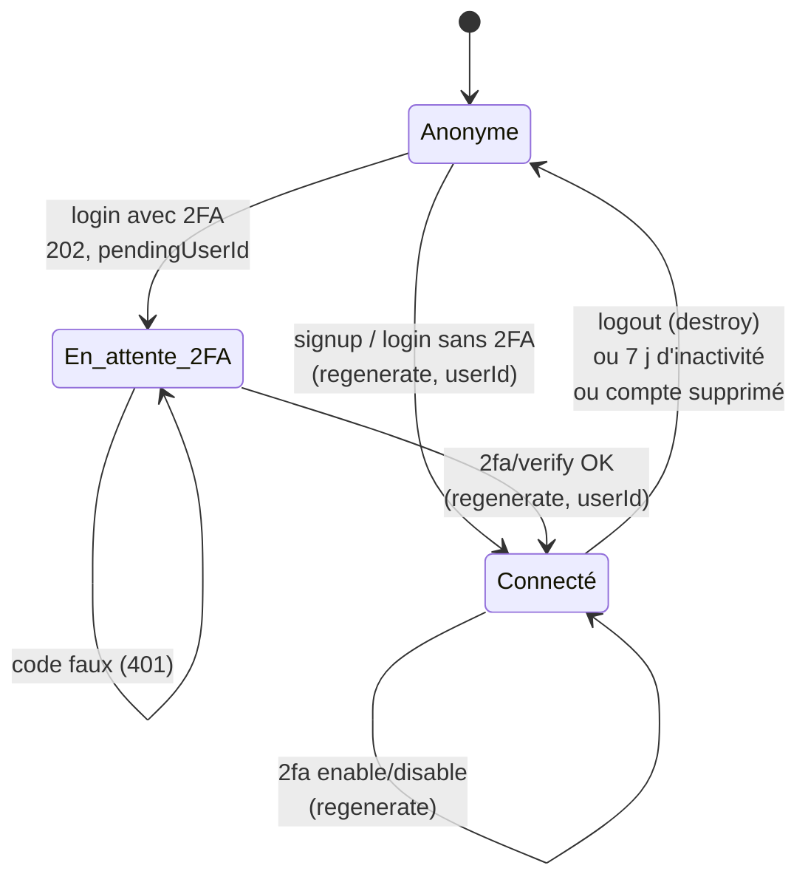

# 08 · Authentification et sécurité (Module 07)

## 1. Ce qu'il faut comprendre

- **Authentification** : « qui es-tu ? » (prouver son identité : mot de passe, code 2FA).
- **Autorisation** : « as-tu le droit ? » (accéder à cette route, à ces données).
- Deux grandes façons de garder un utilisateur connecté :
  - **session côté serveur** : le navigateur garde un cookie contenant un **identifiant
    opaque** ; les données de la session sont sur le serveur ;
  - **jeton (JWT)** : le navigateur garde un jeton signé qui contient lui-même l'identité.

**Nous utilisons des sessions côté serveur, pas de JWT.** [CONFIRMED : `express-session`
+ `connect-redis` dans `app.setup.ts` ; aucune dépendance JWT dans `apps/api/package.json`]
Il n'y a pas d'OAuth non plus (« Explicitly out », `docs/PRODUCT_ARCHITECTURE.md` §2). [NOT PRESENT]

## 2. Explication dans Transcendence

### Le cookie et la session

```ts
// apps/api/src/app.setup.ts (extrait)
session({
  name: 'ft.sid',
  secret: requireSessionSecret(),           // ≥ 32 caractères, sinon l'API refuse de démarrer
  store: new RedisStore({ client, prefix: 'sess:' }),
  resave: false,
  saveUninitialized: false,                  // un visiteur anonyme n'a PAS de session
  rolling: true,                             // chaque requête relance l'expiration
  cookie: {
    httpOnly: true,                          // illisible en JavaScript (protège du vol par XSS)
    secure: process.env.NODE_ENV === 'production',
    sameSite: 'lax',                         // non envoyé sur les POST venant d'un autre site
    maxAge: 7 * 24 * 60 * 60 * 1000,         // 7 jours d'inactivité
    path: '/',
  },
});
```

Ce que contient une session (`apps/api/src/auth/session.d.ts`) : `userId` (connexion
complète) **ou** `pendingUserId` (mot de passe bon, 2FA attendue). Deux clés différentes
pour qu'une connexion à moitié finie ne puisse **jamais** satisfaire le guard.

### Inscription : `POST /api/auth/signup` (public, 10/min/IP)

1. `SignUpDto` = `CreateUserSchema` : e-mail valide ; pseudo 3–32 caractères (lettres,
   chiffres, `._-`) ; mot de passe **12 à 128** caractères avec minuscule, majuscule et chiffre.
2. `AuthService.signUp` : `argon2.hash` (argon2id, 19 MiB, 2 passes, parallélisme 1 :
   recommandation OWASP), e-mail mis en minuscules, `prisma.user.create`.
3. Doublon d'e-mail ou de pseudo → `P2002` → `409 auth.identityTaken`.
4. `startSession` : **régénère** l'id de session (anti-fixation), met `userId`.
5. Réponse `201 SessionUser` (jamais le hash).

### Connexion : `POST /api/auth/login` (public, 5/min/IP)

1. `validateCredentials` : cherche l'e-mail.
   - Inconnu → **vérifie quand même un hash factice** (`DUMMY_HASH`) pour que le temps de
     réponse soit le même → `401 auth.invalidCredentials`.
   - Mauvais mot de passe → **même** code. On ne révèle pas si le compte existe.
2. Si `totpEnabledAt` est posé : session régénérée avec `pendingUserId`, réponse
   **`202 { twoFactorRequired: true }`** sans utilisateur.
3. Sinon : session régénérée avec `userId`, `200 SessionUser`.
4. Dans les deux cas, les sockets de l'**ancienne** session sont fermés (`closeSession`).

### 2FA (TOTP) : `apps/api/src/auth/two-factor.service.ts`

| Étape | Route | Ce qui se passe |
|---|---|---|
| Préparer | `POST /auth/2fa/setup` | secret aléatoire de 20 octets (base32) écrit, **`totpEnabledAt = null`** ; renvoie l'URI `otpauth://` et un QR en data-URL |
| Activer | `POST /auth/2fa/enable` (5/min/IP) | vérifie un code (SHA1, 6 chiffres, 30 s, fenêtre ±1) ; pose `totpEnabledAt` ; génère **10 codes de secours** (4 groupes de 5 caractères sans caractères ambigus), stockés en **SHA-256** ; renvoyés **une seule fois** ; session régénérée |
| Se connecter | `POST /auth/2fa/verify` (5/min/IP) | lit `pendingUserId` ; accepte un code TOTP **ou** un code de secours |
| Désactiver | `DELETE /auth/2fa` (5/min/IP) | **redemande le mot de passe** ; efface secret et codes ; session régénérée |

Un code de secours est consommé de façon atomique :

```ts
// updateMany avec usedAt: null dans le where → deux connexions simultanées
// ne peuvent pas dépenser le même code.
const { count } = await prisma.recoveryCode.updateMany({
  where: { userId, codeHash: digest(code), usedAt: null },
  data: { usedAt: new Date() },
});
return count > 0;
```

Pourquoi SHA-256 et pas argon2 pour ces codes : ils sont **aléatoires** (environ 98 bits
d'entropie), donc rien à « deviner » ; un hash simple permet une recherche indexée au lieu
de 10 vérifications argon2. (Le commentaire du schéma parle de « 160 bits » ; le calcul
sur 20 caractères d'un alphabet de 31 donne ≈ 99 bits. Les deux sont très au-dessus d'un
mot de passe.) [CONFIRMED pour l'alphabet et la longueur ; INFERRED pour le calcul]

### Déconnexion : `POST /api/auth/logout` (public)

`session.destroy` (supprime `sess:<id>` dans Redis ; **échoue bruyamment** si Redis ne
répond pas, plutôt que de mentir), puis fermeture des sockets de cette session, puis
`clearCookie('ft.sid')`. Public pour qu'une déconnexion avec une session expirée ne soit
pas un `401`.

### Protection des routes et autorisations

- **`AuthGuard` global** (`apps/api/src/auth/auth.guard.ts`) : tout est privé sauf `@Public()`.
  Il **relit l'utilisateur en base à chaque requête** : un compte supprimé perd l'accès
  immédiatement, pas à l'expiration.
- **Autorisation par construction** : les routes « à moi » utilisent `@CurrentUser()` et
  jamais un id venant du client (`PATCH /users/me`, `/courses/:lang` = *mes* cours). Il
  est donc impossible de modifier le cours de quelqu'un d'autre.
- **Pas de rôles appliqués** : `Role.ADMIN` existe mais aucune route ne le vérifie. [CONFIRMED]
- **Côté web** : `requireUser()` redirige vers `/login` ; c'est du confort, la vraie
  barrière est l'API.

### Protection du WebSocket

Même cookie, même middleware de session (`SessionIoAdapter`), plus : **vérification de
l'en-tête `Origin`** (même hôte), session avec `userId`, compte existant, maximum 20
sockets par session, 20 événements / 10 s par socket, trames de 16 Kio max. Détails au
[module 10](10-REALTIME-AND-COMMUNICATION.md).

### Validation des entrées et autres défenses

| Menace | Défense dans notre code |
|---|---|
| Entrées invalides | Zod sur **tous** les corps et paramètres (`CodeValidationPipe`, `LangParam`, `UserIdParam`), **et** dans le navigateur |
| Mot de passe volé en base | argon2id salé (le sel est inclus dans le hash argon2) |
| Brute force | Throttler par IP (5/min login, 2FA) ; argon2 coûteux |
| Énumération de comptes | Même message + hash factice pour un e-mail inconnu |
| Fixation de session | `session.regenerate` à chaque changement de privilège |
| Vol du cookie par XSS | `httpOnly` |
| CSRF | `SameSite=Lax` (cookie non envoyé sur un POST d'un autre site) [INFERRED : aucune protection CSRF dédiée] |
| Faux fichiers d'avatar | type MIME limité à png/jpeg/webp **et** vérification des **octets magiques** ; 2 Mio max ; nom aléatoire (`randomUUID`) |
| Fuite de champs | `select` explicites ; `SessionUserSchema` et `.strict()` sur les questions de placement (un champ `answer` en trop fait **échouer** la réponse) |
| Fuite des réponses d'une leçon | le serveur n'envoie que la page courante, sans les clés, et masque les ids par HMAC (module 09) |
| IP falsifiée | `trust proxy = 1` |
| Clickjacking, sniffing | en-têtes Caddy : `X-Frame-Options DENY`, `X-Content-Type-Options nosniff`, `Referrer-Policy`, `Permissions-Policy`, `-Server` |
| Écoute réseau | HTTPS partout depuis l'extérieur (Caddy, CA interne en local, Let's Encrypt en prod) [INFERRED pour la prod : `Caddyfile.prod`] |
| Secrets dans Git | `.env` ignoré, `.env.example` commité ; gitleaks et contrôle de dérive de `.env.example` en CI |

**Pas de Content-Security-Policy** aujourd'hui (`docs/ARCHITECTURE.md` §4). [CONFIRMED]

### Gestion des erreurs d'authentification

| Situation | Statut | Code |
|---|---|---|
| Pas de session / compte supprimé | 401 | `auth.sessionRequired` |
| Mauvais identifiants | 401 | `auth.invalidCredentials` |
| `/2fa/verify` sans mot de passe préalable | 401 | `auth.passwordFirst` |
| Code TOTP faux | 401 | `twoFactor.invalidCode` |
| Activer sans préparer | 400 | `twoFactor.setupFirst` |
| E-mail ou pseudo pris | 409 | `auth.identityTaken` |
| Trop de requêtes | 429 | `server.rateLimited` |

Côté web, `lib/api.ts` transforme un 401 en `{ status: 'signed-out' }` et les pages
redirigent vers `/login`.

## 3. Exemple concret : une connexion avec 2FA

Voir le diagramme de séquence dans [diagrams/AUTHENTICATION-FLOW.md](diagrams/AUTHENTICATION-FLOW.md).
Lina se connecte : `POST /login` → `202` (session `pendingUserId`) → le formulaire affiche
le champ code → `POST /2fa/verify { code: "492817" }` → `200 SessionUser`, nouvel id de
session avec `userId` → redirection vers `/learn`.

## 4. Fichiers à connaître

- `apps/api/src/app.setup.ts` (session, cookie, trust proxy)
- `apps/api/src/auth/auth.controller.ts`, `auth.service.ts`, `two-factor.service.ts`
- `apps/api/src/auth/auth.guard.ts`, `auth.decorators.ts`, `session.d.ts`
- `apps/api/src/throttler/identity-throttler.guard.ts`, `throttle-by-ip.decorator.ts`
- `packages/shared/src/schemas/user.ts`, `two-factor.ts`
- `apps/web/app/[locale]/(main)/login/login-form.tsx`, `settings/2fa/two-factor-panel.tsx`
- `infra/caddy/Caddyfile` (en-têtes)

## 5. Schéma



## 6. Ce qu'il faut retenir

1. **Sessions serveur dans Redis**, cookie `ft.sid` `httpOnly` `SameSite=Lax`, 7 jours glissants. **Pas de JWT, pas d'OAuth.**
2. **argon2id** pour les mots de passe, **SHA-256** pour les codes de secours aléatoires.
3. **Régénération de session** à chaque changement de privilège.
4. **Privé par défaut** (`AuthGuard` global), utilisateur **relu à chaque requête**.
5. **Même message d'erreur** et temps constant pour ne pas révéler les comptes.
6. **Throttler par IP** sur login, 2FA, signup.
7. **2FA complète** : TOTP + QR + 10 codes de secours à usage unique ; désactivation sous mot de passe.
8. Validation **double** (navigateur + API) avec le **même** schéma Zod.

## 7. Questions possibles à l'oral

1. Pourquoi des sessions et pas des JWT ?
2. Comment les mots de passe sont-ils stockés ?
3. Que se passe-t-il si quelqu'un vole le cookie ?
4. Comment empêchez-vous la fixation de session ?
5. Si un utilisateur perd son téléphone, comment se connecte-t-il ?
6. Comment protégez-vous le formulaire contre le CSRF ?

## 8. Réponses attendues

1. « Avec une session serveur, on peut **révoquer** immédiatement : déconnexion, compte
   supprimé, changement de 2FA. Un JWT reste valide jusqu'à son expiration. Comme tout est
   sur la même origine, un cookie `httpOnly` est la solution la plus simple et la plus sûre. »
2. « Hachés avec argon2id, qui inclut un sel aléatoire, avec les paramètres recommandés par
   l'OWASP. Le hash n'apparaît dans aucun schéma partagé, donc jamais dans une réponse. »
3. « Il ne peut pas être lu par du JavaScript (`httpOnly`), il ne circule qu'en HTTPS en
   production (`secure`). S'il est volé quand même, il est valable au plus 7 jours sans
   activité, et une déconnexion ou un changement de 2FA le rend inutile. Désactiver la 2FA
   redemande le mot de passe. »
4. « On appelle `session.regenerate` à l'inscription, à la connexion, à l'étape 2FA, à
   l'activation et à la désactivation de la 2FA. Un id planté avant la connexion ne sert à rien après. »
5. « Avec l'un des 10 codes de secours affichés une seule fois à l'activation. Chaque code
   ne sert qu'une fois, ce qui est garanti par une mise à jour atomique en base. »
6. « Le cookie est `SameSite=Lax` : le navigateur ne l'envoie pas avec un POST venant d'un
   autre site. Et nos routes attendent du JSON, qu'un formulaire HTML d'un autre site ne
   peut pas envoyer avec le bon type. On n'a pas de jeton CSRF dédié. »

## 9. Mini-exercice

Ouvre `apps/api/src/auth/auth.controller.ts`. Pour chacune des 9 routes, note si elle est
`@Public()`, sa limite de débit, et si elle régénère la session.

## 10. Auto-évaluation

1. Quel statut HTTP renvoie un login correct pour un compte avec 2FA ?
2. Où est stockée la session, sous quelle clé ?
3. Pourquoi `pendingUserId` et `userId` sont-ils deux clés distinctes ?
4. Que vérifie l'upload d'avatar en plus du type MIME ?
5. Pourquoi un e-mail inconnu déclenche-t-il quand même un calcul argon2 ?

### Corrections

1. `202 Accepted` avec `{ twoFactorRequired: true }`.
2. Dans Redis, `sess:<sessionID>`.
3. Pour qu'une connexion à moitié terminée ne puisse jamais passer l'`AuthGuard`, qui ne lit que `userId`.
4. Les premiers octets du fichier (signature PNG, JPEG ou RIFF/WEBP) ; sinon le fichier est supprimé et `400 avatar.invalidFile`.
5. Pour que le temps de réponse soit identique et ne révèle pas si l'e-mail est inscrit.

Mini-exercice (réponse) : signup (public, 10/IP, régénère), login (public, 5/IP, régénère),
2fa/verify (public, 5/IP, régénère), GET 2fa (privé, 100/compte, non), 2fa/setup (privé, non),
2fa/enable (privé, 5/IP, régénère), DELETE 2fa (privé, 5/IP, régénère), logout (public, détruit),
me (privé, non).
