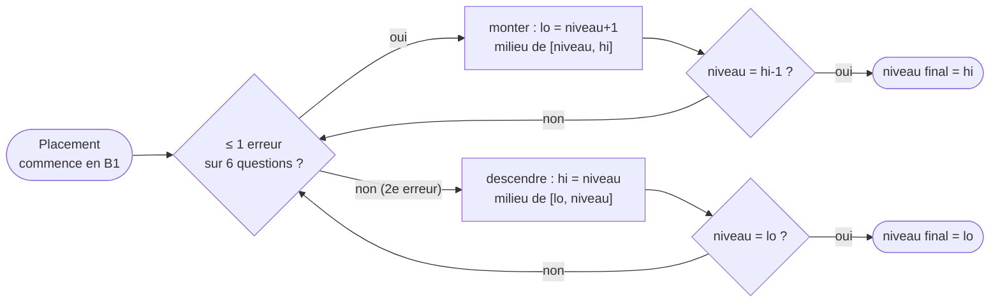

# 09 · Les fonctionnalités métier (Module 08)

## 1. Ce qu'il faut comprendre

Une fonctionnalité métier, c'est ce que l'application **fait pour l'utilisateur**. Pour
chacune, on suit la même grille : objectif, fonctionnement, frontend, backend, données,
interactions, fichiers. Les règles métier de notre projet sont presque toutes
**côté serveur** et souvent **pures** (testables sans base) : `roadmap.rules.ts`,
`gamification.rules.ts`, et le moteur de leçon dans `@ft/shared/lessons/player`.

## 2. Explication dans Transcendence

Vue d'ensemble des fonctionnalités et de leur état :

| # | Fonctionnalité | État |
|---|---|---|
| F1 | Compte, profil, avatar, préférences | Fait [CONFIRMED] |
| F2 | Onboarding : créer un cours (langue + objectif) | Fait [CONFIRMED] |
| F3 | Test de placement adaptatif | Fait [CONFIRMED] |
| F4 | Regarnissage de la banque de questions par LLM | Fait, fixture par défaut [CONFIRMED] |
| F5 | Le plan du jour, objectif quotidien, série | Fait [CONFIRMED] |
| F6 | Jouer une leçon (tentative côté serveur, examen chronométré, score) | Serveur : 4 types ; navigateur : **grammaire seule** [CONFIRMED] |
| F7 | Gamification : XP, rangs, défi du jour, 16 succès | Serveur fait ; **non affichée** dans le web (sauf la série) [CONFIRMED] |
| F8 | Recherche/filtre des leçons d'un niveau | API faite ; **pas de page web** [CONFIRMED] |
| F9 | Changer de niveau, niveau terminé | Fait [CONFIRMED] |
| F10 | Amis, recherche d'utilisateurs, profils publics, « récemment actifs » | Fait [CONFIRMED] |
| F11 | Présence en ligne | Fait (module 10) [CONFIRMED] |
| F12 | Internationalisation en/fr/de | Fait [CONFIRMED] |
| F13 | Pages légales | Fait [CONFIRMED] |
| F14 | Chat | Maquette sans logique [NOT PRESENT] |
| F15 | Écriture du contenu (hors ligne, Claude Code) | Outil fait, 216/3 990 leçons écrites [CONFIRMED] |
| F16 | Apprenants de démonstration | Fait, dev seulement [CONFIRMED] |

---

### F1 · Compte et profil

1. **Objectif** : avoir une identité, un pseudo, un avatar, une langue d'interface, un fuseau horaire.
2. **Fonctionnement** : `PATCH /api/users/me` accepte `displayName`, `locale`, `timeZone`
   (au moins un champ, sinon `profile.noChanges`). L'e-mail et le rôle **ne sont pas
   modifiables** (c'est un changement de privilège). L'avatar : `POST /api/users/me/avatar`
   (multipart, png/jpeg/webp, 2 Mio, octets magiques vérifiés), servi sous
   `/api/uploads/avatars/<uuid>.<ext>` depuis le volume `avatars-data` ; `DELETE` revient à
   l'avatar par défaut. Le fuseau est synchronisé tout seul : `TimeZoneSync` compare
   `Intl.DateTimeFormat().resolvedOptions().timeZone` à celui enregistré et fait le PATCH.
3. **Frontend** : `profile/page.tsx`, `profile/edit/profile-form.tsx`, `components/avatar.tsx`, `components/time-zone-sync.tsx`.
4. **Backend** : `users.controller.ts`, `users.service.ts`.
5. **Données** : `User.displayName`, `avatarUrl`, `locale`, `timeZone`.
6. **Interactions** : le fuseau détermine « aujourd'hui » pour l'objectif et la série (F5).
7. **Fichiers** : ceux ci-dessus + `packages/shared/src/schemas/user.ts` (`UpdateProfileSchema`, `MAX_AVATAR_BYTES`).

### F2 · Onboarding : créer un cours

1. **Objectif** : choisir la langue apprise et l'objectif quotidien.
2. **Fonctionnement** : `resolveOnboardingStep` (`apps/web/lib/onboarding.ts`) décide de
   l'écran : choisir un cours, ou choisir un niveau pour un cours sans niveau. Le niveau
   se choisit **soit** par le placement, **soit** directement (`PATCH /courses/:lang/level`).
   `POST /api/courses { lang, dailyGoal }` crée un `UserLevel` avec `level = null`.
3. **Frontend** : `onboarding/page.tsx`, `choose-course.tsx`, `choose-level.tsx`, `lib/courses-client.ts`.
4. **Backend** : `courses.controller.ts`, `courses.service.ts` (`createCourse`, `setLevel`).
5. **Données** : `UserLevel` ; `User.activeLang` (dernier cours utilisé).
6. **Interactions** : sans niveau, `today` répond `409 course.notPlaced` et la page redirige vers l'onboarding.
7. **Fichiers** : ceux ci-dessus.

### F3 · Le test de placement adaptatif

1. **Objectif** : trouver le niveau CECRL en quelques questions.
2. **Fonctionnement** (`apps/api/src/placement/`) : c'est une **recherche dichotomique**
   sur les 6 niveaux (indices 0 à 5).
   - Départ : `level = B1` (indice 2), `lo = 0`, `hi = 5`.
   - À chaque niveau, au plus **6 questions** (2 par catégorie : vocabulaire, grammaire,
     lecture ; `PLACEMENT_ROUNDS = { perCategory: 2, maxMistakes: 1 }`).
   - Plus d'**une** erreur à ce niveau → on **descend** : `hi = level`, nouveau niveau au milieu de `[lo, level]`.
   - 6 questions avec au plus une erreur → on **monte** : `lo = level + 1`, milieu de `[level, hi]`.
   - Fin quand on monte depuis `hi - 1` (→ `hi`) ou qu'on descend depuis `lo` (→ `lo`).
   - Chaque question a un **temps limite** (`timeLimitS`) + 2 s de tolérance réseau ;
     au-delà, réponse vide comptée fausse.
   - L'état du test est dans **Redis** (hash `user:<id>:eval` + liste `user:<id>:eval_questions`, expirent en 1 h) avec un
     **verrou** `user:<id>:eval_lock` (`SET NX`, 5 s) (libéré par un script Lua qui vérifie le jeton) : deux
     onglets ne peuvent pas répondre en même temps.
   - Le résultat (`targetLevel` + rapport question par question) est **appliqué** au cours
     (`CoursesService.setLevel`) si au moins une réponse a été donnée.
   - La question envoyée au navigateur **n'a pas** le champ `answer` ; ses options sont
     **mélangées** (la banque met souvent la bonne réponse en premier).
3. **Frontend** : `learn/[lang]/placement/` (`placement-exam.tsx`, `start-screen.tsx`, `question-screen.tsx`, `result-screen.tsx`), `lib/placement-client.ts`.
4. **Backend** : `placement.service.ts` (orchestration), `placement-progress.service.ts`
   (règles de montée/descente), `placement-question.service.ts` (tirage),
   `placement-session.service.ts` (Redis).
5. **Données** : `QuestionBank`, `UserSeenQuestion` (Postgres) ; session et verrou (Redis).
6. **Interactions** : fixe `UserLevel.level` (F5 devient possible) ; déclenche F4 ; émet `course:updated`.
7. **Fichiers** : ceux ci-dessus + `packages/shared/src/schemas/placement.ts`.

### F4 · Regarnir la banque de questions (le LLM)

1. **Objectif** : ne jamais tomber à court de questions de placement.
2. **Fonctionnement** : à chaque tirage, pour chaque catégorie, si **3 questions non vues ou
   moins** restent (`RESTOCK_AT = 3`), `QuestionStockService.restock` lance **sans
   attendre** (`void`) une génération : prompt (`prompts/question-batch.prompt.ts`) →
   `llm.generateStructured({ schema: generatedBatchSchema(category) })` → on écarte les
   doublons → `createMany`. Une seule génération à la fois par cellule
   (`langue:niveau:catégorie`) ; après un échec ou un lot sans nouveauté, la cellule
   « refroidit » 10 min. Un échec « retryable » est retenté une fois.
   `GeminiProvider` appelle l'API REST de Gemini en demandant une réponse JSON conforme au
   schéma Zod (`responseMimeType: 'application/json'`, `responseJsonSchema`), avec un timeout.
3. **Frontend** : aucun (invisible pour l'apprenant).
4. **Backend** : `question-generation/`, `llm/` (`llm.provider.ts`, `llm.factory.ts`, `gemini.provider.ts`, `fixture.provider.ts`).
5. **Données** : `QuestionBank` (lignes générées : `sourceId = null`). Les questions
   **écrites** sont servies en priorité sur les générées.
6. **Interactions** : appelé par F3 ; métriques `ft_question_restocks_total`, alerte `QuestionRestocksFailing`.
7. **Fichiers** : `apps/api/src/question-generation/QUESTION_GENERATION.md`, `apps/api/src/llm/GEMINI_PROVIDER.md`.

### F5 · Le plan du jour, l'objectif et la série

1. **Objectif** : proposer exactement le bon nombre de leçons chaque jour et récompenser la régularité.
2. **Fonctionnement** (`apps/api/src/lessons/roadmap.rules.ts`) :
   - **cible** = `dailyGoal / 10` (10 min → 1 leçon, 30 → 3, 60 → 6) ;
   - **« aujourd'hui »** = la date dans le **fuseau de l'utilisateur**, mais jamais avant
     le dernier jour déjà enregistré (`courseDay`) : voyager vers l'ouest ne fait pas
     revivre une journée ;
   - **file d'attente** (`queue`) : d'abord les leçons **non réussies** dans l'ordre du
     syllabus, puis les réussies, de la plus anciennement faite à la plus récente ;
     seules les leçons `ready` ;
   - **plan** : `done` (finies aujourd'hui), `proposed` (cible − faites), `extra` (3 de plus) ;
   - **objectif atteint** quand `faites ≥ cible` ; alors `metOn` fait avancer la série
     (continue si hier était atteint, sinon repart à 1), `bestStreak` = max ;
   - une leçon est **réussie** (`done`) à partir de **70/100** (`LESSON_PASS_MARK`) ;
   - un niveau est **terminé** quand toutes ses leçons prêtes ont été tentées et **80 %**
     réussies (`LEVEL_PASS_SHARE`) ; `levelAfter` propose le suivant.
   - Toute écriture (fin de leçon, objectif baissé) passe par `lockCourse` (`FOR UPDATE`).
3. **Frontend** : `learn/[lang]/page.tsx`, `today.tsx` (`TodayCard`, `StreakLine`, `MoreLessons`, `LevelComplete`), `goal-picker.tsx`.
4. **Backend** : `lessons.controller.ts` (`today`), `lessons.service.ts`, `goal.ts`, `roadmap.rules.ts`.
5. **Données** : `UserLevel` (`dailyGoal`, `streak`, `bestStreak`, `lastGoalDay`), `LessonResult`.
6. **Interactions** : alimenté par F6, récompensé par F7.
7. **Fichiers** : ceux ci-dessus ; tests `roadmap.rules.spec.ts` (661 lignes).

### F6 · Jouer une leçon (le moteur de tentative)

C'est la fonctionnalité la plus originale du projet. **Le navigateur ne voit jamais les
réponses, ne note jamais, et ne contrôle pas le chronomètre.**

1. **Objectif** : apprendre (pages de présentation et d'entraînement corrigées tout de
   suite), puis être évalué (examen chronométré), avec un score fiable.
2. **Fonctionnement** :
   - Une leçon (`brief` + `content` JSON) est transformée en **plan** (`buildPlan`) : une
     suite de **pages** (`presentation`, `practice`, `discussion`, `examIntro`, `exam`),
     chaque page contenant des **unités** (une unité = une réponse notée 0, 0,5 ou 1).
     Le plan contient **toutes les clés** et n'est **jamais stocké ni envoyé** : il est
     reconstruit à chaque requête.
   - `POST …/attempt { locale }` : crée la tentative (`201`) ou reprend celle en cours
     (`200`) ; après les résultats, c'est une **reprise** (l'ancienne est supprimée).
     La « langue maternelle » (consignes) est fixée au départ.
   - Le serveur n'envoie que **la page au curseur**, sans les clés (`redact.ts`) ; chaque
     unité/option/jeton est nommé par une **réf** = `HMAC-SHA256(secret de la tentative, chemin)`
     tronqué à 16 caractères (`attempt-ref.ts`). Les listes mélangées sont **triées par
     réf** : une nouvelle tentative = un nouvel ordre, et l'ordre ne trahit rien.
   - `POST …/attempt/pages/:index { attemptId, answers }` : seule **la page au curseur**
     est acceptée, **une seule fois** (sinon `409 attempt.stale`). Les unités sont notées et
     **verrouillées** ; le curseur avance (**marche avant uniquement**).
   - En entrant sur une page d'examen, le serveur fixe une **deadline** ; une page reçue
     après deadline + 2 s compte toutes ses unités vides (« hors temps »).
   - La dernière page **clôt** la tentative : `results` (feuille de résultats), score =
     **35 % entraînement + 65 % examen** (`POLICY` dans `score.ts`), une réponse à une
     faute près (orthographe) vaut 0,5. Puis `applyFinish` (F5 + F7) dans **la même
     transaction**, et `course:updated` après le commit.
   - Le navigateur garde les brouillons dans `localStorage` pour survivre à un rechargement.
3. **Frontend** : `lessons/[id]/page.tsx` (fiche + bouton commencer/reprendre), `lesson-actions.tsx`,
   `play/page.tsx` + `play/player.tsx` + `exam-timer.tsx`, `results/page.tsx`,
   `components/lesson/*`, `lib/lesson-client.ts`. Rendus : **grammaire uniquement** (`kinds/index.ts`).
4. **Backend** : `attempts.controller.ts`, `attempts.service.ts`, `attempt-ref.ts`, `lessons.service.ts` (`applyFinish`).
5. **Données** : `Lesson.brief/content`, `LessonAttempt` (`secret`, `page`, `deadline`, `answers`, `results`), `LessonResult`.
6. **Interactions** : F5 (objectif, série), F7 (XP, succès), F11 (refresh des autres onglets).
7. **Fichiers** : `packages/shared/src/lessons/player/` (`plan.ts`, `attempt.ts`, `score.ts`, `redact.ts`, `view.ts`, `feedback.ts`), `docs/LESSONS.md` §10.

### F7 · Gamification

1. **Objectif** : motiver (sous-module « Gamification » du sujet : au moins 3 éléments parmi succès, badges, classements, XP, défis quotidiens, récompenses).
2. **Fonctionnement** (`gamification.rules.ts`, `gamification.ts`, constantes dans `@ft/shared/schemas/gamification.ts`) :
   - **XP** : `LESSON_XP = 10` par leçon comptée aujourd'hui + l'**amélioration** du meilleur
     score (`max(0, score − ancien)`) ; `GOAL_XP = 20` quand l'objectif est atteint ;
     `CHALLENGE_XP = 30` pour le défi du jour.
   - **Rangs** : passer du rang n à n+1 coûte `100 × n` XP → seuils 0, 100, 300, 600… (`rankOf`).
   - **Défi du jour** : un parmi `grammar`, `vocabulary`, `functions`, `reading`, `score90`,
     `beyondGoal`, choisi de façon **déterministe** par un hash (FNV-1a + mélange) de
     `(cours, jour)`, seulement parmi les types qui ont des leçons prêtes.
   - **16 succès** : première leçon, 10/25/50 réussies, séries 3/7/30/100, 10/50 défis, un par niveau A1…C2.
3. **Frontend** : seule la **série** est affichée (`StreakLine`). L'API renvoie `xp`,
   `challenge`, `earnedToday` dans `today` et `GET /achievements`, mais **aucune chaîne
   d'interface** ne les affiche. [CONFIRMED]
4. **Backend** : `award()` dans la transaction de fin de leçon ou de changement d'objectif.
5. **Données** : `UserLevel.xp`, `lastChallengeDay`, `lastChallengeCode`, `challengesDone` ; `UserAchievement`.
6. **Interactions** : F5, F6.
7. **Fichiers** : `apps/api/src/lessons/gamification*.ts`, `apps/api/test/gamification.e2e-spec.ts`.

### F8 · Recherche dans les leçons d'un niveau

`GET /api/courses/:lang/lessons` avec `status`, `kind`, `topic`, `theme`, texte (`q`,
insensible aux accents grâce à `foldText`), tri (`position`, `score`, `finishedAt`),
groupement (`none`, `status`, `day`, `kind`) et pages de 20, **en mémoire** (un niveau a au
plus ~320 leçons) : `apps/api/src/lessons/lesson-search.ts`. **Pas de page web** : le lien
« voir tout » mène à la 404. [CONFIRMED]

### F9 · Changer de niveau

`PATCH /api/courses/:lang/level` (choix direct, `DirectLevelPicker`) ou résultat du
placement ; `LevelComplete` s'affiche quand le niveau est terminé et propose
`levelAfter(level)`. Les résultats ne sont **pas filtrés par niveau** : une leçon d'un ancien
niveau faite ce matin reste dans « fait aujourd'hui ».

### F10 · Amis et profils publics

1. **Objectif** : le volet social du module « gestion utilisateur ».
2. **Fonctionnement** : une seule ligne `Friendship` par paire (`pairKey`). Envoyer à
   quelqu'un qui m'a déjà envoyé = **accepter**. Refuser, annuler et retirer **suppriment**
   la ligne. Chaque action notifie **les deux** utilisateurs (`friend:request`,
   `friend:accepted`, `friend:removed`). `GET /friends` renvoie `friends` (avec `online`),
   `received`, `sent`. Recherche par pseudo (`ILIKE`, `_` et `%` échappés). Profil public
   `GET /users/:id` (pseudo, avatar, cours). « Récemment actifs » : utilisateurs dont
   `lastActiveDay` date de moins de 7 jours.
3. **Frontend** : `friends/page.tsx`, `friend-search.tsx`, `components/friend-buttons.tsx`, `users/[id]/page.tsx`, `components/presence-dot.tsx`.
4. **Backend** : `friends/*`, `users/users.service.ts`.
5. **Données** : `Friendship`, `User.lastActiveDay`.
6. **Interactions** : F11 (présence réservée aux amis acceptés).
7. **Fichiers** : ceux ci-dessus + `packages/shared/src/schemas/friend.ts`.

### F12 · Internationalisation

3 catalogues de **475 lignes** chacun (`apps/web/messages/{en,fr,de}.json`), sélecteur
(`components/language-switcher.tsx`), préfixe d'URL obligatoire, erreurs traduites par
code. Un test vérifie que les catalogues ont les mêmes clés (`lib/messages.test.ts`). L'API
est **neutre en langue** : aucune route ne prend de locale, une leçon est écrite dans la
langue du cours.

### F13 · Pages légales

`/privacy` et `/terms` (contenu réel en 3 langues dans `apps/web/lib/legal-content/`),
liées dans le pied de page de tous les layouts ; testées par `e2e/tests/legal.spec.ts`
(critère de **rejet** du sujet si absentes).

### F15 · Le pipeline d'écriture du contenu

Hors production. `pnpm --filter @ft/api lessons:author fr a1` : Claude Code écrit une
leçon d'après le syllabus, `complete` + `validateLesson` la vérifient, les problèmes sont
renvoyés dans la même conversation (plusieurs essais), puis le fichier est écrit dans
`content/`. Le seed ne marque `ready` que les leçons valides. Voir `docs/LESSONS.md` et
`.claude/skills/author-lessons/SKILL.md`.

## 3. Exemple concret

Voir les parcours complets au [module 12](12-END-TO-END-FLOWS.md) : inscription → placement → leçon → série.

## 4. Fichiers à connaître

- `apps/api/src/lessons/roadmap.rules.ts`, `gamification.rules.ts`, `goal.ts`, `lessons.service.ts`, `attempts.service.ts`
- `apps/api/src/placement/placement-progress.service.ts`
- `packages/shared/src/lessons/player/attempt.ts`, `score.ts`, `redact.ts`
- `docs/PRODUCT_ARCHITECTURE.md` §1, `docs/LESSONS.md` §10

## 5. Schéma

Voir [diagrams/MAIN-FEATURE-FLOWS.md](diagrams/MAIN-FEATURE-FLOWS.md).

## 6. Ce qu'il faut retenir

1. Placement = **dichotomie** à partir de **B1**, 6 questions max par niveau, 1 erreur tolérée.
2. Le LLM ne sert qu'à **regarnir** la banque, en arrière-plan, avec cooldown.
3. **Cible du jour** = objectif / 10 min ; **réussite** = 70 ; **niveau fini** = tout tenté + 80 % réussi.
4. Le **jour** est celui du fuseau de l'apprenant, jamais en arrière.
5. Le **serveur** possède la leçon : page au curseur, réfs HMAC, chrono, score 35/65.
6. XP, rangs, défi, succès **calculés** mais **pas affichés** (sauf la série).
7. Amis : **une ligne par paire**, notifications aux deux.
8. État honnête : grammaire seule jouable, pas de page de recherche, pas de chat.

## 7. Questions possibles à l'oral

1. Comment fonctionne le test de placement ?
2. Comment empêchez-vous la triche dans les leçons ?
3. Comment calculez-vous le score ?
4. Comment est déterminé « aujourd'hui » pour la série ?
5. Comment le défi du jour est-il choisi ?
6. Qu'est-ce qui se passe si deux personnes s'envoient une demande d'ami en même temps ?

## 8. Réponses attendues

1. « C'est une recherche dichotomique sur les six niveaux. On commence en B1. À chaque
   niveau on pose jusqu'à deux questions par catégorie ; à la deuxième erreur on descend,
   après six questions avec au plus une erreur on monte, à mi-chemin de l'intervalle
   restant. L'état est dans Redis avec un verrou, et la réponse correcte ne quitte jamais le serveur. »
2. « Le navigateur ne reçoit que la page en cours, sans les réponses ; les identifiants sont
   des HMAC propres à la tentative, et l'ordre des options en dépend. Une page ne peut être
   soumise qu'une fois, dans l'ordre. Le chrono de l'examen est sur le serveur. Il n'existe
   aucune route qui accepte un score. »
3. « Chaque unité vaut 0, 0,5 (faute d'orthographe) ou 1. Score = 35 % de la réussite à
   l'entraînement + 65 % à l'examen. On garde le meilleur score par leçon ; 70 et plus = réussie. »
4. « C'est la date dans le fuseau horaire de l'utilisateur, synchronisé depuis le
   navigateur, mais jamais antérieure au dernier jour déjà enregistré, pour qu'un voyage
   vers l'ouest ne permette pas de refaire une journée. »
5. « Par un hash déterministe de l'id du cours et du jour, parmi les défis possibles (on
   exclut un type sans leçon prête). Même jour, même cours : même défi, sans rien stocker à l'avance. »
6. « Les deux demandes ont la même clé `pairKey`. La première crée la ligne ; la seconde
   échoue sur la clé primaire (`P2002`), relit la ligne, voit une demande de l'autre et l'accepte. »

## 9. Mini-exercice

Avec `RANK_STEP = 100`, à quel rang est un apprenant qui a 650 XP ? Calcule
`rankOf(650)` avec la formule de `gamification.rules.ts`.

## 10. Auto-évaluation

1. Combien de leçons propose-t-on avec un objectif de 60 minutes ?
2. Quelles conditions pour qu'un niveau soit terminé ?
3. Que contient une « réf », et pourquoi ?
4. Quand le LLM est-il appelé ?
5. Quelle part du score vient de l'examen ?

### Corrections

1. 6 (60 / 10), plus 3 leçons « en plus ».
2. Toutes les leçons prêtes du niveau tentées et au moins 80 % (arrondi supérieur) réussies (≥ 70).
3. 16 caractères base64url d'un HMAC-SHA256 du chemin interne, avec le secret de la tentative ; pour que le navigateur ne connaisse ni les ids ni un ordre qui trahirait la réponse.
4. Quand une cellule (langue, niveau, catégorie) n'a plus que 3 questions non vues ou moins pour l'apprenant, en arrière-plan, sauf si une génération est en cours ou en refroidissement.
5. 65 %.

Mini-exercice : `rank = floor((1 + √(1 + 8·650/100)) / 2) = floor((1 + √53) / 2) = floor(4,14) = 4` ;
seuils : rang 4 commence à 600, rang 5 à 1 000.
