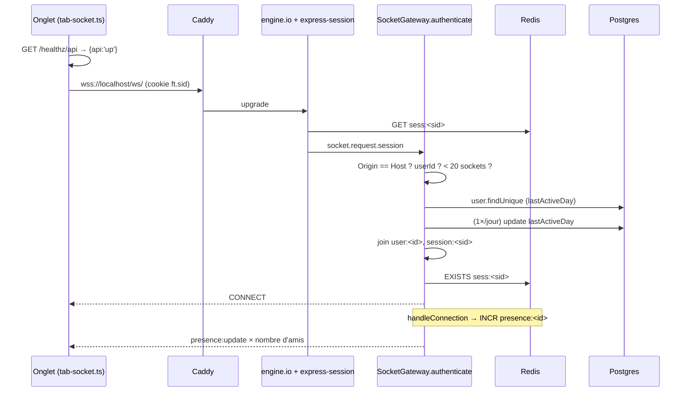
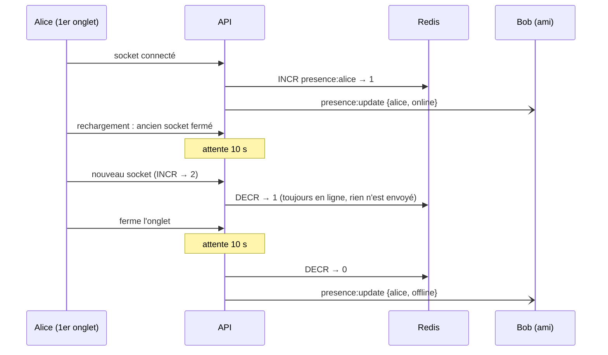

# 10 · Communication et temps réel (Module 09)

## 1. Ce qu'il faut comprendre

En HTTP classique, **le client demande, le serveur répond**. Le serveur ne peut pas
prévenir un navigateur qu'une donnée a changé. Un **WebSocket** est une connexion qui
reste ouverte et où **le serveur peut envoyer** quand il veut.

**Socket.IO** ajoute au WebSocket : des **événements nommés** (`socket.emit('nom', données)`),
des **rooms** (groupes de sockets à qui envoyer d'un coup), des middlewares et la gestion
de la reconnexion.

Chez nous : **REST pour tout ce qui est CRUD, Socket.IO pour pousser les changements**
(`docs/PRODUCT_ARCHITECTURE.md` §3). Et un point clé : aujourd'hui le socket est
**à sens unique**, serveur → client. `CLIENT_EVENTS = {}` : le client n'envoie aucun
événement. [CONFIRMED `packages/shared/src/events/socket.ts`]

## 2. Explication dans Transcendence

### Pourquoi c'est nécessaire

Le sujet (module majeur « Real-time features ») demande des **mises à jour entre
clients**, une **gestion propre des déconnexions/reconnexions** et une **diffusion
efficace**. Nos cas réels :

| Événement | Charge | Envoyé à | Déclencheur |
|---|---|---|---|
| `course:updated` | `{ lang }` | l'utilisateur (tous ses onglets) | objectif ou niveau changé, leçon terminée, placement appliqué |
| `friend:request` | `{ userId }` (l'autre) | les **deux** utilisateurs | demande envoyée |
| `friend:accepted` | `{ userId }` | les deux | demande acceptée |
| `friend:removed` | `{ userId }` | les deux | refus, annulation, suppression |
| `presence:update` | `{ userId, status: 'online'|'offline', at }` | les **amis acceptés** | 1er socket ouvert / 10 s après le dernier fermé |
| `app:error` | `{ code }` | le socket fautif | événement invalide ou trop d'événements |

### Comment la connexion est créée

**Côté serveur** (`apps/api/src/gateway/socket.gateway.ts`) :

```ts
@WebSocketGateway({
  path: '/ws',                  // l'URL d'engine.io, routée par Caddy (/ws/* → api)
  serveClient: false,
  transports: ['websocket'],    // pas de long-polling
  maxHttpBufferSize: 16_384,    // trames de 16 Kio max
})
export class SocketGateway { … }
```

La passerelle vit **dans l'API**, sur le même serveur HTTP (port 3001). `path` et non
`namespace` : `path` est le chemin HTTP de la poignée de main.

**Côté client** (`apps/web/components/tab-socket.ts`) : **un socket par onglet**, en
variable de module, créé à la demande :

```ts
io({ path: '/ws', transports: ['websocket'], autoConnect: false, reconnection: false,
     closeOnBeforeunload: true });
```

Il est ouvert par `ConnectionStatus` (rendu dans `SessionNav` **seulement pour un
utilisateur connecté**) et fermé par `LogOutButton`. Comme il vit dans le module et non
dans un composant, changer de page ou de langue **ne le coupe pas**.

### Comment les utilisateurs sont identifiés

Pas de jeton : **le cookie de session est la seule preuve**. engine.io répond à `/ws`
avant Express, donc `SessionIoAdapter` lui branche **le même middleware
`express-session`** (`server.engine.use(this.session)`). Puis le middleware
`authenticate` de la passerelle refuse, avec `auth.sessionRequired` :

1. un `Origin` d'un autre hôte (`sameOrigin`) : le cookie `SameSite=Lax` serait envoyé par
   un site voisin du même domaine, même site n'est pas même origine ;
2. une session sans `userId` ;
3. une session qui a déjà **20 sockets** (`server.rateLimited`) ;
4. un compte supprimé.

Ensuite : écrit `User.lastActiveDay` si ce n'est pas aujourd'hui, met
`socket.data = { userId, sessionId }`, **rejoint les rooms** `user:<id>` et `session:<sid>`,
puis **revérifie que `sess:<sid>` existe encore dans Redis** (une déconnexion pendant la
poignée de main ne doit pas être ratée).

### Comment les événements sont envoyés

Une seule porte : `SocketsService.toUser(userId, event, payload)` → `server.to('user:<id>').emit(...)`.
**Jamais de broadcast global.** Typé par `ServerToClientEvents` : on ne peut pas émettre
un événement inconnu ni une mauvaise charge.

Toujours **après le commit** de la transaction :

```ts
// apps/api/src/courses/courses.service.ts
const course = await this.prisma.$transaction(async (tx) => { … });
// After the commit: sent from inside the transaction, the other tab could
// read the old row, or a row that then rolls back.
this.sockets.toUser(user.id, SERVER_EVENTS.COURSE_UPDATED, { lang });
```

### Comment les événements sont reçus (côté client)

- `useServerEvent(event, handler)` : s'abonne à un événement.
- `RefreshOn events={[…]}` : à chaque événement listé, `router.refresh()` (Next relit la
  page sur le serveur). Le message dit seulement « relis », il ne transporte pas la donnée :
  **pas de deuxième copie de l'état** à synchroniser.
- Présence : une `Map` (`lib/presence.ts`) alimentée par `presence:update` ;
  `useFriendOnline(id, rendered)` la lit, et sinon utilise la valeur rendue par le serveur.

### Comment les données sont synchronisées : la présence

`apps/api/src/presence/presence.service.ts` :

- **Compteur par utilisateur** dans Redis : `presence:<id>`, `INCR` à l'ouverture d'un
  socket, `DECR` à la fermeture. En ligne au **premier** socket.
- **Délai de grâce de 10 s** avant de décrémenter : un rechargement de page ouvre le
  nouveau socket avant que l'ancien ne compte, donc les amis ne voient pas de clignotement.
- **Amis seulement** : la mise à jour part vers `user:<ami>` pour chaque amitié **acceptée**.
- **Instantané à la connexion** : le nouveau socket reçoit un `presence:update` par ami
  (`isOnline` = un `MGET`). `GET /api/friends` renvoie aussi `online`.
- **Remise à zéro au démarrage** : `onApplicationBootstrap` efface `presence:*` avec
  `SCAN` (jamais `KEYS`), car aucun socket ne survit à un redémarrage. Un compteur négatif est remis à 0.
- **Hypothèse : une seule instance d'API** (la remise à zéro effacerait les compteurs des
  autres, et les rooms ne traversent pas les instances ; ticket #158).

### Comment les erreurs sont gérées

**Serveur** (`screen`, appliqué à chaque paquet entrant) : fenêtre fixe de **20 événements
/ 10 s par socket** (au 21e : `app:error server.rateLimited`, puis silence) ; événement
inconnu ou charge invalide (Zod via `CLIENT_EVENT_SCHEMAS`) → `app:error request.invalid`,
le paquet est jeté ; jamais de crash. Comme `CLIENT_EVENTS` est vide, **tout** événement
client est aujourd'hui rejeté.

**Fermeture avec la session** : à la déconnexion, et à **chaque** changement d'id de session
(signup, login, 2FA), `closeSession(sid)` coupe les sockets de la room `session:<sid>`.
Un **balayage toutes les 60 s** ferme les sockets dont la clé `sess:<sid>` a disparu (expiration).

**Client** (`lib/reconnect.ts`) : reconnexion **manuelle** (`reconnection: false`) :
- délais **1, 2, 4, 8 puis 10 s**, avec ±25 % d'aléa (`backoffMs`) ;
- **avant chaque tentative**, sonde `/healthz/api` (route Next qui répond toujours 200) et
  ne compose que si l'API répond : un échec de WebSocket est une erreur console
  impossible à masquer, et le sujet exige **zéro erreur console** ;
- refus `auth.sessionRequired` → état `signedOut`, on arrête ;
- à la reconnexion, `RefreshOn` relit la page (les événements manqués sont perdus).

### Comment le frontend réagit

`ConnectionStatus` affiche « Reconnexion… » pendant `reconnecting`. `RefreshOn` déclenche
`router.refresh()`. `PresenceDot` passe au vert/gris. Les pages `/friends` et `/users/[id]`
se rafraîchissent sur les événements d'amitié.

### Et sans temps réel ?

Tout le reste est du **REST** : `fetch` vers `/api/...`. Le test de placement et le lecteur
de leçon, même chronométrés, sont en HTTP : le chronomètre est **sur le serveur** (deadline
stockée), le client affiche seulement un compte à rebours (`exam-timer.tsx`).

## 3. Exemple concret

Lina a `/fr/learn/de` ouvert dans deux onglets (A et B). Dans A, elle passe l'objectif à
10 min. L'API commit, émet `course:updated { lang: 'de' }` vers `user:<lina>` ; les sockets
de A et B le reçoivent ; dans les deux, `RefreshOn` appelle `router.refresh()` ; B affiche
le nouvel objectif sans action de Lina.

## 4. Fichiers à connaître

- `packages/shared/src/events/socket.ts` (le contrat)
- `apps/api/src/gateway/socket.gateway.ts`, `sockets.service.ts`, `session-io.adapter.ts`
- `apps/api/src/presence/presence.service.ts`
- `apps/web/components/tab-socket.ts`, `refresh-on.tsx`, `connection-status.tsx`, `presence-dot.tsx`
- `apps/web/lib/reconnect.ts`, `apps/web/lib/presence.ts`
- `apps/api/test/gateway.e2e-spec.ts`, `e2e/tests/live.spec.ts`

## 5. Schémas

### Connexion authentifiée



### Présence



## 6. Ce qu'il faut retenir

1. **Socket.IO sur `/ws`**, dans l'API, transport WebSocket seul.
2. **Le cookie de session est l'unique credential** ; vérification d'`Origin`.
3. **Rooms `user:<id>` et `session:<sid>`**, jamais de broadcast.
4. Événements **après commit**, et ils disent « relis » (`router.refresh()`).
5. **Présence** = compteur Redis + grâce de 10 s + amis acceptés seulement.
6. **Fermeture des sockets** à chaque changement de session + balayage 60 s.
7. Garde-fous : 20 sockets/session, 20 événements/10 s, 16 Kio, Zod.
8. **Reconnexion maison** avec sonde préalable pour garder la console propre.
9. **Aujourd'hui, aucun événement client → serveur** ; le chat n'existe pas.

## 7. Questions possibles à l'oral

1. Comment authentifiez-vous un WebSocket ?
2. Comment envoyez-vous un message à un seul utilisateur ?
3. Que se passe-t-il quand l'API redémarre ?
4. Pourquoi émettre après le commit ?
5. Comment évitez-vous qu'un rechargement de page affiche l'ami hors ligne ?
6. Votre temps réel est-il bidirectionnel ?

## 8. Réponses attendues

1. « Avec le même cookie de session que le REST : l'adaptateur branche `express-session`
   sur engine.io, puis on vérifie l'origine, la présence de `userId` et que le compte existe.
   Sinon la connexion est refusée avec `auth.sessionRequired`. »
2. « Chaque socket rejoint la room `user:<id>`. `SocketsService.toUser` émet vers cette
   room : tous les onglets de l'utilisateur, et personne d'autre. »
3. « Les sockets tombent. Le client sonde `/healthz/api` avec un délai croissant et ne
   recompose qu'une fois l'API revenue, puis rafraîchit la page parce que des événements
   ont pu être perdus. Au démarrage, l'API remet les compteurs de présence à zéro.
   Un test Playwright (`restart.spec.ts`) redémarre l'API pour le vérifier. »
4. « Sinon l'autre onglet pourrait relire avant le commit et voir l'ancienne valeur, ou une
   valeur qui sera annulée par un rollback. »
5. « Le décrément du compteur attend 10 secondes ; le nouveau socket du rechargement
   incrémente avant, le compteur ne tombe jamais à zéro. »
6. « Non, aujourd'hui il est serveur → client. L'infrastructure de réception est prête :
   validation Zod par événement, limite de débit, codes d'erreur. Le chat utilisera ces
   événements clients. »

## 9. Mini-exercice

Dans `apps/api/src/friends/friends.service.ts`, trouve la méthode `notify`. Pourquoi
envoie-t-elle l'événement **aux deux** utilisateurs, et pas seulement au destinataire ?

## 10. Auto-évaluation

1. Quel chemin et quel transport utilise le client Socket.IO ?
2. Quel composant ouvre le socket ?
3. Que contient `socket.data` ?
4. Combien de temps avant d'annoncer un ami hors ligne ?
5. Que reçoit un client qui envoie un événement non déclaré ?

### Corrections

1. `path: '/ws'`, `transports: ['websocket']`.
2. `ConnectionStatus` (via `SessionNav`, utilisateur connecté), qui appelle `connectSocket()`.
3. `{ userId, sessionId }`.
4. 10 s après la fermeture de son **dernier** socket (`PRESENCE_GRACE_MS`).
5. `app:error { code: 'request.invalid' }`, et l'événement est ignoré.

Mini-exercice : pour que les **autres onglets de l'acteur** suivent aussi (son propre
`/friends` ouvert ailleurs se met à jour).
